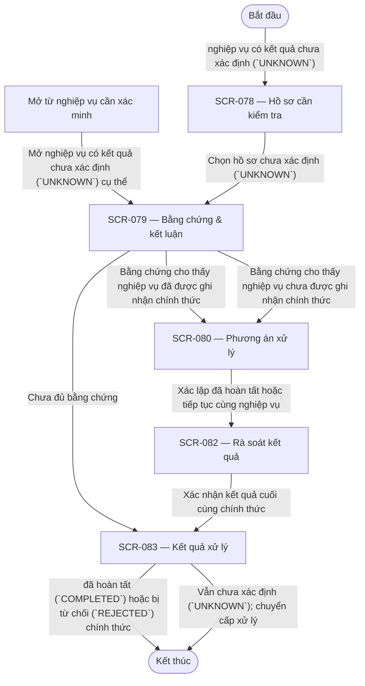

# UIF-17 — Phục hồi nghiệp vụ có kết quả chưa xác định

## 1. Mục đích và phạm vi

Mô tả cách xác minh một nghiệp vụ có kết quả chưa xác định, giữ nguyên thao tác gốc và kết luận đã hoàn tất, chưa thực hiện hoặc vẫn cần bảo vệ để xử lý tiếp.

- **Hành trình nghiệp vụ:** [BJ-17 — Phục hồi nghiệp vụ có kết quả chưa xác định](../../02.specification/behavior/journeys/BJ-17-phuc-hoi-nghiep-vu-co-ket-qua-chua-xac-inh.md)
- **Trường hợp sử dụng liên quan:**
  - [UC-17-01 — Thu thập và đánh giá bằng chứng](../../02.specification/behavior/use-cases/UC-17-01-thu-thap-va-danh-gia-bang-chung.md)
  - [UC-17-02 — Xác lập nghiệp vụ đã hoàn tất](../../02.specification/behavior/use-cases/UC-17-02-xac-lap-operation-da-hoan-tat.md)
  - [UC-17-03 — Tiếp tục với cùng mã thao tác](../../02.specification/behavior/use-cases/UC-17-03-tiep-tuc-cung-operation-identity.md)
  - [UC-17-04 — Giữ trạng thái chưa xác định và chuyển cấp xử lý](../../02.specification/behavior/use-cases/UC-17-04-giu-chua-xac-dinh-va-escalated.md)

**Ranh giới:** UIF chỉ mô tả cách người dùng đi qua các màn hình, điều kiện chuyển bước và cách xử lý khi không thể tiếp tục. Quy tắc nghiệp vụ vẫn lấy từ BJ/UC/Behavioral Contract; nội dung và thành phần của từng màn hình vẫn lấy từ Screen Contract.

## 2. Người dùng bắt đầu và kết thúc ở đâu

| Cách vào luồng | Màn hình | Người thực hiện | Đi từ đâu |
|---|---|---|---|
| Vào từ chức năng | `SCR-078` | Người kiểm soát kho | Kho > Kiểm soát > Việc cần xác minh |
| Mở từ ngữ cảnh liên quan | `SCR-079` | Người kiểm soát kho | Nghiệp vụ có kết quả chưa xác định (`UNKNOWN`) hoặc nguồn chờ xác minh |

Luồng kết thúc khi người dùng đã nhận được kết quả cuối cùng hoặc công việc được chuyển rõ sang một hành trình khác. Trạng thái `UNKNOWN` không được coi là thành công; phải tiếp tục xác minh với đúng thao tác gốc.

## 3. Luồng màn hình

> Sơ đồ trên để đọc nhanh. Phần “Các bước chuyển màn hình” giải thích điều kiện và cách xử lý; phần “Truy vết kỹ thuật” giữ các mã phục vụ Dev/QA/Harness.

## 4. Các bước chuyển màn hình

| Bước | Từ đâu | Người dùng / hệ thống làm gì | Điều kiện cần | Đi đến | Nếu không thể tiếp tục |
|---|---|---|---|---|---|
| `UIF-17-T01` | Bắt đầu | Nghiệp vụ có kết quả chưa xác định (`UNKNOWN`) | Có quyền xác minh và kiểm soát | `SCR-078` — Hồ sơ cần kiểm tra | — |
| `UIF-17-T02` | Mở từ nghiệp vụ cần xác minh | Mở nghiệp vụ có kết quả chưa xác định (`UNKNOWN`) cụ thể | Giữ đúng mã thao tác gốc | `SCR-079` — Bằng chứng & kết luận | — |
| `UIF-17-T03` | `SCR-078` — Hồ sơ cần kiểm tra | Chọn hồ sơ chưa xác định (`UNKNOWN`) | Hồ sơ thuộc phạm vi người dùng được xử lý | `SCR-079` — Bằng chứng & kết luận | — |
| `UIF-17-T04` | `SCR-079` — Bằng chứng & kết luận | Bằng chứng cho thấy nghiệp vụ đã được ghi nhận chính thức | Bằng chứng đủ tin cậy để kết luận | `SCR-080` — Phương án xử lý | Không ghi lại thay đổi nghiệp vụ lần hai |
| `UIF-17-T05` | `SCR-079` — Bằng chứng & kết luận | Bằng chứng cho thấy nghiệp vụ chưa được ghi nhận chính thức | Bằng chứng đủ tin cậy để kết luận | `SCR-080` — Phương án xử lý | Tiếp tục với cùng mã thao tác và nội dung ban đầu |
| `UIF-17-T06` | `SCR-079` — Bằng chứng & kết luận | Chưa đủ bằng chứng | Tiếp tục bảo vệ phạm vi bị ảnh hưởng | `SCR-083` — Kết quả xử lý | Chuyển cấp xử lý; không tạo thao tác mới để thử lại |
| `UIF-17-T07` | `SCR-080` — Phương án xử lý | Xác lập đã hoàn tất hoặc tiếp tục cùng nghiệp vụ | Giữ nguyên mã thao tác; hệ thống phục hồi theo quy tắc đã định nghĩa | `SCR-082` — Rà soát kết quả | Không ghi nhận lặp; không ghi nhận thay đổi lần hai |
| `UIF-17-T08` | `SCR-082` — Rà soát kết quả | Xác nhận kết quả cuối cùng chính thức | Bằng chứng và kết quả đủ để kết luận | `SCR-083` — Kết quả xử lý | Nếu vẫn chưa xác định (`UNKNOWN`) → chuyển cấp xử lý |
| `UIF-17-T09` | `SCR-083` — Kết quả xử lý | đã hoàn tất (`COMPLETED`) hoặc bị từ chối (`REJECTED`) chính thức | — | Kết thúc | — |
| `UIF-17-T10` | `SCR-083` — Kết quả xử lý | Vẫn chưa xác định (`UNKNOWN`); chuyển cấp xử lý | — | Kết thúc | Phạm vi tiếp tục được bảo vệ |

## 5. Các tình huống cần chú ý

Các quy tắc chung về quyền, quay lại, dữ liệu thay đổi và chống ghi nhận lặp vẫn lấy từ UC/Behavioral Contract/Screen Contract. UIF chỉ nhắc lại những điểm ảnh hưởng trực tiếp đến cách đi qua màn hình.

- Nếu kết quả chưa xác định (`UNKNOWN`), không thực hiện lại bằng một thao tác mới. Hệ thống giữ nguyên mã thao tác gốc để xác minh; khi chưa đủ bằng chứng, chuyển sang `BJ-17`.

## 6. Màn hình và Trường hợp sử dụng liên quan

| Trường hợp sử dụng | Màn hình sử dụng |
|---|---|
| [UC-17-01](../../02.specification/behavior/use-cases/UC-17-01-thu-thap-va-danh-gia-bang-chung.md) — Thu thập và đánh giá bằng chứng | `SCR-078`, `SCR-079` |
| [UC-17-02](../../02.specification/behavior/use-cases/UC-17-02-xac-lap-operation-da-hoan-tat.md) — Xác lập nghiệp vụ đã hoàn tất | `SCR-080`, `SCR-082`, `SCR-083` |
| [UC-17-03](../../02.specification/behavior/use-cases/UC-17-03-tiep-tuc-cung-operation-identity.md) — Tiếp tục với cùng mã thao tác | `SCR-080`, `SCR-082`, `SCR-083` |
| [UC-17-04](../../02.specification/behavior/use-cases/UC-17-04-giu-chua-xac-dinh-va-escalated.md) — Giữ trạng thái chưa xác định và chuyển cấp xử lý | `SCR-079`, `SCR-083` |

### Màn hình dùng trong luồng

| Màn hình | Tên | Vai trò trong luồng |
|---|---|---|
| [SCR-078](../screens/SCR-078.md) | Hồ sơ cần kiểm tra | Màn hình chính trong luồng |
| [SCR-079](../screens/SCR-079.md) | Bằng chứng & kết luận | Màn hình chính trong luồng |
| [SCR-080](../screens/SCR-080.md) | Phương án xử lý | Màn hình chính trong luồng |
| [SCR-082](../screens/SCR-082.md) | Rà soát kết quả | Màn hình chính trong luồng |
| [SCR-083](../screens/SCR-083.md) | Kết quả xử lý | Màn hình chính trong luồng |

## 7. Truy vết kỹ thuật

> Phần này dành cho Dev/QA/Harness. Các mã kỹ thuật được giữ nguyên để Dev/QA/Harness đối chiếu tự động.

| Transition | From | To | Loại | Action | UC / BC |
|---|---|---|---|---|---|
| `UIF-17-T01` | `BEGIN` | `SCR-078` | `NAVIGATION` | `—` | UC-17-01 |
| `UIF-17-T02` | `CONTEXT_UNKNOWN` | `SCR-079` | `NAVIGATION` | `—` | UC-17-01 |
| `UIF-17-T03` | `SCR-078` | `SCR-079` | `NAVIGATION` | `—` | UC-17-01 |
| `UIF-17-T04` | `SCR-079` | `SCR-080` | `NAVIGATION` | `—` | UC-17-02 |
| `UIF-17-T05` | `SCR-079` | `SCR-080` | `NAVIGATION` | `—` | UC-17-03 |
| `UIF-17-T06` | `SCR-079` | `SCR-083` | `SYSTEM` | `—` | UC-17-04 |
| `UIF-17-T07` | `SCR-080` | `SCR-082` | `MUTATION` | `ACT-15-RECONCILE` | UC-17-02, UC-17-03 / BC-IC-05 |
| `UIF-17-T08` | `SCR-082` | `SCR-083` | `MUTATION` | `ACT-15-RECONCILE` | UC-17-02, UC-17-03 / BC-IC-05 |
| `UIF-17-T09` | `SCR-083` | `END` | `TERMINAL` | `—` | UC-17-02, UC-17-03 |
| `UIF-17-T10` | `SCR-083` | `END` | `TERMINAL` | `—` | UC-17-04 |

## 8. Kiểm tra tính đầy đủ và liên kết

- [x] Tất cả Trường hợp sử dụng liên quan đều được liên kết từ UIF.
- [x] Mỗi màn hình đang dùng trong luồng có Screen Contract tương ứng.
- [x] Các bước do hệ thống thực hiện không bị mô tả thành thao tác của người dùng.
- [x] Nếu có phê duyệt hoặc chuyển vai trò, người gửi và người nhận có điểm vào riêng.
- [x] Trạng thái kết thúc và trường hợp `UNKNOWN` có hướng xử lý rõ khi áp dụng.
- [x] Bảng đọc chính và bảng truy vết kỹ thuật dùng cùng một tập transition ID; không đổi topology hoặc hành vi.
- [x] Liên kết BJ ↔ UIF ↔ UC/SCR dùng đường dẫn tương đối và mở đúng tài liệu đích.

**Trạng thái đối chiếu thiết kế:** `ALIGNED_TO_CURRENT_SCREEN_CONTRACTS` — UIF đã được viết lại theo Plain BA Language; cấu trúc luồng, ID, mã Action, liên kết UC/BC và trạng thái đối chiếu của v4.1.0 được giữ nguyên. HTML và Screen Contract không thay đổi trong lượt này.

### Liên kết

- [Business Journey](../../02.specification/behavior/journeys/BJ-17-phuc-hoi-nghiep-vu-co-ket-qua-chua-xac-inh.md)
- [Business Journey Map](../../02.specification/behavior/journeys/00-business-journey-map.md)
- [Use Case Map](../../02.specification/behavior/use-cases/00-use-case-map.md)
- [Prototype manifest](../prototype/README.md)
