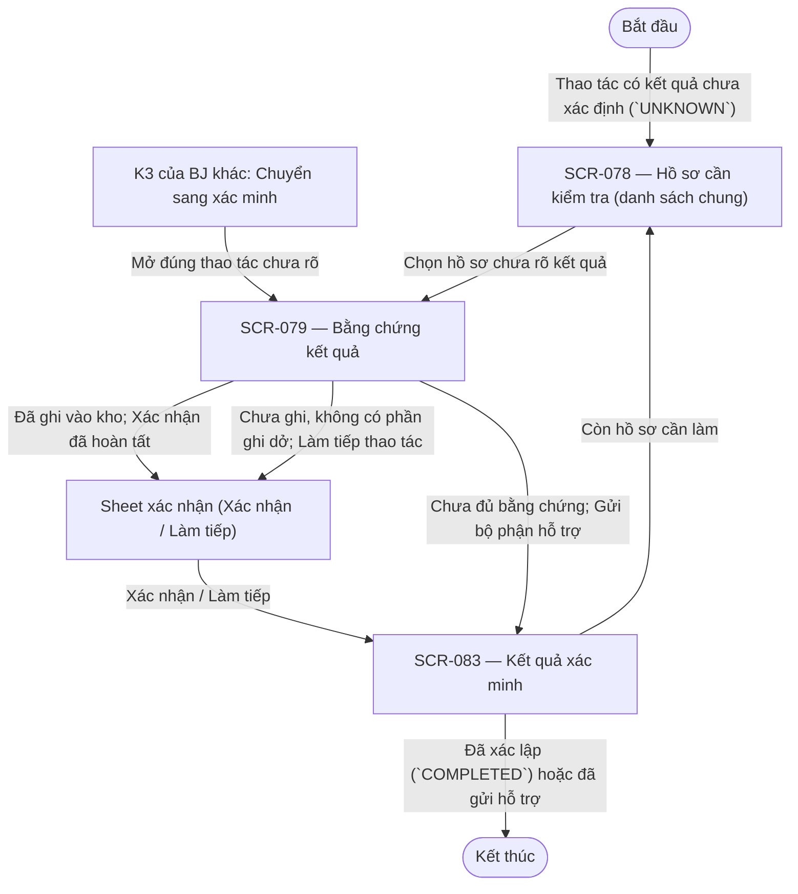

# UIF-17 — Phục hồi nghiệp vụ có kết quả chưa xác định

## 1. Mục đích và phạm vi

Mô tả cách xác minh một thao tác chưa rõ kết quả: biết **đã ghi vào kho hay chưa**, rồi chỉ xác nhận (đã ghi), làm tiếp đúng thao tác cũ (chưa ghi, không có phần ghi dở) hoặc gửi bộ phận hỗ trợ (chưa đủ bằng chứng). Không tạo thao tác mới, không ghi lại lần hai. Xác nhận bằng sheet ở màn bằng chứng rồi sang màn kết quả thẳng. Danh sách là "Hồ sơ cần kiểm tra" dùng chung với BJ-16.

- **Hành trình nghiệp vụ:** [BJ-17 — Phục hồi nghiệp vụ có kết quả chưa xác định](../../02.specification/behavior/journeys/BJ-17-phuc-hoi-nghiep-vu-co-ket-qua-chua-xac-inh.md)
- **Trường hợp sử dụng liên quan:**
  - [UC-17-01 — Thu thập và đánh giá bằng chứng](../../02.specification/behavior/use-cases/UC-17-01-thu-thap-va-danh-gia-bang-chung.md)
  - [UC-17-02 — Xác lập nghiệp vụ đã hoàn tất](../../02.specification/behavior/use-cases/UC-17-02-xac-lap-operation-da-hoan-tat.md)
  - [UC-17-03 — Tiếp tục với cùng mã thao tác](../../02.specification/behavior/use-cases/UC-17-03-tiep-tuc-cung-operation-identity.md)
  - [UC-17-04 — Giữ trạng thái chưa xác định và chuyển cấp xử lý](../../02.specification/behavior/use-cases/UC-17-04-giu-chua-xac-dinh-va-escalated.md)

**Ranh giới:** UIF chỉ mô tả cách người dùng đi qua các màn hình, điều kiện chuyển bước và cách xử lý khi không thể tiếp tục. Quy tắc nghiệp vụ vẫn lấy từ BJ/UC/Behavioral Contract; nội dung và thành phần của từng màn hình vẫn lấy từ Screen Contract.

## 2. Người dùng bắt đầu và kết thúc ở đâu

| Cách vào luồng | Màn hình | Người thực hiện | Đi từ đâu |
|---|---|---|---|
| Vào từ danh sách | `SCR-078` | Chủ cửa hàng (hoặc nhân viên được giao) | Home Kho → "Hồ sơ cần kiểm tra" → chip "Chưa rõ kết quả" |
| Mở từ ngữ cảnh liên quan | `SCR-079` | như trên | **K3 của BJ khác** ("Kết quả chưa xác định" → "Chuyển sang xác minh"): vào thẳng hồ sơ, không qua danh sách (entry `unknown-context`) |

Luồng kết thúc khi kết quả đã được xác lập, hoặc hồ sơ đã gửi bộ phận hỗ trợ (vẫn "Đang chờ"). Trạng thái `UNKNOWN` không được coi là thành công; phải tiếp tục xác minh với đúng thao tác gốc.

## 3. Luồng màn hình

> Sơ đồ trên để đọc nhanh. Phần “Các bước chuyển màn hình” giải thích điều kiện và cách xử lý; phần “Truy vết kỹ thuật” giữ các mã phục vụ Dev/QA/Harness.

## 4. Các bước chuyển màn hình

| Bước | Từ đâu | Người dùng / hệ thống làm gì | Điều kiện cần | Đi đến | Nếu không thể tiếp tục |
|---|---|---|---|---|---|
| `UIF-17-T01` | Bắt đầu | Thao tác có kết quả chưa xác định (`UNKNOWN`) | Có quyền xác minh | `SCR-078` — Hồ sơ cần kiểm tra | — |
| `UIF-17-T02` | K3 của BJ khác | "Chuyển sang xác minh" | Giữ đúng mã thao tác gốc | `SCR-079` — Bằng chứng kết quả | — |
| `UIF-17-T03` | `SCR-078` — Hồ sơ cần kiểm tra | Chọn hồ sơ chưa rõ kết quả | Hồ sơ thuộc phạm vi người dùng được xử lý | `SCR-079` — Bằng chứng kết quả | — |
| `UIF-17-T04` | `SCR-079` — Bằng chứng kết quả | Đã ghi vào kho; "Xác nhận đã hoàn tất" → sheet "Xác nhận" | Bằng chứng đủ tin cậy | `SCR-083` — Kết quả xác minh (`COMPLETED`) | Không ghi lại thay đổi lần hai; bằng chứng đổi → "Kết luận đã thay đổi" |
| `UIF-17-T05` | `SCR-079` — Bằng chứng kết quả | Chưa ghi, không có phần ghi dở; "Làm tiếp thao tác" → sheet "Làm tiếp" | Bằng chứng đủ tin cậy | `SCR-083` — Kết quả xác minh (`COMPLETED`, "Đã làm tiếp, đã ghi") | Dùng đúng thao tác cũ, không tạo thao tác mới |
| `UIF-17-T06` | `SCR-079` — Bằng chứng kết quả | Chưa đủ bằng chứng; "Gửi bộ phận hỗ trợ" | Tiếp tục bảo vệ phạm vi bị ảnh hưởng | `SCR-083` — Kết quả xác minh (`ESCALATED`) | Giữ nguyên, không làm lại; không tạo thao tác mới để thử lại |
| `UIF-17-T07` | `SCR-083` — Kết quả xác minh | "Về hồ sơ cần kiểm tra" | Còn hồ sơ "Cần làm" | `SCR-078` — Hồ sơ cần kiểm tra | Không còn → "Về Kho" |
| `UIF-17-T08` | `SCR-083` — Kết quả xác minh | Đã xác lập (`COMPLETED`) | — | Kết thúc | — |
| `UIF-17-T09` | `SCR-083` — Kết quả xác minh | Đã gửi hỗ trợ (`ESCALATED`) | — | Kết thúc | Phạm vi tiếp tục được bảo vệ; hồ sơ "Đang chờ" |

## 5. Các tình huống cần chú ý

Các quy tắc chung về quyền, quay lại, dữ liệu thay đổi và chống ghi nhận lặp vẫn lấy từ UC/Behavioral Contract/Screen Contract. UIF chỉ nhắc lại những điểm ảnh hưởng trực tiếp đến cách đi qua màn hình.

- **Chưa rõ không phải thất bại** (BR-01); chỉ tra và làm tiếp bằng đúng mã thao tác (BR-02). Đã ghi → chỉ xác lập, không ghi lần hai (BR-03). Chưa ghi và không có phần ghi dở → làm tiếp cùng mã (BR-04). Chưa đủ bằng chứng → giữ chưa rõ, không đoán (BR-05).
- **Không tự hoàn tất** đơn bán / phiếu mua của Theme khác (BR-06); BJ-17 chỉ xác lập kết quả của thao tác kho.
- **Không còn `SCR-080` và `SCR-082`** ở luồng này: sheet ở `SCR-079` → `SCR-083` thẳng.
- Thao tác gửi chuyển xử lý mà vẫn chưa rõ kết quả hiện là K3 "Chuyển hồ sơ" (không trùng trạng thái đã gửi).
- Nếu kết quả chưa xác định (`UNKNOWN`), không thực hiện lại bằng một thao tác mới. Hệ thống giữ nguyên mã thao tác gốc để xác minh; khi chưa đủ bằng chứng, chuyển bộ phận hỗ trợ.

## 6. Màn hình và Trường hợp sử dụng liên quan

| Trường hợp sử dụng | Màn hình sử dụng |
|---|---|
| [UC-17-01](../../02.specification/behavior/use-cases/UC-17-01-thu-thap-va-danh-gia-bang-chung.md) — Thu thập và đánh giá bằng chứng | `SCR-078`, `SCR-079` |
| [UC-17-02](../../02.specification/behavior/use-cases/UC-17-02-xac-lap-operation-da-hoan-tat.md) — Xác lập nghiệp vụ đã hoàn tất | `SCR-079`, `SCR-083` |
| [UC-17-03](../../02.specification/behavior/use-cases/UC-17-03-tiep-tuc-cung-operation-identity.md) — Tiếp tục với cùng mã thao tác | `SCR-079`, `SCR-083` |
| [UC-17-04](../../02.specification/behavior/use-cases/UC-17-04-giu-chua-xac-dinh-va-escalated.md) — Giữ trạng thái chưa xác định và chuyển cấp xử lý | `SCR-079`, `SCR-083` |

### Màn hình dùng trong luồng

| Màn hình | Tên | Vai trò trong luồng |
|---|---|---|
| [SCR-078](../screens/SCR-078.md) | Hồ sơ cần kiểm tra | Màn hình chính trong luồng |
| [SCR-079](../screens/SCR-079.md) | Bằng chứng kết quả | Màn hình chính trong luồng |
| [SCR-083](../screens/SCR-083.md) | Kết quả xác minh | Màn hình chính trong luồng |

## 7. Truy vết kỹ thuật

> Phần này dành cho Dev/QA/Harness. Các mã kỹ thuật được giữ nguyên để Dev/QA/Harness đối chiếu tự động.

| Transition | From | To | Loại | Action | UC / BC |
|---|---|---|---|---|---|
| `UIF-17-T01` | `BEGIN` | `SCR-078` | `NAVIGATION` | `—` | UC-17-01 |
| `UIF-17-T02` | `CONTEXT_UNKNOWN` | `SCR-079` | `NAVIGATION` | `—` | UC-17-01 |
| `UIF-17-T03` | `SCR-078` | `SCR-079` | `NAVIGATION` | `—` | UC-17-01 |
| `UIF-17-T04` | `SCR-079` | `SCR-083` | `MUTATION` | `ACT-15-RECONCILE` | UC-17-02 / BC-IC-05 |
| `UIF-17-T05` | `SCR-079` | `SCR-083` | `MUTATION` | `ACT-15-RECONCILE` | UC-17-03 / BC-IC-05 |
| `UIF-17-T06` | `SCR-079` | `SCR-083` | `SYSTEM` | `—` | UC-17-04 |
| `UIF-17-T07` | `SCR-083` | `SCR-078` | `NAVIGATION` | `—` | UC-17-01 |
| `UIF-17-T08` | `SCR-083` | `END` | `TERMINAL` | `—` | UC-17-02, UC-17-03 |
| `UIF-17-T09` | `SCR-083` | `END` | `TERMINAL` | `—` | UC-17-04 |

## 8. Kiểm tra tính đầy đủ và liên kết

- [x] Tất cả Trường hợp sử dụng liên quan đều được liên kết từ UIF.
- [x] Mỗi màn hình đang dùng trong luồng có Screen Contract tương ứng.
- [x] Các bước do hệ thống thực hiện không bị mô tả thành thao tác của người dùng.
- [x] Nếu có phê duyệt hoặc chuyển vai trò, người gửi và người nhận có điểm vào riêng.
- [x] Trạng thái kết thúc và trường hợp `UNKNOWN` có hướng xử lý rõ khi áp dụng.
- [x] Bảng đọc chính và bảng truy vết kỹ thuật dùng cùng một tập transition ID.
- [x] Liên kết BJ ↔ UIF ↔ UC/SCR dùng đường dẫn tương đối và mở đúng tài liệu đích.

**Trạng thái đối chiếu thiết kế:** `REDESIGNED_v5.18.0` — luồng viết lại theo thiết kế lại T7-P chặng 5: danh sách chung với BJ-16, lối vào từ K3, bỏ `SCR-080` và `SCR-082` (sheet ở `SCR-079` → `SCR-083`).

### Liên kết

- [Business Journey](../../02.specification/behavior/journeys/BJ-17-phuc-hoi-nghiep-vu-co-ket-qua-chua-xac-inh.md)
- [Business Journey Map](../../02.specification/behavior/journeys/00-business-journey-map.md)
- [Use Case Map](../../02.specification/behavior/use-cases/00-use-case-map.md)
- [Prototype manifest](../prototype/README.md)
