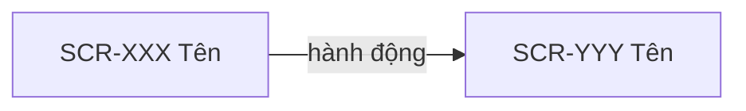

# UIF-XX — <Tên luồng>

## 1. Việc thật

Ai, lúc nào, cần đạt gì; tần suất.

## 2. Lối vào và lối ra

| Hướng | Từ / đến | Điều kiện |
|---|---|---|

## 3. Sơ đồ luồng

## 4. Chuyển màn

| Từ | Hành động | Đến | Ghi chú |
|---|---|---|---|

## 5. Khuôn dùng chung áp dụng

K1…K6 (xem T7-P mục 5) và chỗ áp.

## 6. Liên kết với BJ khác

| Sang / từ BJ | Ở màn | Cách |
|---|---|---|

## 7. Truy vết

BJ · UC · Screen Contract · kịch bản golden.
