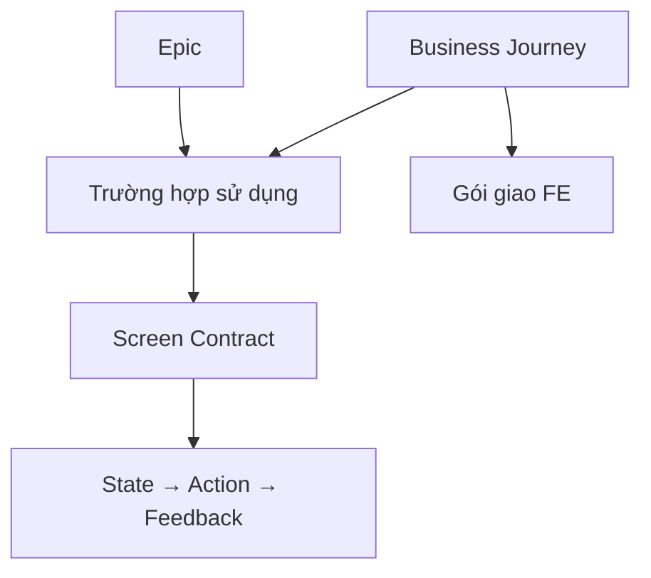

# PAT-UI-UX — UI/UX policy & patterns

## 1. Vấn đề cần giải quyết

Giữ các quy tắc/pattern UI đã được xác lập trong source v3.10.1 cho phạm vi Theme 7.

## 2. Khi nào dùng

Theo phạm vi được mô tả trong nội dung nguồn bên dưới.

## 3. Khi nào không dùng

Không mở rộng ngoài phạm vi nguồn.

## 4. Hành vi bắt buộc

### 1. Vai trò và ranh giới

Phần này đặc tả kiến trúc trải nghiệm và dẫn tới gói Screen Contract. **Screen Group và Figma không còn thuộc mô hình chính thức.** Prototype HTML là renderer thiết kế/kiểm chứng. UIF-02 hiện đã có HTML v0.3.2; các UIF còn lại được triển khai tuần tự qua Harness và cumulative regression.

Thứ tự thẩm quyền khi có xung đột:

`Quyết định nghiệp vụ → BJ/UC → hợp đồng hành vi → Screen Contract → UIF/Theme component usage → Flutter DS → HTML renderer → Flutter implementation`

UI không được tạo thêm thực thể, trạng thái nghiệp vụ, nguồn dữ liệu, quyền hạn, hiệu lực cuối cùng hoặc đường thay đổi dữ liệu.

### 2. Mô hình tổ chức

- BJ là đơn vị giao việc và nghiệm thu đầu-cuối.
- UC là đơn vị hành vi và checkpoint nghiệm thu.
- Screen là bề mặt giao diện dùng lại; một Screen có thể phục vụ nhiều BJ/UC.
- Khu vực điều hướng chỉ phục vụ kiến trúc thông tin, không tham gia tuyến thẩm quyền.
- Component/pattern thuộc Design System, không thuộc riêng BJ hoặc Screen.

### 3. Nguồn Design System

Áp dụng [`../prototype/contracts/design-system-profile.md`](../design-system/design-system-profile.md). Flutter Design System ZIP là semantic/API authority; Vercel là visual authority vì được project xác nhận render trực tiếp từ cùng Flutter DS. HTML không phải Design System thứ hai.

Các nguyên tắc bắt buộc: iPhone và web đều là thiết bị chính (mỗi màn đủ hai bố cục, [LUONG-UNG-DUNG 1.1](../../../../../docs/02-yeu-cau/LUONG-UNG-DUNG.md)); rõ ràng hơn thông minh; theo luồng công việc; một hành động chính; tiết lộ tăng dần; phòng ngừa trước khi sửa; trạng thái và số liệu phải trung thực.

### 4. Kiến trúc thông tin

Sáu khu vực điều hướng được định nghĩa tại [`navigation-areas.md`](PAT-NAV.md). Chúng không thay thế Domain, BJ, UC hoặc phạm vi giao việc.

### 5. Screen Registry

- Registry máy đọc: [`screen-registry.json`](../../09.generated/registries/design/screen-registry.json)
- Registry cho người đọc: [`screen-registry.md`](../../09.generated/registries/design/screen-registry.md)
- Screen Contracts: [`screens/`](../screens)

| Chỉ tiêu | Giá trị |
|---|---:|
| Màn hình canonical | 83 |
| State fixture obligation | 479 |
| UI Action | 33 |
| Screen Group active | 0 |

### 6. Bao phủ Business Journey

| BJ | Số Screen liên quan | Trạng thái |
|---|---:|---|
| `BJ-01` | 17 | `MAPPED` |
| `BJ-02` | 8 | `MAPPED` |
| `BJ-03` | 6 | `MAPPED` |
| `BJ-04` | 11 | `MAPPED` |
| `BJ-05` | 5 | `MAPPED` |
| `BJ-06` | 6 | `MAPPED` |
| `BJ-07` | 6 | `MAPPED` |
| `BJ-08` | 6 | `MAPPED` |
| `BJ-09` | 7 | `MAPPED` |
| `BJ-10` | 6 | `MAPPED` |
| `BJ-11` | 6 | `MAPPED` |
| `BJ-12` | 6 | `MAPPED` |
| `BJ-13` | 6 | `MAPPED` |
| `BJ-14` | 12 | `MAPPED` |
| `BJ-15` | 6 | `MAPPED` |
| `BJ-16` | 6 | `MAPPED` |
| `BJ-17` | 6 | `MAPPED` |

Chi tiết theo BJ/UC nằm tại [`bj-ui-flow-map.md`](../../09.generated/matrices/design/bj-ui-flow-map.md). Mỗi BJ có mapping UI; không có BJ mồ côi.

### 7. Quy tắc Screen Contract

Mỗi Screen Contract phải có: mục đích; BJ/UC liên quan; người dùng và thẩm quyền; dữ liệu; state; action–BC–API; responsive/accessibility; điều kiện nghiệm thu; ranh giới bằng chứng.

Mỗi hành động thay đổi dữ liệu có đúng một Action ID, một BC chính và một API chính. Double submit giữ cùng idempotency key; `UNKNOWN` giữ cùng operation identity để truy vấn hoặc phục hồi.

### 8. Chuẩn nội dung và thuật ngữ

- `Assertion` → **Điều kiện xác thực**.
- `Invariant` → **Điều kiện bắt buộc**.
- `Adjustment` → **Điều chỉnh**; dùng **Điều chỉnh định giá**, **Điều chỉnh tồn kho**, **Điều chỉnh thủ công** khi cần phân loại.
- `Tenant` → **Đơn vị vận hành**.
- `Movement ledger` → **Nhật ký biến động**.
- `Concurrency guard` → **Cơ chế chống xung đột**.
- `Cardinality relationship` → **Quan hệ số lượng**.

Enum, stable ID và error code kỹ thuật giữ nguyên nhưng chỉ xuất hiện như thông tin hỗ trợ.

### 9. Trạng thái prototype

Canonical prototype layer nằm tại `../prototype/`. UIF-02 là seed đã có HTML v0.3.2 và static conformance; UIF-01 đã qua local + cumulative contract review và đang chờ HTML. Mỗi UIF có `component-usage/*.md + *.yaml`; pattern dùng chung chỉ được promote sau cumulative review.

Harness chạy incremental theo BJ/UIF và sau mỗi vòng phải rerun regression với toàn bộ UIF đã hoàn thành trước đó.

### 10. Cổng chất lượng UI/UX

1. 17/17 BJ và 70/70 UC có mapping Screen/UIF; canonical flow hiện có 202 transition sau correction UIF-01.
2. 83/83 Screen có mục đích, state và trace nguồn.
3. 33/33 UI Action có BC/API chính và không mồ côi.
4. Không còn Screen Group active hoặc bước bàn giao qua công cụ thiết kế trung gian trong SRS/UI Contract.
5. Mọi dữ liệu tài chính được che nhất quán theo quyền.
6. `UNKNOWN`, conflict, lock và permission không tạo hiệu lực cuối cùng giả.
7. Một UIF chỉ freeze khi Screen Contract + component usage + HTML + local flow + cumulative regression đều pass; pixel parity với Vercel là gate riêng.

### Inventory Valuation Product-flow rule — v3.13.0

- Entry point, cross-BJ handoff, actor orchestration và lý do kiến trúc không mặc định trở thành banner/card trong app. Chỉ hiển thị context khi nó thay đổi quyết định hiện tại.
- Không materialize mỗi UC/system state thành full screen. Supporting provenance dùng section/sheet; blocker/calculating/publish-review là state khi cùng mental task.
- **BJ03:** `014 → 015 → 017 → 019`; `016` retired. Quick không phụ thuộc Theme 10; `015` cho phép thêm direct basis bằng Form Sheet.
- **BJ13:** `085 → 086 → 088 → 089`; `087` retired. Scope + allocation preview cùng một mental task; signed adjustment có thể dương hoặc âm.
- **BJ14:** `072 → 074 → 077`; `073/075/076` retired. Setup/calculation/blocker/review/publish-confirm là state/section của `074`. Costing method read-only từ tenant policy.
- Mỗi screen có một primary task; list/read-only không có footer CTA vô nghĩa.
- Card dùng tiết chế: ưu tiên `List Row`, `Info Row`, `Key-value Row`, grouped section; `Summary Card` chỉ khi có một summary thật sự.
- Badge chỉ biểu đạt status/label có nghĩa; không dùng badge cho metadata hoặc giải thích.
- `VBottomSheet` là shell canonical cho Form/Confirmation/Action sheet; handle, radius, safe area và anatomy theo Figma DS live.
- Disabled dùng `Opacity/Disabled = 0.4`; không tạo disabled color riêng.

## 5. Bố cục / tương tác chuẩn

Xem mục 4 và Screen Contracts.

## 6. Phần được phép thay đổi

Chỉ dữ liệu/copy/variant được nguồn và DS cho phép.

## 7. Mapping với Design System

Xem `../design-system/design-system-profile.md`.

## 8. Screen tham chiếu

Xem `../screens/`.
