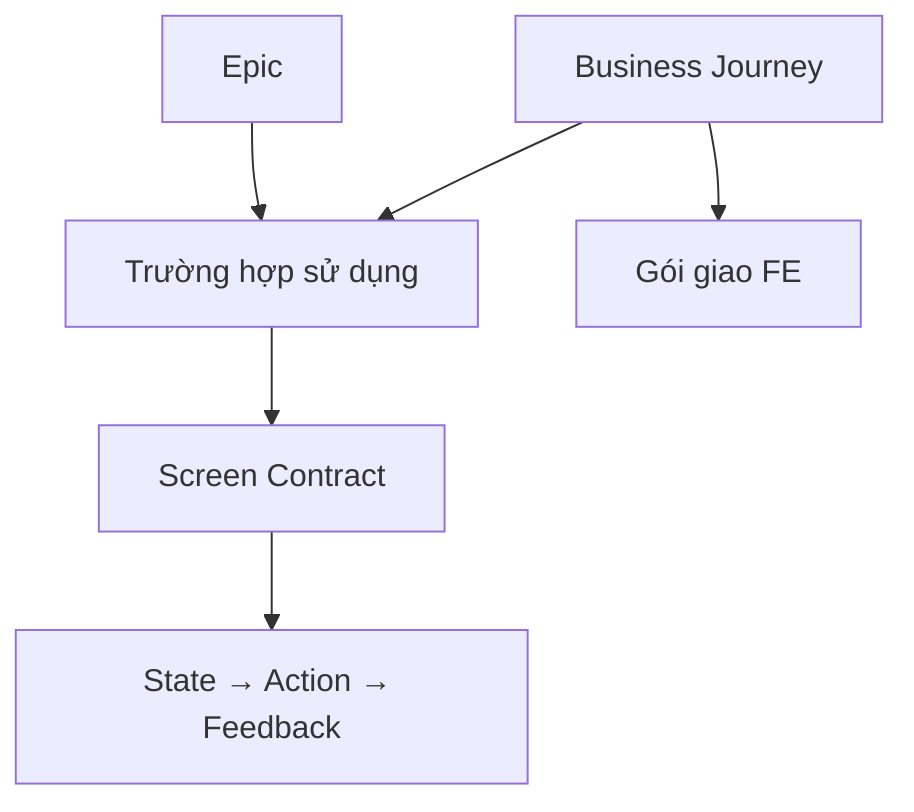

# PAT-UI-UX — UI/UX policy & patterns

## 1. Vấn đề cần giải quyết

Giữ các quy tắc/pattern UI đã được xác lập cho phạm vi phân hệ Kho (Theme 7).

## 2. Khi nào dùng

Áp dụng cho toàn bộ các màn hình, quy trình và tương tác trong Theme 7 (Kho).

## 3. Khi nào không dùng

Không mở rộng ra ngoài phạm vi Theme 7 khi chưa có phê duyệt từ nhóm kiến trúc sản phẩm.

## 4. Hành vi bắt buộc

### 1. Vai trò và ranh giới

Phần này đặc tả kiến trúc trải nghiệm và dẫn tới gói Screen Contract. **Screen Group và Figma không còn thuộc mô hình chính thức.** Prototype HTML là renderer thiết kế/kiểm chứng.

Thứ tự thẩm quyền khi có xung đột:

`Quyết định nghiệp vụ → BJ/UC → hợp đồng hành vi → Screen Contract → UIF/Theme component usage → Flutter DS → HTML renderer → Flutter implementation`

UI không được tạo thêm thực thể, trạng thái nghiệp vụ, nguồn dữ liệu, quyền hạn, hiệu lực cuối cùng hoặc đường thay đổi dữ liệu.

### 2. Mô hình tổ chức

- BJ là đơn vị giao việc và nghiệm thu đầu-cuối.
- UC là đơn vị hành vi và checkpoint nghiệm thu.
- Screen là bề mặt giao diện dùng lại; một Screen có thể phục vụ nhiều BJ/UC.
- Khu vực điều hướng chỉ phục vụ kiến trúc thông tin, không tham gia tuyến thẩm quyền.
- Component/pattern thuộc Design System, không thuộc riêng BJ hoặc Screen.

### 3. Nguồn Design System

Áp dụng [`../design-system/design-system-profile.md`](../design-system/design-system-profile.md). Flutter Design System ZIP là semantic/API authority; Vercel là visual authority vì được project xác nhận render trực tiếp từ cùng Flutter DS. HTML không phải Design System thứ hai.

Các nguyên tắc bắt buộc: iPhone và web đều là thiết bị chính (mỗi màn đủ hai bố cục, [LUONG-UNG-DUNG 1.1](../../../../../docs/02-yeu-cau/LUONG-UNG-DUNG.md)); rõ ràng hơn thông minh; theo luồng công việc; một hành động chính; tiết lộ tăng dần; phòng ngừa trước khi sửa; trạng thái và số liệu phải trung thực.

### 4. Kiến trúc thông tin

Kiến trúc điều hướng của Kho được tổ chức quanh Home Kho (`SCR-090`) và 6 workspace (`SCR-091`…`SCR-096`), xem chi tiết tại [`PAT-NAV.md`](PAT-NAV.md).

### 5. Khuôn dùng chung (K1–K7)

Mỗi khuôn được dựng chuẩn một lần, các màn hình và quy trình sau tái sử dụng trực tiếp:

| # | Khuôn | Dựng ở | Dùng lại ở |
|---|---|---|---|
| K1 | **Trạng thái chung:** không có quyền, đang tải, rỗng, rỗng sau lọc, dữ liệu cũ, bị khoá | BJ-12 | Tất cả các luồng |
| K2 | **Lập → duyệt → kết quả:** người lập gửi; danh sách "Chờ duyệt" (Home → Cần chú ý); màn duyệt (thứ cần quyết đầu tiên, ngoại lệ nổi bật, Duyệt / Từ chối có lý do); người lập thấy trạng thái chờ, khoá sửa; kết quả. | BJ-12 | 02, 06, 08, 09, 10, 11, 13, 14, CAP-01 |
| K3 | **Kết quả chưa rõ → xác minh:** không coi là thất bại; mã tham chiếu + giờ; điều gì an toàn; một nút xác minh; lối ra; BJ-17 là màn xác minh chung | BJ-12 | Mọi BJ có ghi dữ liệu |
| K4 | **Kết quả xong:** tóm tắt (ai, lúc nào, bao nhiêu), bước tiếp hợp lý (xem tồn, làm tiếp, về Kho), không lặp danh sách dài | BJ-12 | Mọi BJ có màn kết quả |
| K5 | **Chọn hàng → xử lý → bàn giao:** danh sách hàng đủ điều kiện, chọn lô / lượng, xác nhận, bàn giao | BJ-09 (SCR-036 / 037 / 041 dựng chung) | 07, 10 |
| K6 | **Danh sách công việc:** danh sách phiếu / phiên với trạng thái, lọc theo trạng thái, mở tiếp đúng bước đang dở | BJ-05 | 06, 07, 08, 11, 12, 14, 16 |
| K7 | **Bố cục web:** danh sách – chi tiết hai cột (chọn bên trái, xem / duyệt bên phải, không đổi trang); bảng thay danh sách thẻ khi có nhiều cột số; footer hành động thành thanh nút bên phải; sheet thành hộp thoại / bảng bên. Dưới bề rộng ngưỡng tự về bố cục iPhone | BJ-12 | Mọi màn web chính |

**Quy tắc duyệt K2:**
> **Người duyệt** là `is_owner` hoặc vai trò `store_owner`, khác người lập. **Ngoại lệ:** cửa hàng chỉ có một chủ, nên `is_owner` lập vẫn gửi duyệt rồi tự duyệt ở màn duyệt (không có đường ghi nhận thẳng); lịch sử ghi người duyệt "Chủ cửa hàng".

### 6. Thành phần Design System mới

Các thành phần phát sinh trong quá trình thiết kế Theme 7 đã được kiểm chứng trên prototype HTML và sẽ được đưa vào Flutter `vet45_design_system` ở Giai đoạn 5 (T7-G5):

| Thành phần | Phát sinh ở | Mô tả | Trạng thái |
|---|---|---|---|
| `ds24DotBadge` / `.ds24-badge--dot` | BJ-01 | VBadge có chấm: đặc = cảnh báo, rỗng = nguy hiểm | prototype; Flutter ở T7-G5 |
| `VStockRow` | BJ-01 | List Row có cột phải hai tầng: số lượng mono + badge | prototype; Flutter ở T7-G5 |
| Nút quét mã vạch trong `VSearchBar` | BJ-01 | Hành động cuối ô tìm kiếm | prototype; Flutter ở T7-G5 |
| `VChip` có số đếm | BJ-01 | Chip lọc kèm số; số 0 mờ, vẫn bấm được | prototype; Flutter ở T7-G5 |
| Bảng dữ liệu web (`k7Table`) | BJ-12 | Bảng có tiêu đề cố định, số mono căn phải; trên iPhone thành danh sách thẻ | prototype; Flutter ở T7-G5 |
| Vùng kéo thả tệp trên web (`VFileDropZone` mở rộng) | BJ-12 | Thêm dòng "Kéo tệp vào đây hoặc Chọn tệp", chỉ web | prototype; Flutter ở T7-G5 |
| Dải số một hàng (`cf12Strip`) | BJ-12 | Biến thể ngang tóm tắt: "{a} dòng đọc được · {b} hợp lệ · {c} cần sửa" | prototype; Flutter ở T7-G5 |
| `VMoneyField` trạng thái lỗi | BJ-12 | Viền + dòng lỗi dưới ô nhập tiền | prototype; Flutter ở T7-G5 |
| Ô số sửa tại dòng (`k7EditCell`) | CAP-01 | Ô số có hậu tố đơn vị, lỗi dưới ô, `aria-label`; chạm ≥ 44 trên iPhone | prototype; Flutter ở T7-G5 |
| `VSegmentedControl` (`dsSegmented`) | CAP-01 | Thanh chọn hai / ba mục; mục chọn nổi nền trắng | prototype; Flutter ở T7-G5 |
| Thẻ lựa chọn lớn (`dsChoiceRow`) | CAP-01 | List Row chọn một có tiêu đề + mô tả + nút tròn | prototype; Flutter ở T7-G5 |
| Thanh tiến độ mảnh (`.bj02-progress`) | BJ-02 | "Đã xử lý {a}/{b} mặt hàng" dưới dòng ngữ cảnh | prototype; Flutter ở T7-G5 |
| Ô hạn dùng tự hiểu độ chính xác | BJ-02 | Nhận "30/11/2026", "11/2026" hoặc "2026"; lỗi tại ô; lưu `expiryPrecision` | prototype; Flutter ở T7-G5 |
| `VFileDropZone` biến thể iPhone | BJ-02 | Hai nút "Chụp ảnh" \| "Chọn tệp" + danh sách tệp có "Xoá" | prototype; Flutter ở T7-G5 |
| Ô số lớn nhập thẳng + ba ô nhỏ | BJ-02 | "Đạt" lớn, "Cách ly" / "Hỏng" / "Từ chối" một hàng; thay bàn phím số riêng | prototype; Flutter ở T7-G5 |
| Ô tick (`role="checkbox"`) kèm mô tả | BJ-02 | Hộp kiểm cam kết kèm dòng giải thích rõ ràng | prototype; Flutter ở T7-G5 |
| Chân màn có dòng lý do (`bj02Footer`) | BJ-02 | Dòng chữ giải thích lý do ngay trên nút khi nút bị tắt (disabled) | prototype; Flutter ở T7-G5 |
| Ô tick trong bảng (`k7Table` cột `select`) | BJ-03 | Chọn dòng sản phẩm; `role="checkbox"` + `aria-checked`; dòng không chọn được thì tắt | prototype; Flutter ở T7-G5 |
| Ô số nhập thẳng tại dòng | BJ-08 | Nhập trực tiếp trên dòng với `enterkeyhint="next"`; Enter nhảy sang ô kế tiếp | prototype; Flutter ở T7-G5 |
| Nút chữ nguy hiểm (`VButton` danger text) | BJ-08 | Nút dạng chữ tone nguy hiểm (vd. "Hủy phiên" ở cuối nội dung) | prototype; Flutter ở T7-G5 |
| Khối "Tóm tắt" + dải tổng | BJ-03 | Web: nhãn — giá trị căn phải; iPhone: dải tổng trên chân màn hình | prototype; Flutter ở T7-G5 |

### 7. Quy tắc UI chung

- Dùng thành phần DS có sẵn (`VChip`, `VSearchBar`, `VBanner`, `VBottomSheet`, `VEmptyState`, `VButton`, `VBadge`, `VFileDropZone`…); không tạo thành phần riêng cho một tính năng khi DS đã đủ.
- Từ 2 Info / Key-value Row cùng nhóm ngữ nghĩa thì **một bề mặt chung**; list độc lập nền trong suốt. Product → LOT là cha–con (row phẳng cùng bề mặt), không card lồng card.
- Mỗi trạng thái **một hành động chính**; footer hai nút xếp ngang (Phụ | Chính). Không có trạng thái cụt; Back / điều hướng không được đổi finality.
- `VBanner` chỉ cho ngoại lệ, cảnh báo, chặn, hệ quả. Thành công cùng màn dùng toast; không toast trùng màn kết quả / lỗi inline / UNKNOWN. `UNKNOWN` ≠ thất bại, luôn có đường phục hồi.
- Chip lọc một hàng, cuộn ngang, không wrap. Hủy đối tượng đang mở nằm trong ngữ cảnh đối tượng, không đặt ở danh sách.
- Nội dung: dùng từ "mã vạch" (không dùng "barcode"), ĐVT (UOM) luôn đi liền với số lượng, không hiển thị ID kỹ thuật. `PERMISSION_DENIED`: dữ liệu được bảo vệ **không có mặt** trong cây widget; `FINANCIAL_MASKED`: hoàn toàn không hiển thị số tiền trong giao diện.
- Đảm bảo độ tương phản màu, kích thước vùng chạm ≥ 44pt trên iPhone, nhãn hỗ trợ tiếp cận (`Semantics`) cho mọi nút icon.
- **Số tiền kiểu chữ số mono:** Số tiền ở thẻ số liệu, Key-value Row, dải tổng và khối "Tóm tắt" dùng kiểu chữ số mono (như cột số của bảng) để thẳng hàng và dễ đối soát trực quan.

### 8. Thiết bị và bố cục chuẩn

- **iPhone và Web ngang nhau ở mọi màn hình:** Cả hai đều là thiết bị chính ([LUONG-UNG-DUNG 1.1](../../../../../docs/02-yeu-cau/LUONG-UNG-DUNG.md)). Không có bên nào là bản thứ cấp chỉ kiểm tra "không vỡ".
- Trên Web: áp dụng khuôn K7 — danh sách/chi tiết hai cột, bảng dữ liệu thay thẻ, thanh nút hành động bên phải, sheet thành modal/dialog. Khi bề rộng cửa sổ thu hẹp dưới ngưỡng responsive, giao diện tự động chuyển về bố cục một cột như iPhone.

### 9. Danh sách màn hình

Danh sách màn hình active và màn hình đã bỏ được chuẩn hoá và quản lý tập trung tại:
- Bảng danh mục màn hình: [`screens/INDEX.md`](../screens/INDEX.md)
- Màn hình đã nghỉ hưu (retired): [`screens/RETIRED.md`](../screens/RETIRED.md)

## 5. Bố cục / tương tác chuẩn

Xem chi tiết tại mục 4 và từng Screen Contract cụ thể.

## 6. Phần được phép thay đổi

Chỉ dữ liệu/copy/variant được nghiệp vụ và Design System cho phép.

## 7. Mapping với Design System

Xem [`../design-system/design-system-profile.md`](../design-system/design-system-profile.md).

## 8. Chuẩn nội dung và thuật ngữ

- `Assertion` → **Điều kiện xác thực**.
- `Invariant` → **Điều kiện bắt buộc**.
- `Adjustment` → **Điều chỉnh**; dùng **Điều chỉnh định giá**, **Điều chỉnh tồn kho**, **Điều chỉnh thủ công** khi cần phân loại.
- `Tenant` → **Đơn vị vận hành**.
- `Movement ledger` → **Nhật ký biến động**.
- `Concurrency guard` → **Cơ chế chống xung đột**.
- `Cardinality relationship` → **Quan hệ số lượng**.

Enum, stable ID và error code kỹ thuật giữ nguyên nhưng chỉ xuất hiện như thông tin hỗ trợ trong tài liệu kỹ thuật hoặc log, không đưa lên UI.

## 9. Screen tham chiếu

Xem [`../screens/INDEX.md`](../screens/INDEX.md).
