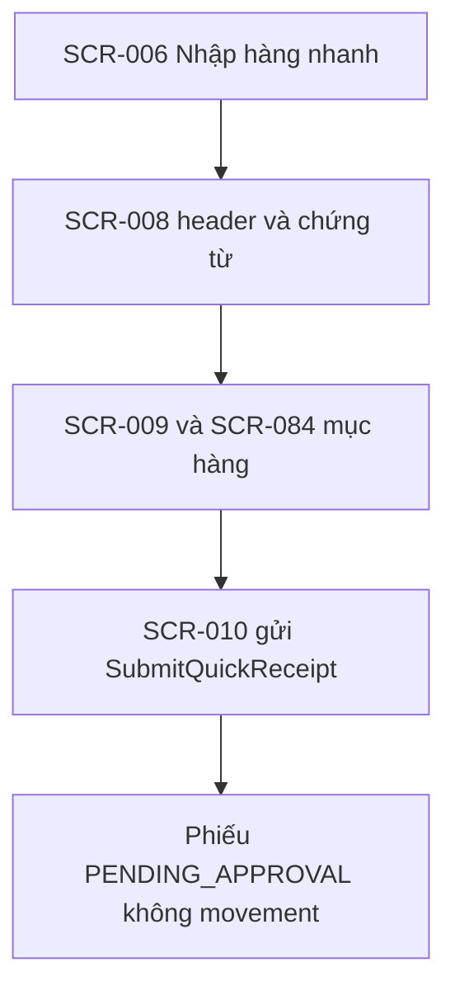

# Work Slice: SL-002 — Gửi phiếu nhận nhanh

```yaml
id: SL-002
journey:
  - BJ-02
usecase:
  - UC-02-02
sources:
  - BC-IC-07
  - BC-IO-02
  - ENT-IO-01
  - ENT-IO-02
  - SCR-006
  - SCR-008
  - SCR-009
  - SCR-084
  - SCR-010
  - UIF-02
  - JA-02
  - BC-COMMON-EXTENSIONS
theme: theme-07
```

**design_status** trên [`CATALOG.md`](CATALOG.md). Field và RPC lấy từ SRS. Phiếu chỉ được tạo khi gửi thành công. Không persist trước submit và không có trạng thái `DRAFT`.

---

## Objective

Thủ kho gửi phiếu nhận nhanh tới `PENDING_APPROVAL` và hệ thống chưa tăng tồn.

---

## Blocked by

- [SL-006](SL-006-default-warehouse.md) — cặp cửa hàng/kho mặc định đang hoạt động (`INV-ORG-02`)
- Phần chứng từ trên SCR-008 và sheet xem chứng từ trên SCR-010: [GitLab #13](https://gitlab.hamsa.co/vet45/vet45/-/issues/13), bị chặn bởi [GitLab #12](https://gitlab.hamsa.co/vet45/vet45/-/issues/12) (`VAttachment`). SCR-006, dòng hàng và gửi phiếu không bị hai issue này chặn.

---

## Scope & Rules

### In Scope

- Một lệnh gửi (`BC-IC-07`) mang Supplier, các mục hàng và evidence
- Gửi thành công tạo phiếu ở `PENDING_APPROVAL`, khóa payload, tạo ApprovalCase, ghi CommandReceipt. Chưa movement
- Gửi bị từ chối thì không tạo phiếu
- Một Supplier đã tồn tại. Product đã tồn tại. Không tạo PO, Supplier hay Product
- Kho và `receiptBusinessDate` do server điền trên result
- Form SCR-006 đến SCR-010. Dữ liệu đang nhập chỉ sống trong phiên màn hình
- Scenario: gửi tới chờ duyệt, replay, mục trùng, card chứng từ không mở SCR-007

### Out of Scope

- Lưu nháp, status `DRAFT`, `BC-IO-16`, `API-C-25`
- Căn cứ giá–tỷ giá và `APPROVAL_PRICE_BASIS_REQUIRED`. [BJ-02](../../02.specification/behavior/journeys/BJ-02-nhan-hang-mua.md) không gồm giá trị nhập chính thức. [BC-IC-07](../../02.specification/behavior/behavioral-contracts/BC-IC-07.md) vẫn đòi căn cứ giá trước submit. Slice này không thực thi guard đó
- Thiết lập cặp cửa hàng/kho mặc định — [SL-006](SL-006-default-warehouse.md)
- Nhận theo chứng từ (`UC-02-01`) — hàng `SL-001` trên catalog, chờ Theme 10
- Duyệt — [SL-003](SL-003-receipt-approval.md)
- Ghi tồn — [SL-004](SL-004-physical-receipt.md)
- SCR-007 và mọi màn chứng từ nguồn. SCR-011, SCR-012, SCR-013
- Khôi phục form sau khi rời luồng
- Fact outbox và handoff «xin duyệt»

### Boundary

| Concern | Owner |
| --- | --- |
| Phiếu, payload, ApprovalCase, CommandReceipt | Inventory, lệnh `SubmitQuickReceipt` |
| Cặp cửa hàng/kho mặc định | [SL-006](SL-006-default-warehouse.md) |
| Màn hình nhập nhanh | `apps/erp`, SCR-006 đến SCR-010 |

### Rules

| ID | Quy tắc (slice) |
| --- | --- |
| [UC-02-02 BR-01](../../02.specification/behavior/use-cases/UC-02-02-chuan-bi-nhap-hang-nhanh.md) | Mọi phiếu đủ điều kiện gửi chuyển `PENDING_APPROVAL`. Không có nhánh `READY` |
| [UC-02-02 BR-02](../../02.specification/behavior/use-cases/UC-02-02-chuan-bi-nhap-hang-nhanh.md) | Đúng một Supplier đã tồn tại. Product đã tồn tại |
| [UC-02-02 BR-03](../../02.specification/behavior/use-cases/UC-02-02-chuan-bi-nhap-hang-nhanh.md) / [BR-04](../../02.specification/behavior/use-cases/UC-02-02-chuan-bi-nhap-hang-nhanh.md) | Một mục = một Product + một transaction UOM. Trùng cặp đó trong payload thì từ chối cả lệnh |
| [UC-02-02 BR-05](../../02.specification/behavior/use-cases/UC-02-02-chuan-bi-nhap-hang-nhanh.md) | Command không mang `receiptItemRef`. Server gán khi tách dòng kỹ thuật theo lô/trạng thái |
| [UC-02-02 BR-06](../../02.specification/behavior/use-cases/UC-02-02-chuan-bi-nhap-hang-nhanh.md) | Bốn số Đạt / Cách ly / Hỏng / Từ chối là input. Không gửi tổng kiểm nhận, vào tồn, hay `baseQuantity`. `Đạt + Cách ly + Hỏng = 0` thì từ chối cả lệnh |
| [UC-02-02 BR-07](../../02.specification/behavior/use-cases/UC-02-02-chuan-bi-nhap-hang-nhanh.md) | `NONE`: đúng một lô, `lotCode` null. `LOT`: mỗi lô có `lotCode`. HSD khi policy bắt buộc. NSX tùy chọn. Precision `day` / `month` / `year` |
| [UC-02-02 BR-08](../../02.specification/behavior/use-cases/UC-02-02-chuan-bi-nhap-hang-nhanh.md) | Thiếu approver thì từ chối, không tạo phiếu (`APPROVER_CONFIGURATION_MISSING`). SRS ghi «giữ `DRAFT`». Slice này không giữ nháp |
| [UC-02-02 BR-09](../../02.specification/behavior/use-cases/UC-02-02-chuan-bi-nhap-hang-nhanh.md) / [BR-10](../../02.specification/behavior/use-cases/UC-02-02-chuan-bi-nhap-hang-nhanh.md) | Client không gửi kho hay ngày nhận. Result trả `warehouseId` và `receiptBusinessDate` do server resolve |
| [UC-02-02 BR-11](../../02.specification/behavior/use-cases/UC-02-02-chuan-bi-nhap-hang-nhanh.md) / [T7-DR-118](../../01.knowledge/decisions/decision-register.md#t7-dr-118) | `evidenceIds` có ít nhất một id. Ownership assertion là fact có cấu trúc, không phải checkbox. Server ghi assertion từ actor đã xác thực trong cùng transaction với phiếu. MIME, kích thước và số lượng file lấy từ Shared Attachment Policy, không hard-code trần riêng cho BJ-02 |
| [BC-IC-07](../../02.specification/behavior/behavioral-contracts/BC-IC-07.md) | `operation_type=QUICK_RECEIPT` luôn tạo ApprovalCase. CommandReceipt cùng transaction với phiếu mới |
| [T7-DR-072](../../01.knowledge/decisions/decision-register.md#t7-dr-072) | Client giữ `operationRequestId` ổn định cho ý định nhận nhanh, khác `idempotencyKey`. Cùng khóa mà payload khác → `IDEMPOTENCY_PAYLOAD_MISMATCH`. [DOM-IO INV-IO-09](../../02.specification/domain/domain-foundation/DOM-IO.md) ghi `IDEMPOTENCY_CONFLICT`. Quy tắc nền tảng idempotency dẫn từ `docs/architecture`; slice ghi cách outcome này áp dụng |
| Trước mutation | Kho chưa `ACTIVE` → `INVENTORY_NOT_ACTIVATED`. Product `DISCONTINUED` → `PRODUCT_DISCONTINUED_FOR_RECEIPT`. Product `ARCHIVED` → `PRODUCT_ARCHIVED`. Không tạo phiếu |
| [T7-DR-121](../../01.knowledge/decisions/decision-register.md#t7-dr-121) / [SCR-006](../../03.design/screens/SCR-006.md) | Không có capability thì không hiện lối nhập nhanh. Blocker tạm thời: hàng điều hướng Disabled kèm lý do, không đi sâu |

Phiếu nhận nhanh bắt đầu ở `PENDING_APPROVAL` khi gửi thành công. `READY`, `COMMITTED`, `REJECTED`, `UNKNOWN` thuộc các slice sau. [ENT-IO-01](../../02.specification/domain/entities/ENT-IO-01-GoodsReceipt.md) vẫn mô tả bắt đầu `DRAFT`. Slice này không đổi entity.

Handler FND là `SubmitInventoryOperation` (`API-C-26`). Path FND có `{id}` vì giả định phiếu đã tồn tại. Slice này tạo phiếu trong cùng lệnh gửi.

### Open Questions

Những câu này còn chặn `READY_TO_IMPLEMENT`.

- Contract chi tiết của outcome này (API, event, transaction, lỗi) trước đây nằm ở FND-TECH-01 và chưa được ghi trong slice. Điền khi review để implement. Quy tắc nền tảng (idempotency, outbox) dẫn từ docs/architecture; slice chỉ ghi cách outcome này áp dụng.

- [T7-DR-027](../../01.knowledge/decisions/decision-register.md#t7-dr-027) vẫn bắt lifecycle `DRAFT → PENDING_APPROVAL` và giữ `DRAFT` khi thiếu dữ kiện. Slice không tạo `DRAFT`. Căn cứ giá trước submit ([BC-IC-07](../../02.specification/behavior/behavioral-contracts/BC-IC-07.md), `APPROVAL_PRICE_BASIS_REQUIRED`) chờ BA: [vet45#11](https://gitlab.hamsa.co/vet45/vet45/-/issues/11).
- Tên bảng và cột cho phiếu, dòng, ApprovalCase, CommandReceipt, và cột của `ownership_assertion`. Entity có thuộc tính nghiệp vụ, chưa có declarative SQL.
- Tên RPC và `p_*`. `API-C-26` là `POST /v1/inventory-operations/{id}/submission` — path có `{id}` vì giả định phiếu đã tồn tại.
- Literal `command_type` trên `CommandReceipt`. FND khóa bộ ba `(tenant_id, command_type, Idempotency-Key)`, không khóa chuỗi của lệnh này.
- Mã lỗi cho mục trùng Product+UOM, accepted physical = 0, thiếu UOM, và thiếu evidence. Catalog không có mã riêng. Slice không dùng `DRAFT_VALIDATION_FAILED`.
- `max_file_count`, MIME và kích thước: [BC-COMMON-EXTENSIONS](../../02.specification/behavior/behavioral-contracts/BC-COMMON-EXTENSIONS.md) trỏ Shared Attachment Policy lúc runtime. Theme 07 không có policy version hay số trần.
- Path route app shell chưa có trong SRS. Prototype chỉ có hash `#/sg-02/scr-01`, `#/sg-02/scr-04`, `#/sg-02/scr-05`.

---

## Flow

### Main Flow



1. Thủ kho chọn «Nhập hàng nhanh» trên SCR-006 khi có capability.
2. Thủ kho khai Supplier, thấy kho và ngày nhận read-only, đính chứng từ trong trần Shared Attachment Policy, rồi sang dòng hàng trong phiên.
3. Thủ kho thêm mục Product+UOM và phân loại số lượng, rồi gửi trên SCR-010.
4. Server tạo phiếu `PENDING_APPROVAL`, ApprovalCase và CommandReceipt trong một transaction.
5. UI dừng ở chờ duyệt. Tồn không tăng.

### Failure Flow

1. Thiếu approver → `APPROVER_CONFIGURATION_MISSING` → không tạo phiếu.
2. `LOT` thiếu `lotCode` → `LOT_REQUIRED`. HSD bắt buộc mà thiếu → `EXPIRY_REQUIRED`. Thuộc tính lô mâu thuẫn → `LOT_ATTRIBUTE_CONFLICT`. Không tạo phiếu.
3. Server không ghi được ownership assertion → `OWNERSHIP_ASSERTION_REQUIRED` → không tạo phiếu.
4. Supplier hoặc Product không phải master → `MASTER_NOT_FOUND` → không tạo master, không tạo phiếu.
5. Kho chưa `ACTIVE`, Product discontinued hoặc archived → `INVENTORY_NOT_ACTIVATED` / `PRODUCT_DISCONTINUED_FOR_RECEIPT` / `PRODUCT_ARCHIVED` → không tạo phiếu.
6. Thiếu mục, thiếu UOM, thiếu evidence, trùng Product+UOM, hoặc `Đạt + Cách ly + Hỏng = 0` → từ chối cả lệnh → không tạo phiếu. Catalog chưa có mã cho các trường hợp này. Không mã `DRAFT_*` và không mã `APPROVAL_PRICE_BASIS_REQUIRED`.
7. Cùng `idempotencyKey` hoặc cùng `operationRequestId` mà payload khác → `IDEMPOTENCY_PAYLOAD_MISMATCH` → không phiếu thứ hai.
8. Cùng key và cùng hash → snapshot trước, `replayed: true`, một ApprovalCase.
9. Chạm «Nhận theo chứng từ» trên SCR-006 → ở lại SCR-006, không mở SCR-007.

---

## Design

### Domain

**Before:** chưa có phiếu. Form chỉ sống trong phiên. Rời luồng, refresh hoặc đóng app thì mất.
**After:** một phiếu `PENDING_APPROVAL`, payload khóa, một ApprovalCase. Không movement. `receiptItemRef` và dòng kỹ thuật `ENT-IO-02` do server gán khi materialize.

### Persistence

Aggregate nghiệp vụ là `GoodsReceipt` ([ENT-IO-01](../../02.specification/domain/entities/ENT-IO-01-GoodsReceipt.md)). Tên bảng chưa có trong SRS. Không có bảng nháp và không có ghi trước submit.

Draft lúc implement: `supabase/migrations/_drafts/inventory_quick_receipt.sql`.

| RPC | Params `p_*` | Returns |
| --- | --- | --- |
| Chưa chốt. FND gắn `BC-IC-07` với `API-C-26` — `POST /v1/inventory-operations/{id}/submission`. Path có `{id}` vì giả định phiếu đã tồn tại | Chưa có trong nguồn | jsonb khớp `SubmitQuickReceiptResultDto` khi thành công hoặc replay |

`API-C-25` không dùng cho slice này.

| Code | Khi nào | Hệ quả |
| --- | --- | --- |
| `IDEMPOTENCY_PAYLOAD_MISMATCH` | Cùng `idempotencyKey` hoặc cùng `operationRequestId`, payload khác | Không ghi bản thứ hai |
| `APPROVER_CONFIGURATION_MISSING` | Không có ApprovalPolicy hoặc approver đủ điều kiện | Không tạo phiếu |
| `LOT_REQUIRED` | `LOT` thiếu `lotCode` | Không tạo phiếu |
| `EXPIRY_REQUIRED` | Policy bắt buộc HSD mà thiếu | Không tạo phiếu |
| `LOT_ATTRIBUTE_CONFLICT` | Thuộc tính lô mâu thuẫn hồ sơ hiện có | Không tạo phiếu |
| `OWNERSHIP_ASSERTION_REQUIRED` | Server không ghi được ownership assertion | Không tạo phiếu |
| `MASTER_NOT_FOUND` | Supplier hoặc Product không phải master | Không tạo master, không tạo phiếu |
| `INVENTORY_NOT_ACTIVATED` | Kho chưa `ACTIVE` | Không tạo phiếu |
| `PRODUCT_DISCONTINUED_FOR_RECEIPT` | Product `DISCONTINUED` | Không tạo phiếu |
| `PRODUCT_ARCHIVED` | Product `ARCHIVED` | Không tạo phiếu |
| Chưa có mã catalog | Thiếu mục, thiếu UOM, thiếu evidence, trùng Product+UOM, hoặc accepted physical = 0 | Không tạo phiếu. Không mã `DRAFT_*` |

### Transaction / Idempotency

Submit hợp lệ trong một transaction: tạo phiếu đã ở `PENDING_APPROVAL` và khóa payload, tạo ApprovalCase, ghi CommandReceipt. Không business outbox.

- `idempotencyKey` ≠ `command.id`. `operationRequestId` ≠ `idempotencyKey`. Hai khóa và hash được tách riêng. Quy tắc nền tảng idempotency dẫn từ `docs/architecture`
- `CommandReceipt` theo `(tenant_id, command_type, Idempotency-Key)` cùng transaction với kết quả. Literal `command_type` nằm ở Open Questions
- Cùng key và cùng hash → snapshot trước. Hash khác → `IDEMPOTENCY_PAYLOAD_MISMATCH`
- Không `expectedVersion`, không `VERSION_CONFLICT`, không `OPERATION_NOT_DRAFT`
- Submit từ chối thì transaction không để lại phiếu

### Code Layout

`QuickReceiptLot` nằm trong `quick_receipt_item.dart`. `DatePrecision` nằm trong `partial_business_date.dart`.

```text
modules/
    inventory/
        application/
            lib/
                src/
                    goods_receipt/
                        commands/
                            submit_quick_receipt/
                                submit_quick_receipt_command.dart
                                quick_receipt_item.dart
                                partial_business_date.dart
                                submit_quick_receipt_handler.dart
                                submit_quick_receipt_validator.dart
                        shared/
                            submit_quick_receipt_result_dto.dart
                        testing/
                            fake_quick_receipt_port.dart
        infrastructure/
            lib/
                src/
                    goods_receipt/
                        quick_receipt_gateway.dart
apps/
    erp/
        lib/
            features/
                inventory/
                    receipt/
                        presentation/
                            receipt_entry_page.dart
                            quick_receipt_header_page.dart
                            receipt_lines_page.dart
                            receipt_line_detail_page.dart
                            receipt_review_page.dart
```

---

## Contracts

Form giữa SCR-008, SCR-009, SCR-084 và SCR-010 chỉ sống trong phiên. Không có lệnh lưu.

### SubmitQuickReceiptCommand

> Gọi khi thủ kho gửi phiếu nhận nhanh. Chưa có `receiptId`. Client đã giữ `operationRequestId` cho ý định này. Outcome thành công: tạo phiếu, khóa payload, tạo ApprovalCase, chuyển `PENDING_APPROVAL`. Chưa movement. Outcome từ chối: không tạo phiếu.

```dart
class SubmitQuickReceiptCommand {
  final String idempotencyKey; // ≠ command.id, ≠ operationRequestId
  final String operationRequestId; // ổn định cho ý định nhận nhanh; giữ khi gửi lại
  final String supplierId;
  final List<String> evidenceIds; // length >= 1; trần file = Shared Attachment Policy
  final List<QuickReceiptItem> items; // length >= 1
}

class QuickReceiptItem {
  final String productId;
  final String transactionUom;
  final List<QuickReceiptLot> lots; // NONE: length == 1 and lotCode == null
}

class QuickReceiptLot {
  final String? lotCode;
  final PartialBusinessDate? expiry;
  final PartialBusinessDate? manufactureDate;
  final String acceptedQuantity;
  final String quarantineQuantity;
  final String damagedQuantity;
  final String rejectedQuantity;
}

enum DatePrecision { day, month, year }

class PartialBusinessDate {
  final DatePrecision precision;
  final String value; // day YYYY-MM-DD, month YYYY-MM, year YYYY
}
```

Số lượng là chuỗi thập phân. Không có `receiptItemRef`, kho, ngày nhận, giá, tỷ giá, hay actor/time của ownership assertion.

### SubmitQuickReceiptResultDto

```dart
class SubmitQuickReceiptResultDto {
  final String receiptId;
  final int version;
  final String status; // PENDING_APPROVAL
  final String approvalCaseId;
  final String warehouseId;
  final String receiptBusinessDate;
  final bool replayed;
}
```

`IQuickReceiptPort.submit` → `SubmitQuickReceiptResultDto`.
`FakeQuickReceiptPort`: cùng `idempotencyKey` và cùng payload → `replayed: true`. Cùng key hoặc cùng `operationRequestId` mà payload khác → conflict. Submit không ghi movement. Từ chối thì không có `receiptId`.

---

## Presentation

### Screens

| Screen | State / action | Nguồn |
| --- | --- | --- |
| SCR-006 | Không có capability thì không render card nhanh. Có capability: «Nhập hàng nhanh» → SCR-008. Blocker tạm thời: hàng Disabled kèm lý do, không đi sâu. «Nhận theo chứng từ» giữ card, disabled, không → SCR-007 | [SCR-006](../../03.design/screens/SCR-006.md) |
| SCR-008 | Supplier master, ngày nghiệp vụ read-only, kho read-only. Chứng từ: `VFileDropZone` và `VAttachment` (gỡ từng file, không mở viewer). Trần số file, MIME và kích thước theo Shared Attachment Policy — không hard-code 3. Đủ trần thì khóa vùng chọn. Batch vượt trần thì không nhận. «Xác nhận & tiếp tục» chỉ sang SCR-009 trong phiên, không gọi `BC-IO-16`. Không nút Lưu nháp | [SCR-008](../../03.design/screens/SCR-008.md) |
| SCR-009 | Danh sách Product+UOM. Quick: `VSearchBar` tìm Product. Một UOM thì vào thẳng SCR-084. Nhiều UOM: chọn trực tiếp một UOM rồi vào SCR-084, không dropdown. Trùng Product+UOM: không tạo mục mới, `VBanner.warning` và «Mở sản phẩm đã có». «Rà soát» chỉ bật khi có ít nhất một mục và mọi mục đã xử lý | [SCR-009](../../03.design/screens/SCR-009.md) |
| SCR-084 | Một mục: bốn phân loại là input. Tổng kiểm nhận và vào tồn là derived, read-only. `NONE` không render lô. `LOT`: mã lô bắt buộc, HSD theo policy, NSX tùy chọn, precision `day` / `month` / `year`. «Thêm lô khác» chỉ thêm lô. «Xong» quay SCR-009. Quick được xóa mục có kiểm soát | [SCR-084](../../03.design/screens/SCR-084.md) |
| SCR-010 | `ACT-02-SUBMIT` gọi `SubmitQuickReceiptCommand`. Quick luôn `PENDING_APPROVAL`, `VBanner.info`, không hỏi có cần duyệt. Submit tắt khi accepted physical = 0 hoặc thiếu evidence. Sheet xem chứng từ: `VAttachment` chỉ đọc, không vùng chọn và không nút gỡ | [SCR-010](../../03.design/screens/SCR-010.md) |

### Route

- Vào từ Kho > Nhận hàng → SCR-006 ([UIF-02](../../03.design/flows/UIF-02-BJ-02.md) `UIF-02-T01`)
- Không deep link từ chứng từ mua
- Path app shell nằm ở Open Questions. Gắn feature inventory khi implement

### State × feedback

| State | UI / feedback | Error code |
| --- | --- | --- |
| loading | Giữ dữ liệu đã nhập trong phiên. Không banner kỹ thuật | — |
| empty | SCR-009 chưa có mục, hoặc còn mục chưa xử lý: «Rà soát» tắt, không sang SCR-010 | — |
| error | Inline tại field. Supplier chưa chọn master: «Chọn nhà cung cấp trong danh sách.» Trùng Product+UOM: `VBanner.warning` «Mở sản phẩm đã có», vẫn một mục | `MASTER_NOT_FOUND`, `LOT_REQUIRED`, `EXPIRY_REQUIRED`, `LOT_ATTRIBUTE_CONFLICT`, `OWNERSHIP_ASSERTION_REQUIRED` |
| success | SCR-010 `VBanner.info` `PENDING_APPROVAL`. Phiên người lập dừng tại chờ duyệt | — |
| permission | `VEmptyState` khi không đủ quyền. Không capability: không render lối nhanh | `PERMISSION_DENIED` |
| gửi bị từ chối | Thiếu approver: banner lỗi. Form còn trong phiên. Không có phiếu | `APPROVER_CONFIGURATION_MISSING` |
| chưa rõ | Không tạo phiếu thứ hai. Tra cùng `idempotencyKey` và `operationRequestId` trước khi gửi lại | `IDEMPOTENCY_PAYLOAD_MISMATCH` |

### Design system

- `VPageScaffold`, `VCard`, `VCardIcon`, `VCombobox`, `VTextFormField`, `VSearchBar`, `VBanner`, `VEmptyState`, `VIcons.chevronRight`, `VFileDropZone`, `VAttachment`, `VAttachmentGroup`
- Card chọn cách nhận: không Badge, không màu semantic trên icon
- Kho và ngày nhận: field read-only, không dropdown và không date picker

### Mediator

- `SubmitQuickReceiptCommand` qua `IModuleMediator`
- Fake khớp Contracts của slice này
- Presentation thuộc `apps/erp`

---

## Verification

Link evidence không chặn `IN_REVIEW`.

### Acceptance Criteria

- [ ] **AC-01** Given payload quick đủ và có approver, When gửi, Then một phiếu `PENDING_APPROVAL`, có `approvalCaseId`, `warehouseId`, `receiptBusinessDate`, không movement, và trước lúc gửi thành công không có phiếu
- [ ] **AC-02** Given cùng `idempotencyKey` và cùng payload, When gửi lần hai, Then kết quả trước và một ApprovalCase. Payload khác thì `IDEMPOTENCY_PAYLOAD_MISMATCH`
- [ ] **AC-03** Given thiếu approver, When gửi, Then không tạo phiếu (`APPROVER_CONFIGURATION_MISSING`)
- [ ] **AC-04** Given thiếu mục, thiếu UOM, thiếu evidence, trùng Product+UOM, hoặc `Đạt + Cách ly + Hỏng = 0`, When gửi, Then cả lệnh bị từ chối, không tạo phiếu, không mã `DRAFT_*` và không mã `APPROVAL_PRICE_BASIS_REQUIRED`
- [ ] **AC-05** Given `LOT` thiếu mã, HSD bắt buộc mà thiếu, thuộc tính lô mâu thuẫn, server không ghi được ownership assertion, master không resolve, kho chưa active, hoặc Product discontinued/archived, When gửi, Then đúng một mã `LOT_REQUIRED`, `EXPIRY_REQUIRED`, `LOT_ATTRIBUTE_CONFLICT`, `OWNERSHIP_ASSERTION_REQUIRED`, `MASTER_NOT_FOUND`, `INVENTORY_NOT_ACTIVATED`, `PRODUCT_DISCONTINUED_FOR_RECEIPT`, hoặc `PRODUCT_ARCHIVED`, và không tạo phiếu
- [ ] **AC-06** Given SCR-006, When chạm card «Nhận theo chứng từ», Then không sang SCR-007
- [ ] **AC-07** Given SCR-008 và `max_file_count` của Shared Attachment Policy, When số file chạm trần, Then vùng chọn khóa. Batch vượt trần không được nhận. Gỡ một file thì chọn tiếp được. Form không mở viewer. Slice không hard-code trần 3

### Tests

| Test id | Given / When / Then | Layer |
| --- | --- | --- |
| `scn_submit_pending` | Payload quick đủ / submit / `PENDING_APPROVAL`, không movement | application fake |
| `scn_submit_replay` | Cùng key và payload / submit lần hai / `replayed: true`, một ApprovalCase | application fake |
| `scn_submit_rejected` | Thiếu approver / submit / không `receiptId` | application fake |
| `scn_submit_payload_invalid` | Thiếu evidence hoặc trùng Product+UOM / submit / không phiếu, chưa có mã catalog, không mã `DRAFT_*` | application / RPC |
| `scn_submit_lot_rejected` | `LOT` thiếu mã / submit / `LOT_REQUIRED`, không phiếu | application fake |
| `scn_submit_ui` | Header và một mục hợp lệ / gửi / màn chờ duyệt với `VBanner.info` | widget |
| `scn_document_card` | Mở SCR-006 / chạm card chứng từ / vẫn ở SCR-006 | widget |
| `scn_supplier_inline` | Gõ supplier không chọn master / rời field / «Chọn nhà cung cấp trong danh sách.», không gọi submit | widget |
| `scn_duplicate_item` | Form đã có Product+UOM / thêm cùng cặp / `VBanner.warning` «Mở sản phẩm đã có», vẫn một mục | widget |
| `scn_evidence_cap` | Số file bằng `max_file_count` của fixture policy / chọn thêm hoặc gỡ một file / batch thừa bị từ chối, gỡ xong thì chọn tiếp được | widget |

### Scenarios

| Scenario | Actor | Across | Given / When / Then | Seed / fixture | Pass / fail |
| --- | --- | --- | --- | --- | --- |
| Gửi phiếu hợp lệ | Thủ kho có quyền nhập nhanh | UI → mediator → RPC → DB | G: Supplier và Product đã có, policy có approver / W: chọn nhập nhanh, khai header, một mục, gửi / T: một phiếu `PENDING_APPROVAL`, không movement | Supplier + Product + ApprovalPolicy | Pass: một phiếu chờ duyệt, movement không tăng. Fail: `READY`, có movement, hoặc có phiếu trước lúc gửi thành công |
| Mục trùng | Thủ kho | UI | G: form đang có một mục Product+UOM / W: thêm cùng cặp / T: `VBanner.warning` «Mở sản phẩm đã có», vẫn một mục, không gọi submit | Không cần phiếu server | Pass: không mục thứ hai và không phiếu. Fail: tạo phiếu hoặc mục trùng |
| Mất response lúc gửi | Thủ kho | UI → RPC | G: submit đã ghi nhưng client không nhận response / W: gửi lại cùng identity / T: vẫn một phiếu `PENDING_APPROVAL` | Cùng `idempotencyKey` | Pass: không phiếu thứ hai. Fail: hai ApprovalCase |
| Card chứng từ | Thủ kho | UI | G: ở SCR-006 / W: chạm «Nhận theo chứng từ» / T: không sang SCR-007 | Không cần chứng từ Theme 10 | Pass: ở lại SCR-006. Fail: mở danh sách chứng từ |
