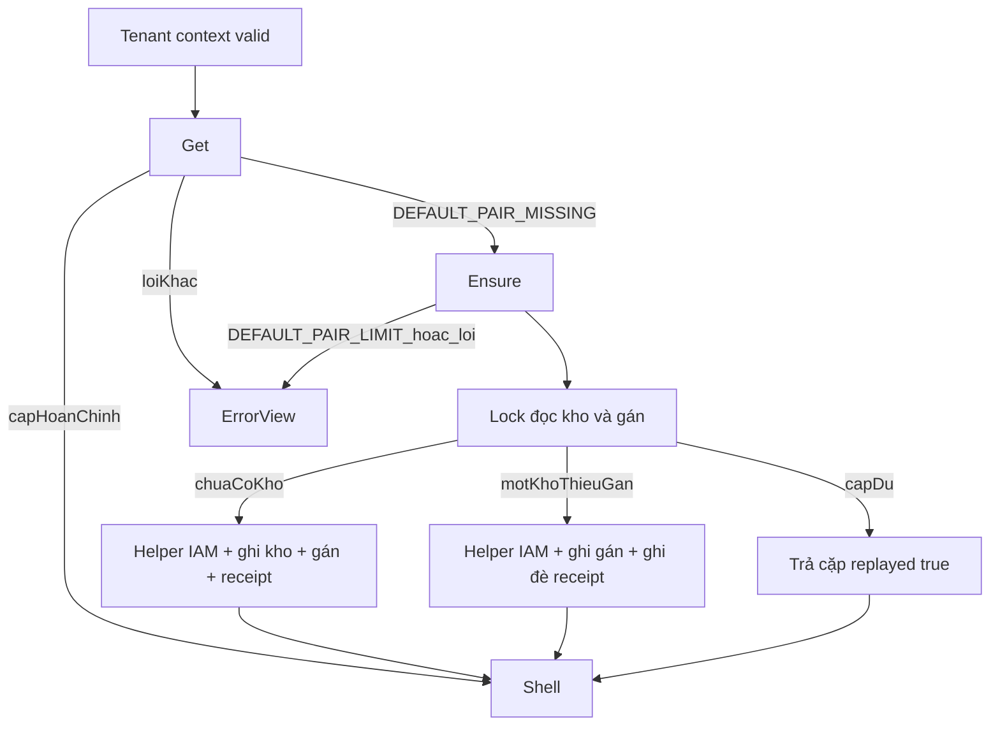
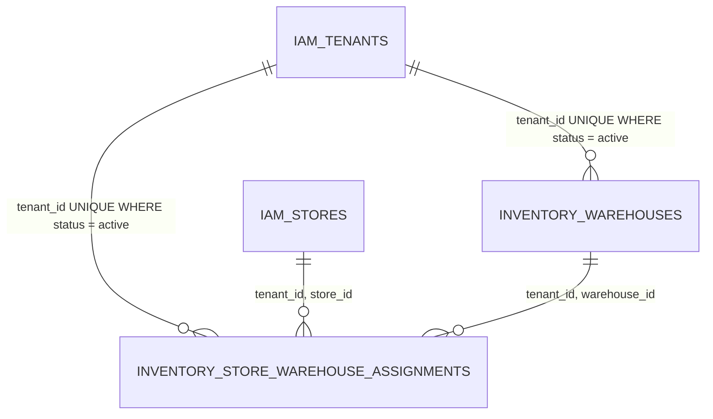

# Work Slice: SL-006 — Thiết lập cặp cửa hàng/kho mặc định

```yaml
id: SL-006
journey: []
usecase: []
sources:
  - DOM-COM
theme: theme-07
```

**design_status** trên [`CATALOG.md`](CATALOG.md). Cửa hàng lấy từ `iam.stores`. Kho, gán, và RPC nằm ở Persistence.

File nằm trong harness BJ-02 để SL-002 gắn `depends_on`. Outcome không thuộc hành trình nhận hàng.

---

## Objective

Tenant có đúng một cặp mặc định để mutation kho sau resolve được cửa hàng và kho trên server.

---

## Blocked by

- `None`

---

## Scope & Rules

### In Scope

- `EnsureDefaultStoreWarehousePair`: actor có `inventory.default_pair.ensure` gọi khi tenant chưa có cặp hoàn chỉnh
- Ensure đọc kho và gán dưới advisory lock trước. Chưa có kho active thì gọi `iam._ensure_tenant_default_store`, ghi kho và gán. Đúng một kho active thiếu gán thì chỉ ghi gán. Đã đủ cặp thì trả cặp đang có
- `GetDefaultStoreWarehousePair`: actor có `inventory.default_pair.read` đọc cặp
- `matches(storeId, warehouseId)` trên port của slice này, để mutation kho sau kiểm cặp
- Cổng ERP trên `DashboardPage`: khi tenant context vừa `valid`, chờ `Get` rồi `Ensure` nếu thiếu cặp trước khi vào shell

### Out of Scope

- Màn hình thiết lập kho, bộ chọn kho, chọn kho, định tuyến, chia đơn, chuyển kho, đóng hoặc đổi kho
- Ghi kho hoặc gán bên trong command tạo tenant của Theme 1
- Tạo Store trong inventory
- Cờ `is_default`, mã cửa hàng, khoảng hiệu lực
- Tạo kho từ vị trí user hoặc device
- Mutation kho tự tạo cặp khi chưa có
- Mutation tồn — [SL-002](SL-002-quick-receipt.md) và các slice sau
- Đổi tên cửa hàng khi store `active` đã có và `display_name` của tenant đổi sau lần ghi
- Sửa `iam._ensure_tenant_default_store`
- Seed `role_permissions` cho hai mã của slice — `iam.has_permission` đã cho membership active với mã ngoài `tenant.*` / `iam.*`
- Số dư đầu kỳ — [BJ-12](../../02.specification/behavior/journeys/BJ-12-khoi-tao-so-du-ton-kho-au-ky.md)
- Nhập hàng nhanh — [SL-002](SL-002-quick-receipt.md)
- Fact outbox và integration command

### Boundary

| Concern | Owner |
| --- | --- |
| Cửa hàng | Theme 1 — `iam.stores`, `iam._ensure_tenant_default_store` |
| Kho và gán | Theme 7 / `inventory` |
| `display_name` của tenant | Theme 1 — helper IAM đọc khi tạo hoặc kích hoạt lại store |
| Cổng vào shell | ERP — `DashboardPage`, không nằm trong `TenantContextCubit` |
| Tồn, phiếu nhận, opening batch | `DOM-IO` / `DOM-IC` |

### Rules

| ID | Quy tắc (slice) |
| --- | --- |
| [INV-ORG-02](../../02.specification/domain/domain-foundation/DOM-COM.md) | Phase 1 đúng một kho `active` và một gán `active`. Không tạo kho từ vị trí user/device. Slice không tạo Store; cửa hàng là bản trên `iam.stores` |
| [Overview §3.1](../../02.specification/overview/overview.md) | Một cửa hàng hoạt động và một kho hoạt động. UI không có bộ chọn kho |
| [KB-KGV-003](../../01.knowledge/know-how/KB-KGV-003-kho-cua-hang-va-khoa-dinh-danh-so-du-ton-kho.md) | Mọi giao dịch ghi `store_id` và `warehouse_id`. Server điền cặp và kiểm lại qua `matches`. SRS không có cột `code` của kho; slice không thêm. Tên kho là «Kho mặc định» |
| Transaction | Mutation ghi receipt trong cùng transaction. Command không nhận `idempotencyKey` từ client. Server tự đặt `idempotency_key = tenant_id` và `payload_hash` hash thân rỗng khi tạo hoặc vá. Không outbox. Quy tắc nền tảng idempotency dẫn từ `docs/architecture` |
| Permission | SRS không có mã. Slice chốt `inventory.default_pair.ensure` và `inventory.default_pair.read`. Mọi membership active được gọi; owner luôn qua; membership không active từ chối. «Một quan hệ hoạt động» là `status = active` cộng unique một bản active, không cột `is_default` |

```dart
abstract final class InventoryPermissions {
  static const defaultPairEnsure = 'inventory.default_pair.ensure';
  static const defaultPairRead = 'inventory.default_pair.read';
}
```

### Open Questions

- Contract chi tiết của outcome này (API, event, transaction, lỗi) trước đây nằm ở FND-TECH-01 và chưa được ghi trong slice. Điền khi review để implement. Quy tắc nền tảng (idempotency, outbox) dẫn từ docs/architecture; slice chỉ ghi cách outcome này áp dụng.

---

## Flow

### Main Flow



1. Tenant đã tồn tại. App, trên `DashboardPage`, khi context vừa `valid` (vào app và đổi tenant), gọi `Get`. Có cặp hoàn chỉnh thì vào shell.
2. `Get` trả `DEFAULT_PAIR_MISSING` thì gọi `Ensure`. Command không nhận field.
3. Ensure lấy advisory lock, rồi đọc kho và gán trước receipt.
4. Chưa có kho active: gọi `iam._ensure_tenant_default_store`. Helper lấy store `active` `code = default`, không có thì store `active` sớm nhất, không có thì insert hoặc kích hoạt lại `code = default`. Tên store lúc tạo hoặc kích hoạt lại: `display_name` đã trim, rỗng thì `Default Store`. Không đọc `tenants.name`. Sau đó ghi một kho «Kho mặc định» và một gán active, rồi ghi một dòng receipt.
5. Đúng một kho active, chưa có gán active: không tạo kho, không đổi tên kho. Gọi helper lấy store, ghi gán vào kho đó, ghi đè snapshot trên đúng một dòng receipt.
6. Đã có một kho active và một gán active trỏ đúng kho đó: trả cặp đang có, `replayed: true`. Không gọi helper, không ghi receipt.
7. Get và `matches` đọc cùng định nghĩa cặp hoàn chỉnh. Client không gửi `store_id` hay `warehouse_id` trên Ensure.

### Failure Flow

1. Hình khác một kho active và một gán active trỏ đúng kho đó, khi Ensure cố ghi thêm → `DEFAULT_PAIR_LIMIT` → không ghi bản mới, không ghi receipt `succeeded`.
2. Command không có field vị trí → Ensure không tạo kho từ vị trí device.
3. Get hoặc `matches` khi chưa có cặp hoàn chỉnh → `DEFAULT_PAIR_MISSING` → không ghi kho mới.
4. `matches` nhận id khác cặp → `DEFAULT_PAIR_MISMATCH` → không ghi kho mới.
5. Actor không có `inventory.default_pair.ensure` → `Permission denied: inventory.default_pair.ensure` → không ghi kho hay gán.
6. Actor không có `inventory.default_pair.read` → `Permission denied: inventory.default_pair.read` → không trả cặp.
7. Tenant không tồn tại → `RESOURCE_NOT_FOUND` → không ghi kho hay gán.
8. `p_tenant_id` null → `CONTEXT_INVALID` → không ghi kho hay gán.
9. Cổng dashboard: `DEFAULT_PAIR_LIMIT` hoặc lỗi khác → không vào shell. `OrganizationEmptyView` chữ lỗi cặp, «Thử lại» chạy lại `Get`/`Ensure`, có lối chọn tổ chức khác.

---

## Design

### Domain

**Before:** tenant không có kho active và gán active để mutation resolve.
**After:** một store `active` trên `iam.stores` (ưu tiên `code = default`), một kho `active` tên «Kho mặc định», và một gán `active` trỏ đúng kho đó.

| Quyết định | Nội dung |
| --- | --- |
| Cửa hàng | `iam.stores`. Ensure gọi `iam._ensure_tenant_default_store` khi cần store. Inventory không insert store. Trạng thái cửa hàng là `iam.stores.status` |
| Tên cửa hàng | Helper IAM đã ship: `coalesce(nullif(trim(display_name), ''), 'Default Store')`. Không đọc `tenants.name`. Store `active` đã có thì lần sau giữ tên. Chưa có store `active` mà có bản `code = default` inactive thì helper đặt lại `active` và ghi đè `display_name` |
| Nhiều store `active` | Helper lấy bản `code = default`. Không có thì bản `active` sớm nhất theo `created_at`, `id`. Không insert store mới |
| Kho | `display_name` «Kho mặc định», `status = active`. Không cột `code`. Tên kho không đổi khi gọi lại Ensure |
| Gán | `status = active`, nối `store_id` của IAM với `warehouse_id`. Không cột `is_default` |
| Cặp hoàn chỉnh | Đúng một kho `active` và đúng một gán `active` trỏ đúng kho đó |
| Người ghi | `inventory.default_pair.ensure`. Theme 1 không ghi kho hay gán lúc tạo tenant |
| Caller ERP | `DashboardPage` sau context `valid`. `TenantContextCubit` không gọi inventory |

### Persistence

Draft lúc implement: `supabase/migrations/_drafts/inventory_default_pair.sql`. Draft không tạo `iam.stores`. Không sửa helper IAM.



Bảng `iam.stores`. Nguồn [`20260830001_iam_active_store_context_group_a.sql`](../../../../../supabase/migrations/20260830001_iam_active_store_context_group_a.sql). Slice không tạo và không sửa bảng này.

| Cột | Kiểu | Null | Ràng buộc |
| --- | --- | --- | --- |
| `id` | uuid | không | PK, default `gen_random_uuid()` |
| `tenant_id` | uuid | không | FK `iam.tenants(id)` ON DELETE CASCADE |
| `code` | text | không | |
| `display_name` | text | không | |
| `status` | text | không | CHECK `active` / `inactive` |
| `created_at` | timestamptz | không | default `now()` |

Unique `(tenant_id, code)`
Unique `(tenant_id, id)`

Bảng `iam.tenants`. Slice không sửa. FK đích là `id`. Helper đọc `display_name` (text, có null). Không đọc `name`. Nguồn [`20260630000001_iam_foundation.sql`](../../../../../supabase/migrations/20260630000001_iam_foundation.sql), [`20260811015_iam_tenant_profile_legal.sql`](../../../../../supabase/migrations/20260811015_iam_tenant_profile_legal.sql), helper [`20260916001_iam_ensure_default_store_scope_helpers.sql`](../../../../../supabase/migrations/20260916001_iam_ensure_default_store_scope_helpers.sql).

Bảng `inventory.warehouses`

| Cột | Kiểu | Null | Ràng buộc |
| --- | --- | --- | --- |
| `id` | uuid | không | PK |
| `tenant_id` | uuid | không | FK `iam.tenants(id)` |
| `display_name` | text | không | |
| `status` | text | không | CHECK `active` / `inactive` |
| `created_at` | timestamptz | không | |

Unique `(tenant_id, id)`
Unique index `warehouses_one_active_per_tenant` trên `(tenant_id)` WHERE `status = 'active'`

Bảng `inventory.store_warehouse_assignments`

| Cột | Kiểu | Null | Ràng buộc |
| --- | --- | --- | --- |
| `id` | uuid | không | PK |
| `tenant_id` | uuid | không | FK `iam.tenants(id)` |
| `store_id` | uuid | không | FK `(tenant_id, store_id)` → `iam.stores(tenant_id, id)` |
| `warehouse_id` | uuid | không | FK `(tenant_id, warehouse_id)` → `inventory.warehouses(tenant_id, id)` |
| `status` | text | không | CHECK `active` / `inactive` |
| `created_at` | timestamptz | không | |

Unique index `store_warehouse_assignments_one_active_per_tenant` trên `(tenant_id)` WHERE `status = 'active'`

Bảng `inventory.idempotency_records`. Cột copy từ [`sales.idempotency_records`](../../../../../supabase/migrations/20260830005_sales_rebuild_schema.sql).

| Cột | Kiểu | Null | Ràng buộc |
| --- | --- | --- | --- |
| `id` | uuid | không | PK |
| `tenant_id` | uuid | không | |
| `command_scope` | varchar(100) | không | |
| `idempotency_key` | varchar(150) | không | |
| `payload_hash` | varchar(128) | không | |
| `status` | text | không | CHECK `in_progress` / `succeeded` / `failed` / `uncertain` |
| `result_type` | varchar(100) | có | |
| `result_id` | uuid | có | |
| `result_snapshot` | jsonb | có | |
| `correlation_id` | uuid | không | |
| `expires_at` | timestamptz | có | |
| `created_at` | timestamptz | không | DEFAULT `now()` |
| `updated_at` | timestamptz | không | DEFAULT `now()` |

Unique `(tenant_id, command_scope, idempotency_key)`

| RPC | Tham số |
| --- | --- |
| `inventory.ensure_default_store_warehouse_pair` | `p_tenant_id`, `p_correlation_id`. Server tự đặt `idempotency_key = tenant_id` và `payload_hash` hash thân rỗng khi tạo hoặc vá. Gọi [`iam._ensure_tenant_default_store(p_tenant_id)`](../../../../../supabase/migrations/20260916001_iam_ensure_default_store_scope_helpers.sql) khi cần store. Helper `returns uuid`: store `active` và `code = default`, không có thì store `active` sớm nhất, không có thì insert hoặc kích hoạt lại `code = default` |
| `inventory.get_default_store_warehouse_pair` | `p_tenant_id` |

`p_tenant_id` và `p_correlation_id` lấy từ execution context.

| Code | Khi nào | Hệ quả |
| --- | --- | --- |
| `DEFAULT_PAIR_MISSING` | Get hoặc `matches` khi chưa có cặp hoàn chỉnh | Không ghi kho mới |
| `DEFAULT_PAIR_MISMATCH` | `matches` nhận id khác cặp | Không ghi kho mới |
| `DEFAULT_PAIR_LIMIT` | Ensure gặp hình khác một kho + một gán đúng kho, khi cố ghi thêm | Không ghi bản mới, không ghi receipt `succeeded` |
| `Permission denied: inventory.default_pair.ensure` | Actor không có quyền Ensure | Không ghi kho hay gán |
| `Permission denied: inventory.default_pair.read` | Actor không có quyền Get | Không trả cặp |
| `RESOURCE_NOT_FOUND` | Helper IAM không thấy tenant | Không ghi kho hay gán |
| `CONTEXT_INVALID` | `p_tenant_id` null | Không ghi kho hay gán |

`payload_hash` là hằng số hash thân rỗng: không có tên, store, warehouse, vị trí. Không băm `command.id` hay `correlation_id`. Client không gửi key hay hash.
Vi phạm unique index một bản `active` map thành `DEFAULT_PAIR_LIMIT`.
`matches` không có RPC riêng. Gateway đọc `inventory.get_default_store_warehouse_pair` rồi so id. Trùng thì trả void.

### Transaction / Idempotency

- `command_scope`: `inventory.default_pair`
- Client không gửi `idempotencyKey`. Server tự đặt `idempotency_key = tenant_id` khi tạo hoặc vá
- `pg_advisory_xact_lock` trên `(tenant_id, command_scope, tenant_id)` trước khi đọc kho và gán
- Đọc kho và gán dưới lock trước khi nhìn receipt. Trạng thái kho và gán là nguồn đúng
- Đã đủ cặp → trả cặp đang có, `replayed: true`. Không gọi helper, không ghi receipt
- Tạo mới hoặc vá gán → ghi hoặc ghi đè đúng một dòng receipt `succeeded` với snapshot cặp vừa commit. Snapshot cũ không chặn lần vá
- Unique `(tenant_id, command_scope, idempotency_key)` trên `inventory.idempotency_records`
- Không outbox. Get và `matches` không ghi

### Presentation — cổng dashboard

- Hook: [`DashboardPage`](../../../../../apps/erp/lib/features/dashboard/presentation/dashboard_page.dart) khi `TenantContextState` vừa `valid` (bootstrap và `switchTo`)
- Spinner `VLoading` cho đến khi `Get` xong. `DEFAULT_PAIR_MISSING` thì gọi `Ensure`. Có cặp thì vào shell
- Lỗi khác và `DEFAULT_PAIR_LIMIT`: không vào dashboard. Cùng [`OrganizationEmptyView`](../../../../../apps/erp/lib/features/iam/presentation/organizations/widgets/organization_empty_view.dart), chữ nói lỗi cặp, không dùng «Không thể tải danh sách tổ chức». «Thử lại» chạy lại `Get`/`Ensure`. Có lối chọn tổ chức khác
- `TenantContextCubit` không gọi inventory

### Code Layout

```text
modules/
    inventory/
        domain/
            lib/
                domain.dart
                src/
                    inventory_permissions.dart
                    default_pair/
                        warehouse.dart
                        store_warehouse_assignment.dart
        application/
            lib/
                application.dart
                src/
                    default_pair/
                        commands/
                            ensure_default_store_warehouse_pair/
                                ensure_default_store_warehouse_pair_command.dart
                                ensure_default_store_warehouse_pair_command_handler.dart
                                ensure_default_store_warehouse_pair_command_validator.dart
                        queries/
                            get_default_store_warehouse_pair/
                                get_default_store_warehouse_pair_query.dart
                                get_default_store_warehouse_pair_query_handler.dart
                        ports/
                            i_default_store_warehouse_pair_port.dart
                        shared/
                            default_store_warehouse_pair_dto.dart
                            ensure_default_store_warehouse_pair_result_dto.dart
                        testing/
                            fake_default_store_warehouse_pair_port.dart
            test/
                default_pair/
                    default_store_warehouse_pair_test.dart
        infrastructure/
            lib/
                src/
                    default_pair/
                        default_store_warehouse_pair_gateway.dart
                    configuration/
                        data_access/
                            data_access_module.dart
                        mediation/
                            mediation_module.dart
supabase/
    migrations/
        _drafts/
            inventory_default_pair.sql
apps/
    erp/
        lib/
            features/
                dashboard/
                    presentation/
                        bloc/
                            default_pair_gate_cubit.dart
                        widgets/
                            default_pair_gate_error_view.dart
```

---

## Contracts

### EnsureDefaultStoreWarehousePairCommand

> Actor có `inventory.default_pair.ensure` gọi sau khi tenant đã tồn tại. Đọc kho và gán dưới lock. Chưa có kho thì gọi helper IAM, ghi kho «Kho mặc định» và gán. Đúng một kho thiếu gán thì chỉ ghi gán. Đã đủ cặp thì trả cặp đó, `replayed: true`, không đổi tên kho, không ghi receipt. `@RequiresPermission(InventoryPermissions.defaultPairEnsure)`.

```dart
class EnsureDefaultStoreWarehousePairCommand {}
```

Command không nhận tên, `storeId`, `warehouseId`, `idempotencyKey`, hay vị trí. `p_tenant_id` và `p_correlation_id` lấy từ execution context.

### EnsureDefaultStoreWarehousePairResultDto

```dart
class EnsureDefaultStoreWarehousePairResultDto {
  final String storeId;
  final String storeName;
  final String warehouseId;
  final String warehouseName; // Kho mặc định
  final bool replayed;
}
```

### GetDefaultStoreWarehousePairQuery

> Actor có `inventory.default_pair.read` đọc cặp. Chưa có cặp hoàn chỉnh thì `DEFAULT_PAIR_MISSING`. `@RequiresPermission(InventoryPermissions.defaultPairRead)`.

```dart
class GetDefaultStoreWarehousePairQuery {}
```

Tenant lấy từ execution context.

### DefaultStoreWarehousePairDto

```dart
class DefaultStoreWarehousePairDto {
  final String storeId;
  final String storeName;
  final String warehouseId;
  final String warehouseName;
}
```

`IDefaultStoreWarehousePairPort.ensure` → `EnsureDefaultStoreWarehousePairResultDto`.
`IDefaultStoreWarehousePairPort.get` → `DefaultStoreWarehousePairDto`.
`IDefaultStoreWarehousePairPort.matches(storeId, warehouseId)` → void. Chưa có cặp hoàn chỉnh thì `DEFAULT_PAIR_MISSING`. Id khác cặp thì `DEFAULT_PAIR_MISMATCH`.
`FakeDefaultStoreWarehousePairPort`: đọc kho và gán trước. Chưa có kho thì tạo kho «Kho mặc định» và gán, store từ fake IAM theo helper đã ship (`display_name` trim, rỗng → `Default Store`; inactive `code = default` → kích hoạt và ghi đè tên). Đúng một kho thiếu gán thì chỉ ghi gán. Đã đủ cặp thì `replayed: true`, không ghi receipt. Hình khác ném `DEFAULT_PAIR_LIMIT`. Không có field vị trí nên không tạo kho từ device. Actor thiếu quyền đọc ném `Permission denied: inventory.default_pair.read`.

---

## Verification

### Acceptance Criteria

- [ ] **AC-01** Given tenant chưa có store và chưa có kho, `display_name` là «Mậu Hiên», When Ensure, Then store IAM tên «Mậu Hiên», một kho «Kho mặc định» `active`, một gán `active`, và một dòng receipt
- [ ] **AC-02** Given tenant `display_name` trống hoặc chỉ khoảng trắng, When Ensure, Then tên cửa hàng là `Default Store`, tên kho là «Kho mặc định»
- [ ] **AC-03** Given đã có cặp hoàn chỉnh và store đang `active`, When Ensure lần hai kể cả khi `display_name` đã đổi, Then cùng id, `replayed: true`, tên kho và tên store giữ nguyên, không ghi receipt
- [ ] **AC-04** Given đã có một kho active và một gán active, When ghi kho hoặc gán thứ hai, Then `DEFAULT_PAIR_LIMIT` và không có bản mới
- [ ] **AC-05** Given command Ensure, When đọc field, Then không có vị trí, `storeId`, `warehouseId`, `idempotencyKey`, hay tên, và Ensure không tạo kho từ vị trí device
- [ ] **AC-06** Given chưa có cặp hoàn chỉnh, kể cả đúng một kho active thiếu gán, When Get hoặc `matches`, Then `DEFAULT_PAIR_MISSING` và không ghi kho mới
- [ ] **AC-07** Given đã có cặp, When `matches` nhận id khác, Then `DEFAULT_PAIR_MISMATCH` và không ghi kho mới
- [ ] **AC-08** Given actor không có `inventory.default_pair.ensure`, When Ensure, Then `Permission denied: inventory.default_pair.ensure` và không ghi kho hay gán
- [ ] **AC-09** Given actor không có `inventory.default_pair.read`, When Get, Then `Permission denied: inventory.default_pair.read` và không trả cặp
- [ ] **AC-10** Given đúng một kho active, chưa có gán active, và có thể đã có receipt `succeeded` cũ, When Ensure, Then không tạo kho thứ hai, không đổi tên kho, ghi gán vào kho đó, ghi đè snapshot receipt, trả cặp
- [ ] **AC-11** Given tenant không tồn tại, When Ensure, Then `RESOURCE_NOT_FOUND` và không ghi kho hay gán
- [ ] **AC-12** Given chưa có store `active`, có store `code = default` đang inactive, When Ensure, Then store đó `active`, tên theo `display_name` lúc gọi hoặc `Default Store`, một kho «Kho mặc định» và một gán `active`
- [ ] **AC-13** Given tenant context vừa `valid` trên `DashboardPage`, When chưa có cặp, Then spinner đến khi `Get`/`Ensure` xong rồi vào shell; When `DEFAULT_PAIR_LIMIT` hoặc lỗi khác, Then không vào shell, `OrganizationEmptyView` chữ lỗi cặp, «Thử lại» chạy lại `Get`/`Ensure`, có lối chọn tổ chức khác

### Tests

| Test id | Given / When / Then | Layer |
| --- | --- | --- |
| `scn_ensure_named_store` | Chưa có store, chưa có kho, `display_name` = Mậu Hiên / Ensure / store «Mậu Hiên», warehouse «Kho mặc định», gán active, có receipt | application fake |
| `scn_ensure_fallback_store_name` | `display_name` trống hoặc whitespace / Ensure / store `Default Store` | application fake |
| `scn_ensure_replay` | Đã có cặp, store active, `display_name` đổi / Ensure / `replayed: true`, tên kho và tên store cũ, không ghi receipt | application fake |
| `scn_second_rejected` | Đã có một kho và một gán / ghi kho thứ hai / `DEFAULT_PAIR_LIMIT`, vẫn một kho | application fake |
| `scn_no_device_warehouse` | Command Ensure / đọc field / không có vị trí hay `idempotencyKey`, không tạo kho từ device | application fake |
| `scn_missing_pair` | Chưa có cặp hoàn chỉnh / Get / `DEFAULT_PAIR_MISSING` | application fake |
| `scn_missing_pair_warehouse_only` | Đúng một kho active, chưa có gán / Get / `DEFAULT_PAIR_MISSING` | application fake |
| `scn_patch_missing_assignment` | Đúng một kho active, thiếu gán, có thể có receipt cũ / Ensure / không kho thứ hai, ghi gán, ghi đè snapshot | application fake |
| `scn_mismatch` | Đã có cặp / `matches` nhận warehouse id khác / `DEFAULT_PAIR_MISMATCH`, không ghi kho mới | application fake |
| `scn_tenant_member_rejected` | Actor không có `inventory.default_pair.ensure` / Ensure / `Permission denied: inventory.default_pair.ensure`, không ghi kho | application fake |
| `scn_read_denied` | Actor không có `inventory.default_pair.read` / Get / `Permission denied: inventory.default_pair.read`, không trả cặp | application fake |
| `scn_tenant_missing` | Tenant không tồn tại / Ensure / `RESOURCE_NOT_FOUND`, không ghi kho | application fake |
| `scn_reactivate_default_store` | Store `code = default` inactive, chưa có store active / Ensure / store đó active, tên theo chuỗi lúc gọi, một kho và một gán | application fake |
| `scn_dashboard_gate_success` | Context valid, chưa có cặp / Get rồi Ensure / vào shell | presentation |
| `scn_dashboard_gate_error` | Context valid, Ensure `DEFAULT_PAIR_LIMIT` / không vào shell, chữ lỗi cặp, thử lại và chọn tổ chức khác | presentation |
