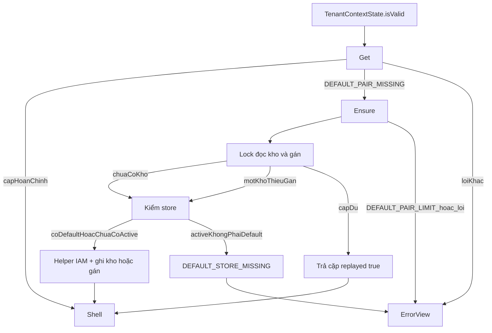
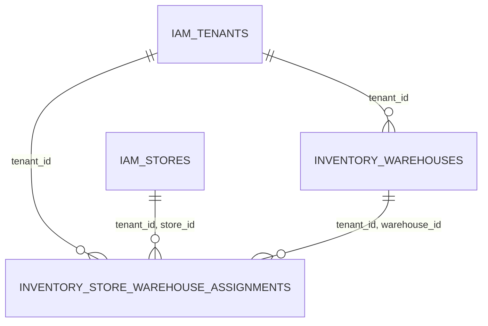

# Work Slice: SL-006 — Thiết lập cặp cửa hàng/kho mặc định

```yaml
id: SL-006
journey: []
usecase: []
sources:
  - DOM-COM
theme: theme-07
```

**design_status** trên [`CATALOG.md`](CATALOG.md). Cửa hàng lấy từ `iam.stores`. Kho, gán, và RPC nằm ở Persistence.

File nằm trong harness BJ-02 để SL-002 gắn `depends_on`. Outcome không thuộc hành trình nhận hàng.

---

## Objective

Tenant có đúng một cặp mặc định để mutation kho sau resolve được cửa hàng và kho trên server.

---

## Blocked by

- `None`

---

## Scope & Rules

### In Scope

- `EnsureDefaultStoreWarehousePair`: actor có `inventory.default_pair.ensure` gọi khi tenant chưa có cặp hoàn chỉnh
- Ensure đọc kho và gán dưới advisory lock trước. Có store `active` mà không có `code = default` đang `active` thì `DEFAULT_STORE_MISSING`. Có store `active` `code = default`, hoặc chưa có store `active` nào, thì gọi `iam._ensure_tenant_default_store`. Chưa có kho active thì ghi kho và gán. Đúng một kho active thiếu gán thì chỉ ghi gán. Đã đủ cặp thì trả cặp đang có
- `GetDefaultStoreWarehousePair`: actor có `inventory.default_pair.read` đọc cặp
- `matches(storeId, warehouseId)` trên port của slice này, để mutation kho sau kiểm cặp
- Cổng ERP trên `DashboardPage`: khi `TenantContextState.isValid`, chờ `Get` rồi `Ensure` nếu thiếu cặp trước khi vào shell
- Đăng ký `IInventoryModule` trong `initDependencies` để cổng gọi được command và query

### Out of Scope

- Màn hình thiết lập kho, bộ chọn kho, chọn kho, định tuyến, chia đơn, chuyển kho, đóng hoặc đổi kho
- Ghi kho hoặc gán bên trong command tạo tenant của Theme 1
- Tạo Store trong inventory
- Cờ `is_default`, mã cửa hàng, khoảng hiệu lực
- Tạo kho từ vị trí user hoặc device
- Mutation kho tự tạo cặp khi chưa có
- Mutation tồn — [SL-002](SL-002-quick-receipt.md) và các slice sau
- Đổi tên cửa hàng khi store `active` đã có và `display_name` của tenant đổi sau lần ghi
- Sửa `iam._ensure_tenant_default_store`
- Seed `role_permissions` cho hai mã của slice — `iam.has_permission` đã cho membership active với mã ngoài `tenant.*` / `iam.*`
- Số dư đầu kỳ — [BJ-12](../../02.specification/behavior/journeys/BJ-12-khoi-tao-so-du-ton-kho-au-ky.md)
- Quick receipt — [SL-002](SL-002-quick-receipt.md)
- Fact outbox và integration command
- Internal command và outbox worker — client stub chỉ để codegen biên dịch

### Boundary

| Concern | Owner |
| --- | --- |
| Cửa hàng | Theme 1 — `iam.stores`, `iam._ensure_tenant_default_store` |
| Kho và gán | Theme 7 / `inventory` |
| `display_name` của tenant | Theme 1 — helper IAM đọc khi tạo hoặc kích hoạt lại store |
| Cổng vào shell | ERP — `DashboardPage` khi `TenantContextState.isValid`, không nằm trong `TenantContextCubit` |
| Tồn, goods receipt, opening batch | `DOM-IO` / `DOM-IC` |

### Rules

| ID | Quy tắc (slice) |
| --- | --- |
| [INV-ORG-02](../../02.specification/domain/domain-foundation/DOM-COM.md) | Phase 1 đúng một kho `active` và một gán `active`. Không tạo kho từ vị trí user/device. Slice không tạo Store; cửa hàng là bản trên `iam.stores` |
| [Overview §3.1](../../02.specification/overview/overview.md) | Một cửa hàng hoạt động và một kho hoạt động. UI không có bộ chọn kho |
| [KB-KGV-003](../../01.knowledge/know-how/KB-KGV-003-kho-cua-hang-va-khoa-dinh-danh-so-du-ton-kho.md) | Mọi giao dịch ghi `store_id` và `warehouse_id`. Server điền cặp và kiểm lại qua `matches`. `WH-01` trong KB là ví dụ, không phải cột `code`. SRS không có cột `code` của kho; slice không thêm. Tên kho là «Kho mặc định» |
| Transaction | Mutation ghi dòng idempotency trong cùng transaction. Command không nhận `idempotencyKey` từ client. `command.id` của `CommandBase` không phải khóa này. Server tự đặt `idempotency_key = tenant_id` và `payload_hash` là SHA-256 hex của chuỗi rỗng khi tạo hoặc vá. Không gọi `sales._begin_sales_idempotency`. Chỉ mượn biểu thức advisory lock. Đọc kho và gán trước dòng idempotency. Cặp chưa hoàn chỉnh thì không trả `result_snapshot` cũ. Lệch [mục 8](../../../../../docs/architecture/13-idempotency-and-message-processing.md): key và hash cố định theo tenant, snapshot lần trước không chặn lần vá. Không outbox |
| Permission | SRS không có mã. Slice chốt `inventory.default_pair.ensure` và `inventory.default_pair.read`. Mọi membership active được gọi; owner luôn qua; membership không active từ chối. «Một quan hệ hoạt động» là `status = active` cộng unique một bản active, không cột `is_default` |

```dart
abstract final class InventoryPermissions {
  static const defaultPairEnsure = 'inventory.default_pair.ensure';
  static const defaultPairRead = 'inventory.default_pair.read';
}
```

---

## Flow

### Main Flow



1. Tenant đã tồn tại. `DashboardPage`, khi `TenantContextState.isValid` (vào app và `switchTo`), gọi `Get`. Có cặp hoàn chỉnh thì vào shell.
2. `Get` trả `DEFAULT_PAIR_MISSING` thì gọi `Ensure`. Command không nhận field. `p_tenant_id` và `p_correlation_id` lấy từ execution context.
3. Ensure lấy advisory lock, đọc kho và gán trước dòng idempotency. Có store `active` `code = default`, hoặc chưa có store `active` nào, thì gọi helper. Có store `active` mà không có bản `code = default` đang `active` thì `DEFAULT_STORE_MISSING`, không gọi helper.
4. Đã đủ cặp thì trả cặp đang có, `replayed: true`, không gọi helper, không ghi dòng idempotency.
5. Tạo mới trả `replayed: false`. Vá gán cũng trả `replayed: false`. Xong thì vào shell.

Helper IAM chỉ được gọi trong hai trường hợp trên. Khi được gọi: store `active` `code = default` thì trả store đó; chưa có store `active` thì insert hoặc kích hoạt lại `code = default`. Tên store lúc tạo hoặc kích hoạt lại: `display_name` đã trim, rỗng thì `Default Store`. Không đọc `tenants.name`. Kho mới tên «Kho mặc định», `status = active`. Gán `status = active` trỏ đúng kho đó. Client không gửi `store_id` hay `warehouse_id`.

### Failure Flow

1. Hình khác một kho active và một gán active trỏ đúng kho đó, khi Ensure cố ghi thêm → `DEFAULT_PAIR_LIMIT` → không ghi bản mới, không ghi dòng idempotency `succeeded`.
2. Có store `active` và không có bản `code = default` đang `active` → `DEFAULT_STORE_MISSING` → không gọi helper, không ghi kho, không ghi gán, không ghi dòng idempotency `succeeded`.
3. Command không có field vị trí → Ensure không tạo kho từ vị trí device.
4. Get hoặc `matches` khi chưa có cặp hoàn chỉnh → `DEFAULT_PAIR_MISSING` → không ghi kho mới.
5. `matches` nhận id khác cặp → `DEFAULT_PAIR_MISMATCH` → không ghi kho mới.
6. Actor không có `inventory.default_pair.ensure` → `Permission denied: inventory.default_pair.ensure` → không ghi kho hay gán.
7. Actor không có `inventory.default_pair.read` → `Permission denied: inventory.default_pair.read` → không trả cặp.
8. Tenant không tồn tại → `RESOURCE_NOT_FOUND` → không ghi kho hay gán.
9. `p_tenant_id` hoặc `p_correlation_id` null → `CONTEXT_INVALID` → không ghi kho hay gán.
10. `iam.has_permission` ném `TENANT_SUSPENDED` hoặc `TENANT_CLOSED` → không ghi kho hay gán, cổng không vào shell.
11. Cổng dashboard: `DEFAULT_PAIR_LIMIT`, `DEFAULT_STORE_MISSING`, hoặc lỗi khác → không vào shell. `DefaultPairGateErrorView` hiện lỗi cặp. «Thử lại» chạy lại `Get`/`Ensure`. «Chọn tổ chức khác» gọi `openTenantContextSelector`.

---

## Design

### Domain

**Before:** tenant không có kho active và gán active để mutation resolve.
**After:** một store `active` `code = default` trên `iam.stores`, một kho `active` tên «Kho mặc định», và một gán `active` trỏ đúng kho đó.

| Quyết định | Nội dung |
| --- | --- |
| Cửa hàng | `iam.stores`. Ensure gọi `iam._ensure_tenant_default_store` khi đã có store `active` `code = default`, hoặc khi chưa có store `active` nào. Inventory không insert store. Trạng thái cửa hàng là `iam.stores.status` |
| Tên cửa hàng | Helper IAM đã ship: `coalesce(nullif(trim(display_name), ''), 'Default Store')`. Không đọc `tenants.name`. Store `active` `code = default` đã có thì lần sau giữ tên. Chưa có store `active` mà có bản `code = default` inactive thì helper đặt lại `active` và ghi đè `display_name` |
| Nhiều store `active` | Có bản `active` `code = default` thì dùng bản đó. Có store `active` mà không có bản `code = default` đang `active` thì `DEFAULT_STORE_MISSING`. Không gọi helper. Không lấy store `active` sớm nhất theo `created_at` hay `id`. Helper đã ship vẫn có nhánh sớm nhất; slice từ chối nhánh đó và không sửa helper |
| Kho | `display_name` «Kho mặc định», `status = active`. Không cột `code`. Tên kho không đổi khi gọi lại Ensure. Kho inactive không được kích hoạt lại; chưa có kho active thì insert kho mới |
| Gán | `status = active`, nối `store_id` của IAM với `warehouse_id`. Không cột `is_default` |
| Cặp hoàn chỉnh | Đúng một kho `active` và đúng một gán `active` trỏ đúng kho đó |
| Người ghi | `inventory.default_pair.ensure`. Theme 1 không ghi kho hay gán lúc tạo tenant |
| Caller ERP | `DashboardPage` khi `TenantContextState.isValid`. `TenantContextCubit` không gọi inventory |

### Persistence

Dùng lại `iam.stores`, `iam.tenants.display_name`, và `iam._ensure_tenant_default_store`. Không tạo store trong inventory, không sửa helper.

Draft lúc implement: `supabase/migrations/_drafts/inventory_default_pair.sql`. Draft tạo schema `inventory` khi chưa có. Repo chưa có schema này. Draft không tạo `iam.stores`. Không sửa helper IAM.

Ba bảng inventory bật RLS, không `FORCE ROW LEVEL SECURITY`, không policy và không grant cho `authenticated` hay `anon`. Owner RPC bỏ qua RLS. Hai RPC `security definer`, `search_path = inventory, iam, pg_temp`, `grant execute` cho `authenticated`. Không grant `iam._ensure_tenant_default_store` cho `authenticated`. Gọi helper bằng tên `iam._ensure_tenant_default_store`.



Bảng `iam.stores`. Nguồn [`20260830001_iam_active_store_context_group_a.sql`](../../../../../supabase/migrations/20260830001_iam_active_store_context_group_a.sql). Slice không tạo và không sửa bảng này.

| Cột | Kiểu | Null | Ràng buộc |
| --- | --- | --- | --- |
| `id` | uuid | không | PK, default `gen_random_uuid()` |
| `tenant_id` | uuid | không | FK `iam.tenants(id)` ON DELETE CASCADE |
| `code` | text | không | |
| `display_name` | text | không | |
| `status` | text | không | CHECK `active` / `inactive` |
| `created_at` | timestamptz | không | default `now()` |

Unique `(tenant_id, code)`
Unique `(tenant_id, id)`

Bảng `iam.tenants`. Slice không tạo và không sửa. Không copy cột profile còn lại: implement chỉ cần FK tới `id` và helper đọc `display_name`. Helper không đọc `name`. Nguồn [`20260630000001_iam_foundation.sql`](../../../../../supabase/migrations/20260630000001_iam_foundation.sql), [`20260811015_iam_tenant_profile_legal.sql`](../../../../../supabase/migrations/20260811015_iam_tenant_profile_legal.sql), helper [`20260916001_iam_ensure_default_store_scope_helpers.sql`](../../../../../supabase/migrations/20260916001_iam_ensure_default_store_scope_helpers.sql).

| Cột | Kiểu | Null | Ràng buộc |
| --- | --- | --- | --- |
| `id` | uuid | không | PK |
| `display_name` | text | có | Helper đọc cột này |

Bảng `inventory.warehouses`

| Cột | Kiểu | Null | Ràng buộc |
| --- | --- | --- | --- |
| `id` | uuid | không | PK, default `gen_random_uuid()` |
| `tenant_id` | uuid | không | FK `iam.tenants(id)` ON DELETE CASCADE |
| `display_name` | text | không | |
| `status` | text | không | CHECK `active` / `inactive` |
| `created_at` | timestamptz | không | default `now()` |

Unique `(tenant_id, id)`
Unique index `warehouses_one_active_per_tenant` trên `(tenant_id)` WHERE `status = 'active'`

Bảng `inventory.store_warehouse_assignments`

| Cột | Kiểu | Null | Ràng buộc |
| --- | --- | --- | --- |
| `id` | uuid | không | PK, default `gen_random_uuid()` |
| `tenant_id` | uuid | không | FK `iam.tenants(id)` ON DELETE CASCADE |
| `store_id` | uuid | không | FK `(tenant_id, store_id)` → `iam.stores(tenant_id, id)` ON DELETE CASCADE |
| `warehouse_id` | uuid | không | FK `(tenant_id, warehouse_id)` → `inventory.warehouses(tenant_id, id)` ON DELETE CASCADE |
| `status` | text | không | CHECK `active` / `inactive` |
| `created_at` | timestamptz | không | default `now()` |

Unique index `store_warehouse_assignments_one_active_per_tenant` trên `(tenant_id)` WHERE `status = 'active'`

Bảng `inventory.idempotency_records`. Cột copy từ [`sales.idempotency_records`](../../../../../supabase/migrations/20260830005_sales_rebuild_schema.sql). `id` không có default trên bảng; RPC gán `gen_random_uuid()` lúc insert.

| Cột | Kiểu | Null | Ràng buộc |
| --- | --- | --- | --- |
| `id` | uuid | không | PK |
| `tenant_id` | uuid | không | |
| `command_scope` | varchar(100) | không | |
| `idempotency_key` | varchar(150) | không | |
| `payload_hash` | varchar(128) | không | |
| `status` | text | không | CHECK `in_progress` / `succeeded` / `failed` / `uncertain` |
| `result_type` | varchar(100) | có | |
| `result_id` | uuid | có | |
| `result_snapshot` | jsonb | có | |
| `correlation_id` | uuid | không | |
| `expires_at` | timestamptz | có | |
| `created_at` | timestamptz | không | DEFAULT `now()` |
| `updated_at` | timestamptz | không | DEFAULT `now()` |

Unique `(tenant_id, command_scope, idempotency_key)`

| RPC | Tham số |
| --- | --- |
| `inventory.ensure_default_store_warehouse_pair` | `p_tenant_id`, `p_correlation_id`. Server tự đặt `idempotency_key = tenant_id` và `payload_hash` SHA-256 hex của chuỗi rỗng khi tạo hoặc vá. Gọi [`iam._ensure_tenant_default_store(p_tenant_id)`](../../../../../supabase/migrations/20260916001_iam_ensure_default_store_scope_helpers.sql) khi đã có store `active` `code = default`, hoặc khi chưa có store `active` nào. Helper `returns uuid`. Có store `active` khác mà không có `code = default` đang `active` thì không gọi helper |
| `inventory.get_default_store_warehouse_pair` | `p_tenant_id` |

`p_tenant_id` và `p_correlation_id` lấy từ execution context. Kiểm `iam.has_permission` trước khi ghi. Pipeline ném `ApplicationException` cùng chuỗi; RPC từ chối cùng chuỗi khi gọi thẳng.

| Code | Khi nào | Hệ quả |
| --- | --- | --- |
| `DEFAULT_PAIR_MISSING` | Get hoặc `matches` khi chưa có cặp hoàn chỉnh | Không ghi kho mới |
| `DEFAULT_PAIR_MISMATCH` | `matches` nhận id khác cặp | Không ghi kho mới |
| `DEFAULT_PAIR_LIMIT` | Ensure gặp hình khác một kho + một gán đúng kho, khi cố ghi thêm | Không ghi bản mới, không ghi dòng idempotency `succeeded` |
| `DEFAULT_STORE_MISSING` | Có store `active` và không có bản `code = default` đang `active` | Không gọi helper, không ghi kho, không ghi gán, không ghi dòng idempotency `succeeded` |
| `Permission denied: inventory.default_pair.ensure` | Actor không có quyền Ensure | Không ghi kho hay gán |
| `Permission denied: inventory.default_pair.read` | Actor không có quyền Get | Không trả cặp |
| `RESOURCE_NOT_FOUND` | Helper IAM không thấy tenant | Không ghi kho hay gán |
| `CONTEXT_INVALID` | `p_tenant_id` hoặc `p_correlation_id` null | Không ghi kho hay gán |
| `TENANT_SUSPENDED` | `iam.has_permission` ném khi tenant suspended | Không ghi kho hay gán |
| `TENANT_CLOSED` | `iam.has_permission` ném khi tenant closed | Không ghi kho hay gán |

`payload_hash` hằng số `e3b0c44298fc1c149afbf4c8996fb92427ae41e4649b934ca495991b7852b855`. Không băm `command.id` hay `correlation_id`. Client không gửi key hay hash.
Vi phạm unique index một bản `active` map thành `DEFAULT_PAIR_LIMIT`.
`matches` không có RPC riêng. Gateway đọc `inventory.get_default_store_warehouse_pair` rồi so id. Trùng thì trả void.
Dòng idempotency `succeeded`: `result_type = inventory.default_pair`, `result_id` là `warehouse_id`, `expires_at` null. `result_snapshot` gồm `storeId`, `storeName`, `warehouseId`, `warehouseName`. `replayed` không nằm trong snapshot.

### Transaction / Idempotency

Cột của dòng idempotency dùng lại `sales.idempotency_records`. Không gọi `sales._begin_sales_idempotency`. Lock chỉ mượn biểu thức `pg_advisory_xact_lock(hashtextextended(tenant_id || ':' || command_scope || ':' || idempotency_key, 0))`.

- `command_scope`: `inventory.default_pair`
- Client không gửi `idempotencyKey`. Server tự đặt `idempotency_key = tenant_id` khi tạo hoặc vá. `command.id` chỉ là id của lần gửi
- Advisory lock ở trên, trước khi đọc kho và gán
- Đọc kho và gán dưới lock trước khi nhìn dòng idempotency. Trạng thái kho và gán là nguồn đúng
- Đã đủ cặp → trả cặp đang có, `replayed: true`. Không gọi helper, không ghi dòng idempotency
- Tạo mới hoặc vá gán → ghi hoặc ghi đè đúng một dòng idempotency `succeeded` với snapshot cặp vừa commit, `replayed: false`. Snapshot cũ không chặn lần vá. Cùng hash không được trả snapshot cũ khi cặp chưa hoàn chỉnh
- Unique `(tenant_id, command_scope, idempotency_key)` trên `inventory.idempotency_records`, cùng transaction với kho, gán, và dòng idempotency
- Không outbox. Get và `matches` không ghi

### Code Layout

Dùng lại skeleton `InventoryStartup`, `InventoryDataAccessModule`, `InventoryMediationModule`, `IInventoryModule`. `initialize` hiện chỉ nhận `SupabaseClient` và trả stub. Đổi chữ ký theo `PricingStartup.initialize`: `supabase`, `loggerFactory`, `executionContext`, `permissionChecker`, `tenantAccessChecker`. Facade theo `PartnerModule`: `CommandBus` và `QueryBus`. Không dùng `ScopedCommandExecutor`. Không thêm file vào `modules/inventory/presentation`.

`infrastructure/pubspec.yaml` thêm `c45_adapters`. Gateway lấy `SupabaseSchemaRpcClient` từ package đó. `mapError` đưa `PostgrestException.message` vào `RpcException`. Không dùng `error.toString()`.

`build.yaml` của infrastructure đang tắt `cqrs_registrar`. Bật bốn builder như `modules/partner/infrastructure/build.yaml`, `module_name: inventory`, `scan_package: c45_inventory_application`. Codegen ghi `processing/generated/inventory_*.g.dart`. Không sửa tay file generated.

`Warehouse` và `StoreWarehouseAssignment` giữ cột của bảng tương ứng. Invariant một bản `active` nằm ở unique index.

```text
modules/
    inventory/
        domain/
            lib/
                domain.dart
                src/
                    inventory_permissions.dart
                    default_pair/
                        warehouse.dart
                        store_warehouse_assignment.dart
        application/
            pubspec.yaml
            lib/
                application.dart
                src/
                    default_pair/
                        commands/
                            ensure_default_store_warehouse_pair/
                                ensure_default_store_warehouse_pair_command.dart
                                ensure_default_store_warehouse_pair_command_handler.dart
                                ensure_default_store_warehouse_pair_command_validator.dart
                        queries/
                            get_default_store_warehouse_pair/
                                get_default_store_warehouse_pair_query.dart
                                get_default_store_warehouse_pair_query_handler.dart
                        ports/
                            i_default_store_warehouse_pair_port.dart
                        shared/
                            default_store_warehouse_pair_dto.dart
                            ensure_default_store_warehouse_pair_result_dto.dart
                        testing/
                            fake_default_store_warehouse_pair_port.dart
            test/
                default_pair/
                    default_store_warehouse_pair_test.dart
        infrastructure/
            pubspec.yaml
            build.yaml
            lib/
                infrastructure.dart
                src/
                    inventory_module.dart
                    default_pair/
                        default_store_warehouse_pair_gateway.dart
                    errors/
                        inventory_error_mapper.dart
                    configuration/
                        inventory_startup.dart
                        data_access/
                            data_access_module.dart
                        mediation/
                            mediation_module.dart
                        processing/
                            inventory_command_pipeline.dart
                            internal_commands/
                                i_inventory_internal_command_client.dart
                                supabase_inventory_internal_command_client.dart
supabase/
    migrations/
        _drafts/
            inventory_default_pair.sql
apps/
    erp/
        pubspec.yaml
        lib/
            core/
                di/
                    injection.dart
            features/
                dashboard/
                    presentation/
                        dashboard_page.dart
                        bloc/
                            default_pair_gate_cubit.dart
                        widgets/
                            default_pair_gate_error_view.dart
        example/
            lib/
                main.dart
                dashboard/
                    main.dart
                    preview/
                        default_pair_gate_error_preview_section.dart
        test/
            core/
                di/
                    injection_test.dart
            features/
                dashboard/
                    presentation/
                        default_pair_gate_test.dart
```

---

## Contracts

### EnsureDefaultStoreWarehousePairCommand

> Actor có `inventory.default_pair.ensure` gọi sau khi tenant đã tồn tại. Đọc kho và gán dưới lock. Có store `active` mà không có `code = default` đang `active` thì `DEFAULT_STORE_MISSING`, không gọi helper. Chưa có store `active`, hoặc đã có store `active` `code = default`, thì gọi helper IAM. Chưa có kho thì ghi kho «Kho mặc định» và gán. Đúng một kho thiếu gán thì chỉ ghi gán. Đã đủ cặp thì trả cặp đó, `replayed: true`, không đổi tên kho, không ghi dòng idempotency. Không `ITenantScopedCommand`.

```dart
@RequiresPermission(InventoryPermissions.defaultPairEnsure)
final class EnsureDefaultStoreWarehousePairCommand
    extends CommandBase<EnsureDefaultStoreWarehousePairResultDto>
    implements ICommand<EnsureDefaultStoreWarehousePairResultDto> {
  EnsureDefaultStoreWarehousePairCommand({String? id}) : super(id);
}
```

Command không nhận tên, `storeId`, `warehouseId`, `idempotencyKey`, `tenantId`, hay vị trí. Không `@RequiresTenant`, không `ITenantScopedCommand`. Handler `@CommandHandlerFor(EnsureDefaultStoreWarehousePairCommand)`, nhận `IExecutionContext` và `IDefaultStoreWarehousePairPort`. `requireTenantId()` và `correlationId` đưa xuống gateway. Validator implement `ICommandValidator` và không chặn field. `application/pubspec.yaml` thêm `c45_annotations`. `domain.dart` export `InventoryPermissions`. `application.dart` export command, handler, validator, query, DTO, và port.

### EnsureDefaultStoreWarehousePairResultDto

```dart
class EnsureDefaultStoreWarehousePairResultDto {
  final String storeId;
  final String storeName;
  final String warehouseId;
  final String warehouseName; // Kho mặc định
  final bool replayed;
}
```

`replayed` là `true` khi cặp đã hoàn chỉnh trước lần gọi. Tạo mới và vá gán đều `false`.

### GetDefaultStoreWarehousePairQuery

> Actor có `inventory.default_pair.read` đọc cặp. Chưa có cặp hoàn chỉnh thì `DEFAULT_PAIR_MISSING`. Không `ITenantScopedCommand`.

```dart
@RequiresPermission(InventoryPermissions.defaultPairRead)
final class GetDefaultStoreWarehousePairQuery
    extends QueryBase<DefaultStoreWarehousePairDto>
    implements IQuery<DefaultStoreWarehousePairDto> {
  GetDefaultStoreWarehousePairQuery({String? id}) : super(id);
}
```

Tenant lấy từ execution context. Handler `@QueryHandlerFor(GetDefaultStoreWarehousePairQuery)`. `QueryBus` không chạy decorator quyền. Handler gọi `IPermissionChecker.require(InventoryPermissions.defaultPairRead)` trước port. RPC vẫn gọi `iam.has_permission`.

### DefaultStoreWarehousePairDto

```dart
class DefaultStoreWarehousePairDto {
  final String storeId;
  final String storeName;
  final String warehouseId;
  final String warehouseName;
}
```

`IDefaultStoreWarehousePairPort.ensure` → `EnsureDefaultStoreWarehousePairResultDto`.
`IDefaultStoreWarehousePairPort.get` → `DefaultStoreWarehousePairDto`.
`IDefaultStoreWarehousePairPort.matches(storeId, warehouseId)` → void. Chưa có cặp hoàn chỉnh thì `DEFAULT_PAIR_MISSING`. Id khác cặp thì `DEFAULT_PAIR_MISMATCH`.
Gateway dùng `SupabaseSchemaRpcClient` schema `inventory`. `inventory_error_mapper` đọc `RpcException.message`: JSON có `code` thì `ApplicationException(code)`; không thì `ApplicationException(message)`. Helper IAM ném JSON `RESOURCE_NOT_FOUND` và `CONTEXT_INVALID`. `iam.has_permission` ném chuỗi `TENANT_SUSPENDED` và `TENANT_CLOSED`. RPC inventory ném đúng chuỗi trong bảng Code.
`IInventoryInternalCommandClient` là interface rỗng. `SupabaseInventoryInternalCommandClient` là stub. `registerGeneratedInventoryHandlers` nhận client đó và không enqueue. `InventoryCommandPipeline.buildBusinessPipeline` gọi `DefaultCommandPipeline` với access metadata, `IPermissionChecker`, và `ITenantAccessChecker`. Hai type của slice không có `@RequiresTenant` nên tenant guard không chạy.
`FakeDefaultStoreWarehousePairPort`: đọc kho và gán trước. Có store `active` mà không có `code = default` đang `active` thì ném `DEFAULT_STORE_MISSING`, không tạo kho hay gán. Chưa có store `active` thì store từ fake IAM theo helper đã ship (`display_name` trim, rỗng → `Default Store`; inactive `code = default` → kích hoạt và ghi đè tên). Đã có store `active` `code = default` thì dùng store đó. Chưa có kho thì tạo kho «Kho mặc định» và gán. Đúng một kho thiếu gán thì chỉ ghi gán, `replayed: false`. Đã đủ cặp thì `replayed: true`, không ghi dòng idempotency. Hình khác ném `DEFAULT_PAIR_LIMIT`. Không có field vị trí nên không tạo kho từ device. Actor thiếu quyền đọc ném `Permission denied: inventory.default_pair.read`. Fake không chọn store `active` sớm nhất.

---

## Presentation

### Screens

Dùng lại `DashboardPage`. Cổng chỉ khi `TenantContextState.isValid` (`TenantContextLoadStatus.ready` và `current.status == TenantContextStatus.valid`). Header và bottom nav đang nằm ngoài `_buildBody`; lúc cổng loading hoặc lỗi thì không hiện.

| Screen | State / action | Nguồn |
| --- | --- | --- |
| `DashboardPage` | Khác `isValid`: giữ UI tenant context hiện có. Gate này không chạy | `dashboard_page.dart` |
| `DashboardPage` | `isValid`: `VLoading` đến khi có cặp, rồi shell hiện tại | Không có SCR trong SRS. Cổng nằm trên page đã có |
| `DefaultPairGateErrorView` | Lỗi cặp. «Thử lại» gọi lại `Get`/`Ensure`. «Chọn tổ chức khác» gọi `openTenantContextSelector` | Widget mới của slice |

### Route

- Path `/`, name `dashboard`. Các builder `DashboardPage` (`home`, `products`, `orders`, `partners`) dùng chung cổng vì gate nằm trong page
- Không thêm route

### State × feedback

| State | UI / feedback | Error code |
| --- | --- | --- |
| loading | `VLoading` giữa trang. Chưa hiện header, tab, bottom nav | — |
| empty | Không có màn empty. `DEFAULT_PAIR_MISSING` giữ loading và gọi `Ensure` | `DEFAULT_PAIR_MISSING` |
| error | Không vào shell. Title «Không thiết lập được kho mặc định». Mô tả «Cửa hàng và kho mặc định chưa sẵn sàng. Thử lại hoặc chọn tổ chức khác.» | `DEFAULT_PAIR_LIMIT`, `DEFAULT_STORE_MISSING`, permission denied, `RESOURCE_NOT_FOUND`, `CONTEXT_INVALID`, `TENANT_SUSPENDED`, `TENANT_CLOSED`, lỗi khác |
| success | Shell dashboard hiện tại | — |

### Design system

- `VLoading` cho loading
- `DefaultPairGateErrorView` dùng `VCard`, `VText`, `VIcon` (`VIcons.error`), `VGap`, `VSpacing`, cùng mật độ với `OrganizationEmptyView`
- Không thêm enum hay chữ vào `OrganizationEmptyView`. Widget đó chỉ có một action và chữ tổ chức cố định
- Catalog: `DefaultPairGateErrorPreviewSection` trong `apps/erp/example`, một hàng trên `_CatalogHome`

### Mediator

- `DefaultPairGateCubit` gọi `IInventoryModule.executeQueryAsync` rồi, khi `ApplicationException.message` là `DEFAULT_PAIR_MISSING`, `executeCommandAsync`
- `initDependencies` gọi `InventoryStartup.initialize` với `supabaseModule.client`, `ILoggerFactory`, `IExecutionContext`, `IPermissionChecker`, và `ITenantAccessChecker` đã đăng ký từ IAM. `apps/erp/pubspec.yaml` thêm `c45_inventory_application` và `c45_inventory_infrastructure`. Đăng ký `IInventoryModule`. `initialize` không gọi RPC
- `InventoryStartup` bỏ stub `UnimplementedError`, gắn command bus và gateway
- `injection_test` kỳ vọng `IInventoryModule` đã đăng ký
- Fake cổng là `FakeDefaultStoreWarehousePairPort`, khớp Contracts
- Presentation thuộc `apps/erp`

---

## Verification

### Acceptance Criteria

- [ ] **AC-01** Given tenant chưa có store và chưa có kho, `display_name` là «Mậu Hiên», When Ensure, Then store IAM tên «Mậu Hiên», một kho «Kho mặc định» `active`, một gán `active`, và một dòng idempotency
- [ ] **AC-02** Given tenant `display_name` trống hoặc chỉ khoảng trắng, When Ensure, Then tên cửa hàng là `Default Store`, tên kho là «Kho mặc định»
- [ ] **AC-03** Given đã có cặp hoàn chỉnh và store đang `active`, When Ensure lần hai kể cả khi `display_name` đã đổi, Then cùng id, `replayed: true`, tên kho và tên store giữ nguyên, không ghi dòng idempotency
- [ ] **AC-04** Given đã có một kho active và một gán active, When ghi kho hoặc gán thứ hai, Then `DEFAULT_PAIR_LIMIT` và không có bản mới
- [ ] **AC-05** Given command Ensure, When đọc field, Then không có vị trí, `storeId`, `warehouseId`, `tenantId`, `idempotencyKey`, hay tên, và Ensure không tạo kho từ vị trí device
- [ ] **AC-06** Given chưa có cặp hoàn chỉnh, kể cả đúng một kho active thiếu gán, When Get hoặc `matches`, Then `DEFAULT_PAIR_MISSING` và không ghi kho mới
- [ ] **AC-07** Given đã có cặp, When `matches` nhận id khác, Then `DEFAULT_PAIR_MISMATCH` và không ghi kho mới
- [ ] **AC-08** Given actor không có `inventory.default_pair.ensure`, When Ensure, Then `Permission denied: inventory.default_pair.ensure` và không ghi kho hay gán
- [ ] **AC-09** Given actor không có `inventory.default_pair.read`, When Get, Then `Permission denied: inventory.default_pair.read` và không trả cặp
- [ ] **AC-10** Given đúng một kho active, chưa có gán active, và có thể đã có dòng idempotency `succeeded` cũ, When Ensure, Then không tạo kho thứ hai, không đổi tên kho, ghi gán vào kho đó, ghi đè snapshot dòng idempotency, `replayed: false`
- [ ] **AC-11** Given tenant không tồn tại, When Ensure, Then `RESOURCE_NOT_FOUND` và không ghi kho hay gán
- [ ] **AC-12** Given chưa có store `active`, có store `code = default` đang inactive, When Ensure, Then store đó `active`, tên theo `display_name` lúc gọi hoặc `Default Store`, một kho «Kho mặc định» và một gán `active`
- [ ] **AC-13** Given `TenantContextState.isValid` trên `DashboardPage`, When chưa có cặp, Then `VLoading` đến khi `Get`/`Ensure` xong rồi vào shell, không header và không bottom nav trong lúc loading; When `DEFAULT_PAIR_LIMIT`, `DEFAULT_STORE_MISSING`, hoặc lỗi khác, Then không vào shell, title «Không thiết lập được kho mặc định», «Thử lại» chạy lại `Get`/`Ensure`, «Chọn tổ chức khác» mở `openTenantContextSelector`
- [ ] **AC-14** Given có store `active` và không có bản `code = default` đang `active`, When Ensure, Then `DEFAULT_STORE_MISSING`, không gọi helper, không ghi kho, không ghi gán, không ghi dòng idempotency `succeeded`

### Tests

| Test id | Given / When / Then | Layer |
| --- | --- | --- |
| `scn_ensure_named_store` | Chưa có store, chưa có kho, `display_name` = Mậu Hiên / Ensure / store «Mậu Hiên», warehouse «Kho mặc định», gán active, có dòng idempotency | application fake |
| `scn_ensure_fallback_store_name` | `display_name` trống hoặc whitespace / Ensure / store `Default Store` | application fake |
| `scn_ensure_replay` | Đã có cặp, store active, `display_name` đổi / Ensure / `replayed: true`, tên kho và tên store cũ, không ghi dòng idempotency | application fake |
| `scn_second_rejected` | Đã có một kho và một gán / ghi kho thứ hai / `DEFAULT_PAIR_LIMIT`, vẫn một kho | application fake |
| `scn_no_device_warehouse` | Command Ensure / đọc field / không có vị trí, `tenantId`, hay `idempotencyKey`, không tạo kho từ device | application fake |
| `scn_missing_pair` | Chưa có cặp hoàn chỉnh / Get / `DEFAULT_PAIR_MISSING` | application fake |
| `scn_missing_pair_warehouse_only` | Đúng một kho active, chưa có gán / Get / `DEFAULT_PAIR_MISSING` | application fake |
| `scn_patch_missing_assignment` | Đúng một kho active, thiếu gán, có thể có dòng idempotency cũ / Ensure / không kho thứ hai, ghi gán, ghi đè snapshot, `replayed: false` | application fake |
| `scn_mismatch` | Đã có cặp / `matches` nhận warehouse id khác / `DEFAULT_PAIR_MISMATCH`, không ghi kho mới | application fake |
| `scn_tenant_member_rejected` | Actor không có `inventory.default_pair.ensure` / Ensure / `Permission denied: inventory.default_pair.ensure`, không ghi kho | application fake |
| `scn_read_denied` | Actor không có `inventory.default_pair.read` / Get / `Permission denied: inventory.default_pair.read`, không trả cặp | application fake |
| `scn_tenant_missing` | Tenant không tồn tại / Ensure / `RESOURCE_NOT_FOUND`, không ghi kho | application fake |
| `scn_reactivate_default_store` | Store `code = default` inactive, chưa có store active / Ensure / store đó active, tên theo chuỗi lúc gọi, một kho và một gán | application fake |
| `scn_active_store_without_default` | Có store `active` mã khác `default`, không có `code = default` đang `active` / Ensure / `DEFAULT_STORE_MISSING`, không kho, không gán, không dòng idempotency `succeeded` | application fake |
| `scn_dashboard_gate_success` | `TenantContextState.isValid`, chưa có cặp / Get rồi Ensure / vào shell, loading không hiện header và bottom nav | presentation |
| `scn_dashboard_gate_error` | Context valid, Ensure `DEFAULT_PAIR_LIMIT` / không vào shell, title lỗi cặp, thử lại và `openTenantContextSelector` | presentation |
| `scn_inventory_module_registered` | `initDependencies` / xong / `IInventoryModule` có trong GetIt | presentation |

### Scenarios

| Scenario | Actor | Across | Given / When / Then | Seed / fixture | Pass / fail |
| --- | --- | --- | --- | --- | --- |
| Vào shell khi thiếu cặp | Membership active | UI → `IInventoryModule` → fake port | G: `TenantContextState.isValid`, chưa có cặp / W: mở `DashboardPage` / T: loading rồi shell, một kho và một gán | `FakeDefaultStoreWarehousePairPort` rỗng | pass khi shell hiện sau Ensure; fail khi shell hiện trước khi có cặp |
| Chặn shell khi lỗi cặp | Membership active | UI → `IInventoryModule` → fake port | G: `TenantContextState.isValid`, Ensure ném `DEFAULT_PAIR_LIMIT` / W: mở `DashboardPage` / T: không shell, title «Không thiết lập được kho mặc định», thử lại và chọn tổ chức | Fake ném `DEFAULT_PAIR_LIMIT` | pass khi cả hai action có; fail khi vào shell hoặc dùng chữ «Không thể tải danh sách» |
