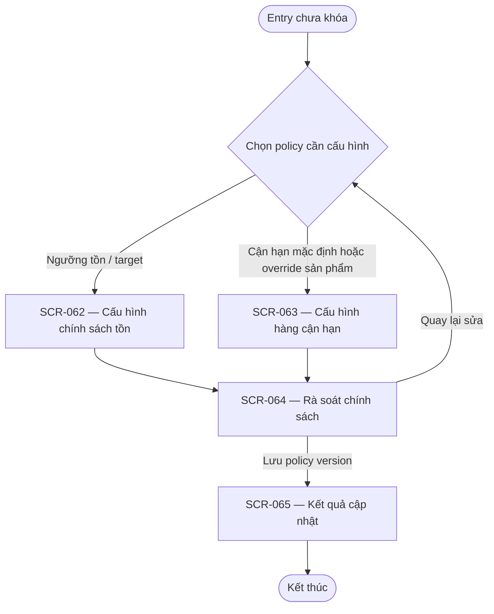

# Supporting UI Flow — CAP-01 — Quản lý chính sách tồn và cận hạn

> Checkpoint `4.3.1-dr1` · Loại `SUPPORTING_CAPABILITY_FLOW_PROPOSAL` · Không tăng số 17 BJ canonical · Trạng thái `REVIEW_REQUIRED` do `BG-006`.

## 1. Boundary

- Owner: `CAP-01 — Inventory Policy / Product Configuration`.
- Consumer: BJ-01 dùng threshold/target/near-expiry; BJ-09 dùng policy eligibility.
- Không tạo movement/value; mỗi thay đổi tạo policy version/effective time.
- Flutter DS là source duy nhất; screen dùng module-presentation composition.

## 2. Flow tối thiểu có thể dẫn xuất

## 3. Điểm chưa được nguồn khóa

1. Entry chính là NAV-06, chi tiết chỉ báo SCR-061 hay cả hai.
2. Cách chọn tenant default so với product override.
3. Permission cụ thể và return destination.
4. Sau kết quả có quay lại chỉ báo, policy list hay product detail.

Không được đưa flow này vào HTML production cho đến khi `BG-006` được duyệt.

---

## Amendment — 15/09/2026 · Theme 7 HTML prototype

Project decision now requires **all Theme 7 product/supporting surfaces to be prototyped in the HTML harness**. Therefore SCR-062..065 are rendered from v3.6.0 for task-flow, UX, interaction and QA coverage.

This amendment does **not** resolve `BG-006`: exact production entry point, permission matrix and return destination remain open. The harness uses a review fallback so screens are never dead, while avoiding any claim that the fallback is the final production IA.

Figma is used only for the current Design System and reference to mature prior-theme designs; Theme 7 screen design lives in the HTML prototype.
