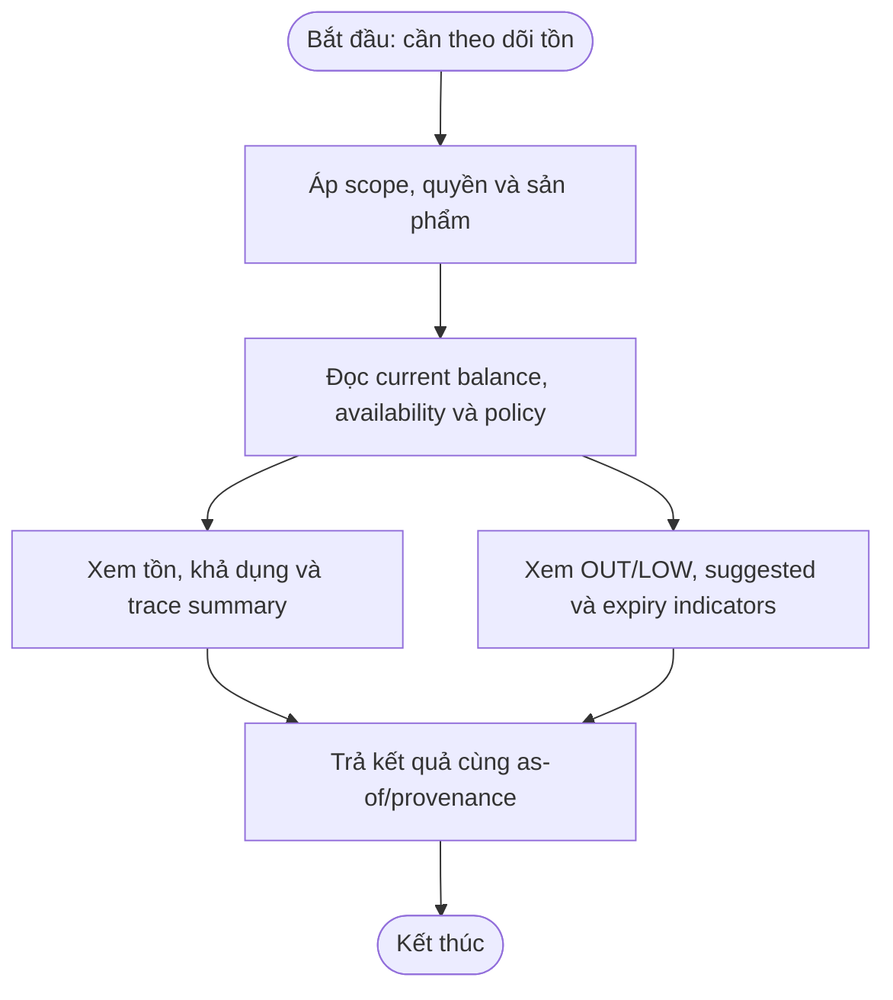

# BJ-01 — Theo dõi tồn, khả dụng và chỉ báo vận hành

> **Trạng thái:** Release đã đóng băng `4.1.0` — hợp nhất từ BJ-01 và BJ-17 của v4.0.0  
> **Phạm vi:** Phase 1 — current inventory/availability và chỉ báo vận hành tại kho mặc định  
> **Chủ sở hữu nghiệp vụ:** Inventory Operations / Monitoring  
> **Finality contract:** `COMPLETED` hoặc `REJECTED`; Journey chỉ đọc, không có mutation
> **Quyết định nghiệp vụ:** `T7-BASELINE-FREEZE-v4.0.0` + `T7-DR-012`, `T7-DR-018`, `T7-DR-029`, `T7-DR-084#REQ-01`, `T7-DR-088`, `T7-DR-095`, `T7-DR-096`

# 1. Mục tiêu và ranh giới

## 1.1 Mục tiêu

Cho phép người bán, thủ kho và chủ cửa hàng biết tồn vật lý, lượng đủ điều kiện bán, lượng đang giữ và tồn khả dụng; đồng thời nhận biết hết hàng, tồn thấp, lượng gợi ý bổ sung và hàng cận/hết hạn theo một as-of và policy version rõ ràng.

## 1.2 Điểm bắt đầu và kết thúc

| Thuộc tính | Nội dung |
|---|---|
| Bắt đầu | Người dùng cần kiểm tra một sản phẩm hoặc danh sách mặt hàng cần chú ý |
| Kết thúc | Current snapshot/indicator được hiển thị cùng scope, as-of và provenance; hoặc truy cập bị từ chối có lý do |
| Tác động chính | Query result/read model; không tạo identity nghiệp vụ mới |
| Không làm thay đổi | Quantity/value ledger, reservation, policy, trạng thái hàng, purchase proposal hoặc alert lifecycle |

## 1.3 Trong và ngoài ranh giới

| Trong ranh giới | Ngoài ranh giới |
|---|---|
| Tìm/chọn sản phẩm; current quantity/availability; breakdown ngắn theo trạng thái/lô; OUT/LOW; suggested quantity; near/expired indicator; filter/sort; policy/as-of | Full stock-card/history/cut-off/export thuộc BJ-15; forecast, MOQ/pack/lead time; purchase proposal/PO; alert assignment/SLA/close; mọi mutation |

CAP-01 cung cấp threshold/target và near-expiry policy. Transactional balance vẫn là authority cho mutation; projection trễ chỉ phục vụ xem và phải hiển thị độ mới.

# 2. Sơ đồ hành trình

# 3. Trường hợp sử dụng

| UC | Tên | Kết quả |
|---|---|---|
| [UC-01-01](../../../../../../../02.specification/behavior/use-cases/UC-01-01-xac-dinh-ngu-canh-va-san-pham.md) | Xác định ngữ cảnh và sản phẩm | Query/monitoring context hợp lệ hoặc truy cập bị từ chối |
| [UC-01-02](../../../../../../../02.specification/behavior/use-cases/UC-01-02-xem-ton-va-kha-dung.md) | Xem tồn và khả dụng | Current snapshot có as-of |
| [UC-01-03](../../../../../../../02.specification/behavior/use-cases/UC-01-03-xem-trace-summary.md) | Xem trace summary | Breakdown ngắn phục vụ quyết định tức thời; full history handoff BJ-15 |
| [UC-01-04](../../../../../../../02.specification/behavior/use-cases/UC-01-04-xem-ton-thap-va-luong-goi-y.md) | Xem tồn thấp và lượng gợi ý | OUT/LOW và suggested quantity có policy version |
| [UC-01-05](../../../../../../../02.specification/behavior/use-cases/UC-01-05-xem-hang-can-han-va-het-han.md) | Xem hàng cận hạn và hết hạn | Derived expiry indicator có as-of |

# 4. Logic nghiệp vụ cần giữ

| Điểm kiểm soát | Quy tắc |
|---|---|
| Khả dụng | Lượng vật lý đủ điều kiện bán − lượng đang giữ hợp lệ |
| Hết/tồn thấp | `OUT` khi available = 0; `LOW` khi `0 < available ≤ threshold` |
| Lượng gợi ý | `max(0, target_stock_level − available_quantity)` theo đơn vị cơ sở |
| Thiếu policy | Gắn `NOT_CONFIGURED`; không tự suy ra threshold/target |
| Cận/hết hạn | Product override ưu tiên tenant default; chỉ áp cho lượng có expiry |
| LOT/NONE | Chỉ hiển thị lô khi sản phẩm theo LOT; không tạo lô/expiry giả |
| Không proposal/alert | Chỉ báo tự xuất hiện/biến mất theo nguồn; không có proposal ID hoặc manual close |
| Thời điểm | Mọi kết quả mang as-of/sequence và policy version |
| Quyền tài chính | Quyền xem quantity không mặc nhiên cho phép xem unit cost/total value |

# 5. Quan hệ và bàn giao

- Nhận policy từ CAP-01 và current balance từ authoritative inventory facts.
- Full stock card, lịch sử, cut-off và export thuộc BJ-15.
- `BLOCK_SALE`/expiry eligibility được thực thi bởi BJ-09 và các hợp đồng issue; danh sách theo dõi không mutation.
- Nhu cầu mua hàng được bàn giao sang Theme 10 — Mua hàng; BJ-01 không tạo PO/proposal.

# 6. Nguồn tri thức liên quan

- [Tồn vật lý và tồn khả dụng](../../../../../../../01.knowledge/know-how/KB-KGV-005-ton-vat-ly-va-ton-kha-dung.md)
- [Hàng cận hạn, hết hạn, hư hỏng và tiêu hủy](../../../../../../../01.knowledge/know-how/KB-KGV-014-hang-can-han-het-han-hu-hong-va-tieu-huy.md)
- [Thẻ kho, báo cáo lịch sử và đối soát nguồn](../../../../../../../01.knowledge/know-how/KB-KGV-033-the-kho-bao-cao-lich-su-va-doi-soat-nguon.md)
- [Tồn dự kiến và đề xuất bổ sung hàng](../../../../../../../01.knowledge/know-how/KB-KGV-036-ton-du-kien-va-de-xuat-bo-sung-hang.md)
