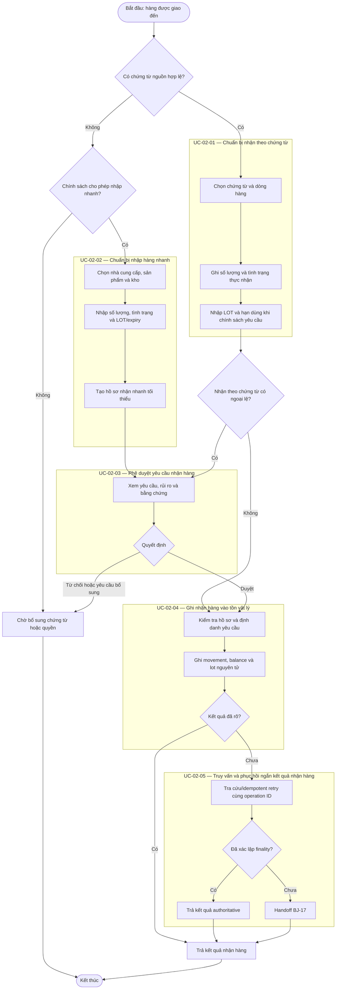

# BJ-02 — Nhận hàng mua

> **Trạng thái:** Release đã đóng băng `4.1.0` — đã remap ID và boundary  
> **Chuyển đổi chính thức:** Theme 7 `4.0.0/BJ-02` → `4.1.0/BJ-02`  
> **Finality contract:** `COMPLETED`, `REJECTED/CANCELLED`, `SUSPENDED/BLOCKED`, `UNKNOWN/ESCALATED`
> **Phạm vi:** Phase 1 — nhận theo chứng từ nguồn hoặc nhập hàng nhanh được phép  
> **Chủ sở hữu nghiệp vụ:** Inventory Operations
> **Quyết định nghiệp vụ:** `T7-BASELINE-FREEZE-v4.0.0` + `T7-DR-003`, `T7-DR-020`, `T7-DR-022`, `T7-DR-024`, `T7-DR-027`, `T7-DR-071`, `T7-DR-072`, `T7-DR-074`

# 1. Mục tiêu và ranh giới

## 1.1 Mục tiêu

Ghi đúng **hàng thực tế đã đến và thuộc quyền sở hữu của đơn vị**, bao gồm sản phẩm, số lượng, đơn vị tính, lô/hạn dùng khi áp dụng và tình trạng thực nhận. Nhập hàng nhanh là lối vào song song, không đi vòng qua nhận theo chứng từ.

## 1.2 Điểm bắt đầu và kết thúc

| Thuộc tính | Nội dung |
|---|---|
| Bắt đầu | Hàng mua thực tế được giao đến |
| Kết thúc | Kết quả ghi nhận tồn vật lý đã rõ; hoặc hồ sơ dừng/chờ bổ sung mà không tạo tác động bán phần |
| Tác động chính | Tăng tồn vật lý theo đúng trạng thái thực nhận; tạo movement và bằng chứng nguồn |
| Không quyết định | Giá trị nhập chính thức, công nợ nhà cung cấp, payment hoặc quyền lợi thương mại |

## 1.3 Trong và ngoài ranh giới

| Trong ranh giới | Ngoài ranh giới |
|---|---|
| Nhận theo nguồn; nhập nhanh; nhận từng phần; chênh lệch giao nhận; LOT/expiry; tình trạng sellable/quarantine/damaged; duyệt vượt ngưỡng; duyệt bắt buộc cho nhập nhanh; truy vấn/idempotent retry ngắn hạn | Sở hữu PO/Purchase Planning; xác nhận invoice; tính công nợ; chuyển kho; hàng ký gửi |
| Ghi nhận hàng thuộc quyền sở hữu | Nhập hàng giữ hộ hoặc chưa có ownership assertion |

**Phụ thuộc bên ngoài:** PO/Receipt Intent và Supplier Return commercial intent thuộc capability mua hàng. Nếu capability đó chưa tồn tại, BJ chỉ tích hợp qua source contract; không tự biến Theme 7 thành module mua hàng.

# 2. Sơ đồ hành trình

# 3. Trường hợp sử dụng

| UC | Tên | Bắt đầu | Kết thúc | Kết quả |
|---|---|---|---|---|
| [UC-02-01](../../../../../../../02.specification/behavior/use-cases/UC-02-01-chuan-bi-nhan-theo-chung-tu.md) | Chuẩn bị nhận theo chứng từ | Chứng từ nguồn hợp lệ được chọn | Hồ sơ thực nhận sẵn sàng hoặc cần duyệt | Receipt draft gắn source/version |
| [UC-02-02](../../../../../../../02.specification/behavior/use-cases/UC-02-02-chuan-bi-nhap-hang-nhanh.md) | Chuẩn bị nhập hàng nhanh | Không có chứng từ mua và chính sách cho phép lập hồ sơ nhanh | Hồ sơ đủ dữ kiện được chuyển bắt buộc sang Chờ phê duyệt | Hồ sơ nhận nhanh có nguồn/bằng chứng tối thiểu; không tạo PO giả và chưa tạo movement |
| [UC-02-03](../../../../../../../02.specification/behavior/use-cases/UC-02-03-phe-duyet-yeu-cau-nhan-hang.md) | Phê duyệt yêu cầu nhận hàng | Nhập nhanh đã gửi hoặc nhận theo chứng từ có ngoại lệ | Duyệt, từ chối hoặc yêu cầu bổ sung | Quyết định có bằng chứng; chỉ nhánh duyệt mới được ghi tồn vật lý |
| [UC-02-04](../../../../../../../02.specification/behavior/use-cases/UC-02-04-ghi-nhan-hang-vao-ton-vat-ly.md) | Ghi nhận hàng vào tồn vật lý | Hồ sơ hợp lệ và đủ thẩm quyền | COMMITTED, REJECTED hoặc UNKNOWN | Movement/balance/lot và result |
| [UC-02-05](../../../../../../../02.specification/behavior/use-cases/UC-02-05-truy-van-va-phuc-hoi-ngan-ket-qua-nhan-hang.md) | Truy vấn và phục hồi ngắn kết quả nhận hàng | Operation có kết quả UNKNOWN | Trả committed/rejected; hoặc handoff BJ-17 nếu chưa đủ finality | Kết quả authoritative hoặc recovery handoff |

# 4. Logic nghiệp vụ cần giữ

| Điểm kiểm soát | Quy tắc |
|---|---|
| Nhận vượt nguồn | Đánh giá theo từng source line trên lượng đạt lũy kế ở base UOM; ngưỡng % và số lượng tuyệt đối do ApprovalPolicy quy định |
| Hàng từ chối | Không tạo movement; vẫn lưu discrepancy/evidence |
| Tình trạng ngay khi nhận | Hàng cách ly/hỏng vẫn tăng tồn vật lý vào đúng trạng thái; không được mặc định chuyển thành sellable |
| LOT/expiry | NONE không hỏi hạn dùng; LOT mới mở yêu cầu hạn dùng theo product policy |
| Nhận từng phần | Cho phép nhiều receipt cùng tham chiếu source line nhưng tổng lượng được kiểm bằng concurrency guard |
| Nguyên tử | Movement, balance, lot, result và outbox cùng commit hoặc không có gì commit |
| Nhập nhanh | Chỉ giảm bước chọn chứng từ mua; không bỏ kiểm tra nguồn/quyền sở hữu, quyền, sản phẩm, LOT/expiry, tình trạng hoặc idempotency; mọi hồ sơ đủ điều kiện gửi đều vào `PENDING_APPROVAL`, không đi thẳng `READY` |

# 5. Quan hệ và bàn giao

- Bàn giao sang BJ-03 để xác nhận giá trị hàng nhận.
- Hàng có thể đã có giá trị nhưng vẫn không bán được nếu đang quarantine/damaged/expired.
- Commercial purchase ownership và công nợ nằm ngoài Theme 7.
- Khi result UNKNOWN, không được tạo receipt mới; UC-02-05 chỉ truy vấn/idempotent retry ngắn hạn bằng cùng operation identity. Nếu chưa xác lập được finality, phải handoff BJ-17.

# 6. Nguồn tri thức liên quan

- [Nhận hàng mua và xử lý chênh lệch giao nhận](../../../../../../../01.knowledge/know-how/KB-KGV-007-nhan-hang-mua-va-xu-ly-chenh-lech-giao-nhan.md)
- [Hàng đã nhận nhưng chưa chốt giá](../../../../../../../01.knowledge/know-how/KB-KGV-008-hang-da-nhan-nhung-chua-chot-gia.md)
- [Chính sách NONE, LOT hoặc SERIAL](../../../../../../../01.knowledge/know-how/KB-KGV-024-chinh-sach-quan-ly-hang-thong-thuong-theo-lo-hoac-theo-serial.md)
- [Danh tính và vòng đời của một lô hàng](../../../../../../../01.knowledge/know-how/KB-KGV-025-danh-tinh-va-vong-doi-cua-mot-lo-hang.md)
- [Tính nguyên tử khi ghi tồn kho và phát sự kiện](../../../../../../../01.knowledge/know-how/KB-KGV-029-tinh-nguyen-tu-khi-ghi-ton-kho-va-phat-su-kien.md)
- [Phê duyệt inventory operation theo mức rủi ro](../../../../../../../01.knowledge/know-how/KB-KGV-031-phe-duyet-inventory-operation-theo-muc-rui-ro.md)
