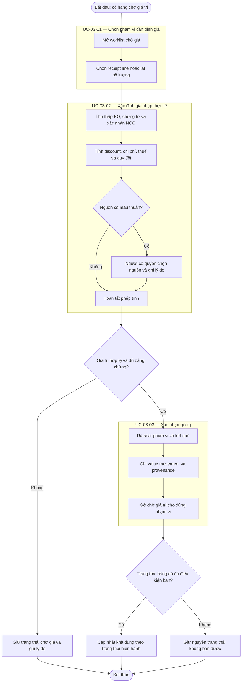

# BJ-03 — Xác nhận giá trị ban đầu của hàng nhận

> **Trạng thái:** Release đã đóng băng `4.1.0` — đã remap ID và boundary  
> **Chuyển đổi chính thức:** Theme 7 `4.0.0/BJ-03` → `4.1.0/BJ-03`  
> **Finality contract:** `COMPLETED`, `REJECTED/CANCELLED`, `SUSPENDED/BLOCKED`, `UNKNOWN/ESCALATED`
> **Phạm vi:** Phase 1 — xác nhận giá trị theo dòng hoặc lát số lượng được định danh  
> **Chủ sở hữu nghiệp vụ:** Inventory Valuation
> **Quyết định nghiệp vụ:** `T7-BASELINE-FREEZE-v4.0.0` + `T7-DR-021`, `T7-DR-025`, `T7-DR-026`

# 1. Mục tiêu và ranh giới

## 1.1 Mục tiêu

Xác lập **giá nhập thực tế và giá trị tồn kho ban đầu** cho hàng đã nhận quyền sở hữu. Việc xác nhận giá trị độc lập với việc hàng có đủ điều kiện bán hay không.

## 1.2 Điểm bắt đầu và kết thúc

| Thuộc tính | Nội dung |
|---|---|
| Bắt đầu | Có lượng hàng đã nhận đang chờ xác nhận giá trị hoặc có thêm bằng chứng chi phí |
| Kết thúc | Dòng/lát số lượng đã được định giá; hoặc vẫn chờ giá với lý do rõ ràng |
| Tác động chính | Value movement và provenance của giá nhập |
| Không quyết định | Giá bán, promotion, công nợ, hay việc quarantine/damaged có trở thành sellable |

## 1.3 Trong và ngoài ranh giới

| Trong ranh giới | Ngoài ranh giới |
|---|---|
| Worklist chờ giá; chọn bằng chứng; tính giá nhập thực tế; phân bổ discount/chi phí; xác nhận từng dòng; xử lý xung đột nguồn | Phê duyệt invoice, thanh toán NCC, pricing, promotion |
| Gỡ cờ chờ giá trị cho đúng lượng đã xác nhận | Tự chuyển hàng quarantine/damaged/expired thành sellable |

# 2. Sơ đồ hành trình

# 3. Trường hợp sử dụng

| UC | Tên | Bắt đầu | Kết thúc | Kết quả |
|---|---|---|---|---|
| [UC-03-01](../../../../../../../02.specification/behavior/use-cases/UC-03-01-chon-pham-vi-can-dinh-gia.md) | Chọn phạm vi cần định giá | Worklist có hàng chờ giá | Receipt line/lát số lượng được khóa chọn | Valuation scope |
| [UC-03-02](../../../../../../../02.specification/behavior/use-cases/UC-03-02-xac-dinh-gia-nhap-thuc-te.md) | Xác định giá nhập thực tế | Có scope và bằng chứng | Có phép tính hợp lệ hoặc danh sách thiếu/xung đột | Cost calculation draft có provenance |
| [UC-03-03](../../../../../../../02.specification/behavior/use-cases/UC-03-03-xac-nhan-gia-tri.md) | Xác nhận giá trị | Phép tính hợp lệ được rà soát | Value movement được commit và scope hết chờ giá | Confirmed receipt valuation |

# 4. Logic nghiệp vụ cần giữ

| Điểm kiểm soát | Quy tắc |
|---|---|
| Nguồn giá | Hệ thống không âm thầm chọn khi PO/chứng từ/NCC mâu thuẫn; người có quyền phải chọn nguồn và ghi lý do |
| Giá nhập thực tế | Bao gồm giá sau discount dòng, phân bổ discount cấp phiếu, chi phí mua phân bổ, thuế không được khấu trừ; loại VAT được khấu trừ |
| Hàng tặng | Phân bổ quyền lợi theo chính sách đã phê duyệt; không mặc định giá 0 nếu làm sai tổng giá trị |
| Ngoại tệ | Dùng tỷ giá được nguồn kế toán phê duyệt và lưu provenance |
| Làm tròn | Làm tròn theo tiền tệ; phần dư được phân bổ xác định, không làm lệch tổng chứng từ |
| Xác nhận từng phần | Cho phép theo dòng hoặc lát số lượng định danh; phần còn lại tiếp tục chờ giá |
| Giá trị và sellability | Xác nhận giá trị không thay đổi quarantine/damaged/expired; khả dụng chỉ tăng khi trạng thái hiện hành đủ điều kiện |

# 5. Quan hệ và bàn giao

- Nhận đầu vào từ BJ-02.
- Cung cấp value facts cho BJ-14.
- Nếu bằng chứng chi phí mua đến sau, dùng BJ-13 để ghi nhận và bàn giao scope cho cost run kế nhiệm; không sửa movement nhận hàng gốc.
- Việc chuyển trạng thái hàng thuộc BJ-09, không thuộc BJ này.

# 6. Nguồn tri thức liên quan

- [Hàng đã nhận nhưng chưa chốt giá](../../../../../../../01.knowledge/know-how/KB-KGV-008-hang-da-nhan-nhung-chua-chot-gia.md)
- [Đơn giá tồn kho chính thức và tổng giá trị ghi sổ](../../../../../../../01.knowledge/know-how/KB-KGV-015-don-gia-ton-kho-chinh-thuc-va-tong-gia-tri-ghi-so.md)
- [Các thành phần hình thành giá nhập thực tế](../../../../../../../01.knowledge/know-how/KB-KGV-019-cac-thanh-phan-hinh-thanh-gia-nhap-thuc-te.md)
