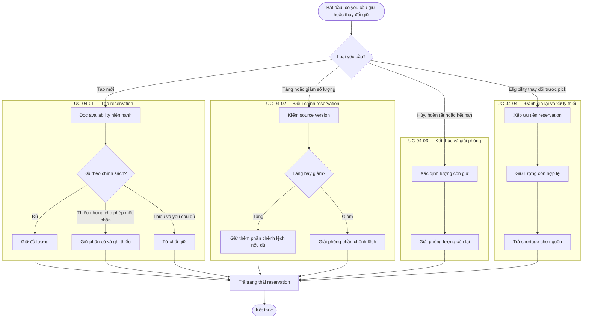

# BJ-04 — Quản lý vòng đời giữ hàng

> **Trạng thái:** Release đã đóng băng `4.1.0` — đã remap ID và boundary  
> **Chuyển đổi chính thức:** Theme 7 `4.0.0/BJ-04` → `4.1.0/BJ-04`  
> **Finality contract:** `COMPLETED`, `REJECTED/CANCELLED`, `SUSPENDED/BLOCKED`, `UNKNOWN/ESCALATED`
> **Phạm vi:** Phase 1 — giữ hàng trong một kho mặc định, chưa chọn lô khi reserve  
> **Chủ sở hữu nghiệp vụ:** Inventory Operations
> **Quyết định nghiệp vụ:** `T7-BASELINE-FREEZE-v4.0.0` + `T7-DR-029`, `T7-DR-031`, `T7-DR-032`, `T7-DR-033`

# 1. Mục tiêu và ranh giới

## 1.1 Mục tiêu

Bảo đảm lượng hàng cho đơn sỉ/online đã xác nhận, đồng thời quản lý đầy đủ việc tăng, giảm, hết hạn, giải phóng, đánh giá lại và thông báo thiếu hàng mà không làm thay đổi tồn vật lý.

## 1.2 Điểm bắt đầu và kết thúc

| Thuộc tính | Nội dung |
|---|---|
| Bắt đầu | Nguồn bán hàng yêu cầu tạo hoặc thay đổi cam kết giữ hàng |
| Kết thúc | Reservation đạt trạng thái và số lượng authoritative mới; phần thiếu được trả rõ cho nguồn |
| Tác động chính | Reserved balance và available balance |
| Không làm thay đổi | Physical quantity, lot allocation hoặc quantity movement |

## 1.3 Trong và ngoài ranh giới

| Trong ranh giới | Ngoài ranh giới |
|---|---|
| Tạo, tăng, giảm, hết hạn, release; giữ toàn phần/một phần; đánh giá lại trước pick; shortage | Chọn lô, pick, handover, tìm kho khác, tạo purchase proposal |
| Priority khi lượng đủ điều kiện giảm | Reallocate PickAllocation đã hình thành; nội dung này thuộc BJ-05 |

# 2. Sơ đồ hành trình

# 3. Trường hợp sử dụng

| UC | Tên | Bắt đầu | Kết thúc | Kết quả |
|---|---|---|---|---|
| [UC-04-01](../../../../../../../02.specification/behavior/use-cases/UC-04-01-tao-reservation.md) | Tạo reservation | Order/source version yêu cầu giữ | Giữ đủ, giữ một phần hoặc từ chối | Reservation version đầu tiên |
| [UC-04-02](../../../../../../../02.specification/behavior/use-cases/UC-04-02-dieu-chinh-reservation.md) | Điều chỉnh reservation | Số lượng nguồn tăng hoặc giảm | Delta được giữ/giải phóng hoặc thiếu được trả | Reservation version mới |
| [UC-04-03](../../../../../../../02.specification/behavior/use-cases/UC-04-03-ket-thuc-va-giai-phong.md) | Kết thúc và giải phóng | Đơn hủy, hoàn tất, hết hạn hoặc nguồn yêu cầu release | Lượng giữ còn lại được giải phóng | Reservation closed/released |
| [UC-04-04](../../../../../../../02.specification/behavior/use-cases/UC-04-04-danh-gia-lai-va-xu-ly-thieu.md) | Đánh giá lại và xử lý thiếu | Eligibility giảm trước pick | Lượng còn giữ được xác lập và shortage được phát | Re-evaluation result |

# 4. Logic nghiệp vụ cần giữ

| Điểm kiểm soát | Quy tắc |
|---|---|
| Đơn tăng số lượng | Chỉ reserve delta tăng; phần đã giữ không bị tạo lại |
| Đơn giảm số lượng | Release delta giảm; không tạo movement |
| Giữ một phần | Phase 1 không tự top-up khi hàng mới về; nguồn phải gửi yêu cầu reevaluate hoặc amend có version |
| Không có expires_at | Reservation tồn tại theo lifecycle nguồn cho đến complete/cancel/release; không tự đặt TTL ngầm |
| Priority khi thiếu | Ưu tiên do nguồn cam kết cung cấp; nếu thiếu thì dùng thời điểm xác nhận sớm hơn, sau đó stable ID để phá hòa |
| Concurrency | Create/amend/release cùng source line phải tuần tự theo source version |
| Combo | Chỉ giữ số nguyên combo khi đủ mọi component; không giữ mảnh tạo thành combo không hoàn chỉnh |

# 5. Quan hệ và bàn giao

- Nhận availability từ BJ-01.
- Bàn giao reservation hiện hành cho BJ-05.
- Nếu allocation sau pick trở nên stale, BJ-05 xử lý; BJ này không sửa PickAllocation.
- Nguồn bán hàng quyết định tiếp tục, giảm đơn hoặc hủy phần thiếu.

# 6. Nguồn tri thức liên quan

- [Giữ hàng và xử lý đơn không đủ tồn khả dụng](../../../../../../../01.knowledge/know-how/KB-KGV-009-giu-hang-va-xu-ly-don-khong-du-ton-kha-dung.md)
- [Chọn hàng để xuất và thời điểm hoàn tất xuất bán](../../../../../../../01.knowledge/know-how/KB-KGV-010-chon-hang-de-xuat-va-thoi-diem-hoan-tat-xuat-ban.md)
- [Combo bán hàng và tồn kho theo thành phần](../../../../../../../01.knowledge/know-how/KB-KGV-035-combo-ban-hang-va-ton-kho-theo-thanh-phan.md)
