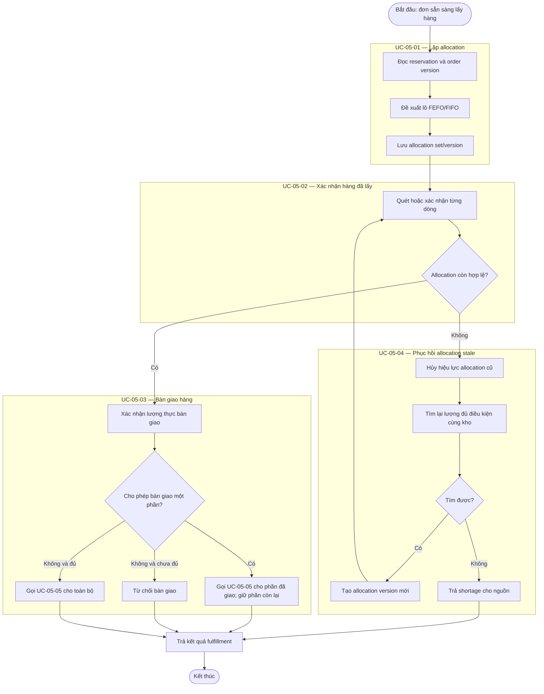

> **UX/state amendment v1.3.7:** Queue mặc định `Tất cả`; dữ liệu pick scope theo đúng Order/Fulfillment; override/stale sau khi đã pick phải invalidate physical pick cũ và yêu cầu repick; handover chỉ render picked allocations, có summary actual/remaining; result không Back về commit screen và phải mutate remaining task state theo actual handover.

# BJ-05 — Lấy hàng và bàn giao đơn

> **Trạng thái:** Release đã đóng băng `4.1.0` — đã remap ID và boundary  
> **Chuyển đổi chính thức:** Theme 7 `4.0.0/BJ-06` → `4.1.0/BJ-05`  
> **Finality contract:** `COMPLETED`, `REJECTED/CANCELLED`, `SUSPENDED/BLOCKED`, `UNKNOWN/ESCALATED`
> **Phạm vi:** Phase 1 — fulfillment trong một kho mặc định  
> **Chủ sở hữu nghiệp vụ:** Inventory Operations  
> **Source intent owner:** Sales/Fulfillment
> **Quyết định nghiệp vụ:** `T7-BASELINE-FREEZE-v4.0.0` + `T7-DR-030`, `T7-DR-031`, `T7-DR-032`, `T7-DR-070`, `T7-DR-071`

# 1. Mục tiêu và ranh giới

## 1.1 Mục tiêu

Giúp nhân viên chọn đúng sản phẩm/lô, theo dõi allocation có phiên bản và chỉ giảm tồn vật lý khi hàng thực sự được bàn giao cho khách hoặc đơn vị vận chuyển.

## 1.2 Điểm bắt đầu và kết thúc

| Thuộc tính | Nội dung |
|---|---|
| Bắt đầu | Có đơn/reservation sẵn sàng để lấy hàng |
| Kết thúc | Hàng được bàn giao toàn phần/một phần; hoặc shortage được trả về nguồn mà không xuất sai |
| Tác động chính | PickAllocation, reservation consumption, issue movement và COGS snapshot |
| Không quyết định | Commercial delivery promise, vận chuyển hoặc thu tiền |

## 1.3 Trong và ngoài ranh giới

| Trong ranh giới | Ngoài ranh giới |
|---|---|
| Allocation version; FEFO/FIFO; pick; partial handover; stale recovery; shortage | Chọn kho khác; tối ưu tuyến giao; payment; hủy thương mại |
| Xử lý allocation sau pick | Reservation trước pick thuộc BJ-04 |

# 2. Sơ đồ hành trình

# 3. Trường hợp sử dụng

| UC | Tên | Bắt đầu | Kết thúc | Kết quả |
|---|---|---|---|---|
| [UC-05-01](../../../../../../../02.specification/behavior/use-cases/UC-05-01-lap-allocation.md) | Lập allocation | Đơn/reservation sẵn sàng | Một allocation version active được tạo | Stable allocation set |
| [UC-05-02](../../../../../../../02.specification/behavior/use-cases/UC-05-02-xac-nhan-hang-da-lay.md) | Xác nhận hàng đã lấy | Có allocation active | Dòng pick được xác nhận hoặc stale được phát hiện | Pick evidence |
| [UC-05-03](../../../../../../../02.specification/behavior/use-cases/UC-05-03-ban-giao-hang.md) | Bàn giao hàng | Hàng đã pick và allocation hợp lệ | Xuất toàn phần/một phần hoặc bị từ chối | Handover issue result |
| [UC-05-04](../../../../../../../02.specification/behavior/use-cases/UC-05-04-phuc-hoi-allocation-stale.md) | Phục hồi allocation stale | Allocation/order/lot không còn hợp lệ | Allocation mới hoặc shortage | Recovery result |
| [UC-05-05](../../../../../../../02.specification/behavior/use-cases/UC-05-05-ghi-xuat-kho-nguyen-tu.md) | Ghi xuất kho nguyên tử | Có handover assertion và allocation hợp lệ | Consume allocation/reservation và ghi movement/cost snapshot | Inventory issue result dùng chung |

# 4. Logic nghiệp vụ cần giữ

| Điểm kiểm soát | Quy tắc |
|---|---|
| Allocation version | Chỉ một version active; handover phải mang đúng active version |
| Pick | Pick không giảm physical quantity |
| Partial handover | Consume đúng lượng đã giao; reservation còn lại giảm tương ứng và vẫn active nếu source cho phép |
| Không cho partial | Chưa đủ lượng thì toàn bộ handover bị từ chối, không commit bán phần |
| Stale recovery | Reallocate trong cùng kho; không tìm kho khác và không âm thầm đổi order |
| Lô thay thế | Phải còn eligible; override FEFO/FIFO cần quyền và lý do |
| Handover lặp | Cùng source handover/version không được ghi issue lần hai |

# 5. Quan hệ và bàn giao

- Nhận reservation từ BJ-04.
- Nếu không thể reallocate, trả shortage cho Sales để quyết định giảm/hủy/chờ.
- Cung cấp issue movement và cost snapshot cho BJ-14 và BJ-15.
- Hủy thương mại sau bàn giao phải đi qua BJ-06 khi hàng thực quay về; chỉ sai sót operation mới dùng BJ-11. Không tự cộng tồn trở lại.

# 6. Nguồn tri thức liên quan

- [Giữ hàng và xử lý đơn không đủ tồn khả dụng](../../../../../../../01.knowledge/know-how/KB-KGV-009-giu-hang-va-xu-ly-don-khong-du-ton-kha-dung.md)
- [Chọn hàng để xuất và thời điểm hoàn tất xuất bán](../../../../../../../01.knowledge/know-how/KB-KGV-010-chon-hang-de-xuat-va-thoi-diem-hoan-tat-xuat-ban.md)
- [Danh tính và vòng đời của một lô hàng](../../../../../../../01.knowledge/know-how/KB-KGV-025-danh-tinh-va-vong-doi-cua-mot-lo-hang.md)
