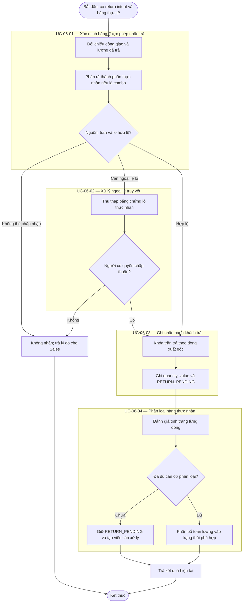

# BJ-06 — Tiếp nhận và phân loại hàng khách trả

> **Trạng thái:** Release đã đóng băng `4.1.0` — đã remap ID và boundary  
> **Chuyển đổi chính thức:** Theme 7 `4.0.0/BJ-07` → `4.1.0/BJ-06`  
> **Finality contract:** `COMPLETED`, `REJECTED/CANCELLED`, `SUSPENDED/BLOCKED`, `UNKNOWN/ESCALATED`
> **Phạm vi:** Phase 1 — nhận hàng thực tế theo return intent hợp lệ, chưa quản lý serial  
> **Chủ sở hữu nghiệp vụ:** Inventory Operations  
> **Source intent owner:** Sales/Returns
> **Quyết định nghiệp vụ:** `T7-BASELINE-FREEZE-v4.0.0` + `T7-DR-040`, `T7-DR-041`, `T7-DR-043`, `T7-DR-044`, `T7-DR-045`, `T7-DR-048`

# 1. Mục tiêu và ranh giới

## 1.1 Mục tiêu

Ghi đúng **hàng thực tế quay về từ khách**, liên kết được với lần giao gốc, không nhận vượt trần và không đưa hàng trở lại bán trước khi phân loại. Việc nhận vật lý và việc phân loại là hai mốc khác nhau trong cùng hành trình.

## 1.2 Điểm bắt đầu và kết thúc

| Thuộc tính | Nội dung |
|---|---|
| Bắt đầu | Có return intent hợp lệ và hàng thực tế được khách giao lại |
| Kết thúc | Hàng thực nhận đã được ghi vào `RETURN_PENDING` và được phân loại; hoặc vẫn chờ phân loại/ngoại lệ với tác động đã được nói rõ; hoặc không nhận hàng |
| Tác động chính | Quantity/value movement khi nhận; state movement khi phân loại; cập nhật cumulative returned quantity |
| Không quyết định | Khách có được đổi/trả về mặt thương mại, số tiền hoàn, phương thức hoàn tiền hoặc cách xử lý combo ở cấp đơn bán |

## 1.3 Trong và ngoài ranh giới

| Trong ranh giới | Ngoài ranh giới |
|---|---|
| Đối chiếu dòng giao gốc; kiểm trần trả; nhận từng sản phẩm/thành phần combo thực tế; đối chiếu lô; ghi `RETURN_PENDING`; phân loại sellable/quarantine/damaged/expired | Phê duyệt chính sách đổi trả; refund; đổi sản phẩm; sửa đơn bán; tạo tồn combo |
| Ghi giá trị hàng trả theo căn cứ kỳ xuất gốc và giữ provenance | Chạy lại hoặc sửa COGS của dòng xuất gốc |

**Phụ thuộc bên ngoài:** Theme 5 sở hữu commercial return intent và quyết định combo/partial return. Theme 7 chỉ thực hiện inventory effect trên đúng hàng thực nhận.

# 2. Sơ đồ hành trình

# 3. Trường hợp sử dụng

| UC | Tên | Bắt đầu | Kết thúc | Kết quả |
|---|---|---|---|---|
| [UC-06-01](../../../../../../../02.specification/behavior/use-cases/UC-06-01-xac-minh-hang-duoc-phep-nhan-tra.md) | Xác minh hàng được phép nhận trả | Có return intent và hàng vật lý | Hàng đủ điều kiện nhận, cần ngoại lệ hoặc bị từ chối | Return validation result |
| [UC-06-02](../../../../../../../02.specification/behavior/use-cases/UC-06-02-xu-ly-ngoai-le-truy-vet.md) | Xử lý ngoại lệ truy vết | Lô thực nhận không khớp lô đã xuất | Ngoại lệ được chấp thuận hoặc từ chối có bằng chứng | Trace exception decision |
| [UC-06-03](../../../../../../../02.specification/behavior/use-cases/UC-06-03-ghi-nhan-hang-khach-tra.md) | Ghi nhận hàng khách trả | Các dòng thực nhận đã hợp lệ | Toàn yêu cầu được commit vào `RETURN_PENDING` hoặc không có gì commit | Return receipt có quantity/value provenance |
| [UC-06-04](../../../../../../../02.specification/behavior/use-cases/UC-06-04-phan-loai-hang-thuc-nhan.md) | Phân loại hàng thực nhận | Có lượng `RETURN_PENDING` | Toàn lượng được phân loại hoặc giữ pending với việc cần xử lý | Classification result |

# 4. Logic nghiệp vụ cần giữ

| Điểm kiểm soát | Quy tắc |
|---|---|
| Trần trả | Tổng lượng đã nhận trả không vượt lượng giao thực tế sau các lần trả trước; kiểm tra và cộng dồn nguyên tử trên dòng xuất gốc |
| Combo | Chỉ thành phần thực nhận tăng tồn; không tạo tồn combo; các dòng trong cùng yêu cầu nhận trả commit hoặc rollback cùng nhau |
| Lô | Sản phẩm LOT phải đối chiếu lô đã xuất; sai lô cần bằng chứng và quyết định ngoại lệ, không tự hợp thức hóa |
| Mốc ghi giá trị | Ghi value movement cùng lúc nhận vật lý vào `RETURN_PENDING`; phân loại không ghi giá trị lần hai |
| Căn cứ giá | Dùng giá đã đối soát của sản phẩm và kỳ xuất gốc; nếu kỳ gốc chưa đối soát thì dùng snapshot tại lần xuất và giữ liên kết để điều chỉnh theo policy |
| Phân loại | Tổng lượng phân loại phải bằng lượng pending; chỉ phần sellable và còn đủ điều kiện mới tăng khả dụng |
| Hàng hết hạn | Không được phân loại trở lại sellable |

# 5. Quan hệ và bàn giao

- Nhận commercial return intent, source version và quyết định hoàn tiền từ Theme 5 nhưng không sở hữu các quyết định đó.
- Phần sellable sau phân loại bàn giao cho BJ-01; phần quarantine/damaged/expired bàn giao cho BJ-09 và có thể tiếp tục sang BJ-10.
- Nếu phát hiện sai operation sau khi hoàn tất, dùng BJ-11; không sửa return receipt hoặc movement gốc.
- Giá trị hàng trả được đưa vào BJ-14 để đối soát theo kỳ nguồn.

# 6. Nguồn tri thức liên quan

- [Hàng khách trả: từ tiếp nhận đến phân loại](../../../../../../../01.knowledge/know-how/KB-KGV-012-hang-khach-tra-tu-tiep-nhan-den-phan-loai.md)
- [Danh tính và vòng đời của một lô hàng](../../../../../../../01.knowledge/know-how/KB-KGV-025-danh-tinh-va-vong-doi-cua-mot-lo-hang.md)
- [Combo bán hàng và tồn kho theo thành phần](../../../../../../../01.knowledge/know-how/KB-KGV-035-combo-ban-hang-va-ton-kho-theo-thanh-phan.md)
- [Định giá hàng trả, tiêu hủy và chênh lệch thừa thiếu](../../../../../../../01.knowledge/know-how/KB-KGV-020-dinh-gia-hang-tra-tieu-huy-va-chenh-lech-thua-thieu.md)
