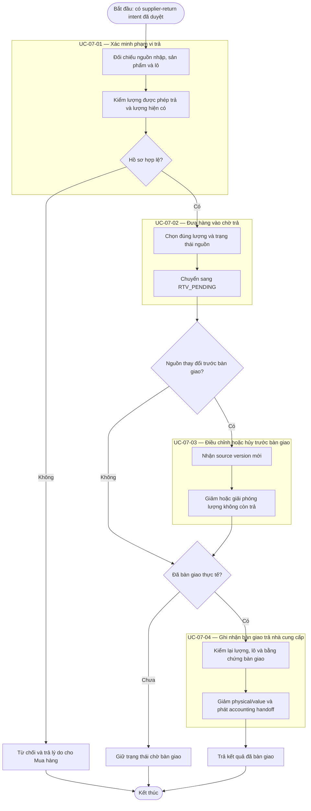

# BJ-07 — Thực hiện trả hàng cho nhà cung cấp

> **Trạng thái:** Release đã đóng băng `4.1.0` — đã remap ID và boundary  
> **Chuyển đổi chính thức:** Theme 7 `4.0.0/BJ-08` → `4.1.0/BJ-07`  
> **Finality contract:** `COMPLETED`, `REJECTED/CANCELLED`, `SUSPENDED/BLOCKED`, `UNKNOWN/ESCALATED`
> **Phạm vi:** Phase 1 — trả từ một kho mặc định theo supplier-return intent được chấp thuận  
> **Chủ sở hữu nghiệp vụ:** Inventory Operations  
> **Source intent owner:** Theme 10 — Mua hàng / Supplier Returns
> **Quyết định nghiệp vụ:** `T7-BASELINE-FREEZE-v4.0.0` + `T7-DR-042`, `T7-DR-054`

# 1. Mục tiêu và ranh giới

## 1.1 Mục tiêu

Loại hàng đã được chấp thuận trả khỏi khả dụng và chỉ giảm **tồn vật lý, giá trị tồn kho** khi hàng thực sự được bàn giao cho nhà cung cấp hoặc đơn vị vận chuyển.

## 1.2 Điểm bắt đầu và kết thúc

| Thuộc tính | Nội dung |
|---|---|
| Bắt đầu | Capability Mua hàng gửi supplier-return intent đã đủ nguồn, phiên bản và thẩm quyền |
| Kết thúc | Yêu cầu đang chờ bàn giao, đã được điều chỉnh/hủy trước bàn giao, đã bàn giao thành công, hoặc bị từ chối mà không tạo tác động bán phần |
| Tác động chính | Chuyển sang `RTV_PENDING`; khi bàn giao thì giảm physical/value và phát accounting handoff |
| Không quyết định | Nhà cung cấp có chấp thuận thương mại hay không, giảm công nợ bao nhiêu hoặc hạch toán chênh lệch thế nào |

## 1.3 Trong và ngoài ranh giới

| Trong ranh giới | Ngoài ranh giới |
|---|---|
| Kiểm source/lượng/lô; đưa hàng vào chờ trả; giảm hoặc hủy lượng chờ trả trước bàn giao; ghi nhận bàn giao | Tạo purchase-return commercial intent; thương lượng giá trả; debit note; giảm công nợ |
| Giảm tồn theo lô và giá trị theo official cost tại lúc bàn giao | Chuyển kho; mô phỏng trả NCC bằng adjustment |

**Phụ thuộc bên ngoài:** Capability Mua hàng sở hữu lý do thương mại, supplier approval và lượng được phép trả. Theme Kế toán sở hữu tác động công nợ và hạch toán chênh lệch.

# 2. Sơ đồ hành trình

# 3. Trường hợp sử dụng

| UC | Tên | Bắt đầu | Kết thúc | Kết quả |
|---|---|---|---|---|
| [UC-07-01](../../../../../../../02.specification/behavior/use-cases/UC-07-01-xac-minh-pham-vi-tra.md) | Xác minh phạm vi trả | Có supplier-return intent được duyệt | Hồ sơ hợp lệ hoặc bị từ chối | Validated return scope |
| [UC-07-02](../../../../../../../02.specification/behavior/use-cases/UC-07-02-dua-hang-vao-cho-tra.md) | Đưa hàng vào chờ trả | Có scope hợp lệ | Lượng được chuyển sang `RTV_PENDING` và loại khỏi khả dụng | Pending supplier return |
| [UC-07-03](../../../../../../../02.specification/behavior/use-cases/UC-07-03-dieu-chinh-hoac-huy-truoc-ban-giao.md) | Điều chỉnh hoặc hủy trước bàn giao | Source giảm lượng hoặc hủy khi chưa bàn giao | Lượng pending được cập nhật, phần bỏ trả quay về trạng thái nguồn hợp lệ | Amended/cancelled pending return |
| [UC-07-04](../../../../../../../02.specification/behavior/use-cases/UC-07-04-ghi-nhan-ban-giao-tra-nha-cung-cap.md) | Ghi nhận bàn giao trả nhà cung cấp | Có handover assertion và lượng pending hợp lệ | Tồn vật lý/giá trị giảm hoặc toàn operation bị từ chối | Supplier return issue result |

# 4. Logic nghiệp vụ cần giữ

| Điểm kiểm soát | Quy tắc |
|---|---|
| Giới hạn lượng | Lượng trả không vượt đồng thời lượng còn được source cho phép và lượng tenant thực có theo đúng sản phẩm/lô |
| Nguồn nhập | Giữ liên kết đến receipt/source nhập gốc khi nguồn cung cấp; không tự tạo quan hệ thương mại mới |
| Mốc loại khỏi khả dụng | Khi supplier return đã được chấp thuận và lượng chuyển `RTV_PENDING` |
| Mốc giảm vật lý | Chỉ khi có bằng chứng bàn giao thực tế; tạo hồ sơ chờ trả không giảm physical |
| Sửa trước bàn giao | Không sửa trực tiếp payload đã khóa; source version mới tạo thay đổi có truy vết và chỉ giải phóng phần chưa bàn giao |
| Giá trị | Giảm theo official cost có hiệu lực; giá nhà cung cấp chấp thuận và chênh lệch chỉ là accounting handoff |
| Công nợ | Chỉ Theme Kế toán được giảm công nợ hoặc hạch toán chênh lệch |

# 5. Quan hệ và bàn giao

- Nhận commercial intent từ Purchase/Supplier Returns và trả kết quả bàn giao về capability đó.
- Có thể nhận hàng quarantine/damaged/expired từ BJ-09 nhưng phải chuyển qua `RTV_PENDING` bằng operation có nguồn.
- Nếu hàng thực tế bị tiêu hủy thay vì trả, dùng BJ-10; hai hành trình không thay thế lẫn nhau.
- Accounting handoff được chuyển sang Theme Kế toán; Theme 7 không suy ra khoản phải trả mới.

# 6. Nguồn tri thức liên quan

- [Trả hàng cho nhà cung cấp](../../../../../../../01.knowledge/know-how/KB-KGV-013-tra-hang-cho-nha-cung-cap.md)
- [Chọn hàng để xuất và thời điểm hoàn tất xuất bán](../../../../../../../01.knowledge/know-how/KB-KGV-010-chon-hang-de-xuat-va-thoi-diem-hoan-tat-xuat-ban.md)
- [Đơn giá tồn kho chính thức và tổng giá trị ghi sổ](../../../../../../../01.knowledge/know-how/KB-KGV-015-don-gia-ton-kho-chinh-thuc-va-tong-gia-tri-ghi-so.md)
- [Tính nguyên tử khi ghi tồn kho và phát sự kiện](../../../../../../../01.knowledge/know-how/KB-KGV-029-tinh-nguyen-tu-khi-ghi-ton-kho-va-phat-su-kien.md)
