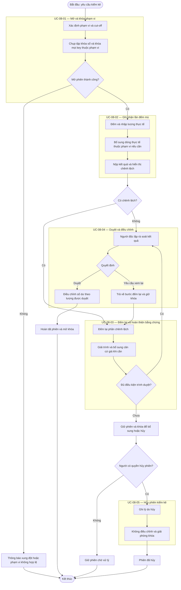

# BJ-08 — Kiểm kê và điều chỉnh chênh lệch

> **Trạng thái:** Release đã đóng băng `4.1.0` — đã remap ID và boundary  
> **Chuyển đổi chính thức:** Theme 7 `4.0.0/BJ-09` → `4.1.0/BJ-08`  
> **Finality contract:** `COMPLETED`, `REJECTED/CANCELLED`, `SUSPENDED/BLOCKED`, `UNKNOWN/ESCALATED`
> **Phạm vi:** Phase 1 — kiểm kê toàn kho hoặc một phần tại một cut-off xác định  
> **Chủ sở hữu nghiệp vụ:** Inventory Control
> **Quyết định nghiệp vụ:** `T7-BASELINE-FREEZE-v4.0.0` + `T7-DR-035`, `T7-DR-036`, `T7-DR-037`, `T7-DR-038`, `T7-DR-039`

# 1. Mục tiêu và ranh giới

## 1.1 Mục tiêu

So sánh hàng thực tế với sổ tồn tại cùng một cut-off, xác minh chênh lệch bằng **đếm mù và đếm lại**, rồi điều chỉnh có maker–checker mà không làm mất lịch sử hoặc cho giao dịch khác chen vào phạm vi đang kiểm.

## 1.2 Điểm bắt đầu và kết thúc

| Thuộc tính | Nội dung |
|---|---|
| Bắt đầu | Người có quyền yêu cầu kiểm kê một phạm vi xác định |
| Kết thúc | Phiên hoàn tất và số dư bằng kết quả được duyệt; hoặc phiên bị hủy hợp lệ và mở khóa; hoặc phiên giữ chờ bổ sung bằng chứng mà không điều chỉnh |
| Tác động chính | Khóa phạm vi, count evidence và inventory adjustment khi được duyệt |
| Không quyết định | Nguyên nhân kế toán cuối cùng của thừa/thiếu hoặc cách xử lý trách nhiệm nhân sự |

## 1.3 Trong và ngoài ranh giới

| Trong ranh giới | Ngoài ranh giới |
|---|---|
| Mở phiên; materialize scope; khóa; đếm mù; thêm dòng thực tế thuộc scope; recount; duyệt; adjustment; hủy và mở khóa | Sửa trực tiếp book quantity; thay đổi scope sau khi mở; tự tạo product/lot master ngoài policy |
| Ghi căn cứ giá cho thừa/thiếu và giữ phiên khi chưa đủ căn cứ | Hợp thức hóa hàng thừa không rõ nguồn bằng sửa số dư |

# 2. Sơ đồ hành trình

# 3. Trường hợp sử dụng

| UC | Tên | Bắt đầu | Kết thúc | Kết quả |
|---|---|---|---|---|
| [UC-08-01](../../../../../../../02.specification/behavior/use-cases/UC-08-01-mo-va-khoa-pham-vi.md) | Mở và khóa phạm vi | Có yêu cầu kiểm kê hợp lệ | Phiên mở với scope/cut-off bất biến hoặc bị từ chối | Locked count session |
| [UC-08-02](../../../../../../../02.specification/behavior/use-cases/UC-08-02-ghi-nhan-lan-dem-mu.md) | Ghi nhận lần đếm mù | Phiên đã mở và người kiểm được phân công | Kết quả lần đầu được nộp và variance được lộ | First-count evidence |
| [UC-08-03](../../../../../../../02.specification/behavior/use-cases/UC-08-03-dem-lai-va-hoan-thien-bang-chung.md) | Đếm lại và hoàn thiện bằng chứng | Có dòng chênh lệch | Recount và căn cứ cần thiết sẵn sàng hoặc phiên chờ bổ sung | Recount/variance evidence |
| [UC-08-04](../../../../../../../02.specification/behavior/use-cases/UC-08-04-duyet-va-dieu-chinh.md) | Duyệt và điều chỉnh | Kết quả đủ điều kiện trình duyệt | Adjustment được commit và phiên hoàn tất, hoặc trả về xem lại | Approved count result |
| [UC-08-05](../../../../../../../02.specification/behavior/use-cases/UC-08-05-huy-phien-kiem-ke.md) | Hủy phiên kiểm kê | Phiên chưa hoàn tất và có quyền/lý do | Không adjustment, toàn lịch sử giữ lại và khóa được giải phóng | Cancelled count session |

# 4. Logic nghiệp vụ cần giữ

| Điểm kiểm soát | Quy tắc |
|---|---|
| Scope | Phạm vi và tập key được đóng băng tại cut-off; thay đổi master/group sau đó không tự đổi scope |
| Prospective key | Hàng/lô thực tế mới chỉ được bổ sung nếu nằm trong biểu thức phạm vi đã khóa và master/tracking hợp lệ; ngoài scope phải bị từ chối |
| Khóa | Chặn nhập, xuất, giữ và state change thuộc cả key hiện có lẫn key có thể phát sinh trong scope |
| Đếm mù | Người kiểm không thấy book quantity trước lần nộp đầu |
| Recount | Chênh lệch lần đầu phải đếm lại; kết quả recount là căn cứ trình duyệt, người duyệt có thể yêu cầu xem lại nhưng không tự sửa số đếm |
| Maker–checker | Người đếm không tự duyệt; ngưỡng duyệt dùng cả lượng và giá trị rủi ro |
| Thiếu căn cứ giá | Hàng thừa chưa có căn cứ giá không được adjustment; phiên giữ khóa chờ bổ sung hoặc được hủy có lý do |
| Hủy | Không tạo adjustment, giữ toàn bộ bằng chứng và giải phóng khóa |
| Nguyên tử | Adjustment nhiều dòng commit toàn bộ hoặc không commit; sau commit số dư bằng lượng được duyệt |

# 5. Quan hệ và bàn giao

- Dùng số dư và movement từ BJ-01 tại đúng cut-off, không dùng projection trễ làm book quantity.
- Adjustment đã duyệt cung cấp facts cho BJ-14; chênh lệch thiếu dùng official cost có hiệu lực, chênh lệch thừa cần căn cứ giá hợp lệ.
- Nếu phát hiện operation nguồn sai, có thể mở BJ-11 sau khi phiên kiểm kê kết thúc; không sửa operation nguồn trong lúc scope đang khóa.
- Hàng/lô phát hiện trong kiểm kê phải tuân thủ product tracking policy; Theme 7 không tự tạo sản phẩm.

# 6. Nguồn tri thức liên quan

- [Kiểm kê hàng tồn kho: từ khóa phạm vi đến điều chỉnh chênh lệch](../../../../../../../01.knowledge/know-how/KB-KGV-011-kiem-ke-hang-ton-kho-tu-khoa-pham-vi-den-dieu-chinh-chenh-lech.md)
- [Định giá hàng trả, tiêu hủy và chênh lệch thừa thiếu](../../../../../../../01.knowledge/know-how/KB-KGV-020-dinh-gia-hang-tra-tieu-huy-va-chenh-lech-thua-thieu.md)
- [Tính chính thức của tồn kho và nguyên tắc chống xuất âm](../../../../../../../01.knowledge/know-how/KB-KGV-006-tinh-chinh-thuc-cua-ton-kho-va-nguyen-tac-chong-xuat-am.md)
- [Tính nguyên tử khi ghi tồn kho và phát sự kiện](../../../../../../../01.knowledge/know-how/KB-KGV-029-tinh-nguyen-tu-khi-ghi-ton-kho-va-phat-su-kien.md)
