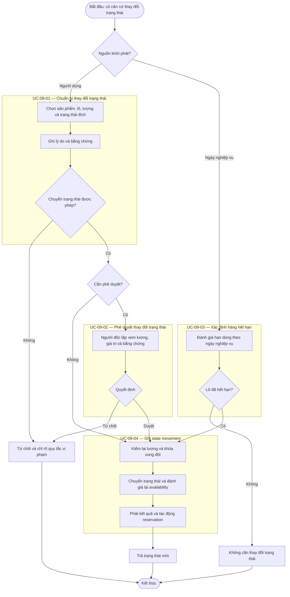

# BJ-09 — Quản lý trạng thái hàng

> **Trạng thái:** Release đã đóng băng `4.1.0` — đã remap ID và boundary  
> **Chuyển đổi chính thức:** Theme 7 `4.0.0/BJ-10` → `4.1.0/BJ-09`  
> **Finality contract:** `COMPLETED`, `REJECTED/CANCELLED`, `SUSPENDED/BLOCKED`, `UNKNOWN/ESCALATED`
> **Phạm vi:** Phase 1 — thay đổi trạng thái trong một kho mặc định, không giảm tổng tồn vật lý  
> **Chủ sở hữu nghiệp vụ:** Inventory Control; CAP-01 cung cấp policy
> **Quyết định nghiệp vụ:** `T7-BASELINE-FREEZE-v4.0.0` + `T7-DR-012`, `T7-DR-018`, `T7-DR-046`, `T7-DR-047`, `T7-DR-092`

# 1. Mục tiêu và ranh giới

## 1.1 Mục tiêu

Phản ánh đúng **tình trạng và khả năng bán của hàng vẫn còn hiện diện**, bao gồm sellable, quarantine, damaged, demo và expired; mọi thay đổi có lý do, quyền và dấu vết, không sửa trực tiếp số dư.

## 1.2 Điểm bắt đầu và kết thúc

| Thuộc tính | Nội dung |
|---|---|
| Bắt đầu | Người dùng có căn cứ đổi tình trạng hàng, hoặc ngày nghiệp vụ làm một lô hết hạn |
| Kết thúc | State movement được ghi và khả dụng được đánh giá lại; hoặc yêu cầu bị từ chối/chờ duyệt mà không có tác động bán phần |
| Tác động chính | Chuyển lượng giữa các trạng thái; cập nhật eligibility, availability và tác động reservation liên quan |
| Không làm thay đổi | Tổng tồn vật lý và tổng giá trị ghi sổ của sản phẩm |

## 1.3 Trong và ngoài ranh giới

| Trong ranh giới | Ngoài ranh giới |
|---|---|
| Chuyển sellable/quarantine/damaged/demo theo ma trận; xác định expired; quyền/lý do/duyệt; đánh giá lại khả dụng | Tiêu hủy; trả NCC; nhận khách trả; xác nhận giá; sửa trạng thái trực tiếp |
| Materialize `EXPIRED` có chống trùng nếu hệ thống cần lưu trạng thái | Tạo lifecycle cảnh báo cận hạn hoặc sửa hạn dùng để né hết hạn |

**Ranh giới quan trọng:** `VALUATION_PENDING`, `RETURN_PENDING` và `RTV_PENDING` chỉ được tạo/giải phóng bởi BJ sở hữu tương ứng; chức năng đổi trạng thái chung không phải đường tắt để đi vào hoặc thoát các trạng thái này.

# 2. Sơ đồ hành trình

# 3. Trường hợp sử dụng

| UC | Tên | Bắt đầu | Kết thúc | Kết quả |
|---|---|---|---|---|
| [UC-09-01](../../../../../../../02.specification/behavior/use-cases/UC-09-01-chuan-bi-thay-doi-trang-thai.md) | Chuẩn bị thay đổi trạng thái | Có căn cứ nghiệp vụ và lượng hàng xác định | Hồ sơ hợp lệ, cần duyệt hoặc bị từ chối | State-change request |
| [UC-09-02](../../../../../../../02.specification/behavior/use-cases/UC-09-02-phe-duyet-thay-doi-trang-thai.md) | Phê duyệt thay đổi trạng thái | Yêu cầu vượt ngưỡng/rủi ro | Duyệt hoặc từ chối có lý do | Approval decision |
| [UC-09-03](../../../../../../../02.specification/behavior/use-cases/UC-09-03-xac-dinh-hang-het-han.md) | Xác định hàng hết hạn | Ngày nghiệp vụ thay đổi hoặc dữ liệu lô được đánh giá | Không có tác động hoặc xác định lượng phải hết hạn | Expiry evaluation result |
| [UC-09-04](../../../../../../../02.specification/behavior/use-cases/UC-09-04-ghi-state-movement.md) | Ghi state movement | Có thay đổi hợp lệ và đủ thẩm quyền | State movement/balance được commit hoặc không có gì commit | Authoritative inventory state result |

# 4. Logic nghiệp vụ cần giữ

| Điểm kiểm soát | Quy tắc |
|---|---|
| Ma trận chuyển trạng thái | Chỉ cho các chuyển đổi được whitelist; mỗi chuyển đổi xác định quyền, lý do, bằng chứng và mức duyệt |
| Tổng vật lý | Chuyển trạng thái không làm đổi tổng physical quantity của sản phẩm/lô |
| Hết hạn | Xác định trực tiếp từ hạn dùng và ngày nghiệp vụ; loại khỏi khả dụng ngay, không phụ thuộc tác vụ nền đã materialize `EXPIRED` hay chưa |
| Cận hạn | Chỉ là chỉ báo/policy `WARN` hoặc `BLOCK_SALE`; không phải state movement và không tạo hồ sơ cảnh báo có lifecycle |
| Demo | Vẫn thuộc physical và book value nhưng không khả dụng; muốn bán lại phải qua chuyển trạng thái được phép |
| Reservation | Khi eligible giảm, phát tác động để BJ-04 đánh giá lại; BJ này không tự sửa order hoặc PickAllocation |
| Trạng thái do BJ khác sở hữu | Không cho người dùng chọn trực tiếp `VALUATION_PENDING`, `RETURN_PENDING` hoặc `RTV_PENDING` ngoài hành trình nguồn |
| Khóa | State change bị chặn trong scope kiểm kê hoặc khi có operation xung đột |

# 5. Quan hệ và bàn giao

- Nhận lượng cần phân loại từ BJ-06 và lượng cần quản lý tình trạng từ BJ-02.
- Khi lượng mất eligibility, bàn giao tín hiệu cho BJ-04; nếu đã có PickAllocation thì BJ-05 xử lý stale allocation.
- Hàng damaged/expired có thể được chọn cho BJ-10 hoặc BJ-07; đổi trạng thái không tự tiêu hủy hay trả NCC.
- Cấu hình cận hạn theo sản phẩm/tenant thuộc capability cấu hình chính sách tồn, không nằm trong BJ này.

# 6. Nguồn tri thức liên quan

- [Hàng cận hạn, hết hạn, hư hỏng và tiêu hủy](../../../../../../../01.knowledge/know-how/KB-KGV-014-hang-can-han-het-han-hu-hong-va-tieu-huy.md)
- [Tồn vật lý và tồn khả dụng](../../../../../../../01.knowledge/know-how/KB-KGV-005-ton-vat-ly-va-ton-kha-dung.md)
- [Danh tính và vòng đời của một lô hàng](../../../../../../../01.knowledge/know-how/KB-KGV-025-danh-tinh-va-vong-doi-cua-mot-lo-hang.md)
- [Hàng ký gửi, hàng demo và quyền sở hữu](../../../../../../../01.knowledge/know-how/KB-KGV-034-quyen-so-huu-hang-hoa-hang-ky-gui-va-hang-demo.md)
