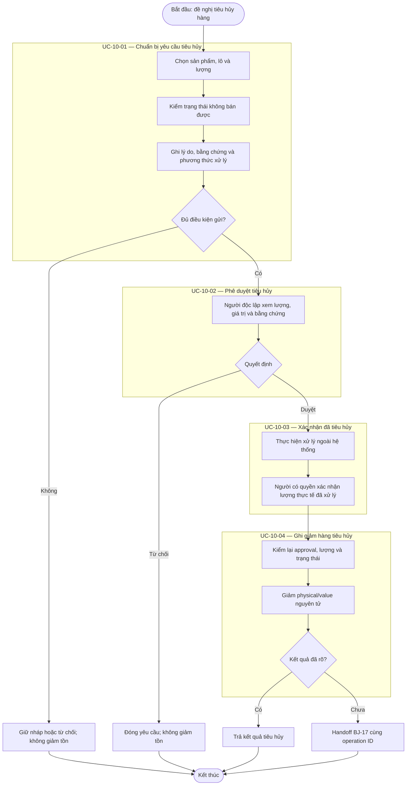

# BJ-10 — Tiêu hủy hàng

> **Trạng thái:** Release đã đóng băng `4.1.0` — đã remap ID và boundary  
> **Chuyển đổi chính thức:** Theme 7 `4.0.0/BJ-11` → `4.1.0/BJ-10`  
> **Finality contract:** `COMPLETED`, `REJECTED/CANCELLED`, `SUSPENDED/BLOCKED`, `UNKNOWN/ESCALATED`
> **Phạm vi:** Phase 1 — tiêu hủy lượng hàng thuộc tenant và đã ở trạng thái không bán được  
> **Chủ sở hữu nghiệp vụ:** Inventory Control
> **Quyết định nghiệp vụ:** `T7-BASELINE-FREEZE-v4.0.0` + `T7-DR-047`, `T7-DR-078`, `T7-DR-080`, `T7-DR-081`

# 1. Mục tiêu và ranh giới

## 1.1 Mục tiêu

Ghi nhận đúng việc **hàng đã thực sự bị tiêu hủy hoặc xử lý loại bỏ**, chỉ giảm tồn vật lý và giá trị sau khi có đủ lý do, bằng chứng, phê duyệt theo rủi ro và xác nhận hoàn tất.

## 1.2 Điểm bắt đầu và kết thúc

| Thuộc tính | Nội dung |
|---|---|
| Bắt đầu | Người có quyền chọn một lượng hàng không bán được để đề nghị tiêu hủy |
| Kết thúc | Hàng được tiêu hủy và giảm physical/value; hoặc yêu cầu chờ duyệt/chờ xử lý; hoặc bị từ chối mà không giảm tồn |
| Tác động chính | Disposal issue movement, value movement, balance và audit evidence |
| Không quyết định | Trách nhiệm bồi thường, xử lý môi trường/chuyên ngành hoặc hạch toán chi phí ngoài inventory value effect |

## 1.3 Trong và ngoài ranh giới

| Trong ranh giới | Ngoài ranh giới |
|---|---|
| Chọn lượng/lô; kiểm trạng thái; lý do/bằng chứng; tính rủi ro; duyệt; xác nhận đã xử lý; ghi giảm | Đổi trạng thái để hợp thức hóa; tiêu hủy hàng vẫn sellable; trả NCC; điều chỉnh thiếu do kiểm kê |
| Ghi giảm giá trị theo official cost có hiệu lực | Xóa movement, sửa ledger hoặc dùng adjustment thay cho disposal |

# 2. Sơ đồ hành trình

# 3. Trường hợp sử dụng

| UC | Tên | Bắt đầu | Kết thúc | Kết quả |
|---|---|---|---|---|
| [UC-10-01](../../../../../../../02.specification/behavior/use-cases/UC-10-01-chuan-bi-yeu-cau-tieu-huy.md) | Chuẩn bị yêu cầu tiêu hủy | Có lượng hàng được đề nghị loại bỏ | Draft đủ điều kiện gửi hoặc bị chặn | Disposal request |
| [UC-10-02](../../../../../../../02.specification/behavior/use-cases/UC-10-02-phe-duyet-tieu-huy.md) | Phê duyệt tiêu hủy | Yêu cầu có snapshot rủi ro và approver hợp lệ | Duyệt hoặc từ chối có lý do | Approval decision |
| [UC-10-03](../../../../../../../02.specification/behavior/use-cases/UC-10-03-xac-nhan-da-tieu-huy.md) | Xác nhận đã tiêu hủy | Yêu cầu đã duyệt và việc xử lý thực tế diễn ra | Có completion assertion cho lượng thực xử lý | Disposal completion evidence |
| [UC-10-04](../../../../../../../02.specification/behavior/use-cases/UC-10-04-ghi-giam-hang-tieu-huy.md) | Ghi giảm hàng tiêu hủy | Approval và completion assertion còn hợp lệ | Physical/value giảm nguyên tử hoặc result không rõ được chuyển đối soát | Disposal inventory result |

# 4. Logic nghiệp vụ cần giữ

| Điểm kiểm soát | Quy tắc |
|---|---|
| Trạng thái nguồn | Chỉ hàng không bán được và thuộc tenant mới được tiêu hủy; hàng sellable phải qua BJ-09 trước |
| Mốc giảm tồn | Phê duyệt chưa làm giảm physical; chỉ completion assertion hợp lệ mới cho phép ghi giảm |
| Maker–checker | Người lập không tự duyệt; cấp duyệt suy ra từ trị tuyệt đối lượng × căn cứ giá |
| Thiếu căn cứ giá | Không gửi duyệt khi thiếu cả official cost và giá nguồn; giữ nháp để bổ sung, không gán rủi ro không xác định |
| Giá trị | Giảm theo official cost có hiệu lực tại thời điểm hoàn tất; không suy ra giá riêng theo kho/lô |
| Số lượng thực xử lý | Nếu khác lượng được duyệt, chỉ cho phép trong phạm vi policy; vượt phạm vi phải quay lại lập/duyệt yêu cầu mới |
| Chống trùng | Cùng operation/completion assertion không được ghi giảm hai lần |
| UNKNOWN | Không tạo disposal mới; truy vấn ngắn bằng cùng operation identity, sau đó handoff BJ-17 nếu chưa xác lập finality |

# 5. Quan hệ và bàn giao

- Nhận hàng damaged/expired/quarantine phù hợp từ BJ-09 hoặc BJ-06.
- Nếu quyết định thực tế là trả nhà cung cấp, dùng BJ-07; không đổi type của disposal đang xử lý.
- Cung cấp quantity/value facts cho BJ-14 và Theme Kế toán nhưng không quyết định tài khoản chi phí.
- Sai sót sau khi hoàn tất phải đi qua BJ-11 và thỏa reversal guard; không sửa disposal gốc.

# 6. Nguồn tri thức liên quan

- [Hàng cận hạn, hết hạn, hư hỏng và tiêu hủy](../../../../../../../01.knowledge/know-how/KB-KGV-014-hang-can-han-het-han-hu-hong-va-tieu-huy.md)
- [Định giá hàng trả, tiêu hủy và chênh lệch thừa thiếu](../../../../../../../01.knowledge/know-how/KB-KGV-020-dinh-gia-hang-tra-tieu-huy-va-chenh-lech-thua-thieu.md)
- [Phê duyệt inventory operation theo mức rủi ro](../../../../../../../01.knowledge/know-how/KB-KGV-031-phe-duyet-inventory-operation-theo-muc-rui-ro.md)
- [Tính nguyên tử khi ghi tồn kho và phát sự kiện](../../../../../../../01.knowledge/know-how/KB-KGV-029-tinh-nguyen-tu-khi-ghi-ton-kho-va-phat-su-kien.md)
