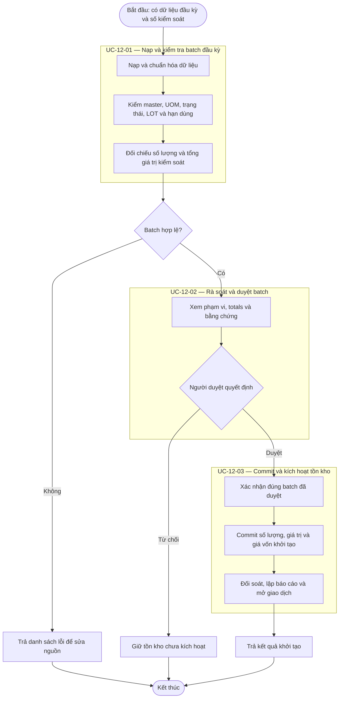

# BJ-12 — Khởi tạo số dư tồn kho đầu kỳ

> **Trạng thái:** Release đã đóng băng `4.1.0` — đã remap ID và boundary  
> **Chuyển đổi chính thức:** Theme 7 `4.0.0/BJ-13` → `4.1.0/BJ-12`  
> **Finality contract:** `COMPLETED`, `REJECTED/CANCELLED`, `SUSPENDED/BLOCKED`, `UNKNOWN/ESCALATED`
> **Phạm vi:** Phase 1 — một lần khởi tạo cho cửa hàng và kho mặc định  
> **Chủ sở hữu nghiệp vụ:** Inventory Control; Inventory Valuation tham gia
> **Quyết định nghiệp vụ:** `T7-BASELINE-FREEZE-v4.0.0` + `T7-DR-067`, `T7-DR-068`, `T7-DR-069`

# 1. Mục tiêu và ranh giới

## 1.1 Mục tiêu

Khởi tạo **số lượng, trạng thái, lô/hạn dùng và giá trị tồn kho đầu kỳ** từ nguồn đã được kiểm soát; chỉ mở giao dịch kho thông thường sau khi toàn bộ batch được kiểm tra, duyệt, commit và đối soát thành công.

## 1.2 Điểm bắt đầu và kết thúc

| Thuộc tính | Nội dung |
|---|---|
| Bắt đầu | Đơn vị chuẩn bị vận hành tồn kho và có file số dư cùng số kiểm soát tại cut-off |
| Kết thúc | Tồn kho được kích hoạt bằng một batch đã commit và có báo cáo đối soát; hoặc batch dừng ở kết quả lỗi/từ chối mà chưa mở giao dịch |
| Tác động chính | Opening movement, balance, value, initial official cost và bằng chứng migration |
| Không quyết định | Tạo Product, Store, Warehouse, đơn vị tính hoặc sửa dữ liệu nguồn bên ngoài |

## 1.3 Trong và ngoài ranh giới

| Trong ranh giới | Ngoài ranh giới |
|---|---|
| Nạp file; chuẩn hóa; kiểm tra master/UOM/LOT/expiry; so control totals; duyệt độc lập; commit nguyên tử; kích hoạt; báo cáo migration | Tự tạo master data; nhập batch đầu kỳ lần hai; cho phép giao dịch thường trước activation; chuyển kho |
| Số lượng chi tiết theo kho/trạng thái/lô và tổng giá trị có thẩm quyền theo tenant + sản phẩm | Dùng giá trị theo kho/lô làm sổ giá trị độc lập |

**Phụ thuộc bên ngoài:** Store, Warehouse, Product, UOM và quan hệ mặc định phải được capability nền tảng/master-data tạo trước khi bắt đầu BJ này.

# 2. Sơ đồ hành trình

# 3. Trường hợp sử dụng

| UC | Tên | Bắt đầu | Kết thúc | Kết quả |
|---|---|---|---|---|
| [UC-12-01](../../../../../../../02.specification/behavior/use-cases/UC-12-01-nap-va-kiem-tra-batch-dau-ky.md) | Nạp và kiểm tra batch đầu kỳ | Có file nguồn, cut-off và control totals | Batch hợp lệ hoặc có danh sách lỗi đầy đủ | Prepared batch có version/hash, chưa ghi ledger |
| [UC-12-02](../../../../../../../02.specification/behavior/use-cases/UC-12-02-ra-soat-va-duyet-batch.md) | Rà soát và duyệt batch | Có prepared batch hợp lệ | Batch được duyệt hoặc từ chối | Approval decision độc lập với người lập |
| [UC-12-03](../../../../../../../02.specification/behavior/use-cases/UC-12-03-commit-va-kich-hoat-ton-kho.md) | Commit và kích hoạt tồn kho | Có đúng version/hash đã duyệt | Toàn bộ batch hoàn tất và inventory được mở; hoặc không có gì commit | Opening evidence và activation result |

# 4. Logic nghiệp vụ cần giữ

| Điểm kiểm soát | Quy tắc |
|---|---|
| Activation gate | Khi chưa hoàn tất batch đầu tiên, chỉ nghiệp vụ chuẩn bị/duyệt/commit đầu kỳ được phép; mutation thường bị chặn |
| Một batch chính thức | Chỉ một opening batch được hoàn tất; sai sau activation phải dùng correction/adjustment |
| Dữ liệu bất thường | Quantity âm hoặc quantity bằng 0 nhưng có value bị từ chối; quantity dương phải có căn cứ giá trị đủ để hình thành giá vốn khởi tạo |
| Trùng khóa | Không tự gộp im lặng các dòng trùng product + warehouse + state + lot; phải báo lỗi để sửa nguồn |
| LOT/expiry | Sản phẩm NONE không có lô; sản phẩm LOT bắt buộc mã lô và chỉ bắt buộc hạn dùng khi product policy yêu cầu |
| Trạng thái | Có thể nhập non-sellable khi state được khai rõ; chỉ lượng sellable và đủ dữ liệu mới tăng khả dụng |
| Giá trị | Quantity chi tiết theo kho/trạng thái/lô; giá trị có thẩm quyền và initial official cost theo tenant + sản phẩm |
| Nguyên tử | Opening movement, balance, value, initial cost, report và activation cùng commit hoặc cùng rollback |
| Maker–checker | Người chuẩn bị không tự duyệt batch |

# 5. Quan hệ và bàn giao

- Nhận master data và Store/Warehouse mặc định từ capability nền tảng.
- Sau activation, BJ-01 có thể hiển thị số dư và BJ-15 có thể truy báo cáo/thẻ kho.
- Initial official cost là đầu vào đầu tiên của BJ-14.
- Mọi sửa sai sau khi kích hoạt phải đi qua BJ-11 hoặc adjustment phù hợp; không mở lại batch đầu kỳ.

# 6. Nguồn tri thức liên quan

- [Chuẩn bị dữ liệu số dư tồn kho đầu kỳ](../../../../../../../01.knowledge/know-how/KB-KGV-022-chuan-bi-du-lieu-so-du-ton-kho-dau-ky.md)
- [Xác nhận số dư đầu kỳ, Chuyển đổi chính thức và đối soát migration](../../../../../../../01.knowledge/know-how/KB-KGV-023-xac-nhan-so-du-dau-ky-chuyen-doi-chinh-thuc-va-doi-soat-migration.md)
- [Kho, cửa hàng và khóa định danh số dư tồn kho](../../../../../../../01.knowledge/know-how/KB-KGV-003-kho-cua-hang-va-khoa-dinh-danh-so-du-ton-kho.md)
- [Đơn vị tính và cách quy đổi số lượng tồn kho](../../../../../../../01.knowledge/know-how/KB-KGV-004-don-vi-tinh-va-cach-quy-doi-so-luong-ton-kho.md)
- [Đơn giá tồn kho chính thức và tổng giá trị ghi sổ](../../../../../../../01.knowledge/know-how/KB-KGV-015-don-gia-ton-kho-chinh-thuc-va-tong-gia-tri-ghi-so.md)
