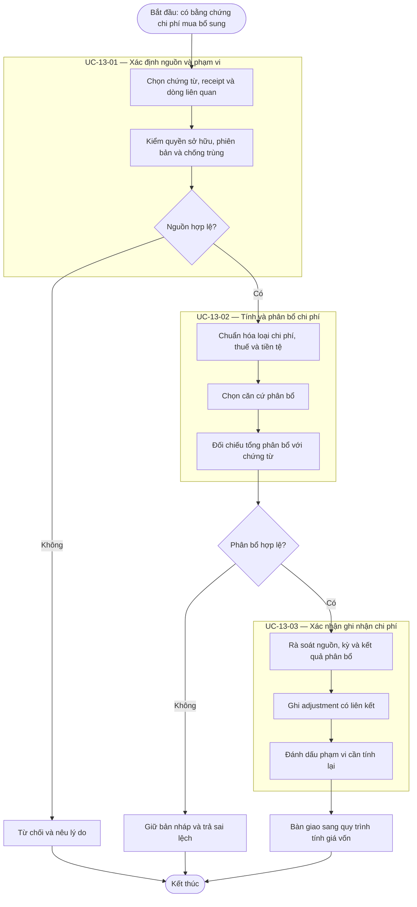

# BJ-13 — Ghi nhận chi phí mua đến muộn

> **Trạng thái:** Release đã đóng băng `4.1.0` — đã remap ID và boundary  
> **Chuyển đổi chính thức:** Theme 7 `4.0.0/BJ-14` → `4.1.0/BJ-13`  
> **Finality contract:** `COMPLETED`, `REJECTED/CANCELLED`, `SUSPENDED/BLOCKED`, `UNKNOWN/ESCALATED`
> **Phạm vi:** Phase 1 — chi phí mua đến sau lần xác nhận giá trị ban đầu  
> **Chủ sở hữu nghiệp vụ:** Inventory Valuation; nguồn chứng từ thuộc Mua hàng/Kế toán
> **Quyết định nghiệp vụ:** `T7-BASELINE-FREEZE-v4.0.0` + `T7-DR-058`

# 1. Mục tiêu và ranh giới

## 1.1 Mục tiêu

Ghi nhận **chi phí mua bổ sung có nguồn và phương pháp phân bổ rõ ràng** mà không sửa receipt hoặc value movement gốc; xác định đúng sản phẩm/kỳ cần tính lại giá vốn.

## 1.2 Điểm bắt đầu và kết thúc

| Thuộc tính | Nội dung |
|---|---|
| Bắt đầu | Có chứng từ hoặc bằng chứng chi phí mua phát sinh sau khi receipt đã được định giá |
| Kết thúc | Chi phí được ghi đúng một lần và phạm vi bị ảnh hưởng được bàn giao để tính lại; hoặc yêu cầu bị từ chối với lý do rõ ràng |
| Tác động chính | Value-only adjustment có provenance và dirty scope sản phẩm + kỳ |
| Không làm thay đổi | Quantity, receipt gốc, PO, công nợ hoặc giá bán |

## 1.3 Trong và ngoài ranh giới

| Trong ranh giới | Ngoài ranh giới |
|---|---|
| Xác định nguồn; chọn receipt/dòng hàng; phân loại chi phí; quy đổi VND; phân bổ; chống trùng; xác định kỳ ghi nhận | Phê duyệt invoice, thanh toán, chênh lệch tỷ giá thanh toán, sửa chứng từ gốc |
| Bàn giao phạm vi cần tính lại cho BJ-14 | Tự công bố giá vốn mới hoặc tự đổi giá bán |

# 2. Sơ đồ hành trình

# 3. Trường hợp sử dụng

| UC | Tên | Bắt đầu | Kết thúc | Kết quả |
|---|---|---|---|---|
| [UC-13-01](../../../../../../../02.specification/behavior/use-cases/UC-13-01-xac-dinh-nguon-va-pham-vi.md) | Xác định nguồn và phạm vi | Có bằng chứng chi phí bổ sung | Nguồn/scope hợp lệ hoặc bị từ chối | Cost source identity và affected receipts |
| [UC-13-02](../../../../../../../02.specification/behavior/use-cases/UC-13-02-tinh-va-phan-bo-chi-phi.md) | Tính và phân bổ chi phí | Có source/scope hợp lệ | Phân bổ cân bằng hoặc có sai lệch cần sửa | Allocation draft có provenance |
| [UC-13-03](../../../../../../../02.specification/behavior/use-cases/UC-13-03-xac-nhan-ghi-nhan-chi-phi.md) | Xác nhận ghi nhận chi phí | Phân bổ hợp lệ được rà soát | Adjustment được ghi và scope cần tính lại được xác định | Late-cost result dùng cho successor cost run |

# 4. Logic nghiệp vụ cần giữ

| Điểm kiểm soát | Quy tắc |
|---|---|
| Nguồn bắt buộc | Mỗi chi phí phải có source document/line/version và bằng chứng; không nhập một khoản tổng không truy nguyên |
| Chống trùng | Cùng source component/version/allocation line chỉ được ghi một lần |
| Thành phần giá trị | Chi phí mua, discount, hàng tặng và thuế được chuẩn hóa theo chính sách; VAT được khấu trừ không vào giá vốn |
| Ngoại tệ | Sổ tồn dùng VND; dùng tỷ giá do nguồn Kế toán cung cấp; chênh lệch thanh toán không làm đổi giá trị tồn đã ghi |
| Phân bổ | Tổng các dòng phân bổ phải khớp tổng chi phí sau chuẩn hóa; phần dư làm tròn phải được xử lý xác định |
| Kỳ mở/khóa | Kỳ còn mở ghi vào phạm vi cần tính lại; kỳ đã khóa ghi adjustment ở kỳ mở hiện tại và giữ liên kết kỳ gốc |
| Bất biến lịch sử | Không sửa receipt, valuation hoặc cost run cũ; lần tính tiếp theo dùng run kế nhiệm |
| Không tác động lượng | Chỉ tạo ảnh hưởng giá trị, không tạo quantity movement |

# 5. Quan hệ và bàn giao

- Nhận receipt/value facts từ BJ-02 và BJ-03.
- Nguồn invoice, loại thuế, tỷ giá và approval chứng từ thuộc capability Mua hàng/Kế toán.
- Khi ghi nhận thành công, bàn giao product-period scope cho BJ-14.
- Nếu source sai sau khi đã ghi, sửa bằng BJ-11; không sửa adjustment cũ trực tiếp.

# 6. Nguồn tri thức liên quan

- [Các thành phần hình thành giá nhập thực tế](../../../../../../../01.knowledge/know-how/KB-KGV-019-cac-thanh-phan-hinh-thanh-gia-nhap-thuc-te.md)
- [Đối soát giá vốn cuối kỳ và cập nhật đột xuất giữa kỳ](../../../../../../../01.knowledge/know-how/KB-KGV-018-doi-soat-gia-von-cuoi-ky-va-cap-nhat-dot-xuat-giua-ky.md)
- [Đơn giá tồn kho chính thức và tổng giá trị ghi sổ](../../../../../../../01.knowledge/know-how/KB-KGV-015-don-gia-ton-kho-chinh-thuc-va-tong-gia-tri-ghi-so.md)
- [Sửa sai tồn kho mà không sửa lịch sử](../../../../../../../01.knowledge/know-how/KB-KGV-021-sua-sai-ton-kho-khong-sua-lich-su.md)
