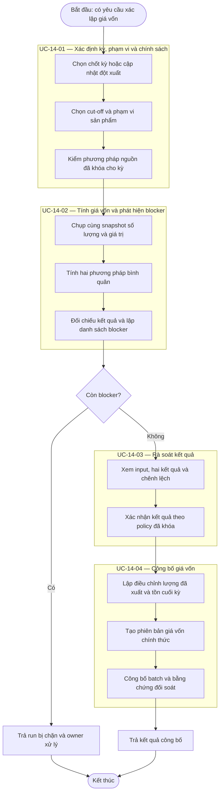

# BJ-14 — Tính và công bố giá vốn

> **Trạng thái:** Release đã đóng băng `4.1.0` — đã remap ID và boundary  
> **Chuyển đổi chính thức:** Theme 7 `4.0.0/BJ-15` → `4.1.0/BJ-14`  
> **Finality contract:** `COMPLETED`, `REJECTED/CANCELLED`, `SUSPENDED/BLOCKED`, `UNKNOWN/ESCALATED`
> **Phạm vi:** Phase 1 — chốt kỳ chuẩn hoặc cập nhật đột xuất có phạm vi  
> **Chủ sở hữu nghiệp vụ:** Inventory Valuation
> **Quyết định nghiệp vụ:** `T7-BASELINE-FREEZE-v4.0.0` + `T7-DR-049`, `T7-DR-050`, `T7-DR-052`, `T7-DR-053`, `T7-DR-056`, `T7-DR-058`, `T7-DR-059`, `T7-DR-060`

# 1. Mục tiêu và ranh giới

## 1.1 Mục tiêu

Tính song song hai phương pháp bình quân trên cùng dữ liệu, giúp kế toán rà soát blocker và công bố **giá vốn chính thức cùng các điều chỉnh liên kết**, không sửa giao dịch lịch sử.

## 1.2 Điểm bắt đầu và kết thúc

| Thuộc tính | Nội dung |
|---|---|
| Bắt đầu | Đến cut-off chốt kỳ hoặc có yêu cầu cập nhật giá vốn đột xuất được phép |
| Kết thúc | Run được công bố với giá vốn/adjustment mới; hoặc kết thúc bị chặn kèm danh sách blocker và owner xử lý |
| Tác động chính | COGS true-up, ending inventory adjustment và official cost version |
| Không quyết định | Giá bán, giá sàn, giá niêm yết, công nợ hoặc thay đổi đơn hàng/xuất kho gốc |

## 1.3 Trong và ngoài ranh giới

| Trong ranh giới | Ngoài ranh giới |
|---|---|
| Chọn kỳ/cut-off/scope; kiểm policy; snapshot; tính hai phương pháp; phát hiện blocker; review; công bố; successor run | Sửa receipt/issue/value movement gốc; giải quyết thay cho owner của blocker; tự công bố giá bán |
| Cập nhật đột xuất theo scope và effective time rõ | Thay đổi phương pháp ngầm trong một run đã bắt đầu |

# 2. Sơ đồ hành trình

# 3. Trường hợp sử dụng

| UC | Tên | Bắt đầu | Kết thúc | Kết quả |
|---|---|---|---|---|
| [UC-14-01](../../../../../../../02.specification/behavior/use-cases/UC-14-01-xac-dinh-ky-pham-vi-va-chinh-sach.md) | Xác định kỳ, phạm vi và chính sách | Có yêu cầu chốt kỳ/cập nhật đột xuất | Kỳ, cut-off, scope và policy được xác định | Cost-run context bất biến |
| [UC-14-02](../../../../../../../02.specification/behavior/use-cases/UC-14-02-tinh-gia-von-va-phat-hien-blocker.md) | Tính giá vốn và phát hiện blocker | Có context hợp lệ | Có hai kết quả và blocker snapshot | Draft run blocked hoặc ready for review |
| [UC-14-03](../../../../../../../02.specification/behavior/use-cases/UC-14-03-ra-soat-ket-qua.md) | Rà soát kết quả | Run không còn blocker | Kết quả nguồn theo policy được xác nhận | Reviewed valuation draft |
| [UC-14-04](../../../../../../../02.specification/behavior/use-cases/UC-14-04-cong-bo-gia-von.md) | Công bố giá vốn | Draft đã được rà soát | Adjustment và official cost version cùng được công bố | Published valuation batch |

# 4. Logic nghiệp vụ cần giữ

| Điểm kiểm soát | Quy tắc |
|---|---|
| Cùng dữ liệu | Hai phương pháp tính trên cùng movement/value snapshot và cut-off; phương pháp không chọn vẫn được giữ để đối chiếu |
| Policy theo kỳ | Phương pháp nguồn phải được version/khóa cho kỳ trước khi tính; không được override kín trong lúc review |
| Blocker | UNKNOWN, hàng chờ giá, kiểm kê/correction/reconciliation có thể đổi số liệu phải chặn đúng product-period scope |
| Run finality | Run đã bắt đầu không bị hủy, sửa hoặc tái sử dụng; sau khi dữ liệu thay đổi phải tạo successor run |
| Công bố nguyên tử | COGS true-up, ending inventory delta và official cost version cùng một batch cân bằng |
| Không hồi tố | Không sửa order, issue, receipt hoặc value movement gốc; mọi ảnh hưởng là adjustment liên kết |
| Cập nhật đột xuất | Có cut-off, product scope và effective time; chỉ giao dịch sau effective time dùng giá mới |
| Giá bán | Official cost mới chỉ là nguồn cho miền định giá; không tự đổi pricing cost basis hoặc giá bán |

# 5. Quan hệ và bàn giao

- Nhận quantity/value facts từ mọi BJ có inventory effect, đặc biệt BJ-03 và BJ-13.
- Blocker được bàn giao về BJ nguồn hoặc BJ-16; BJ này không sửa dữ liệu thay cho owner.
- Cung cấp official cost cho checkout/fulfillment tương lai và báo cáo giá vốn.
- Event công bố có thể khởi phát hành trình rà soát giá vốn tham chiếu định giá, nhưng không tự cập nhật giá bán.

# 6. Nguồn tri thức liên quan

- [Vì sao sử dụng song song hai phương pháp tính giá vốn](../../../../../../../01.knowledge/know-how/KB-KGV-016-vi-sao-tinh-song-song-hai-phuong-phap-gia-von.md)
- [Công bố đơn giá tồn kho và ghi nhận giá vốn xuất bán](../../../../../../../01.knowledge/know-how/KB-KGV-017-cong-bo-don-gia-ton-kho-va-ghi-nhan-gia-von-xuat-ban.md)
- [Đối soát giá vốn cuối kỳ và cập nhật đột xuất giữa kỳ](../../../../../../../01.knowledge/know-how/KB-KGV-018-doi-soat-gia-von-cuoi-ky-va-cap-nhat-dot-xuat-giua-ky.md)
- [Định giá hàng trả, tiêu hủy và chênh lệch thừa thiếu](../../../../../../../01.knowledge/know-how/KB-KGV-020-dinh-gia-hang-tra-tieu-huy-va-chenh-lech-thua-thieu.md)
- [Sửa sai tồn kho mà không sửa lịch sử](../../../../../../../01.knowledge/know-how/KB-KGV-021-sua-sai-ton-kho-khong-sua-lich-su.md)
