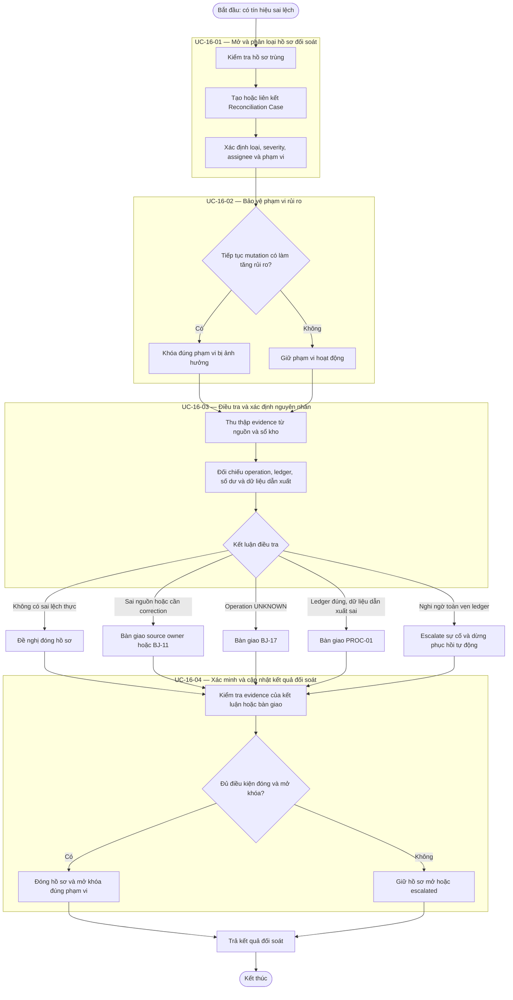

# BJ-16 — Điều tra và đối soát sai lệch

> **Trạng thái:** Release đã đóng băng `4.1.0` — đã remap ID và boundary  
> **Chuyển đổi chính thức:** Theme 7 `4.0.0/BJ-19` → `4.1.0/BJ-16`  
> **Finality contract:** `COMPLETED`, `REJECTED/CANCELLED`, `SUSPENDED/BLOCKED`, `UNKNOWN/ESCALATED`
> **Phạm vi:** Phase 1 — điều tra sai lệch giữa nguồn, operation, ledger, số dư và dữ liệu dẫn xuất  
> **Chủ sở hữu nghiệp vụ:** Inventory Control
> **Quyết định nghiệp vụ:** `T7-BASELINE-FREEZE-v4.0.0` + `T7-DR-084`, `T7-DR-086`, `T7-DR-088`, `T7-DR-090`

# 1. Mục tiêu và ranh giới

## 1.1 Mục tiêu

Giúp người vận hành **xác định sai lệch có thực hay không, nguyên nhân nằm ở đâu và hành trình nào phải xử lý tiếp**, đồng thời giữ đầy đủ bằng chứng để chỉ đóng hồ sơ khi kết quả đã được chứng minh.

BJ này là hành trình điều tra và điều phối xử lý. Nó không mặc định coi mọi sai lệch là lỗi dữ liệu dẫn xuất và không tự dựng lại projection cho mọi Reconciliation Case.

## 1.2 Điểm bắt đầu và kết thúc

| Thuộc tính | Nội dung |
|---|---|
| Bắt đầu | Có tín hiệu sai lệch từ người dùng, kiểm soát tự động, báo cáo hoặc một operation có kết quả chưa xác định |
| Kết thúc | Reconciliation Case được đóng bằng bằng chứng; hoặc đã được bàn giao/escalate có kiểm soát và giữ trạng thái mở phù hợp |
| Tác động chính | Reconciliation Case, evidence, phân loại nguyên nhân, hướng xử lý và quyết định bảo vệ/mở khóa phạm vi |
| Không làm thay đổi | Ledger, movement hoặc số dư chỉ để làm cho báo cáo “khớp” |

## 1.3 Trong và ngoài ranh giới

| Trong ranh giới | Ngoài ranh giới |
|---|---|
| Chống tạo case trùng; xác định severity, assignee và phạm vi; thu thập evidence; phân loại nguyên nhân; route xử lý; verify và close/reopen | Sửa chứng từ nguồn; correction operation; giải quyết UNKNOWN; dựng lại dữ liệu dẫn xuất; khôi phục ledger bị hỏng |
| Khóa phạm vi khi tiếp tục mutation có rủi ro làm sai lệch nặng hơn | Khóa toàn tenant mặc định khi chỉ một phạm vi nhỏ bị ảnh hưởng |

# 2. Sơ đồ hành trình

# 3. Trường hợp sử dụng

| UC | Tên | Bắt đầu | Kết thúc | Kết quả |
|---|---|---|---|---|
| [UC-16-01](../../../../../../../02.specification/behavior/use-cases/UC-16-01-mo-va-phan-loai-ho-so-doi-soat.md) | Mở và phân loại hồ sơ đối soát | Có tín hiệu sai lệch | Case được tạo/liên kết và có loại, mức độ, người xử lý, phạm vi | Reconciliation Case không trùng |
| [UC-16-02](../../../../../../../02.specification/behavior/use-cases/UC-16-02-bao-ve-pham-vi-rui-ro.md) | Bảo vệ phạm vi rủi ro | Đã xác định phạm vi sai lệch | Phạm vi cần thiết được khóa hoặc có bằng chứng không cần khóa | Scope protection decision dùng chung |
| [UC-16-03](../../../../../../../02.specification/behavior/use-cases/UC-16-03-dieu-tra-va-xac-dinh-nguyen-nhan.md) | Điều tra và xác định nguyên nhân | Case đã được phân loại | Có kết luận sơ bộ và hướng xử lý | Investigation evidence và resolution route |
| [UC-16-04](../../../../../../../02.specification/behavior/use-cases/UC-16-04-xac-minh-va-cap-nhat-ket-qua-doi-soat.md) | Xác minh và cập nhật kết quả đối soát | Có kết luận hoặc evidence từ hành trình được bàn giao | Case đóng/mở lại/giữ mở và lock được xử lý đúng | Authoritative case result |

# 4. Logic nghiệp vụ cần giữ

| Điểm kiểm soát | Quy tắc |
|---|---|
| Chống hồ sơ trùng | Cùng loại sai lệch và cùng phạm vi đang có case hoạt động thì liên kết evidence mới, không tạo case song song vô nghĩa |
| Phân loại nguyên nhân | Phải phân biệt source mismatch, UNKNOWN, projection mismatch, correction cần thiết và nghi ngờ ledger integrity |
| Rebuild | Chỉ route sang PROC-01 khi đã chứng minh ledger đúng và dữ liệu dẫn xuất sai; không phải case nào cũng rebuild |
| Bảo vệ phạm vi | Chỉ khóa phạm vi cần thiết; lock có owner, lý do và điều kiện mở rõ ràng |
| Đóng hồ sơ | Chỉ đóng khi evidence chứng minh kết quả và các tác động cần thiết đã hoàn tất; case có thể reopen nếu evidence mới phủ định kết luận cũ |
| Ledger integrity | Khi nghi ngờ ledger, dừng rebuild/correction tự động và escalated; không dựng ledger từ báo cáo hoặc chứng từ nguồn để che lỗi |
| Chỉ báo dẫn xuất | Tồn thấp/cận hạn tự biến mất theo điều kiện nguồn và không tạo Reconciliation Case |

# 5. Quan hệ và bàn giao

- Nhận tín hiệu từ BJ-15, các worklist kiểm soát, audit hoặc operation `UNKNOWN`.
- Route sai chứng từ sang owner nguồn; route nghiệp vụ cần sửa sai sang BJ-11.
- Route `UNKNOWN` sang BJ-17 và projection mismatch sang PROC-01.
- Evidence từ hành trình được bàn giao quay lại UC-16-04 để quyết định close/reopen/unlock.
- BJ này không sở hữu UI báo cáo thông thường và không sửa ledger.

# 6. Nguồn tri thức liên quan

- [Sửa sai tồn kho không sửa lịch sử](../../../../../../../01.knowledge/know-how/KB-KGV-021-sua-sai-ton-kho-khong-sua-lich-su.md)
- [Idempotency, phiên bản nguồn và xử lý kết quả chưa xác định](../../../../../../../01.knowledge/know-how/KB-KGV-028-idempotency-phien-ban-nguon-va-xu-ly-ket-qua-chua-xac-dinh.md)
- [Movement ledger, số dư dẫn xuất và phục hồi sau sự cố](../../../../../../../01.knowledge/know-how/KB-KGV-032-movement-ledger-so-du-dan-xuat-va-phuc-hoi-sau-su-co.md)
- [Thẻ kho, báo cáo lịch sử và đối soát nguồn](../../../../../../../01.knowledge/know-how/KB-KGV-033-the-kho-bao-cao-lich-su-va-doi-soat-nguon.md)
