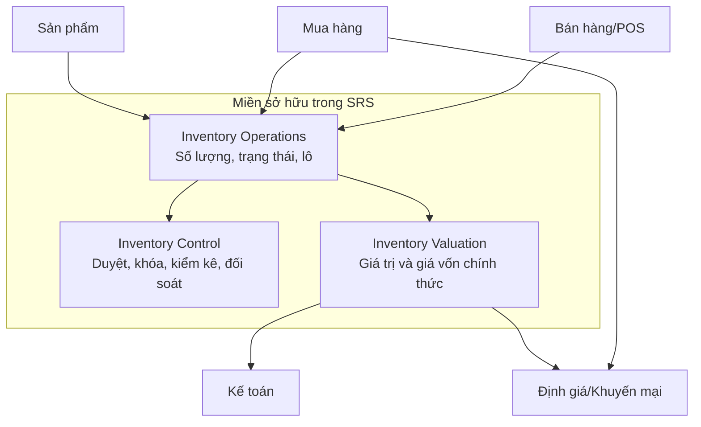
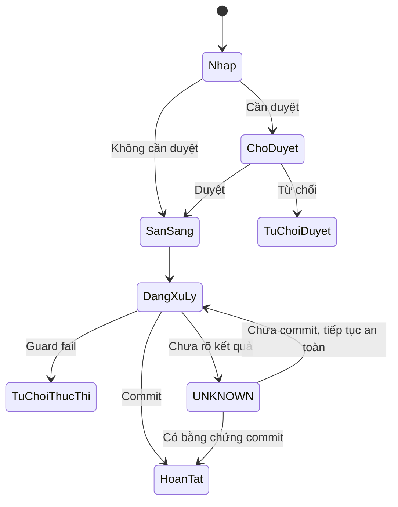

# 03 — Nền tảng miền nghiệp vụ

## 1. Mục đích

Phần này xác định ranh giới thẩm quyền, aggregate, lifecycle và bất biến trước khi mô tả bảng dữ liệu hoặc API. Mọi phần sau phải dùng cùng thuật ngữ và không được tạo một Dữ liệu gốc cạnh tranh.

## 2. Bản đồ bối cảnh

Ba miền sở hữu có thể cùng nằm trong một bounded context triển khai ban đầu, nhưng quyền sở hữu dữ liệu và consistency boundary vẫn phải tách rõ.

## 3. Ba miền sở hữu

### 3.1 Inventory Operations (`IO`)

**Trách nhiệm:** tiếp nhận yêu cầu có identity/version; quản lý lifecycle Inventory Operation; ghi movement số lượng; cập nhật transactional balance; giữ hàng; trạng thái hàng; hồ sơ lô; return/issue/receipt/correction; phát outbox event.

**Không sở hữu:** PO, sales order, giá bán, master sản phẩm, chính sách promotion, bút toán công nợ hoặc quyết định pháp lý về quyền sở hữu.

**Aggregate chính:**

- `InventoryOperation` — ranh giới lifecycle, payload lock sau submit và kết quả all-or-nothing.
- `CommandReceipt` — ranh giới idempotency của mọi mutation command.
- `Reservation` + `ReservationBucket` — cam kết theo source line và tổng lượng giữ giao dịch ở product + warehouse.
- `PickAllocation` — lô/lượng pick có version, chưa làm giảm vật lý.
- `Lot` — thuộc tính chung của tenant + product + manufacturer lot code.
- `CorrectionChain` — quan hệ operation gốc, reversal và correction.

### 3.2 Inventory Control (`IC`)

**Trách nhiệm:** policy snapshot và phê duyệt; warehouse scope; stock count; inventory lock; opening balance governance; Reconciliation Case; recovery/rebuild gate.

**Không sở hữu:** nội dung chứng từ nguồn, movement đã commit, giá bán hoặc cách tính promotion.

**Aggregate chính:**

- `ApprovalCase` — snapshot tuyến duyệt và quyết định nguyên tử.
- `StockCountSession` — scope/cut-off/lock/đếm/duyệt.
- `OpeningBalanceBatch` — migration all-or-nothing và control totals.
- `ReconciliationCase` — bằng chứng sai lệch, action và điều kiện mở khóa.

### 3.3 Inventory Valuation (`IV`)

**Trách nhiệm:** receipt valuation; value movement ledger; hai phương pháp bình quân; cost calculation run; official cost version; valuation adjustment; COGS initial snapshot và true-up.

**Không sở hữu:** pricing cost basis, floor/list price, promotion, sales price, AP/GL posting hoặc kịch bản chiết khấu mua hàng.

**Aggregate chính:**

- `ReceiptValuation` — bằng chứng và giá trực tiếp cho receipt.
- `CostCalculationRun` — input cut-off, blocker, hai kết quả và trạng thái công bố.
- `OfficialCostVersion` — giá có hiệu lực theo tenant + product.
- `ValuationAdjustmentBatch` — COGS true-up và ending inventory adjustment có line-level trace.

## 4. Bối cảnh tham chiếu và hợp đồng liên miền

| Bối cảnh | Dữ liệu sở hữu | Dữ liệu/hợp đồng được sử dụng |
|---|---|---|
| Tenant/IAM | Tenant, User, Role, functional permission | `tenant_id`, actor, permission và warehouse scope |
| Cửa hàng/Kho | Store, Warehouse, StoreWarehouseAssignment | Cặp mặc định; trạng thái hoạt động; scope |
| Sản phẩm | Product, UOM conversion, tracking policy, combo definition | Snapshot version/status; `NONE/LOT`; `expiry_required`; base UOM guard; component snapshot |
| Mua hàng | PO/line, receipt intent, supplier return, ownership assertion, price evidence | Source type/ID/line/version/request; quantity/price assertion |
| Bán hàng/POS | Order/line, fulfillment, handover, return request | Reserve/issue/release/return request và source version |
| Kế toán | Accounting period, GL/AP policy | Kỳ mở/khóa; nhận value/cost events; cung cấp căn cứ giá khi cần |
| Định giá/Khuyến mại | Pricing Cost Basis, floor/list price, price publication, promotion | Nhận official cost/projected scenario source; trả pricing draft/version |
| Kịch bản mua hàng | Purchase Discount Scenario | Projected cost version; không có thẩm quyền lên ledger |

## 5. Mô hình tổ chức và capability boundary

### 5.1 Hiện tại

- Một `Store` hoạt động.
- Một `Warehouse` hoạt động.
- Một `StoreWarehouseAssignment` mặc định.
- Mọi mutation ghi `store_id` và `warehouse_id` mặc định.
- Nhiều user/session trực tuyến được phép đồng thời.

### 5.2 Tương lai nhưng đã chừa ranh giới

- Quan hệ Store–Warehouse nhiều–nhiều.
- Warehouse scope trên permission và operation.
- Balance key có warehouse dimension.
- API source mang warehouse identity.

### 5.3 Chưa có hành vi

Không có warehouse selector/routing, transfer/in-transit, close/switch warehouse, offline device, serial, custody, tracking conversion batch, forecast hoặc replenishment proposal.

## 6. Ngôn ngữ chung

| Thuật ngữ | Định nghĩa miền |
|---|---|
| [Tồn vật lý](../../../../../../01.knowledge/glossary/glossary.md#term-ton-vat-ly) | Tổng lượng đang hiện diện và thuộc tenant, bất kể trạng thái bán được |
| [Lượng đủ điều kiện bán](../../../../../../01.knowledge/glossary/glossary.md#term-luong-du-dieu-kien-ban) | Phần vật lý ở trạng thái cho phép bán, không hết hạn/bị chặn |
| [Lượng đã giữ](../../../../../../01.knowledge/glossary/glossary.md#term-luong-da-giu) | Phần đã cam kết cho đơn nhưng chưa rời kho |
| [Tồn khả dụng](../../../../../../01.knowledge/glossary/glossary.md#term-ton-kha-dung) | Lượng đủ điều kiện bán trừ lượng đã giữ |
| [Bút ghi biến động (`Movement`)](../../../../../../01.knowledge/glossary/glossary.md#term-but-ghi-bien-dong) | Bản ghi bất biến về thay đổi số lượng hoặc trạng thái |
| [Số dư hiện hành (`Balance`)](../../../../../../01.knowledge/glossary/glossary.md#term-so-du-hien-hanh) | Projection giao dịch được cập nhật nguyên tử từ movement |
| [Lô sản xuất](../../../../../../01.knowledge/glossary/glossary.md#term-lo-san-xuat) | Danh tính sản xuất tenant + product + manufacturer lot code |
| [Giá vốn chính thức](../../../../../../01.knowledge/glossary/glossary.md#term-gia-von-chinh-thuc) | Official cost version có hiệu lực dùng cho value issue/COGS ban đầu |
| [Giá trị ghi sổ](../../../../../../01.knowledge/glossary/glossary.md#term-gia-tri-ghi-so) | Tổng value movement có thẩm quyền; không phải balance có thể sửa |
| [Giá vốn tham chiếu định giá](../../../../../../01.knowledge/glossary/glossary.md#term-gia-von-tham-chieu-dinh-gia) | Dữ liệu miền định giá dùng làm đầu vào cho floor/list price |
| [Giá vốn dự kiến](../../../../../../01.knowledge/glossary/glossary.md#term-gia-von-du-kien) | Kết quả kịch bản mua hàng; không phải dữ liệu kế toán |
| [Nghiệp vụ sửa sai (`Correction`)](../../../../../../01.knowledge/glossary/glossary.md#term-nghiep-vu-sua-sai) | Operation mới sửa sai và liên kết operation gốc |
| [Đối soát (`Reconciliation`)](../../../../../../01.knowledge/glossary/glossary.md#term-doi-soat) | Quá trình thu thập bằng chứng để giải quyết lệch/`UNKNOWN`, không sửa tay |

## 7. Bất biến miền

### 7.1 Tổ chức và phạm vi

| ID | Bất biến | Nguồn quyết định |
|---|---|---|
| `INV-ORG-01` | Mỗi mutation thuộc đúng một tenant, store và warehouse. | [`T7-DR-004`](../../../../../../01.knowledge/decisions/decision-register.md#t7-dr-004), [`T7-DR-004`](../../../../../../01.knowledge/decisions/decision-register.md#t7-dr-004) |
| `INV-ORG-02` | Phase 1 chỉ chấp nhận cặp store/warehouse mặc định đang hoạt động. | [`T7-DR-004`](../../../../../../01.knowledge/decisions/decision-register.md#t7-dr-004) |
| `INV-ORG-03` | Vị trí user/device không tạo store hoặc warehouse mới. | [`T7-DR-004`](../../../../../../01.knowledge/decisions/decision-register.md#t7-dr-004) |
| `INV-ORG-04` | Capability ngoài phạm vi bị từ chối trước mutation. | [`T7-DR-008`](../../../../../../01.knowledge/decisions/decision-register.md#t7-dr-008), [`T7-DR-008#REQ-02`](../../../../../../01.knowledge/decisions/decision-register.md#t7-dr-008-req-02) |

### 7.2 Operation và số lượng

| ID | Bất biến | Nguồn quyết định |
|---|---|---|
| `INV-IO-01` | `operation_request_id` nhận diện operation; mọi mutation có `idempotency_key` riêng và cùng key chỉ ánh xạ một command payload hash/kết quả qua CommandReceipt. | [`T7-DR-072`](../../../../../../01.knowledge/decisions/decision-register.md#t7-dr-072), [`T7-DR-072`](../../../../../../01.knowledge/decisions/decision-register.md#t7-dr-072) |
| `INV-IO-02` | Chỉ operation Hoàn tất thay đổi số lượng/giá trị chính thức. | [`T7-DR-070`](../../../../../../01.knowledge/decisions/decision-register.md#t7-dr-070), [`T7-DR-074`](../../../../../../01.knowledge/decisions/decision-register.md#t7-dr-074) |
| `INV-IO-03` | Operation nhiều dòng là all-or-nothing. | [`T7-DR-073#REQ-01`](../../../../../../01.knowledge/decisions/decision-register.md#t7-dr-073-req-01) |
| `INV-IO-04` | Movement bất biến; balance là projection và không có đường sửa trực tiếp. | [`T7-DR-084`](../../../../../../01.knowledge/decisions/decision-register.md#t7-dr-084) |
| `INV-IO-05` | Giao dịch trực tuyến không được làm khả dụng hoặc số dư có thẩm quyền âm ngoài operation được định nghĩa. | [`T7-DR-028`](../../../../../../01.knowledge/decisions/decision-register.md#t7-dr-028), [`T7-DR-033`](../../../../../../01.knowledge/decisions/decision-register.md#t7-dr-033) |
| `INV-IO-06` | Kiểm tra và giữ/xuất là nguyên tử; commit hợp lệ đầu tiên thắng. | [`T7-DR-033`](../../../../../../01.knowledge/decisions/decision-register.md#t7-dr-033) |
| `INV-IO-07` | Reservation không làm giảm vật lý; issue/handover mới giảm vật lý. | [`T7-DR-029#REQ-01`](../../../../../../01.knowledge/decisions/decision-register.md#t7-dr-029-req-01), [`T7-DR-030#REQ-01`](../../../../../../01.knowledge/decisions/decision-register.md#t7-dr-030-req-01) |
| `INV-IO-08` | Hủy sau bàn giao không tự tăng tồn; chỉ return receipt thực tế làm tăng. | [`T7-DR-040`](../../../../../../01.knowledge/decisions/decision-register.md#t7-dr-040) |
| `INV-IO-09` | Cùng request ID khác payload hash bị từ chối. | [`T7-DR-072`](../../../../../../01.knowledge/decisions/decision-register.md#t7-dr-072) |
| `INV-IO-10` | Tổng `ReservationBucket` theo product + warehouse bằng tổng lượng còn hiệu lực của Reservation; balance theo lô không chứa reserved. | [`T7-DR-029#REQ-03`](../../../../../../01.knowledge/decisions/decision-register.md#t7-dr-029-req-03) |
| `INV-IO-11` | PickAllocation không đổi physical; chỉ một active allocation set version và handover chỉ consume đúng version còn hiệu lực sau khi kiểm eligibility. | [`T7-DR-030`](../../../../../../01.knowledge/decisions/decision-register.md#t7-dr-030), [`T7-DR-030`](../../../../../../01.knowledge/decisions/decision-register.md#t7-dr-030) |
| `INV-IO-12` | `UNKNOWN` không được coi là thất bại; chỉ đối soát/tiếp tục cùng ID. | [`T7-DR-071`](../../../../../../01.knowledge/decisions/decision-register.md#t7-dr-071), [`T7-DR-071`](../../../../../../01.knowledge/decisions/decision-register.md#t7-dr-071) |
| `INV-IO-13` | Combo return kiểm cap, lô, số lượng và giá trị trên từng component; toàn request all-or-nothing. | [`T7-DR-048`](../../../../../../01.knowledge/decisions/decision-register.md#t7-dr-048), [`T7-DR-048#REQ-01`](../../../../../../01.knowledge/decisions/decision-register.md#t7-dr-048-req-01) |

### 7.3 Lô và hạn dùng

| ID | Bất biến | Nguồn quyết định |
|---|---|---|
| `INV-LOT-01` | `tracking_mode=NONE` không có lot/manufacture/expiry data. | [`T7-DR-013`](../../../../../../01.knowledge/decisions/decision-register.md#t7-dr-013), [`T7-DR-013#REQ-02`](../../../../../../01.knowledge/decisions/decision-register.md#t7-dr-013-req-02) |
| `INV-LOT-02` | `expiry_required` chỉ hợp lệ khi `tracking_mode=LOT`. | [`T7-DR-013#REQ-02`](../../../../../../01.knowledge/decisions/decision-register.md#t7-dr-013-req-02) |
| `INV-LOT-03` | Sản phẩm `LOT` bắt buộc mã lô nhà sản xuất/đóng gói trong mọi mutation liên quan. | [`T7-DR-013#REQ-01`](../../../../../../01.knowledge/decisions/decision-register.md#t7-dr-013-req-01), [`T7-DR-013`](../../../../../../01.knowledge/decisions/decision-register.md#t7-dr-013) |
| `INV-LOT-04` | Cùng tenant + product + lot code là cùng một lô trên mọi receipt/kho. | [`T7-DR-015`](../../../../../../01.knowledge/decisions/decision-register.md#t7-dr-015) |
| `INV-LOT-05` | Lot record chỉ chính thức khi operation đầu tiên phát sinh tồn commit. | [`T7-DR-016`](../../../../../../01.knowledge/decisions/decision-register.md#t7-dr-016) |
| `INV-LOT-06` | Xung đột manufacture/expiry data chặn commit cho đến khi sửa có lịch sử. | [`T7-DR-016#REQ-01`](../../../../../../01.knowledge/decisions/decision-register.md#t7-dr-016-req-01) |
| `INV-LOT-07` | Lượng hết hạn không thuộc sellable/available dù background job chưa materialize trạng thái. | [`T7-DR-046`](../../../../../../01.knowledge/decisions/decision-register.md#t7-dr-046), [`T7-DR-017`](../../../../../../01.knowledge/decisions/decision-register.md#t7-dr-017) |
| `INV-LOT-08` | Đổi `NONE ↔ LOT` chỉ khi vật lý = 0 và không có reservation/operation mở. | [`T7-DR-014`](../../../../../../01.knowledge/decisions/decision-register.md#t7-dr-014) |

### 7.4 Giá trị và giá vốn

| ID | Bất biến | Nguồn quyết định |
|---|---|---|
| `INV-IV-01` | Value Movement ledger bất biến là nguồn của tổng giá trị ghi sổ. | [`T7-DR-050`](../../../../../../01.knowledge/decisions/decision-register.md#t7-dr-050) |
| `INV-IV-02` | Official cost xác định ở tenant + product, không tách theo kho/lô. | [`T7-DR-050`](../../../../../../01.knowledge/decisions/decision-register.md#t7-dr-050), [`T7-DR-050#REQ-01`](../../../../../../01.knowledge/decisions/decision-register.md#t7-dr-050-req-01) |
| `INV-IV-03` | Hàng `VALUATION_PENDING` chưa khả dụng và chưa có official value movement cho direct cost. | [`T7-DR-021`](../../../../../../01.knowledge/decisions/decision-register.md#t7-dr-021) |
| `INV-IV-04` | Xác nhận giá trực tiếp, value movement và release khả dụng commit cùng nhau. | [`T7-DR-021#REQ-01`](../../../../../../01.knowledge/decisions/decision-register.md#t7-dr-021-req-01), [`T7-DR-021#REQ-02`](../../../../../../01.knowledge/decisions/decision-register.md#t7-dr-021-req-02) |
| `INV-IV-05` | Dòng xuất chụp official cost version tại bàn giao. | [`T7-DR-053`](../../../../../../01.knowledge/decisions/decision-register.md#t7-dr-053), [`T7-DR-053`](../../../../../../01.knowledge/decisions/decision-register.md#t7-dr-053) |
| `INV-IV-06` | Chốt kỳ ghi phần chênh bằng adjustment; không update order/issue/value movement gốc. | [`T7-DR-056`](../../../../../../01.knowledge/decisions/decision-register.md#t7-dr-056), [`T7-DR-053`](../../../../../../01.knowledge/decisions/decision-register.md#t7-dr-053) |
| `INV-IV-07` | Cost run không publish khi còn blocker có thể đổi lượng/giá trị của kỳ. | [`T7-DR-059`](../../../../../../01.knowledge/decisions/decision-register.md#t7-dr-059) |
| `INV-IV-08` | Projected purchase-discount cost không được ghi ledger hoặc dùng làm accounting COGS. | [`T7-DR-098#REQ-01`](../../../../../../01.knowledge/decisions/decision-register.md#t7-dr-098-req-01), [`T7-DR-053`](../../../../../../01.knowledge/decisions/decision-register.md#t7-dr-053) |
| `INV-IV-09` | Official cost publication không tự thay pricing cost basis hoặc selling price. | [`T7-DR-098`](../../../../../../01.knowledge/decisions/decision-register.md#t7-dr-098), [`T7-DR-100#REQ-03`](../../../../../../01.knowledge/decisions/decision-register.md#t7-dr-100-req-03) |
| `INV-IV-10` | Pricing cost basis có source type/version, actor và effective time. | [`T7-DR-100#REQ-02`](../../../../../../01.knowledge/decisions/decision-register.md#t7-dr-100-req-02) |
| `INV-IV-11` | Receipt operation luôn kết thúc lượng đạt ở `VALUATION_PENDING`; xác nhận direct cost là command/transaction riêng. | [`T7-DR-020#REQ-01`](../../../../../../01.knowledge/decisions/decision-register.md#t7-dr-020-req-01) |
| `INV-IV-12` | Cost run không có cancellation trong Phase 1; rerun tạo successor có liên kết và không sửa run cũ. | [`T7-DR-060#REQ-01`](../../../../../../01.knowledge/decisions/decision-register.md#t7-dr-060-req-01) |
| `INV-IV-13` | Late-cost component chống trùng theo khóa nguồn; dữ liệu đến muộn chỉ đánh dấu đúng product-period scope `DIRTY`. | [`T7-DR-058`](../../../../../../01.knowledge/decisions/decision-register.md#t7-dr-058), [`T7-DR-058`](../../../../../../01.knowledge/decisions/decision-register.md#t7-dr-058) |

### 7.5 Kiểm soát và tin cậy

| ID | Bất biến | Nguồn quyết định |
|---|---|---|
| `INV-IC-01` | Mọi mutation kiểm functional permission và warehouse scope tại thời điểm hành động. | [`T7-DR-079`](../../../../../../01.knowledge/decisions/decision-register.md#t7-dr-079) |
| `INV-IC-02` | Người lập/kiểm không được duyệt operation/kết quả của mình khi policy yêu cầu maker–checker. | [`T7-DR-081`](../../../../../../01.knowledge/decisions/decision-register.md#t7-dr-081) |
| `INV-IC-03` | Khi gửi duyệt, hệ thống tính `Σ |base_quantity_i × price_basis_i|` sau quy đổi từng dòng sang VND; không bù trừ dòng tăng/giảm. Mỗi dòng ưu tiên official cost, fallback giá thực tế nguồn; thiếu một căn cứ hoặc không có người đủ cấp thì giữ `DRAFT` và chặn. Policy/version, price/FX basis từng dòng, tổng risk và một required level được snapshot. | [`T7-DR-080`](../../../../../../01.knowledge/decisions/decision-register.md#t7-dr-080), [`T7-DR-080`](../../../../../../01.knowledge/decisions/decision-register.md#t7-dr-080) |
| `INV-IC-04` | Stock count lưu predicate/range và materialized keys tại cut-off; khóa cả key hiện hữu lẫn key mới có thể phát sinh trong predicate. | [`T7-DR-035#REQ-01`](../../../../../../01.knowledge/decisions/decision-register.md#t7-dr-035-req-01), [`T7-DR-035#REQ-02`](../../../../../../01.knowledge/decisions/decision-register.md#t7-dr-035-req-02) |
| `INV-IC-05` | Projection lệch ledger phải khóa scope và rebuild từ ledger, không sửa balance. | [`T7-DR-084`](../../../../../../01.knowledge/decisions/decision-register.md#t7-dr-084), [`T7-DR-090`](../../../../../../01.knowledge/decisions/decision-register.md#t7-dr-090) |
| `INV-IC-06` | Operation result, ledger/balance/lot/value và outbox liên quan nằm trong cùng commit set. | [`T7-DR-073`](../../../../../../01.knowledge/decisions/decision-register.md#t7-dr-073) |
| `INV-IC-07` | Event delivery retry cùng event ID; lỗi giao không đảo operation đã commit. | [`T7-DR-076`](../../../../../../01.knowledge/decisions/decision-register.md#t7-dr-076) |
| `INV-IC-08` | Dữ liệu giá chỉ lộ cho quyền tài chính dù risk engine vẫn tính nội bộ. | [`T7-DR-083`](../../../../../../01.knowledge/decisions/decision-register.md#t7-dr-083), [`T7-DR-083`](../../../../../../01.knowledge/decisions/decision-register.md#t7-dr-083) |
| `INV-IC-09` | Trước khi opening balance commit và báo cáo đối soát thành công, trạng thái kích hoạt là `PREPARING` và mọi mutation thường bị chặn; commit chuyển nguyên tử sang `ACTIVE`. | [`T7-DR-069#REQ-02`](../../../../../../01.knowledge/decisions/decision-register.md#t7-dr-069-req-02) |
| `INV-IC-10` | `FINANCIAL_RESTRICTED` được lọc ở server trên API/export/event/projection/log, không chỉ ẩn ở UI. | [`T7-DR-083`](../../../../../../01.knowledge/decisions/decision-register.md#t7-dr-083) |
| `INV-IC-11` | `DISCONTINUED` chặn mua/receipt mới trừ continuation assertion hợp lệ; `ARCHIVED` chặn mọi mutation; base UOM bất biến sau movement. | [`T7-DR-097`](../../../../../../01.knowledge/decisions/decision-register.md#t7-dr-097) |
| `INV-IC-12` | Nhập hàng nhanh đủ dữ liệu bắt buộc luôn chuyển sang `PENDING_APPROVAL`; giao diện không hỏi có cần duyệt và hệ thống không được đi thẳng `READY`. Thiếu dữ liệu bắt buộc thì giữ `DRAFT`. | [`T7-DR-027`](../../../../../../01.knowledge/decisions/decision-register.md#t7-dr-027) |

## 8. Lifecycle chuẩn

### 8.1 Inventory Operation

`Đã hủy` chỉ đến từ Nháp, Chờ duyệt hoặc Sẵn sàng. `Từ chối duyệt`, `Từ chối thực thi` và Hoàn tất là terminal. `UNKNOWN` không được sửa tay.

Nhánh “Không cần duyệt” chỉ áp dụng cho loại operation được chính sách cho phép. Riêng **nhập hàng nhanh**, hồ sơ đủ dữ liệu luôn đi từ Nháp sang Chờ duyệt; không hỏi người dùng có cần duyệt và không đi thẳng Sẵn sàng theo [`T7-DR-027`](../../../../../../01.knowledge/decisions/decision-register.md#t7-dr-027).

### 8.2 Hàng chờ giá

`RECEIVED → VALUATION_PENDING → SELLABLE` khi xác nhận giá trực tiếp và value movement commit. Hàng không thuộc tenant không được đi vào lifecycle này.

### 8.3 Return

`OUTSIDE → RETURN_PENDING → SELLABLE | QUARANTINE | DAMAGED | EXPIRED`. Chỉ bước nhận thực tế tăng vật lý; phân loại chỉ đổi trạng thái.

### 8.4 Stock Count

`DRAFT → OPEN/LOCKED → SUBMITTED → RECOUNT_REQUIRED? → PENDING_APPROVAL → COMPLETED | CANCELLED`.

### 8.5 Cost Run

`DRAFT → CALCULATED → BLOCKED | READY_FOR_REVIEW → PUBLISHED`. Không có cancellation sau khi run bắt đầu trong Phase 1. Tính lại tạo run mới có `supersedes_run_id`; publish tạo valuation batch và official cost versions, không sửa input/run cũ.

## 9. Consistency boundaries

| Boundary | Dữ liệu phải commit cùng nhau |
|---|---|
| Quantity mutation | Operation result + quantity movement + transactional balance + state/lot effect + outbox |
| Direct price confirmation | Receipt valuation + value movement + status movement + balance/availability + outbox |
| Reservation | Reservation/version + ReservationBucket + result/outbox |
| Pick | Allocation set/version/lines + audit; chỉ một active version; không movement/value/outbox tích hợp bắt buộc |
| Customer return receipt | Return quantity movement + balance `RETURN_PENDING` + value movement kỳ mở hiện tại + cumulative cap + outbox |
| Count adjustment | Count approval result + adjustment operation/movement/balance + unlock evidence |
| Opening preparation | Batch staging/version + validation/control totals; không ledger/value/unlock |
| Opening balance | Batch đã duyệt + opening movements/balances + initial value + cost version + immutable report + activation `ACTIVE` |
| Late landed cost | Natural-key receipt + adjustment batch/lines + value movement + source/original-period link + dirty scope + outbox |
| Period close | Cost run publication + adjustment batch/lines + official cost versions + outbox |

Event delivery, projection reporting và downstream accounting posting xảy ra sau commit, có identity và cơ chế retry; không mở rộng transaction phân tán vào hệ thống khác.

## 10. Quy tắc chọn dữ liệu theo thời gian

- Mutation dùng transactional state mới nhất tại thời điểm commit.
- Report/export dùng một cut-off/ledger sequence cho toàn bộ tập dữ liệu.
- Historical view theo ngày ghi nhận bảo toàn kỳ khóa.
- Historical view theo ngày nghiệp vụ gốc phục vụ phân tích vận hành và phải có nhãn rõ.
- Official cost chọn version có hiệu lực tại thời điểm bàn giao.
- Lợi nhuận tại giao dịch dùng initial COGS; lợi nhuận sau đối soát cộng true-up; lợi nhuận dự kiến dùng pricing cost basis.

## 11. Quy tắc thay đổi miền

Mọi thay đổi làm biến động aggregate, lifecycle, identity, Dữ liệu gốc hoặc financial finality phải:

1. có Decision ID mới hoặc Supersession entry;
2. cập nhật glossary/wiki khi thuật ngữ đổi;
3. cập nhật SRS 03–09 và trace matrix;
4. có migration/compatibility plan nếu schema hoặc enum đổi;
5. có test cho đường mới và structured rejection của đường cũ;
6. tạo baseline version mới, không sửa snapshot đã freeze.
