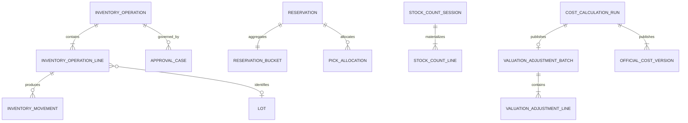

# 04 — Dữ liệu và thực thể

## 1. Mục đích và nguyên tắc mô hình

Mô hình dữ liệu gồm **23 thực thể sở hữu**, các thực thể tham chiếu từ miền khác và các projection có thể dựng lại. Mục tiêu là đủ để triển khai Phase 1 nhưng không tạo entity cho capability chưa có.

Nguyên tắc:

1. Ledger bất biến là Dữ liệu gốc; balance/report là projection.
2. Identity mang `tenant_id`; mutation mang `store_id` và `warehouse_id` dù hiện chỉ có một cặp mặc định.
3. Mọi entity có `id`, `tenant_id`, `created_at`, `created_by`; entity mutable có `version` và audit.
4. Tiền dùng decimal + currency; số lượng dùng decimal theo precision UOM, không dùng float.
5. Ngày nghiệp vụ và instant ghi nhận được lưu tách; instant lưu UTC, diễn giải theo timezone tenant.
6. Snapshot nguồn giữ ID, version và payload hash cần để tái hiện quyết định.
7. Không tạo bảng Serial, OfflineTransaction, ReplenishmentProposal, GenericAlert hoặc WarehouseTransfer trong Phase 1.

## 2. Danh mục 23 thực thể sở hữu

### 2.1 Inventory Operations — 10 thực thể

| ID | Thực thể | Vai trò | Khóa/quan hệ chính |
|---|---|---|---|
| `ENT-IO-01` | `InventoryOperation` | Header lifecycle, business identity, payload lock và final result | unique `(tenant_id, source_type, operation_request_id)`; FK store/warehouse |
| `ENT-IO-02` | `InventoryOperationLine` | Dòng product/quantity/UOM/lot/value context | FK operation, product, lot nullable |
| `ENT-IO-03` | `InventoryMovement` | Ledger số lượng/trạng thái bất biến | FK operation line; monotonic `ledger_sequence` |
| `ENT-IO-04` | `TransactionalBalance` | Projection giao dịch cập nhật nguyên tử | unique balance key + `version` |
| `ENT-IO-05` | `Reservation` | Cam kết lượng theo source order line | unique source/version rules; FK product/warehouse |
| `ENT-IO-06` | `Lot` | Hồ sơ lô sản xuất dùng chung trong tenant | unique `(tenant_id, product_id, normalized_lot_code)` |
| `ENT-IO-07` | `CorrectionChain` | Quan hệ operation gốc–reversal–correction | unique operation membership; root/original linkage |
| `ENT-IO-08` | `ReservationBucket` | Tổng lượng giữ giao dịch theo sản phẩm + kho, độc lập lô | unique `(tenant_id, product_id, warehouse_id)` + version |
| `ENT-IO-09` | `PickAllocation` | Snapshot dòng trong tập phân bổ lô/lượng đã pick nhưng chưa xuất | FK reservation/fulfillment; one active set version |
| `ENT-IO-10` | `CommandReceipt` | Idempotency/result của mọi mutation command | unique `(tenant_id, command_type, idempotency_key)` |

### 2.2 Inventory Control — 7 thực thể

| ID | Thực thể | Vai trò | Khóa/quan hệ chính |
|---|---|---|---|
| `ENT-IC-01` | `ApprovalPolicy` | Policy version theo operation type/risk | natural scope + effective version |
| `ENT-IC-02` | `ApprovalCase` | Snapshot route, quyết định và actor | FK operation/policy version |
| `ENT-IC-03` | `InventoryLock` | Khóa balance key/range có owner và lease | unique active lock target |
| `ENT-IC-04` | `StockCountSession` | Scope, cut-off và lifecycle kiểm kê | FK warehouse; unique active conflicting scope |
| `ENT-IC-05` | `StockCountLine` | Materialized balance key, book/count/recount | FK session; unique session + balance key |
| `ENT-IC-06` | `OpeningBalanceBatch` | Batch migration, control totals và immutable report | max one completed per tenant/baseline |
| `ENT-IC-07` | `ReconciliationCase` | Sai lệch, evidence, action và unlock gate | case type + affected scope + lifecycle |

### 2.3 Inventory Valuation — 6 thực thể

| ID | Thực thể | Vai trò | Khóa/quan hệ chính |
|---|---|---|---|
| `ENT-IV-01` | `ReceiptValuation` | Giá trực tiếp và bằng chứng của receipt quantity | FK receipt operation line; source price version |
| `ENT-IV-02` | `InventoryValueMovement` | Ledger giá trị bất biến | FK operation/value batch; monotonic value sequence |
| `ENT-IV-03` | `CostCalculationRun` | Cut-off, input hash, hai phương pháp, blocker và publish state | unique run ID; tenant + period + scope |
| `ENT-IV-04` | `OfficialCostVersion` | Đơn giá chính thức có hiệu lực | unique tenant + product + effective interval |
| `ENT-IV-05` | `ValuationAdjustmentBatch` | Header batch điều chỉnh cuối kỳ/giữa kỳ | FK cost run; batch type/period |
| `ENT-IV-06` | `ValuationAdjustmentLine` | Chi tiết COGS true-up hoặc tồn cuối kỳ | FK batch; source issue/value reference |

## 3. Chi tiết thực thể Inventory Operations

Các kiểu dưới đây là kiểu logic độc lập công nghệ: ID nội bộ dùng `UUID`; số lượng dùng `DECIMAL(20,6)`; tỷ lệ quy đổi dùng `DECIMAL(24,12)`; tiền dùng `DECIMAL(20,6)` kèm `CHAR(3)`; instant dùng `TIMESTAMPTZ`; payload/snapshot dùng `JSONB`; hash SHA-256 dùng `CHAR(64)`. Cột “Bắt buộc” là yêu cầu nghiệp vụ, không thay thế database migration.

### ENT-IO-01 — InventoryOperation

| Trường | Kiểu dữ liệu logic | PK/FK | Bắt buộc/nullable | Mặc định | Ràng buộc/ghi chú |
|---|---|---|---|---|---|
| `operation_id` | `UUID` | PK | Bắt buộc | Sinh UUID | Định danh operation bất biến |
| `tenant_id` | `UUID` | FK → `Tenant` | Bắt buộc | — | Tenant scope |
| `store_id` | `UUID` | FK → `Store` | Bắt buộc | — | Phase 1 phải là cửa hàng mặc định đang hoạt động |
| `warehouse_id` | `UUID` | FK → `Warehouse` | Bắt buộc | — | Phase 1 phải là kho mặc định đang hoạt động |
| `source_type` | `VARCHAR(40)` | — | Bắt buộc | — | Loại capability/chứng từ nguồn |
| `source_document_id` | `VARCHAR(128)` | Tham chiếu ngoài | Nullable | `NULL` | Có thể trống với operation nội bộ |
| `source_version` | `BIGINT` | — | Nullable | `NULL` | Bắt buộc khi operation do chứng từ nguồn điều khiển |
| `operation_request_id` | `VARCHAR(128)` | UK thành phần | Bắt buộc | — | Unique `(tenant_id, source_type, operation_request_id)` |
| `submitted_payload_hash` | `CHAR(64)` | — | Nullable | `NULL` | Bất biến sau khi submit |
| `replaces_operation_id` | `UUID` | FK → `InventoryOperation` | Nullable | `NULL` | Operation bị thay thế nếu có |
| `operation_type` | `VARCHAR(40)` | — | Bắt buộc | — | Receipt, issue, state change, adjustment… |
| `reason_code` | `VARCHAR(40)` | — | Nullable | `NULL` | Bắt buộc theo operation type/policy |
| `business_date` | `DATE` | — | Bắt buộc | — | Ngày nghiệp vụ |
| `recorded_at` | `TIMESTAMPTZ` | — | Bắt buộc | `now()` | Instant ghi nhận UTC |
| `status` | `VARCHAR(40)` | — | Bắt buộc | `DRAFT` | Lifecycle chuẩn của Inventory Operation |
| `submitted_at` | `TIMESTAMPTZ` | — | Nullable | `NULL` | Có khi đã submit |
| `ready_at` | `TIMESTAMPTZ` | — | Nullable | `NULL` | Có khi vào `READY` |
| `processing_started_at` | `TIMESTAMPTZ` | — | Nullable | `NULL` | Có khi bắt đầu thực thi |
| `completed_at` | `TIMESTAMPTZ` | — | Nullable | `NULL` | Có khi `COMPLETED` |
| `cancelled_at` | `TIMESTAMPTZ` | — | Nullable | `NULL` | Có khi `CANCELLED` |
| `approval_required` | `BOOLEAN` | — | Bắt buộc | `false` | **Luôn là `true` với nhập hàng nhanh; không được cấu hình tắt** |
| `approval_policy_version_id` | `UUID` | FK → `ApprovalPolicy` | Nullable | `NULL` | Bắt buộc khi cần duyệt |
| `risk_value_snapshot` | `DECIMAL(20,6)` | — | Nullable | `NULL` | Tổng giá trị rủi ro đã snapshot |
| `currency` | `CHAR(3)` | — | Nullable | `NULL` | Bắt buộc khi có giá trị tiền |
| `result_code` | `VARCHAR(80)` | — | Nullable | `NULL` | Mã kết quả ổn định |
| `result_payload_hash` | `CHAR(64)` | — | Nullable | `NULL` | Hash kết quả cuối |
| `unknown_since` | `TIMESTAMPTZ` | — | Nullable | `NULL` | Chỉ có khi `UNKNOWN` |
| `failure_detail` | `JSONB` | — | Nullable | `NULL` | Structured failure, không chứa dữ liệu nhạy cảm nguyên văn |
| `created_by` | `UUID` | FK → `User` | Bắt buộc | — | Actor tạo |
| `created_at` | `TIMESTAMPTZ` | — | Bắt buộc | `now()` | Audit |
| `version` | `BIGINT` | — | Bắt buộc | `1` | Optimistic concurrency |
| `updated_by` | `UUID` | FK → `User` | Bắt buộc | — | Actor cập nhật gần nhất |
| `updated_at` | `TIMESTAMPTZ` | — | Bắt buộc | `now()` | Audit |

Status: `DRAFT`, `PENDING_APPROVAL`, `READY`, `PROCESSING`, `COMPLETED`, `APPROVAL_REJECTED`, `EXECUTION_REJECTED`, `UNKNOWN`, `CANCELLED`. Payload chỉ mutable ở `DRAFT`. Với `operation_type=QUICK_RECEIPT`, submit hợp lệ bắt buộc chuyển `DRAFT → PENDING_APPROVAL`; tuyệt đối không có nhánh `DRAFT → READY`.

### ENT-IO-02 — InventoryOperationLine

| Trường | Kiểu dữ liệu logic | PK/FK | Bắt buộc/nullable | Mặc định | Ràng buộc/ghi chú |
|---|---|---|---|---|---|
| `line_id` | `UUID` | PK | Bắt buộc | Sinh UUID | — |
| `tenant_id` | `UUID` | FK → `Tenant` | Bắt buộc | — | Khớp operation |
| `operation_id` | `UUID` | FK → `InventoryOperation` | Bắt buộc | — | Unique với `line_no` |
| `line_no` | `INTEGER` | UK thành phần | Bắt buộc | — | `> 0` |
| `product_id` | `UUID` | FK → `Product` | Bắt buộc | — | Snapshot product status/version nằm trong metadata khi cần |
| `transaction_uom_id` | `UUID` | FK → `UOM` | Bắt buộc | — | Đơn vị giao dịch |
| `transaction_quantity` | `DECIMAL(20,6)` | — | Bắt buộc | — | Theo precision UOM |
| `base_quantity` | `DECIMAL(20,6)` | — | Bắt buộc | — | Tái hiện được từ quantity × ratio |
| `conversion_ratio` | `DECIMAL(24,12)` | — | Bắt buộc | — | Snapshot, không tính lại bằng version mới |
| `uom_version_id` | `UUID` | FK → `UOMConversionVersion` | Bắt buộc | — | — |
| `from_state` | `VARCHAR(40)` | — | Nullable | `NULL` | Theo operation semantics |
| `to_state` | `VARCHAR(40)` | — | Nullable | `NULL` | Theo operation semantics |
| `lot_id` | `UUID` | FK → `Lot` | Nullable | `NULL` | `NONE` phải null; `LOT` bắt buộc với mutation vật lý |
| `source_line_id` | `VARCHAR(128)` | Tham chiếu ngoài | Nullable | `NULL` | Bắt buộc với source line |
| `source_line_version` | `BIGINT` | — | Nullable | `NULL` | Đi cùng source line |
| `official_cost_version_id` | `UUID` | FK → `OfficialCostVersion` | Nullable | `NULL` | Chỉ với operation cần official cost |
| `initial_unit_cost` | `DECIMAL(20,6)` | — | Nullable | `NULL` | Snapshot tại issue/handover |
| `currency` | `CHAR(3)` | — | Nullable | `NULL` | Đi cùng unit cost |
| `metadata_snapshot` | `JSONB` | — | Bắt buộc | `{}` | Assertion/version cần tái hiện quyết định |
| `created_by` | `UUID` | FK → `User` | Bắt buộc | — | Audit |
| `created_at` | `TIMESTAMPTZ` | — | Bắt buộc | `now()` | Audit |

### ENT-IO-03 — InventoryMovement

| Trường | Kiểu dữ liệu logic | PK/FK | Bắt buộc/nullable | Mặc định | Ràng buộc/ghi chú |
|---|---|---|---|---|---|
| `movement_id` | `UUID` | PK | Bắt buộc | Sinh UUID | — |
| `ledger_sequence` | `BIGINT` | UK | Bắt buộc | Cấp tuần tự | Monotonic trong tenant/shard |
| `tenant_id` | `UUID` | FK → `Tenant` | Bắt buộc | — | — |
| `store_id` | `UUID` | FK → `Store` | Bắt buộc | — | — |
| `warehouse_id` | `UUID` | FK → `Warehouse` | Bắt buộc | — | — |
| `operation_id` | `UUID` | FK → `InventoryOperation` | Bắt buộc | — | — |
| `operation_line_id` | `UUID` | FK → `InventoryOperationLine` | Bắt buộc | — | — |
| `product_id` | `UUID` | FK → `Product` | Bắt buộc | — | — |
| `lot_id` | `UUID` | FK → `Lot` | Nullable | `NULL` | Theo tracking policy snapshot |
| `movement_kind` | `VARCHAR(40)` | — | Bắt buộc | — | Receipt, issue, state transfer, adjustment… |
| `from_state` | `VARCHAR(40)` | — | Nullable | `NULL` | State nguồn nếu chuyển trạng thái |
| `to_state` | `VARCHAR(40)` | — | Nullable | `NULL` | State đích nếu chuyển trạng thái |
| `quantity_delta` | `DECIMAL(20,6)` | — | Bắt buộc | — | Khác 0; dấu theo movement semantics |
| `business_date` | `DATE` | — | Bắt buộc | — | — |
| `recorded_at` | `TIMESTAMPTZ` | — | Bắt buộc | `now()` | — |
| `source_identity_snapshot` | `JSONB` | — | Bắt buộc | — | ID/version/hash nguồn |
| `reversal_of_movement_id` | `UUID` | FK → `InventoryMovement` | Nullable | `NULL` | Không tự tham chiếu; không tạo cycle |
| `created_by` | `UUID` | FK → `User` | Bắt buộc | — | Actor/system identity |
| `created_at` | `TIMESTAMPTZ` | — | Bắt buộc | `now()` | Append-only |

Movement append-only, không `UPDATE/DELETE`. Một state transition phải dùng cùng một encoding đã khóa ở technical schema; không được trộn hai cách trong cùng deployment.

### ENT-IO-04 — TransactionalBalance

| Trường | Kiểu dữ liệu logic | PK/FK | Bắt buộc/nullable | Mặc định | Ràng buộc/ghi chú |
|---|---|---|---|---|---|
| `balance_id` | `UUID` | PK | Bắt buộc | Sinh UUID | — |
| `tenant_id` | `UUID` | FK → `Tenant` | Bắt buộc | — | UK thành phần |
| `product_id` | `UUID` | FK → `Product` | Bắt buộc | — | UK thành phần |
| `warehouse_id` | `UUID` | FK → `Warehouse` | Bắt buộc | — | UK thành phần |
| `stock_state` | `VARCHAR(40)` | — | Bắt buộc | — | UK thành phần |
| `lot_id` | `UUID` | FK → `Lot` | Nullable | `NULL` | Null với tracking `NONE` |
| `lot_key` | `VARCHAR(128)` hoặc generated key | UK thành phần | Bắt buộc | Sentinel ổn định khi không lô | Không dùng unique nullable thuần túy |
| `physical_quantity` | `DECIMAL(20,6)` | — | Bắt buộc | `0` | Không lưu lượng giữ |
| `last_ledger_sequence` | `BIGINT` | — | Bắt buộc | `0` | Movement cuối đã áp dụng |
| `version` | `BIGINT` | — | Bắt buộc | `1` | Optimistic concurrency |
| `created_by` | `UUID` | FK → `User` | Bắt buộc | — | Audit |
| `created_at` | `TIMESTAMPTZ` | — | Bắt buộc | `now()` | Audit |
| `updated_by` | `UUID` | FK → `User` | Bắt buộc | — | Audit |
| `updated_at` | `TIMESTAMPTZ` | — | Bắt buộc | `now()` | Audit |

Unique `(tenant_id, product_id, warehouse_id, stock_state, lot_key)`. Hạn dùng không thuộc khóa; eligibility là quy tắc dẫn xuất.

### ENT-IO-05 — Reservation

| Trường | Kiểu dữ liệu logic | PK/FK | Bắt buộc/nullable | Mặc định | Ràng buộc/ghi chú |
|---|---|---|---|---|---|
| `reservation_id` | `UUID` | PK | Bắt buộc | Sinh UUID | — |
| `tenant_id` | `UUID` | FK → `Tenant` | Bắt buộc | — | — |
| `store_id` | `UUID` | FK → `Store` | Bắt buộc | — | — |
| `warehouse_id` | `UUID` | FK → `Warehouse` | Bắt buộc | — | — |
| `source_type` | `VARCHAR(40)` | — | Bắt buộc | — | — |
| `source_document_id` | `VARCHAR(128)` | Tham chiếu ngoài | Bắt buộc | — | — |
| `source_line_id` | `VARCHAR(128)` | Tham chiếu ngoài | Bắt buộc | — | — |
| `source_version` | `BIGINT` | — | Bắt buộc | — | Monotonic source version |
| `product_id` | `UUID` | FK → `Product` | Bắt buộc | — | — |
| `requested_base_quantity` | `DECIMAL(20,6)` | — | Bắt buộc | — | `> 0` |
| `reserved_base_quantity` | `DECIMAL(20,6)` | — | Bắt buộc | `0` | Từ 0 đến requested quantity |
| `status` | `VARCHAR(40)` | — | Bắt buộc | `ACTIVE` | `ACTIVE`, `PARTIALLY_CONSUMED`, `CONSUMED`, `RELEASED`, `EXPIRED` |
| `expires_at` | `TIMESTAMPTZ` | — | Nullable | `NULL` | Null nghĩa là tồn tại đến terminal event theo source contract |
| `expiry_policy_snapshot` | `JSONB` | — | Nullable | `NULL` | Căn cứ expiry nếu được suy ra |
| `released_reason` | `VARCHAR(80)` | — | Nullable | `NULL` | Bắt buộc khi released thủ công/policy |
| `consumed_at` | `TIMESTAMPTZ` | — | Nullable | `NULL` | — |
| `created_by` | `UUID` | FK → `User` | Bắt buộc | — | Audit |
| `created_at` | `TIMESTAMPTZ` | — | Bắt buộc | `now()` | Audit |
| `version` | `BIGINT` | — | Bắt buộc | `1` | Concurrency |
| `updated_by` | `UUID` | FK → `User` | Bắt buộc | — | Audit |
| `updated_at` | `TIMESTAMPTZ` | — | Bắt buộc | `now()` | Audit |

Reservation không gắn lô; lô chỉ được chọn tại pick/allocation.

### ENT-IO-06 — Lot

| Trường | Kiểu dữ liệu logic | PK/FK | Bắt buộc/nullable | Mặc định | Ràng buộc/ghi chú |
|---|---|---|---|---|---|
| `lot_id` | `UUID` | PK | Bắt buộc | Sinh UUID | — |
| `tenant_id` | `UUID` | FK → `Tenant` | Bắt buộc | — | UK thành phần |
| `product_id` | `UUID` | FK → `Product` | Bắt buộc | — | UK thành phần |
| `lot_code` | `VARCHAR(128)` | — | Bắt buộc | — | Mã từ nhà sản xuất/đóng gói |
| `normalized_lot_code` | `VARCHAR(128)` | UK thành phần | Bắt buộc | — | Unique trong tenant + product |
| `manufacture_date` | `DATE` | — | Nullable | `NULL` | — |
| `manufacture_date_precision` | `VARCHAR(10)` | — | Nullable | `NULL` | `DAY`, `MONTH`, `YEAR` |
| `expiry_date` | `DATE` | — | Nullable | `NULL` | Bắt buộc nếu product policy yêu cầu |
| `expiry_date_precision` | `VARCHAR(10)` | — | Nullable | `NULL` | Precision gốc |
| `created_by_operation_id` | `UUID` | FK → `InventoryOperation` | Bắt buộc | — | Operation đầu tiên phát sinh tồn |
| `status` | `VARCHAR(40)` | — | Bắt buộc | `ACTIVE` | Không dùng status thay stock state |
| `last_changed_reason` | `TEXT` | — | Nullable | `NULL` | Bắt buộc khi sửa thuộc tính |
| `created_by` | `UUID` | FK → `User` | Bắt buộc | — | Audit |
| `created_at` | `TIMESTAMPTZ` | — | Bắt buộc | `now()` | Audit |
| `version` | `BIGINT` | — | Bắt buộc | `1` | Concurrency |
| `updated_by` | `UUID` | FK → `User` | Bắt buộc | — | Audit |
| `updated_at` | `TIMESTAMPTZ` | — | Bắt buộc | `now()` | Audit |

Unique `(tenant_id, product_id, normalized_lot_code)`. Xung đột manufacture/expiry chặn commit.

### ENT-IO-07 — CorrectionChain

| Trường | Kiểu dữ liệu logic | PK/FK | Bắt buộc/nullable | Mặc định | Ràng buộc/ghi chú |
|---|---|---|---|---|---|
| `chain_entry_id` | `UUID` | PK | Bắt buộc | Sinh UUID | Một membership trong chain |
| `chain_id` | `UUID` | UK thành phần | Bắt buộc | Sinh khi tạo chain | ID nhóm dùng chung cho các entry |
| `tenant_id` | `UUID` | FK → `Tenant` | Bắt buộc | — | — |
| `root_operation_id` | `UUID` | FK → `InventoryOperation` | Bắt buộc | — | Operation gốc |
| `member_operation_id` | `UUID` | FK → `InventoryOperation` | Bắt buộc | — | Unique toàn bảng |
| `relation_type` | `VARCHAR(20)` | — | Bắt buộc | — | `ORIGINAL`, `REVERSAL`, `CORRECTION`, `REPLACEMENT` |
| `predecessor_operation_id` | `UUID` | FK → `InventoryOperation` | Nullable | `NULL` | Null với root |
| `reason` | `TEXT` | — | Bắt buộc | — | — |
| `sequence_no` | `INTEGER` | UK thành phần | Bắt buộc | — | Tăng trong chain |
| `created_by` | `UUID` | FK → `User` | Bắt buộc | — | Audit |
| `created_at` | `TIMESTAMPTZ` | — | Bắt buộc | `now()` | Append-only |

Unique `member_operation_id` và `(chain_id, sequence_no)`; chain không cycle.

### ENT-IO-08 — ReservationBucket

| Trường | Kiểu dữ liệu logic | PK/FK | Bắt buộc/nullable | Mặc định | Ràng buộc/ghi chú |
|---|---|---|---|---|---|
| `reservation_bucket_id` | `UUID` | PK | Bắt buộc | Sinh UUID | — |
| `tenant_id` | `UUID` | FK → `Tenant` | Bắt buộc | — | UK thành phần |
| `product_id` | `UUID` | FK → `Product` | Bắt buộc | — | UK thành phần |
| `warehouse_id` | `UUID` | FK → `Warehouse` | Bắt buộc | — | UK thành phần |
| `reserved_base_quantity` | `DECIMAL(20,6)` | — | Bắt buộc | `0` | Không âm; bằng tổng reservation còn hiệu lực |
| `last_reservation_id` | `UUID` | FK → `Reservation` | Nullable | `NULL` | Trace cập nhật gần nhất |
| `version` | `BIGINT` | — | Bắt buộc | `1` | Lock/CAS khi reserve-release |
| `created_by` | `UUID` | FK → `User` | Bắt buộc | — | Audit |
| `created_at` | `TIMESTAMPTZ` | — | Bắt buộc | `now()` | Audit |
| `updated_by` | `UUID` | FK → `User` | Bắt buộc | — | Audit |
| `updated_at` | `TIMESTAMPTZ` | — | Bắt buộc | `now()` | Audit |

Unique `(tenant_id, product_id, warehouse_id)`; không có `lot_id` hoặc `stock_state`.

### ENT-IO-09 — PickAllocation

| Trường | Kiểu dữ liệu logic | PK/FK | Bắt buộc/nullable | Mặc định | Ràng buộc/ghi chú |
|---|---|---|---|---|---|
| `allocation_id` | `UUID` | PK | Bắt buộc | Sinh UUID | — |
| `tenant_id` | `UUID` | FK → `Tenant` | Bắt buộc | — | — |
| `store_id` | `UUID` | FK → `Store` | Bắt buộc | — | — |
| `allocation_set_id` | `UUID` | UK thành phần | Bắt buộc | — | ID tập phân bổ |
| `allocation_version` | `BIGINT` | UK thành phần | Bắt buộc | `1` | Version tập |
| `line_no` | `INTEGER` | UK thành phần | Bắt buộc | — | — |
| `fulfillment_id` | `VARCHAR(128)` | Tham chiếu ngoài | Bắt buộc | — | — |
| `reservation_id` | `UUID` | FK → `Reservation` | Bắt buộc | — | — |
| `product_id` | `UUID` | FK → `Product` | Bắt buộc | — | Khớp reservation |
| `warehouse_id` | `UUID` | FK → `Warehouse` | Bắt buộc | — | Khớp reservation |
| `lot_id` | `UUID` | FK → `Lot` | Nullable | `NULL` | Bắt buộc với product LOT |
| `allocated_base_quantity` | `DECIMAL(20,6)` | — | Bắt buộc | — | `> 0`; tổng không vượt lượng chưa consume |
| `allocation_method` | `VARCHAR(20)` | — | Bắt buộc | — | FEFO, MANUAL hoặc policy khác đã định nghĩa |
| `override_reason` | `TEXT` | — | Nullable | `NULL` | Bắt buộc với manual override |
| `status` | `VARCHAR(20)` | — | Bắt buộc | `ACTIVE` | `ACTIVE`, `SUPERSEDED`, `CONSUMED`, `RELEASED` |
| `row_version` | `BIGINT` | — | Bắt buộc | `1` | CAS |
| `picked_by` | `UUID` | FK → `User` | Nullable | `NULL` | — |
| `picked_at` | `TIMESTAMPTZ` | — | Nullable | `NULL` | — |
| `consumed_by_operation_id` | `UUID` | FK → `InventoryOperation` | Nullable | `NULL` | Chỉ có khi issue/handover commit |
| `created_by` | `UUID` | FK → `User` | Bắt buộc | — | Audit |
| `created_at` | `TIMESTAMPTZ` | — | Bắt buộc | `now()` | Audit |
| `updated_by` | `UUID` | FK → `User` | Bắt buộc | — | Audit |
| `updated_at` | `TIMESTAMPTZ` | — | Bắt buộc | `now()` | Audit |

Unique `(tenant_id, allocation_set_id, allocation_version, line_no)`; mỗi fulfillment chỉ có một active set version.

### ENT-IO-10 — CommandReceipt

| Trường | Kiểu dữ liệu logic | PK/FK | Bắt buộc/nullable | Mặc định | Ràng buộc/ghi chú |
|---|---|---|---|---|---|
| `command_receipt_id` | `UUID` | PK | Bắt buộc | Sinh UUID | — |
| `tenant_id` | `UUID` | FK → `Tenant` | Bắt buộc | — | UK thành phần |
| `command_type` | `VARCHAR(80)` | UK thành phần | Bắt buộc | — | — |
| `idempotency_key` | `VARCHAR(128)` | UK thành phần | Bắt buộc | — | — |
| `request_payload_hash` | `CHAR(64)` | — | Bắt buộc | — | Cùng key khác hash bị chặn |
| `target_operation_id` | `UUID` | FK → `InventoryOperation` | Nullable | `NULL` | — |
| `target_entity_type` | `VARCHAR(80)` | — | Nullable | `NULL` | Khi command không nhắm operation |
| `target_entity_id` | `UUID` | — | Nullable | `NULL` | Đi cùng target entity type |
| `expected_entity_version` | `BIGINT` | — | Nullable | `NULL` | CAS/If-Match |
| `result_status` | `VARCHAR(40)` | — | Bắt buộc | `PROCESSING` | Processing/completed/rejected/unknown |
| `result_payload_hash` | `CHAR(64)` | — | Nullable | `NULL` | — |
| `error_code` | `VARCHAR(80)` | — | Nullable | `NULL` | Stable structured code |
| `completed_at` | `TIMESTAMPTZ` | — | Nullable | `NULL` | — |
| `created_by` | `UUID` | FK → `User` | Bắt buộc | — | Actor/system identity |
| `created_at` | `TIMESTAMPTZ` | — | Bắt buộc | `now()` | Audit |

Unique `(tenant_id, command_type, idempotency_key)`. Không lưu payload tài chính nhạy cảm nguyên văn.

## 4. Chi tiết thực thể Inventory Control

### ENT-IC-01 — ApprovalPolicy

| Trường | Kiểu dữ liệu logic | PK/FK | Bắt buộc/nullable | Mặc định | Ràng buộc/ghi chú |
|---|---|---|---|---|---|
| `approval_policy_version_id` | `UUID` | PK | Bắt buộc | Sinh UUID | ID của một policy version bất biến sau khi active |
| `policy_id` | `UUID` | UK thành phần | Bắt buộc | Sinh khi tạo policy | Stable ID qua các version |
| `tenant_id` | `UUID` | FK → `Tenant` | Bắt buộc | — | — |
| `version_no` | `BIGINT` | UK thành phần | Bắt buộc | `1` | Tăng đơn điệu theo policy |
| `operation_type` | `VARCHAR(40)` | — | Bắt buộc | — | Selector loại operation |
| `reason_selectors` | `JSONB` | — | Bắt buộc | `{}` | Điều kiện route, không được vô hiệu duyệt nhập nhanh |
| `risk_selectors` | `JSONB` | — | Bắt buộc | `{}` | Điều kiện risk/threshold nếu loại operation cho phép |
| `threshold_amount` | `DECIMAL(20,6)` | — | Nullable | `NULL` | Ngưỡng route; không phải ngưỡng bỏ duyệt nhập nhanh |
| `threshold_currency` | `CHAR(3)` | — | Nullable | `NULL` | Đi cùng threshold amount |
| `required_approval_level` | `INTEGER` | — | Bắt buộc | — | Cấp cao nhất cần đáp ứng |
| `eligible_role_conditions` | `JSONB` | — | Bắt buộc | — | Role/permission/scope hợp lệ |
| `effective_from` | `TIMESTAMPTZ` | — | Bắt buộc | — | — |
| `effective_to` | `TIMESTAMPTZ` | — | Nullable | `NULL` | Không overlap cùng scope |
| `status` | `VARCHAR(20)` | — | Bắt buộc | `DRAFT` | `DRAFT`, `ACTIVE`, `RETIRED` |
| `created_by` | `UUID` | FK → `User` | Bắt buộc | — | Audit |
| `created_at` | `TIMESTAMPTZ` | — | Bắt buộc | `now()` | Audit |
| `updated_by` | `UUID` | FK → `User` | Bắt buộc | — | Audit |
| `updated_at` | `TIMESTAMPTZ` | — | Bắt buộc | `now()` | Audit |

**Bất biến nhập hàng nhanh:** policy chỉ xác định tuyến/cấp/người duyệt. Nó không có cờ “có cần duyệt hay không”. Với operation nhập hàng nhanh, submit hợp lệ luôn tạo `ApprovalCase` và chuyển operation sang `PENDING_APPROVAL`; thiếu policy active hoặc thiếu approver đủ cấp thì giữ `DRAFT` và trả structured rejection.

### ENT-IC-02 — ApprovalCase

| Trường | Kiểu dữ liệu logic | PK/FK | Bắt buộc/nullable | Mặc định | Ràng buộc/ghi chú |
|---|---|---|---|---|---|
| `approval_case_id` | `UUID` | PK | Bắt buộc | Sinh UUID | — |
| `tenant_id` | `UUID` | FK → `Tenant` | Bắt buộc | — | — |
| `operation_id` | `UUID` | FK → `InventoryOperation` | Bắt buộc | — | Tối đa một case active/operation |
| `approval_policy_version_id` | `UUID` | FK → `ApprovalPolicy` | Bắt buộc | — | Snapshot đúng version |
| `required_approval_level` | `INTEGER` | — | Bắt buộc | — | Cấp suy ra khi submit |
| `requester_id` | `UUID` | FK → `User` | Bắt buộc | — | Maker |
| `risk_value_vnd` | `DECIMAL(20,6)` | — | Bắt buộc | `0` | `Σ |line_amount_vnd|` |
| `risk_lines_snapshot` | `JSONB` | — | Bắt buộc | `[]` | Quantity, price source/version, currency, FX, VND amount từng dòng |
| `eligible_approvers_snapshot` | `JSONB` | — | Bắt buộc | `[]` | Bằng chứng route tại submit |
| `status` | `VARCHAR(30)` | — | Bắt buộc | `PENDING` | `PENDING`, `APPROVED`, `REJECTED`, `CANCELLED` |
| `decision_level` | `INTEGER` | — | Nullable | `NULL` | Có khi đã quyết định |
| `decision_actor_id` | `UUID` | FK → `User` | Nullable | `NULL` | Recheck permission/scope tại lúc quyết định |
| `decision` | `VARCHAR(20)` | — | Nullable | `NULL` | `APPROVE` hoặc `REJECT` |
| `decision_reason` | `TEXT` | — | Nullable | `NULL` | Bắt buộc khi reject |
| `decided_at` | `TIMESTAMPTZ` | — | Nullable | `NULL` | — |
| `submitted_at` | `TIMESTAMPTZ` | — | Bắt buộc | `now()` | — |
| `created_by` | `UUID` | FK → `User` | Bắt buộc | — | Audit |
| `created_at` | `TIMESTAMPTZ` | — | Bắt buộc | `now()` | Audit |
| `version` | `BIGINT` | — | Bắt buộc | `1` | First valid decision wins |
| `updated_by` | `UUID` | FK → `User` | Bắt buộc | — | Audit |
| `updated_at` | `TIMESTAMPTZ` | — | Bắt buộc | `now()` | Audit |

Maker không được duyệt case của mình. Một approver đủ cấp cao nhất quyết định, không tuần tự qua các cấp thấp hơn.

### ENT-IC-03 — InventoryLock

| Trường | Kiểu dữ liệu logic | PK/FK | Bắt buộc/nullable | Mặc định | Ràng buộc/ghi chú |
|---|---|---|---|---|---|
| `lock_id` | `UUID` | PK | Bắt buộc | Sinh UUID | — |
| `tenant_id` | `UUID` | FK → `Tenant` | Bắt buộc | — | — |
| `warehouse_id` | `UUID` | FK → `Warehouse` | Bắt buộc | — | — |
| `lock_type` | `VARCHAR(40)` | — | Bắt buộc | — | Count, reconciliation, migration, recovery… |
| `owner_type` | `VARCHAR(40)` | — | Bắt buộc | — | Loại aggregate sở hữu lock |
| `owner_id` | `UUID` | — | Bắt buộc | — | ID aggregate owner |
| `scope_type` | `VARCHAR(40)` | — | Bắt buộc | — | Key, range hoặc predicate |
| `scope_predicate_snapshot` | `JSONB` | — | Bắt buộc | — | Kiểm cả key hiện hữu và key có thể phát sinh |
| `scope_predicate_hash` | `CHAR(64)` | — | Bắt buộc | — | Stable scope identity |
| `materialized_key_snapshot` | `JSONB` | — | Nullable | `NULL` | Keys tại cut-off |
| `materialized_key_hash` | `CHAR(64)` | — | Nullable | `NULL` | Hash snapshot keys |
| `cutoff_ledger_sequence` | `BIGINT` | — | Bắt buộc | — | — |
| `status` | `VARCHAR(20)` | — | Bắt buộc | `ACTIVE` | `ACTIVE`, `RELEASED`, `EXPIRED` |
| `acquired_at` | `TIMESTAMPTZ` | — | Bắt buộc | `now()` | — |
| `expires_at` | `TIMESTAMPTZ` | — | Nullable | `NULL` | Lease nếu áp dụng |
| `released_at` | `TIMESTAMPTZ` | — | Nullable | `NULL` | — |
| `release_reason` | `TEXT` | — | Nullable | `NULL` | Bắt buộc khi release ngoài normal completion |
| `created_by` | `UUID` | FK → `User` | Bắt buộc | — | Audit |
| `created_at` | `TIMESTAMPTZ` | — | Bắt buộc | `now()` | Audit |
| `version` | `BIGINT` | — | Bắt buộc | `1` | Concurrency |
| `updated_by` | `UUID` | FK → `User` | Bắt buộc | — | Audit |
| `updated_at` | `TIMESTAMPTZ` | — | Bắt buộc | `now()` | Audit |

Cần partial/exclusion constraint chống hai active lock có scope xung đột. Lock ứng dụng không thay row lock/CAS của balance.

### ENT-IC-04 — StockCountSession

| Trường | Kiểu dữ liệu logic | PK/FK | Bắt buộc/nullable | Mặc định | Ràng buộc/ghi chú |
|---|---|---|---|---|---|
| `session_id` | `UUID` | PK | Bắt buộc | Sinh UUID | — |
| `tenant_id` | `UUID` | FK → `Tenant` | Bắt buộc | — | — |
| `store_id` | `UUID` | FK → `Store` | Bắt buộc | — | — |
| `warehouse_id` | `UUID` | FK → `Warehouse` | Bắt buộc | — | — |
| `scope_definition` | `JSONB` | — | Bắt buộc | — | Predicate/range do người dùng xác nhận |
| `scope_snapshot_hash` | `CHAR(64)` | — | Bắt buộc | — | Membership không đổi sau open |
| `cutoff_ledger_sequence` | `BIGINT` | — | Bắt buộc | — | — |
| `status` | `VARCHAR(30)` | — | Bắt buộc | `DRAFT` | Lifecycle Stock Count |
| `lock_id` | `UUID` | FK → `InventoryLock` | Nullable | `NULL` | Bắt buộc từ `OPEN/LOCKED` |
| `approval_case_id` | `UUID` | FK → `ApprovalCase` | Nullable | `NULL` | Có khi cần duyệt variance |
| `opened_at` | `TIMESTAMPTZ` | — | Nullable | `NULL` | — |
| `submitted_at` | `TIMESTAMPTZ` | — | Nullable | `NULL` | — |
| `approved_at` | `TIMESTAMPTZ` | — | Nullable | `NULL` | — |
| `cancelled_at` | `TIMESTAMPTZ` | — | Nullable | `NULL` | — |
| `submitted_by` | `UUID` | FK → `User` | Nullable | `NULL` | — |
| `approved_by` | `UUID` | FK → `User` | Nullable | `NULL` | — |
| `cancelled_by` | `UUID` | FK → `User` | Nullable | `NULL` | — |
| `created_by` | `UUID` | FK → `User` | Bắt buộc | — | Audit |
| `created_at` | `TIMESTAMPTZ` | — | Bắt buộc | `now()` | Audit |
| `version` | `BIGINT` | — | Bắt buộc | `1` | Concurrency |
| `updated_by` | `UUID` | FK → `User` | Bắt buộc | — | Audit |
| `updated_at` | `TIMESTAMPTZ` | — | Bắt buộc | `now()` | Audit |

### ENT-IC-05 — StockCountLine

| Trường | Kiểu dữ liệu logic | PK/FK | Bắt buộc/nullable | Mặc định | Ràng buộc/ghi chú |
|---|---|---|---|---|---|
| `stock_count_line_id` | `UUID` | PK | Bắt buộc | Sinh UUID | — |
| `tenant_id` | `UUID` | FK → `Tenant` | Bắt buộc | — | — |
| `session_id` | `UUID` | FK → `StockCountSession` | Bắt buộc | — | — |
| `line_no` | `INTEGER` | UK thành phần | Bắt buộc | — | — |
| `book_balance_id` | `UUID` | FK → `TransactionalBalance` | Nullable | `NULL` | Null với hàng/lô mới tìm thấy ngoài snapshot |
| `product_id` | `UUID` | FK → `Product` | Bắt buộc | — | Balance key snapshot |
| `stock_state` | `VARCHAR(40)` | — | Bắt buộc | — | Balance key snapshot |
| `lot_id` | `UUID` | FK → `Lot` | Nullable | `NULL` | — |
| `lot_key_snapshot` | `VARCHAR(128)` | UK thành phần | Bắt buộc | — | Sentinel ổn định khi không lô |
| `is_unexpected_key` | `BOOLEAN` | — | Bắt buộc | `false` | True khi thực tế có nhưng snapshot không có |
| `book_quantity` | `DECIMAL(20,6)` | — | Bắt buộc | `0` | Chỉ lộ sau lần submit đầu |
| `first_count_quantity` | `DECIMAL(20,6)` | — | Nullable | `NULL` | — |
| `recount_quantity` | `DECIMAL(20,6)` | — | Nullable | `NULL` | — |
| `final_count_quantity` | `DECIMAL(20,6)` | — | Nullable | `NULL` | Số được chọn làm căn cứ cuối |
| `variance_quantity` | `DECIMAL(20,6)` | — | Nullable | `NULL` | `final_count - book` |
| `risk_valuation_snapshot` | `JSONB` | — | Nullable | `NULL` | Căn cứ giá/risk |
| `first_counted_by` | `UUID` | FK → `User` | Nullable | `NULL` | — |
| `first_counted_at` | `TIMESTAMPTZ` | — | Nullable | `NULL` | — |
| `recounted_by` | `UUID` | FK → `User` | Nullable | `NULL` | — |
| `recounted_at` | `TIMESTAMPTZ` | — | Nullable | `NULL` | — |
| `decision` | `VARCHAR(30)` | — | Nullable | `NULL` | Accept/recount/reject theo lifecycle |
| `adjustment_line_id` | `UUID` | FK → `InventoryOperationLine` | Nullable | `NULL` | Có khi variance đã commit |
| `created_by` | `UUID` | FK → `User` | Bắt buộc | — | Audit |
| `created_at` | `TIMESTAMPTZ` | — | Bắt buộc | `now()` | Audit |
| `version` | `BIGINT` | — | Bắt buộc | `1` | Concurrency |
| `updated_by` | `UUID` | FK → `User` | Bắt buộc | — | Audit |
| `updated_at` | `TIMESTAMPTZ` | — | Bắt buộc | `now()` | Audit |

Unique `(session_id, product_id, stock_state, lot_key_snapshot)`.

### ENT-IC-06 — OpeningBalanceBatch

| Trường | Kiểu dữ liệu logic | PK/FK | Bắt buộc/nullable | Mặc định | Ràng buộc/ghi chú |
|---|---|---|---|---|---|
| `batch_id` | `UUID` | PK | Bắt buộc | Sinh UUID | — |
| `tenant_id` | `UUID` | FK → `Tenant` | Bắt buộc | — | — |
| `baseline_id` | `VARCHAR(128)` | UK thành phần | Bắt buộc | — | Tối đa một completed batch/tenant/baseline |
| `cutoff_at` | `TIMESTAMPTZ` | — | Bắt buộc | — | — |
| `scope_snapshot` | `JSONB` | — | Bắt buộc | — | Store/warehouse/product scope |
| `source_uri` | `TEXT` | — | Bắt buộc | — | Không chứa secret |
| `source_hash` | `CHAR(64)` | — | Bắt buộc | — | Bằng chứng input |
| `control_quantity_totals` | `JSONB` | — | Bắt buộc | — | Theo warehouse/key đã khóa |
| `control_value_totals` | `JSONB` | — | Bắt buộc | — | Theo product/currency |
| `status` | `VARCHAR(30)` | — | Bắt buộc | `DRAFT` | Preparation/approval/commit lifecycle |
| `approval_case_id` | `UUID` | FK → `ApprovalCase` | Nullable | `NULL` | — |
| `committed_operation_ids` | `JSONB` | — | Nullable | `NULL` | Stable ordered list |
| `immutable_report_uri` | `TEXT` | — | Nullable | `NULL` | Bắt buộc khi completed |
| `immutable_report_hash` | `CHAR(64)` | — | Nullable | `NULL` | Bắt buộc khi completed |
| `activation_from_status` | `VARCHAR(20)` | — | Nullable | `NULL` | Kỳ vọng `PREPARING` |
| `activation_to_status` | `VARCHAR(20)` | — | Nullable | `NULL` | Kỳ vọng `ACTIVE` |
| `completed_at` | `TIMESTAMPTZ` | — | Nullable | `NULL` | — |
| `created_by` | `UUID` | FK → `User` | Bắt buộc | — | Audit |
| `created_at` | `TIMESTAMPTZ` | — | Bắt buộc | `now()` | Audit |
| `version` | `BIGINT` | — | Bắt buộc | `1` | Concurrency |
| `updated_by` | `UUID` | FK → `User` | Bắt buộc | — | Audit |
| `updated_at` | `TIMESTAMPTZ` | — | Bắt buộc | `now()` | Audit |

Staging trước commit là transient storage, không phải Dữ liệu gốc và không thuộc authoritative entity model.

### ENT-IC-07 — ReconciliationCase

| Trường | Kiểu dữ liệu logic | PK/FK | Bắt buộc/nullable | Mặc định | Ràng buộc/ghi chú |
|---|---|---|---|---|---|
| `case_id` | `UUID` | PK | Bắt buộc | Sinh UUID | — |
| `tenant_id` | `UUID` | FK → `Tenant` | Bắt buộc | — | — |
| `case_type` | `VARCHAR(40)` | — | Bắt buộc | — | UNKNOWN, source mismatch, ledger/projection mismatch… |
| `severity` | `VARCHAR(20)` | — | Bắt buộc | — | — |
| `warehouse_id` | `UUID` | FK → `Warehouse` | Nullable | `NULL` | Affected scope |
| `product_id` | `UUID` | FK → `Product` | Nullable | `NULL` | Affected scope |
| `operation_id` | `UUID` | FK → `InventoryOperation` | Nullable | `NULL` | Affected scope |
| `accounting_period_id` | `UUID` | FK → `AccountingPeriod` | Nullable | `NULL` | Affected scope |
| `detected_at` | `TIMESTAMPTZ` | — | Bắt buộc | `now()` | — |
| `expected_evidence_refs` | `JSONB` | — | Nullable | `NULL` | — |
| `actual_evidence_refs` | `JSONB` | — | Nullable | `NULL` | — |
| `status` | `VARCHAR(30)` | — | Bắt buộc | `OPEN` | `OPEN`, `INVESTIGATING`, `RESOLVED`, `UNRESOLVED` |
| `assigned_to` | `UUID` | FK → `User` | Nullable | `NULL` | — |
| `actions` | `JSONB` | — | Bắt buộc | `[]` | Append-only action history trong case snapshot |
| `resolution_code` | `VARCHAR(80)` | — | Nullable | `NULL` | — |
| `resolution_evidence` | `JSONB` | — | Nullable | `NULL` | — |
| `resolution_evidence_hash` | `CHAR(64)` | — | Nullable | `NULL` | — |
| `locked_scope_id` | `UUID` | FK → `InventoryLock` | Nullable | `NULL` | — |
| `duplicate_of_case_id` | `UUID` | FK → `ReconciliationCase` | Nullable | `NULL` | Không tự tham chiếu |
| `reopened_from_case_id` | `UUID` | FK → `ReconciliationCase` | Nullable | `NULL` | Trace reopen |
| `resolved_by` | `UUID` | FK → `User` | Nullable | `NULL` | — |
| `resolved_at` | `TIMESTAMPTZ` | — | Nullable | `NULL` | — |
| `created_by` | `UUID` | FK → `User` | Bắt buộc | — | Audit |
| `created_at` | `TIMESTAMPTZ` | — | Bắt buộc | `now()` | Audit |
| `version` | `BIGINT` | — | Bắt buộc | `1` | Concurrency |
| `updated_by` | `UUID` | FK → `User` | Bắt buộc | — | Audit |
| `updated_at` | `TIMESTAMPTZ` | — | Bắt buộc | `now()` | Audit |

Tồn thấp/cận hạn không tạo Reconciliation Case.

## 5. Chi tiết thực thể Inventory Valuation

### ENT-IV-01 — ReceiptValuation

| Trường | Kiểu dữ liệu logic | PK/FK | Bắt buộc/nullable | Mặc định | Ràng buộc/ghi chú |
|---|---|---|---|---|---|
| `receipt_valuation_id` | `UUID` | PK | Bắt buộc | Sinh UUID | — |
| `tenant_id` | `UUID` | FK → `Tenant` | Bắt buộc | — | — |
| `receipt_operation_line_id` | `UUID` | FK → `InventoryOperationLine` | Bắt buộc | — | Receipt line đã chuyển quyền sở hữu |
| `valuation_kind` | `VARCHAR(30)` | — | Bắt buộc | `DIRECT_PRICE` | `DIRECT_PRICE` hoặc `LATE_COMPONENT` |
| `price_source_type` | `VARCHAR(40)` | — | Bắt buộc | — | PO, invoice, supplier evidence… |
| `price_source_id` | `VARCHAR(128)` | Tham chiếu ngoài | Bắt buộc | — | — |
| `price_source_version` | `BIGINT` | — | Bắt buộc | — | — |
| `cost_component_type` | `VARCHAR(40)` | — | Nullable | `NULL` | Bắt buộc với `LATE_COMPONENT` |
| `source_natural_key_hash` | `CHAR(64)` | UK có điều kiện | Nullable | `NULL` | Bắt buộc/unique với late component |
| `quantity_basis` | `DECIMAL(20,6)` | — | Nullable | `NULL` | Căn cứ phân bổ |
| `unit_purchase_price` | `DECIMAL(20,6)` | — | Nullable | `NULL` | Direct price trước cost component |
| `deductible_vat_amount` | `DECIMAL(20,6)` | — | Bắt buộc | `0` | — |
| `non_deductible_vat_amount` | `DECIMAL(20,6)` | — | Bắt buộc | `0` | Cấu phần vào direct cost theo policy |
| `confirmed_direct_unit_cost` | `DECIMAL(20,6)` | — | Nullable | `NULL` | Bắt buộc với direct confirmation |
| `currency` | `CHAR(3)` | — | Bắt buộc | — | — |
| `evidence_hash` | `CHAR(64)` | — | Bắt buộc | — | — |
| `late_cost_status` | `VARCHAR(30)` | — | Nullable | `NULL` | Chỉ với late component |
| `original_period_id` | `UUID` | FK → `AccountingPeriod` | Nullable | `NULL` | Chỉ với late component |
| `posting_period_id` | `UUID` | FK → `AccountingPeriod` | Nullable | `NULL` | Kỳ mở ghi adjustment |
| `allocation_basis` | `JSONB` | — | Nullable | `NULL` | — |
| `allocation_hash` | `CHAR(64)` | — | Nullable | `NULL` | — |
| `affected_scope` | `JSONB` | — | Nullable | `NULL` | Product-period scope bị đánh dấu dirty |
| `superseding_run_id` | `UUID` | FK → `CostCalculationRun` | Nullable | `NULL` | Run kế tiếp nếu có |
| `confirmed_by` | `UUID` | FK → `User` | Nullable | `NULL` | Bắt buộc khi confirmed |
| `confirmed_at` | `TIMESTAMPTZ` | — | Nullable | `NULL` | Bắt buộc khi confirmed |
| `created_by` | `UUID` | FK → `User` | Bắt buộc | — | Audit |
| `created_at` | `TIMESTAMPTZ` | — | Bắt buộc | `now()` | Audit |
| `version` | `BIGINT` | — | Bắt buộc | `1` | Concurrency/lifecycle |
| `updated_by` | `UUID` | FK → `User` | Bắt buộc | — | Audit |
| `updated_at` | `TIMESTAMPTZ` | — | Bắt buộc | `now()` | Audit |

Một receipt line chỉ có một direct-price confirmation chính thức. Late component chống trùng bằng natural-key hash; hai loại bản ghi dùng conditional constraints riêng.

### ENT-IV-02 — InventoryValueMovement

| Trường | Kiểu dữ liệu logic | PK/FK | Bắt buộc/nullable | Mặc định | Ràng buộc/ghi chú |
|---|---|---|---|---|---|
| `value_movement_id` | `UUID` | PK | Bắt buộc | Sinh UUID | — |
| `value_sequence` | `BIGINT` | UK | Bắt buộc | Cấp tuần tự | Monotonic trong tenant/shard |
| `tenant_id` | `UUID` | FK → `Tenant` | Bắt buộc | — | — |
| `product_id` | `UUID` | FK → `Product` | Bắt buộc | — | Official value scope |
| `warehouse_id` | `UUID` | FK → `Warehouse` | Nullable | `NULL` | Bắt buộc khi gắn quantity operation |
| `operation_line_id` | `UUID` | FK → `InventoryOperationLine` | Nullable | `NULL` | Một trong hai source line |
| `valuation_adjustment_line_id` | `UUID` | FK → `ValuationAdjustmentLine` | Nullable | `NULL` | Một trong hai source line |
| `value_type` | `VARCHAR(40)` | — | Bắt buộc | — | Receipt, COGS, return, true-up… |
| `amount` | `DECIMAL(20,6)` | — | Bắt buộc | — | Signed delta |
| `currency` | `CHAR(3)` | — | Bắt buộc | — | — |
| `business_date` | `DATE` | — | Bắt buộc | — | — |
| `recorded_at` | `TIMESTAMPTZ` | — | Bắt buộc | `now()` | — |
| `accounting_period_id` | `UUID` | FK → `AccountingPeriod` | Bắt buộc | — | Posting period |
| `original_period_id` | `UUID` | FK → `AccountingPeriod` | Nullable | `NULL` | Kỳ gốc với late/true-up |
| `source_identity` | `JSONB` | — | Bắt buộc | — | — |
| `source_identity_hash` | `CHAR(64)` | — | Bắt buộc | — | — |
| `reversal_of_value_movement_id` | `UUID` | FK → `InventoryValueMovement` | Nullable | `NULL` | Không tự tham chiếu/cycle |
| `created_by` | `UUID` | FK → `User` | Bắt buộc | — | Actor/system identity |
| `created_at` | `TIMESTAMPTZ` | — | Bắt buộc | `now()` | Append-only |

Append-only; đúng một trong `operation_line_id` hoặc `valuation_adjustment_line_id` phải có giá trị. Value-only cấp tenant có thể không có kho nhưng phải giữ allocation basis ở source adjustment.

### ENT-IV-03 — CostCalculationRun

| Trường | Kiểu dữ liệu logic | PK/FK | Bắt buộc/nullable | Mặc định | Ràng buộc/ghi chú |
|---|---|---|---|---|---|
| `run_id` | `UUID` | PK | Bắt buộc | Sinh UUID | — |
| `tenant_id` | `UUID` | FK → `Tenant` | Bắt buộc | — | — |
| `accounting_period_id` | `UUID` | FK → `AccountingPeriod` | Bắt buộc | — | — |
| `scope` | `JSONB` | — | Bắt buộc | — | Product/period scope |
| `scope_hash` | `CHAR(64)` | — | Bắt buộc | — | Stable scope identity |
| `cutoff_ledger_sequence` | `BIGINT` | — | Bắt buộc | — | Quantity cut-off |
| `cutoff_value_sequence` | `BIGINT` | — | Bắt buộc | — | Value cut-off |
| `input_hash` | `CHAR(64)` | — | Bắt buộc | — | Toàn bộ input snapshot |
| `status` | `VARCHAR(30)` | — | Bắt buộc | `DRAFT` | Không có `CANCELLED` Phase 1 |
| `moving_average_result_uri` | `TEXT` | — | Nullable | `NULL` | Immutable result set |
| `moving_average_result_hash` | `CHAR(64)` | — | Nullable | `NULL` | — |
| `periodic_average_result_uri` | `TEXT` | — | Nullable | `NULL` | Immutable result set |
| `periodic_average_result_hash` | `CHAR(64)` | — | Nullable | `NULL` | — |
| `selected_method_snapshot` | `JSONB` | — | Nullable | `NULL` | Có khi ready/published |
| `blockers_snapshot` | `JSONB` | — | Bắt buộc | `[]` | — |
| `supersedes_run_id` | `UUID` | FK → `CostCalculationRun` | Nullable | `NULL` | Re-run tạo ID mới |
| `dirty_scope_snapshot` | `JSONB` | — | Nullable | `NULL` | Phạm vi cần tính lại |
| `calculated_by` | `UUID` | FK → `User` | Nullable | `NULL` | — |
| `calculated_at` | `TIMESTAMPTZ` | — | Nullable | `NULL` | — |
| `published_by` | `UUID` | FK → `User` | Nullable | `NULL` | — |
| `published_at` | `TIMESTAMPTZ` | — | Nullable | `NULL` | — |
| `created_by` | `UUID` | FK → `User` | Bắt buộc | — | Audit |
| `created_at` | `TIMESTAMPTZ` | — | Bắt buộc | `now()` | Audit |
| `version` | `BIGINT` | — | Bắt buộc | `1` | Publish recheck bằng expected version |
| `updated_by` | `UUID` | FK → `User` | Bắt buộc | — | Audit |
| `updated_at` | `TIMESTAMPTZ` | — | Bắt buộc | `now()` | Audit |

### ENT-IV-04 — OfficialCostVersion

| Trường | Kiểu dữ liệu logic | PK/FK | Bắt buộc/nullable | Mặc định | Ràng buộc/ghi chú |
|---|---|---|---|---|---|
| `official_cost_version_id` | `UUID` | PK | Bắt buộc | Sinh UUID | — |
| `tenant_id` | `UUID` | FK → `Tenant` | Bắt buộc | — | Effective scope |
| `product_id` | `UUID` | FK → `Product` | Bắt buộc | — | Effective scope |
| `unit_cost` | `DECIMAL(20,6)` | — | Bắt buộc | — | Không âm |
| `currency` | `CHAR(3)` | — | Bắt buộc | — | — |
| `source_type` | `VARCHAR(30)` | — | Bắt buộc | — | Cost run hoặc receipt valuation |
| `source_run_id` | `UUID` | FK → `CostCalculationRun` | Nullable | `NULL` | Theo source type |
| `source_receipt_valuation_id` | `UUID` | FK → `ReceiptValuation` | Nullable | `NULL` | Theo source type |
| `selected_method` | `VARCHAR(30)` | — | Nullable | `NULL` | Moving hoặc periodic khi từ cost run |
| `effective_from` | `TIMESTAMPTZ` | — | Bắt buộc | — | — |
| `effective_to` | `TIMESTAMPTZ` | — | Nullable | `NULL` | Exclusive end |
| `published_by` | `UUID` | FK → `User` | Bắt buộc | — | — |
| `published_at` | `TIMESTAMPTZ` | — | Bắt buộc | `now()` | — |
| `predecessor_id` | `UUID` | FK → `OfficialCostVersion` | Nullable | `NULL` | Version trước |
| `created_by` | `UUID` | FK → `User` | Bắt buộc | — | Audit |
| `created_at` | `TIMESTAMPTZ` | — | Bắt buộc | `now()` | Audit |

Đúng một source FK phù hợp `source_type`; effective interval không overlap cho cùng tenant + product.

### ENT-IV-05 — ValuationAdjustmentBatch

| Trường | Kiểu dữ liệu logic | PK/FK | Bắt buộc/nullable | Mặc định | Ràng buộc/ghi chú |
|---|---|---|---|---|---|
| `adjustment_batch_id` | `UUID` | PK | Bắt buộc | Sinh UUID | — |
| `tenant_id` | `UUID` | FK → `Tenant` | Bắt buộc | — | — |
| `batch_type` | `VARCHAR(30)` | — | Bắt buộc | — | `PERIOD_CLOSE`, `AD_HOC`, `LATE_LANDED_COST`, `CORRECTION` |
| `run_id` | `UUID` | FK → `CostCalculationRun` | Nullable | `NULL` | Bắt buộc với period close từ run |
| `accounting_period_id` | `UUID` | FK → `AccountingPeriod` | Bắt buộc | — | Posting period |
| `cutoff_ledger_sequence` | `BIGINT` | — | Nullable | `NULL` | — |
| `cutoff_value_sequence` | `BIGINT` | — | Nullable | `NULL` | — |
| `cutoff_at` | `TIMESTAMPTZ` | — | Bắt buộc | — | — |
| `total_amount` | `DECIMAL(20,6)` | — | Bắt buộc | `0` | Bằng tổng line delta |
| `currency` | `CHAR(3)` | — | Bắt buộc | — | — |
| `status` | `VARCHAR(30)` | — | Bắt buộc | `DRAFT` | — |
| `published_by` | `UUID` | FK → `User` | Nullable | `NULL` | — |
| `published_at` | `TIMESTAMPTZ` | — | Nullable | `NULL` | — |
| `outbox_correlation_id` | `UUID` | — | Nullable | `NULL` | Trace commit/event |
| `created_by` | `UUID` | FK → `User` | Bắt buộc | — | Audit |
| `created_at` | `TIMESTAMPTZ` | — | Bắt buộc | `now()` | Audit |
| `version` | `BIGINT` | — | Bắt buộc | `1` | Concurrency |
| `updated_by` | `UUID` | FK → `User` | Bắt buộc | — | Audit |
| `updated_at` | `TIMESTAMPTZ` | — | Bắt buộc | `now()` | Audit |

### ENT-IV-06 — ValuationAdjustmentLine

| Trường | Kiểu dữ liệu logic | PK/FK | Bắt buộc/nullable | Mặc định | Ràng buộc/ghi chú |
|---|---|---|---|---|---|
| `adjustment_line_id` | `UUID` | PK | Bắt buộc | Sinh UUID | — |
| `tenant_id` | `UUID` | FK → `Tenant` | Bắt buộc | — | — |
| `adjustment_batch_id` | `UUID` | FK → `ValuationAdjustmentBatch` | Bắt buộc | — | — |
| `line_no` | `INTEGER` | UK thành phần | Bắt buộc | — | Unique trong batch |
| `product_id` | `UUID` | FK → `Product` | Bắt buộc | — | — |
| `warehouse_id` | `UUID` | FK → `Warehouse` | Nullable | `NULL` | Breakdown phân tích nếu có |
| `adjustment_type` | `VARCHAR(30)` | — | Bắt buộc | — | `COGS_TRUE_UP`, `ENDING_INVENTORY`, `OTHER_VALUE_ONLY` |
| `source_issue_line_id` | `UUID` | FK → `InventoryOperationLine` | Nullable | `NULL` | Bắt buộc với COGS true-up |
| `source_value_movement_id` | `UUID` | FK → `InventoryValueMovement` | Nullable | `NULL` | Source value nếu áp dụng |
| `quantity_basis` | `DECIMAL(20,6)` | — | Nullable | `NULL` | Bắt buộc khi adjustment dựa trên quantity |
| `old_unit_cost` | `DECIMAL(20,6)` | — | Nullable | `NULL` | — |
| `new_unit_cost` | `DECIMAL(20,6)` | — | Nullable | `NULL` | — |
| `delta_amount` | `DECIMAL(20,6)` | — | Bắt buộc | — | Chỉ ghi delta |
| `currency` | `CHAR(3)` | — | Bắt buộc | — | — |
| `business_date` | `DATE` | — | Bắt buộc | — | — |
| `original_period_id` | `UUID` | FK → `AccountingPeriod` | Nullable | `NULL` | Kỳ gốc nếu khác posting period |
| `accounting_period_id` | `UUID` | FK → `AccountingPeriod` | Bắt buộc | — | Posting period |
| `created_by` | `UUID` | FK → `User` | Bắt buộc | — | Audit |
| `created_at` | `TIMESTAMPTZ` | — | Bắt buộc | `now()` | Append-only sau publish |

Unique `(adjustment_batch_id, line_no)`; tổng `delta_amount` của line phải bằng batch total.

## 6. Thực thể tham chiếu, không sở hữu

| Ref ID | Thực thể | Trường được snapshot/tham chiếu |
|---|---|---|
| `REF-01` | `Tenant` | timezone, business date, currency, retention |
| `REF-02` | `Store` | ID/status/default flag |
| `REF-03` | `Warehouse` | ID/status |
| `REF-04` | `StoreWarehouseAssignment` | store, warehouse, active/default/effective interval |
| `REF-05` | `User/Role/PermissionScope` | actor, role, warehouse scope, financial permission |
| `REF-06` | `Product` | product ID/status/base UOM, movement-exists guard, discontinued continuation assertion/version |
| `REF-07` | `UOMConversionVersion` | source/base UOM, ratio, precision, effective version |
| `REF-08` | `TrackingPolicyVersion` | `NONE/LOT`, `expiry_required`, tenant default/product override `near_expiry_days`, `near_expiry_action`, effective version |
| `REF-09` | `ComboDefinitionVersion` | component product/quantity snapshot |
| `REF-10` | `SourceDocumentLine` | source type/document/line/version/assertions |
| `REF-11` | `AccountingPeriod` | open/locked, dates, timezone |
| `REF-12` | `PurchaseDiscountScenarioVersion` | projected cost and assumptions; read-only handoff |
| `REF-13` | `PricingCostBasisVersion` | source type/version, value, actor/effective time |
| `REF-14` | `PricePublication` | floor/list/effective version; no inventory authority |

## 7. Projection/read model

| Projection ID | Nội dung | Nguồn dựng | Freshness |
|---|---|---|---|
| `PRJ-01` | `AvailabilityView` | TransactionalBalance + ReservationBucket + Lot eligibility | Transactional cho commit/query trọng yếu |
| `PRJ-02` | `StockCardView` | InventoryMovement | Async cho tra cứu, có sequence/as-of |
| `PRJ-03` | `HistoricalStockView` | Movement + business/recorded date | Async/snapshot |
| `PRJ-04` | `OperationWorkQueue` | Operation + Approval + locks | Near real-time |
| `PRJ-05` | `CountProgressView` | Count session/lines | Near real-time |
| `PRJ-06` | `InventoryValueSummary` | ValueMovement | Async, cut-off rõ |
| `PRJ-07` | `ValuationWorkbenchView` | Cost run + blockers + value/quantity | Snapshot per run |
| `PRJ-08` | `LowStockView` | Availability + threshold/target ref | Derived on read/cache |
| `PRJ-09` | `TrustAndReconciliationView` | UNKNOWN/outbox/cases/rebuild | Near real-time |
| `PRJ-10` | `MarginComparisonView` | Initial COGS + true-up + pricing basis refs | Async/report snapshot |

Projection không nhận mutation trực tiếp; không dùng làm Dữ liệu gốc khi commit. FK trong các bảng dưới đây là **tham chiếu logic**, không bắt buộc triển khai database FK. Mọi projection phải có `as_of`, `last_sequence` hoặc `snapshot_id`; lệch ledger dẫn tới lock/rebuild theo Reconciliation Case.

### PRJ-01 — AvailabilityView

| Trường | Kiểu dữ liệu logic | PK/FK | Bắt buộc/nullable | Mặc định | Ràng buộc/ghi chú |
|---|---|---|---|---|---|
| `tenant_id` | `UUID` | Khóa projection | Bắt buộc | — | — |
| `store_id` | `UUID` | Tham chiếu logic → `Store` | Bắt buộc | — | — |
| `warehouse_id` | `UUID` | Khóa projection | Bắt buộc | — | — |
| `product_id` | `UUID` | Khóa projection | Bắt buộc | — | — |
| `lot_id` | `UUID` | Khóa projection | Nullable | `NULL` | — |
| `stock_state` | `VARCHAR(40)` | Khóa projection | Bắt buộc | — | — |
| `physical_quantity` | `DECIMAL(20,6)` | — | Bắt buộc | `0` | Từ TransactionalBalance |
| `eligible_quantity` | `DECIMAL(20,6)` | — | Bắt buộc | `0` | Sau state/expiry eligibility |
| `reserved_quantity` | `DECIMAL(20,6)` | — | Bắt buộc | `0` | Từ ReservationBucket ở cấp product + warehouse |
| `available_quantity` | `DECIMAL(20,6)` | — | Bắt buộc | `0` | Eligible trừ reserved theo rule phân bổ |
| `expiry_date` | `DATE` | — | Nullable | `NULL` | Chỉ với lô |
| `eligibility_status` | `VARCHAR(30)` | — | Bắt buộc | — | Eligible/expired/blocked… |
| `last_ledger_sequence` | `BIGINT` | — | Bắt buộc | `0` | — |
| `reservation_bucket_version` | `BIGINT` | — | Bắt buộc | `0` | — |
| `as_of` | `TIMESTAMPTZ` | — | Bắt buộc | — | — |

### PRJ-02 — StockCardView

| Trường | Kiểu dữ liệu logic | PK/FK | Bắt buộc/nullable | Mặc định | Ràng buộc/ghi chú |
|---|---|---|---|---|---|
| `tenant_id` | `UUID` | Khóa projection | Bắt buộc | — | — |
| `warehouse_id` | `UUID` | Khóa projection | Bắt buộc | — | — |
| `product_id` | `UUID` | Khóa projection | Bắt buộc | — | — |
| `lot_id` | `UUID` | Khóa projection | Nullable | `NULL` | — |
| `movement_id` | `UUID` | Tham chiếu logic → `InventoryMovement` | Bắt buộc | — | Unique row identity |
| `ledger_sequence` | `BIGINT` | — | Bắt buộc | — | Stable ordering |
| `operation_id` | `UUID` | Tham chiếu logic → `InventoryOperation` | Bắt buộc | — | — |
| `operation_type` | `VARCHAR(40)` | — | Bắt buộc | — | — |
| `business_date` | `DATE` | — | Bắt buộc | — | — |
| `recorded_at` | `TIMESTAMPTZ` | — | Bắt buộc | — | — |
| `stock_state` | `VARCHAR(40)` | — | Bắt buộc | — | — |
| `quantity_delta` | `DECIMAL(20,6)` | — | Bắt buộc | — | — |
| `running_quantity` | `DECIMAL(20,6)` | — | Bắt buộc | — | Tại ledger sequence |
| `source_type` | `VARCHAR(40)` | — | Bắt buộc | — | — |
| `source_document_id` | `VARCHAR(128)` | — | Nullable | `NULL` | — |
| `as_of` | `TIMESTAMPTZ` | — | Bắt buộc | — | — |

### PRJ-03 — HistoricalStockView

| Trường | Kiểu dữ liệu logic | PK/FK | Bắt buộc/nullable | Mặc định | Ràng buộc/ghi chú |
|---|---|---|---|---|---|
| `snapshot_id` | `UUID` | PK logic | Bắt buộc | — | Immutable report snapshot |
| `tenant_id` | `UUID` | Khóa projection | Bắt buộc | — | — |
| `warehouse_id` | `UUID` | Khóa projection | Bắt buộc | — | — |
| `product_id` | `UUID` | Khóa projection | Bắt buộc | — | — |
| `lot_id` | `UUID` | Khóa projection | Nullable | `NULL` | — |
| `stock_state` | `VARCHAR(40)` | Khóa projection | Bắt buộc | — | — |
| `view_mode` | `VARCHAR(20)` | — | Bắt buộc | — | `BUSINESS_DATE` hoặc `RECORDED_AT` |
| `cutoff_date` | `DATE` | — | Bắt buộc | — | — |
| `cutoff_sequence` | `BIGINT` | — | Bắt buộc | — | — |
| `opening_quantity` | `DECIMAL(20,6)` | — | Bắt buộc | `0` | — |
| `inbound_quantity` | `DECIMAL(20,6)` | — | Bắt buộc | `0` | — |
| `outbound_quantity` | `DECIMAL(20,6)` | — | Bắt buộc | `0` | — |
| `closing_quantity` | `DECIMAL(20,6)` | — | Bắt buộc | `0` | Opening + inbound − outbound |
| `generated_at` | `TIMESTAMPTZ` | — | Bắt buộc | — | Cũng là `as_of` của snapshot |

### PRJ-04 — OperationWorkQueue

| Trường | Kiểu dữ liệu logic | PK/FK | Bắt buộc/nullable | Mặc định | Ràng buộc/ghi chú |
|---|---|---|---|---|---|
| `tenant_id` | `UUID` | Khóa projection | Bắt buộc | — | — |
| `operation_id` | `UUID` | PK logic | Bắt buộc | — | — |
| `operation_type` | `VARCHAR(40)` | — | Bắt buộc | — | — |
| `status` | `VARCHAR(40)` | — | Bắt buộc | — | — |
| `store_id` | `UUID` | — | Bắt buộc | — | — |
| `warehouse_id` | `UUID` | — | Bắt buộc | — | — |
| `source_type` | `VARCHAR(40)` | — | Bắt buộc | — | — |
| `source_document_id` | `VARCHAR(128)` | — | Nullable | `NULL` | — |
| `business_date` | `DATE` | — | Bắt buộc | — | — |
| `approval_required` | `BOOLEAN` | — | Bắt buộc | `false` | Luôn true với quick receipt đã submit |
| `approval_case_id` | `UUID` | Tham chiếu logic → `ApprovalCase` | Nullable | `NULL` | — |
| `required_level` | `INTEGER` | — | Nullable | `NULL` | — |
| `lock_status` | `VARCHAR(20)` | — | Nullable | `NULL` | — |
| `unknown_since` | `TIMESTAMPTZ` | — | Nullable | `NULL` | — |
| `assignee_id` | `UUID` | — | Nullable | `NULL` | — |
| `version` | `BIGINT` | — | Bắt buộc | — | Source aggregate version |
| `updated_at` | `TIMESTAMPTZ` | — | Bắt buộc | — | — |
| `as_of` | `TIMESTAMPTZ` | — | Bắt buộc | — | — |

### PRJ-05 — CountProgressView

| Trường | Kiểu dữ liệu logic | PK/FK | Bắt buộc/nullable | Mặc định | Ràng buộc/ghi chú |
|---|---|---|---|---|---|
| `tenant_id` | `UUID` | Khóa projection | Bắt buộc | — | — |
| `session_id` | `UUID` | PK logic | Bắt buộc | — | — |
| `warehouse_id` | `UUID` | — | Bắt buộc | — | — |
| `status` | `VARCHAR(30)` | — | Bắt buộc | — | — |
| `scope_hash` | `CHAR(64)` | — | Bắt buộc | — | — |
| `cutoff_sequence` | `BIGINT` | — | Bắt buộc | — | — |
| `total_lines` | `INTEGER` | — | Bắt buộc | `0` | — |
| `uncounted_lines` | `INTEGER` | — | Bắt buộc | `0` | — |
| `counted_lines` | `INTEGER` | — | Bắt buộc | `0` | — |
| `recount_lines` | `INTEGER` | — | Bắt buộc | `0` | — |
| `variance_lines` | `INTEGER` | — | Bắt buộc | `0` | — |
| `pending_approval_lines` | `INTEGER` | — | Bắt buộc | `0` | — |
| `lock_id` | `UUID` | Tham chiếu logic → `InventoryLock` | Nullable | `NULL` | — |
| `last_activity_at` | `TIMESTAMPTZ` | — | Bắt buộc | — | — |
| `as_of` | `TIMESTAMPTZ` | — | Bắt buộc | — | — |

### PRJ-06 — InventoryValueSummary

| Trường | Kiểu dữ liệu logic | PK/FK | Bắt buộc/nullable | Mặc định | Ràng buộc/ghi chú |
|---|---|---|---|---|---|
| `snapshot_id` | `UUID` | PK logic | Bắt buộc | — | — |
| `tenant_id` | `UUID` | Khóa projection | Bắt buộc | — | — |
| `warehouse_id` | `UUID` | Khóa projection | Nullable | `NULL` | Null cho tenant-level value |
| `product_id` | `UUID` | Khóa projection | Bắt buộc | — | — |
| `currency` | `CHAR(3)` | Khóa projection | Bắt buộc | — | — |
| `accounting_period_id` | `UUID` | Khóa projection | Bắt buộc | — | — |
| `opening_value` | `DECIMAL(20,6)` | — | Bắt buộc | `0` | — |
| `inbound_value` | `DECIMAL(20,6)` | — | Bắt buộc | `0` | — |
| `outbound_value` | `DECIMAL(20,6)` | — | Bắt buộc | `0` | — |
| `adjustment_value` | `DECIMAL(20,6)` | — | Bắt buộc | `0` | — |
| `closing_value` | `DECIMAL(20,6)` | — | Bắt buộc | `0` | — |
| `last_value_sequence` | `BIGINT` | — | Bắt buộc | — | — |
| `as_of` | `TIMESTAMPTZ` | — | Bắt buộc | — | — |

### PRJ-07 — ValuationWorkbenchView

| Trường | Kiểu dữ liệu logic | PK/FK | Bắt buộc/nullable | Mặc định | Ràng buộc/ghi chú |
|---|---|---|---|---|---|
| `tenant_id` | `UUID` | Khóa projection | Bắt buộc | — | — |
| `run_id` | `UUID` | PK logic | Bắt buộc | — | — |
| `accounting_period_id` | `UUID` | — | Bắt buộc | — | — |
| `status` | `VARCHAR(30)` | — | Bắt buộc | — | — |
| `scope_hash` | `CHAR(64)` | — | Bắt buộc | — | — |
| `cutoff_ledger_sequence` | `BIGINT` | — | Bắt buộc | — | — |
| `cutoff_value_sequence` | `BIGINT` | — | Bắt buộc | — | — |
| `product_count` | `INTEGER` | — | Bắt buộc | `0` | — |
| `blocker_count` | `INTEGER` | — | Bắt buộc | `0` | — |
| `dirty_scope_count` | `INTEGER` | — | Bắt buộc | `0` | — |
| `moving_result_hash` | `CHAR(64)` | — | Nullable | `NULL` | — |
| `periodic_result_hash` | `CHAR(64)` | — | Nullable | `NULL` | — |
| `selected_method` | `VARCHAR(30)` | — | Nullable | `NULL` | — |
| `supersedes_run_id` | `UUID` | Tham chiếu logic → `CostCalculationRun` | Nullable | `NULL` | — |
| `calculated_at` | `TIMESTAMPTZ` | — | Nullable | `NULL` | — |
| `published_at` | `TIMESTAMPTZ` | — | Nullable | `NULL` | — |
| `as_of` | `TIMESTAMPTZ` | — | Bắt buộc | — | — |

### PRJ-08 — LowStockView

| Trường | Kiểu dữ liệu logic | PK/FK | Bắt buộc/nullable | Mặc định | Ràng buộc/ghi chú |
|---|---|---|---|---|---|
| `tenant_id` | `UUID` | Khóa projection | Bắt buộc | — | — |
| `warehouse_id` | `UUID` | Khóa projection | Bắt buộc | — | — |
| `product_id` | `UUID` | Khóa projection | Bắt buộc | — | — |
| `available_quantity` | `DECIMAL(20,6)` | — | Bắt buộc | `0` | — |
| `threshold_quantity` | `DECIMAL(20,6)` | — | Bắt buộc | `0` | Căn cứ cảnh báo |
| `target_quantity` | `DECIMAL(20,6)` | — | Bắt buộc | `0` | Mục tiêu sau nhập |
| `suggested_quantity` | `DECIMAL(20,6)` | — | Bắt buộc | `0` | `max(target - available, 0)` theo rule |
| `policy_version_id` | `UUID` | Tham chiếu logic → policy ngoài miền | Bắt buộc | — | — |
| `policy_source` | `VARCHAR(30)` | — | Bắt buộc | — | Tenant default hoặc product override |
| `near_expiry_quantity` | `DECIMAL(20,6)` | — | Bắt buộc | `0` | Dẫn xuất từ Lot |
| `near_expiry_days` | `INTEGER` | — | Nullable | `NULL` | — |
| `near_expiry_action` | `VARCHAR(30)` | — | Nullable | `NULL` | — |
| `stock_indicator` | `VARCHAR(30)` | — | Bắt buộc | — | LOW/OUT/NORMAL/NEAR_EXPIRY… |
| `last_ledger_sequence` | `BIGINT` | — | Bắt buộc | — | — |
| `as_of` | `TIMESTAMPTZ` | — | Bắt buộc | — | — |

Đây không phải `InventoryAlert`; product override ưu tiên tenant default, và `BLOCK_SALE` làm lượng tương ứng không khả dụng.

### PRJ-09 — TrustAndReconciliationView

| Trường | Kiểu dữ liệu logic | PK/FK | Bắt buộc/nullable | Mặc định | Ràng buộc/ghi chú |
|---|---|---|---|---|---|
| `tenant_id` | `UUID` | Khóa projection | Bắt buộc | — | — |
| `case_id` | `UUID` | PK logic | Bắt buộc | — | — |
| `case_type` | `VARCHAR(40)` | — | Bắt buộc | — | — |
| `severity` | `VARCHAR(20)` | — | Bắt buộc | — | — |
| `status` | `VARCHAR(30)` | — | Bắt buộc | — | — |
| `warehouse_id` | `UUID` | — | Nullable | `NULL` | — |
| `product_id` | `UUID` | — | Nullable | `NULL` | — |
| `operation_id` | `UUID` | — | Nullable | `NULL` | — |
| `lock_id` | `UUID` | — | Nullable | `NULL` | — |
| `effect_status` | `VARCHAR(20)` | — | Nullable | `NULL` | NONE/COMMITTED/UNKNOWN |
| `expected_sequence` | `BIGINT` | — | Nullable | `NULL` | — |
| `actual_sequence` | `BIGINT` | — | Nullable | `NULL` | — |
| `assigned_to` | `UUID` | — | Nullable | `NULL` | — |
| `last_action_code` | `VARCHAR(80)` | — | Nullable | `NULL` | — |
| `resolution_code` | `VARCHAR(80)` | — | Nullable | `NULL` | — |
| `detected_at` | `TIMESTAMPTZ` | — | Bắt buộc | — | — |
| `updated_at` | `TIMESTAMPTZ` | — | Bắt buộc | — | — |
| `as_of` | `TIMESTAMPTZ` | — | Bắt buộc | — | — |

### PRJ-10 — MarginComparisonView

| Trường | Kiểu dữ liệu logic | PK/FK | Bắt buộc/nullable | Mặc định | Ràng buộc/ghi chú |
|---|---|---|---|---|---|
| `snapshot_id` | `UUID` | PK logic | Bắt buộc | — | Consistent report snapshot |
| `tenant_id` | `UUID` | Khóa projection | Bắt buộc | — | — |
| `product_id` | `UUID` | Khóa projection | Bắt buộc | — | — |
| `sales_line_id` | `VARCHAR(128)` | Tham chiếu ngoài | Nullable | `NULL` | Có khi xem theo giao dịch |
| `accounting_period_id` | `UUID` | Khóa projection | Bắt buộc | — | — |
| `currency` | `CHAR(3)` | — | Bắt buộc | — | — |
| `revenue_amount` | `DECIMAL(20,6)` | — | Bắt buộc | `0` | Dữ liệu miền bán hàng |
| `initial_cogs` | `DECIMAL(20,6)` | — | Bắt buộc | `0` | Theme 7 cung cấp |
| `true_up_amount` | `DECIMAL(20,6)` | — | Bắt buộc | `0` | Theme 7 cung cấp |
| `reconciled_cogs` | `DECIMAL(20,6)` | — | Bắt buộc | `0` | Initial COGS + true-up |
| `pricing_cost_basis` | `DECIMAL(20,6)` | — | Nullable | `NULL` | Miền định giá cung cấp |
| `transaction_margin` | `DECIMAL(20,6)` | — | Bắt buộc | `0` | — |
| `reconciled_margin` | `DECIMAL(20,6)` | — | Bắt buộc | `0` | — |
| `projected_margin` | `DECIMAL(20,6)` | — | Nullable | `NULL` | — |
| `official_cost_version_id` | `UUID` | Tham chiếu logic → `OfficialCostVersion` | Nullable | `NULL` | — |
| `pricing_basis_version_id` | `UUID` | Tham chiếu ngoài | Nullable | `NULL` | — |
| `as_of` | `TIMESTAMPTZ` | — | Bắt buộc | — | — |

`MarginComparisonView` là cross-domain projection. Theme 7 chỉ sở hữu cost/COGS facts, không sở hữu doanh thu hoặc quyết định định giá.

## 8. Quan hệ chính

## 9. Index, partition và concurrency tối thiểu

- Partition movement/value movement theo tenant + recorded period; `ledger_sequence`/`value_sequence` monotonic trong tenant hoặc shard có thứ tự xác định.
- Index bắt buộc: command idempotency key; operation `(tenant, source_type, operation_request_id)` và source document/version; movement product+warehouse+sequence; normalized balance `lot_key`; lot unique key; reservation source/product/status; reservation bucket product+warehouse; one active allocation set version; late-cost natural key; cost version product+effective interval; reconciliation affected scope/status.
- Balance dùng optimistic version hoặc row lock; lock order deterministic theo normalized balance key để giảm deadlock.
- Reserve/issue nhiều thành phần sort key trước khi lock; rollback toàn bộ khi một component fail.
- Report lớn chạy async trên snapshot/cut-off; không khóa transaction path lâu.

## 10. Retention, privacy và audit

- Operation, movement, value movement, approval decision, correction link và audit giữ tối thiểu 10 năm.
- Không hard-delete ledger. Archive vẫn truy vấn, export và rebuild được.
- Nhóm `FINANCIAL_RESTRICTED` gồm purchase/direct/landed cost, official cost và carrying value, COGS/true-up/adjustment, projected/pricing-reference cost và purchase-discount scenario. Server áp field-level authorization/masking nhất quán cho API, export, event/projection và log; audit vẫn giữ giá trị thật ở phạm vi bảo vệ.
- Evidence URI/hash không chứa secret; access theo permission và retention nguồn.
- Personal data tối thiểu: actor ID; không copy thông tin khách hàng/nhà cung cấp không cần thiết vào ledger.

## 11. Thực thể cố ý không tạo

| Thực thể giả định | Lý do không tạo |
|---|---|
| `Serial` | Serial deferred; không có hành vi hiện tại |
| `OfflineTransaction/DeviceSnapshot` | POS offline deferred |
| `WarehouseTransfer/InTransitBalance` | Chuyển kho ngoài phạm vi |
| `ReplenishmentProposal` | Lượng gợi ý là projection không lifecycle |
| `InventoryAlert` | Chỉ báo dẫn xuất hoặc lifecycle của case/operation gốc |
| `CustodyInventory` | Ký gửi/giữ hộ ngoài phạm vi |
| `TrackingConversionBatch` | Chuyển khi còn tồn deferred |
| `PricingCostBasis` nội bộ | Miền định giá sở hữu; tồn kho chỉ tham chiếu/handoff |

## 12. Data acceptance gates

1. 23/23 entity có owner, identity, lifecycle/immutability và retention.
2. Không entity tương lai xuất hiện trong migration hoặc API Phase 1.
3. Tất cả khóa duy nhất và FK mang `tenant_id` hoặc được bảo vệ tenant boundary.
4. 100% quantity/value ledger mutation append-only.
5. Balance rebuild từ ledger cho cùng cut-off cho kết quả đúng trong test.
6. Lot unique key và conflict rule được kiểm thử cạnh tranh.
7. Official cost effective interval không overlap.
8. Adjustment line sum khớp batch total và trace về source.
