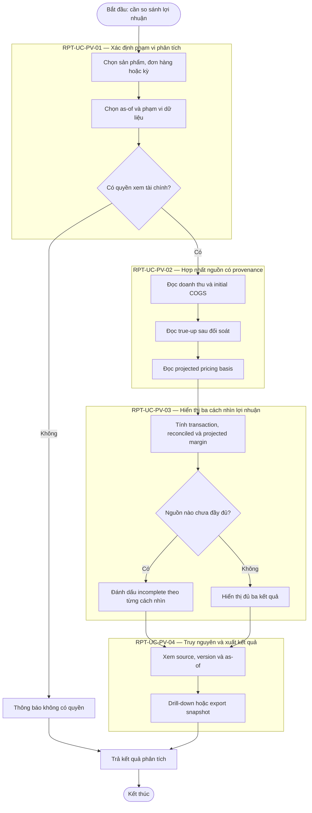

# RPT-BJ-PROFIT-VIEWS — So sánh ba cách nhìn lợi nhuận

> **Trạng thái:** Outbound handoff tạm thời `4.1.0`  
> **Legacy source:** Theme 7 `4.0.0/BJ-25`; receiving Theme được quyền re-ID
> **Phạm vi:** Phase 1 — báo cáo quản trị đọc ba nguồn cost khác nhau; không tạo số liệu kế toán mới  
> **Chủ sở hữu hành trình:** Reporting / Management Analytics; Theme 7 và Theme 2 — Sản phẩm là nhà cung cấp dữ liệu
> **Ranh giới Quyết định nghiệp vụ Theme 7:** `T7-BASELINE-FREEZE-v4.0.0` + `T7-DR-002`, `T7-DR-083`, `T7-DR-102`

# 1. Mục tiêu và ranh giới

## 1.1 Mục tiêu

Giúp người quản lý phân biệt và so sánh **lợi nhuận tại giao dịch, lợi nhuận sau đối soát và lợi nhuận dự kiến**, với source/version/as-of rõ ràng để không nhầm ba góc nhìn thành cùng một số liệu kế toán.

## 1.2 Điểm bắt đầu và kết thúc

| Thuộc tính | Nội dung |
|---|---|
| Bắt đầu | Người có quyền cần phân tích lợi nhuận theo sản phẩm, đơn hàng hoặc kỳ |
| Kết thúc | Người dùng nhận comparison snapshot/export có nhãn và provenance; hoặc nhận lý do dữ liệu chưa đủ/không có quyền |
| Tác động chính | Read model/report snapshot; không mutation |
| Không quyết định | Official Cost, pricing cost basis, active price, promotion hoặc bút toán điều chỉnh |

## 1.3 Trong và ngoài ranh giới

| Trong ranh giới | Ngoài ranh giới |
|---|---|
| Chọn scope/as-of; đọc doanh thu, initial COGS, true-up và projected basis; tính/hiển thị ba cách nhìn; drill-down/export | Tính lại giá vốn; thay pricing basis; công bố giá bán; sửa order hoặc accounting entry |
| Gắn nhãn incomplete khi thiếu nguồn | Tự lấy một nguồn thay cho nguồn còn thiếu hoặc công bố một con số “lợi nhuận chính thức” duy nhất |

**Ranh giới liên miền:** Sales cung cấp doanh thu; Theme 7 cung cấp initial COGS và true-up; Pricing cung cấp projected pricing basis; Reporting sở hữu phép trình bày và UI/FE task của BJ này.

# 2. Sơ đồ hành trình

# 3. Trường hợp sử dụng

| UC | Tên | Bắt đầu | Kết thúc | Kết quả |
|---|---|---|---|---|
| `RPT-UC-PV-01` | Xác định phạm vi phân tích | Có nhu cầu xem lợi nhuận | Scope/as-of hợp lệ hoặc quyền bị từ chối | Analysis context |
| `RPT-UC-PV-02` | Hợp nhất nguồn có provenance | Có context và quyền | Doanh thu cùng ba nguồn cost được liên kết theo scope | Labeled source set dùng chung |
| `RPT-UC-PV-03` | Hiển thị ba cách nhìn lợi nhuận | Có source set | Ba margin view được tính hoặc đánh dấu incomplete riêng | Comparison view |
| `RPT-UC-PV-04` | Truy nguyên và xuất kết quả | Có comparison view | Người dùng thấy provenance hoặc nhận export snapshot | Traceable report output |

# 4. Logic nghiệp vụ cần giữ

| Điểm kiểm soát | Quy tắc |
|---|---|
| Lợi nhuận tại giao dịch | Dùng doanh thu giao dịch và initial COGS đã snapshot khi xuất |
| Lợi nhuận sau đối soát | Dùng initial COGS cộng các true-up/adjustment liên kết; không rewrite order/issue gốc |
| Lợi nhuận dự kiến | Dùng pricing cost basis hiện hành có provenance; không phải số liệu kế toán |
| Thiếu dữ liệu | Đánh dấu cách nhìn tương ứng `INCOMPLETE`; không lấy Official Cost hay projected cost thay thế im lặng |
| Nhãn và provenance | Mỗi kết quả có source type/version/as-of; không collapse thành một con số “margin” không rõ nghĩa |
| Quyền tài chính | Hệ thống phải bảo vệ nhất quán mọi kênh xem và xuất dữ liệu; không chỉ ẩn bằng giao diện |
| Read-only | Xem/export không tạo value adjustment, pricing decision hoặc publication |

# 5. Quan hệ và bàn giao

- Nhận doanh thu từ Sales, initial COGS/true-up từ Theme 7 và pricing basis từ Pricing.
- Official Cost mới và pricing review có thể làm thay đổi dữ liệu nguồn ở lần đọc sau nhưng không sửa snapshot report cũ.
- `T2-BJ-PRICING-BASIS` và `T2-BJ-PRICING-REVIEW` cung cấp basis/provenance; Theme 7 BJ-14 cung cấp cost/true-up facts.
- Hành trình này thuộc Reporting/Analytics, không nên được hiểu là UI capability do Theme 7 sở hữu toàn bộ.

# 6. Nguồn tri thức liên quan

- [Công bố đơn giá tồn kho và ghi nhận giá vốn xuất bán](../../../01.knowledge/know-how/KB-KGV-017-cong-bo-don-gia-ton-kho-va-ghi-nhan-gia-von-xuat-ban.md)
- [Đối soát giá vốn cuối kỳ và cập nhật đột xuất giữa kỳ](../../../01.knowledge/know-how/KB-KGV-018-doi-soat-gia-von-cuoi-ky-va-cap-nhat-dot-xuat-giua-ky.md)
- [Từ giá vốn tham chiếu đến giá bán giao dịch](../../../01.knowledge/know-how/KB-KGV-044-tu-gia-von-tham-chieu-den-gia-ban-giao-dich.md)
- [Rà soát giá vốn tham chiếu sau chốt kỳ](../../../01.knowledge/know-how/KB-KGV-045-ra-soat-gia-von-tham-chieu-sau-chot-ky.md)
