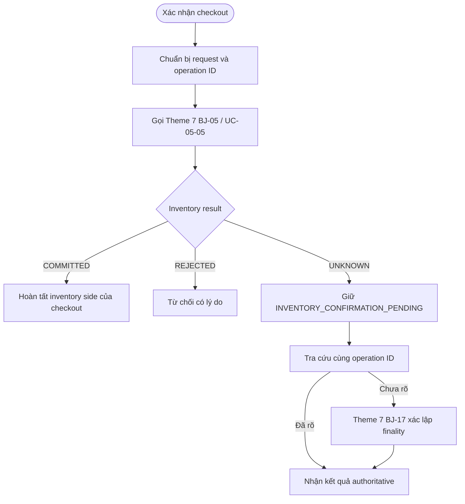

# T5-BJ-CHECKOUT-POS — Checkout POS có kết nối

> **Trạng thái:** Outbound handoff tạm thời `4.1.0`  
> **Legacy source:** Theme 7 `4.0.0/BJ-05`; Theme 5 được quyền re-ID  
> **Phạm vi:** Phase 1 — bắt buộc có kết nối máy chủ; chưa bán offline  
> **Journey owner:** Theme 5 — Sales/POS  
> **Inventory-effect provider:** Theme 7 — BJ-05/UC-05-05 và BJ-17
> **Ranh giới Quyết định nghiệp vụ Theme 7:** `T7-BASELINE-FREEZE-v4.0.0` + `T7-DR-002`, `T7-DR-003`, `T7-DR-029#REQ-01`, `T7-DR-033`, `T7-DR-070`

# 1. Mục tiêu và ranh giới

Theme 5 điều phối checkout thương mại và gọi Theme 7 bằng một operation identity ổn định. Theme 7 revalidate availability, chọn lô, ghi issue/cost snapshot nguyên tử và trả finality authoritative. Theme 5 không tự ghi tồn, không sở hữu atomic-issue UC và không suy diễn timeout thành thất bại.

| Thuộc tính | Nội dung |
|---|---|
| Bắt đầu | Nhân viên POS xác nhận checkout của đơn bán |
| Kết thúc | Checkout nhận `COMMITTED`/`REJECTED`; hoặc giữ `INVENTORY_CONFIRMATION_PENDING` khi inventory result còn `UNKNOWN` |
| Theme 5 sở hữu | Order/cart validation, operation identity, trạng thái checkout/payment và phản hồi người dùng |
| Theme 7 sở hữu | Eligibility, lot selection, concurrency, issue movement, balance, reservation consumption, cost snapshot và finality |

# 2. Sơ đồ hành trình

# 3. Trường hợp sử dụng thuộc Theme 5

| UC | Tên | Kết quả |
|---|---|---|
| `T5-UC-CP-01` | Chuẩn bị yêu cầu inventory issue | Request có order version, operation ID và payload ổn định |
| `T5-UC-CP-02` | Gửi yêu cầu và áp kết quả inventory | Checkout nhận `COMMITTED`, `REJECTED` hoặc chuyển pending nếu `UNKNOWN` |
| `T5-UC-CP-03` | Quản lý checkout chờ finality | Chỉ dùng cùng operation ID; nhận kết luận từ Theme 7 BJ-17 |

# 4. Provider contract bắt buộc

| Điểm kiểm soát | Quy tắc |
|---|---|
| Atomic issue | Theme 7 BJ-05/UC-05-05 là Dữ liệu gốc duy nhất cho movement, balance, reservation và cost snapshot |
| Không có Official Cost | Theme 7 từ chối issue; không ghi COGS bằng 0 hoặc projected cost |
| Chọn lô | Theme 7 áp FEFO/FIFO; override cần quyền và lý do |
| Cạnh tranh tồn | Theme 7 revalidate tại commit; không dựa vào snapshot phía POS |
| Combo | Mọi component issue all-or-nothing theo số nguyên combo |
| `UNKNOWN` | Theme 5 không tạo issue thứ hai, không tự hoàn tất/refund; Theme 7 BJ-17 sở hữu authoritative recovery |
| Offline | Không ghi local completion; mất mạng phải dừng hoặc chờ kết nối |

# 5. Handoff

- Theme 5 cung cấp cart/order, giá bán và operation identity.
- Theme 7 trả inventory result và issue/cost facts; Reporting/Costing chỉ đọc facts authoritative này.
- Payment/Sales giữ trạng thái pending resolution nếu payment đã tồn tại trước kết quả `UNKNOWN`.
