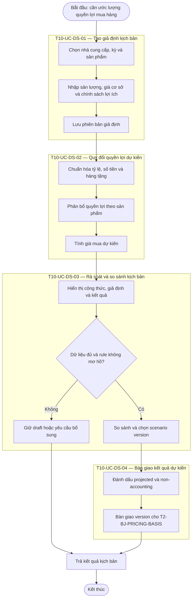

# T10-BJ-DISCOUNT-SCENARIO — Lập kịch bản chiết khấu mua hàng

> **Trạng thái:** Outbound handoff tạm thời `4.1.0`  
> **Legacy source:** Theme 7 `4.0.0/BJ-22`; receiving Theme được quyền re-ID
> **Phạm vi:** Phase 1 — kịch bản dự kiến trước PO/receipt; chưa phải theo dõi KPI nhà cung cấp thực tế  
> **Chủ sở hữu hành trình:** Theme 10 — Mua hàng — Purchase Planning / Supplier Program; Theme 7 chỉ bảo vệ ranh giới tồn kho và giá vốn chính thức
> **Ranh giới Quyết định nghiệp vụ Theme 7:** `T7-BASELINE-FREEZE-v4.0.0` + `T7-DR-002`, `T7-DR-098#REQ-01`, `T7-DR-099`

# 1. Mục tiêu và ranh giới

## 1.1 Mục tiêu

Cho phép chủ cửa hàng ước lượng **quyền lợi mua hàng và giá mua dự kiến theo sản phẩm** trước khi đặt hàng hoặc nhận hàng, sau đó bàn giao một phiên bản có nguồn gốc rõ cho miền Định giá sử dụng.

## 1.2 Điểm bắt đầu và kết thúc

| Thuộc tính | Nội dung |
|---|---|
| Bắt đầu | Người lập kế hoạch muốn đánh giá một giả định mua hàng/chiết khấu trong kỳ |
| Kết thúc | Một scenario version được chọn và bàn giao cho Pricing; hoặc scenario vẫn ở draft/blocked mà không tác động hệ thống khác |
| Tác động chính | Kịch bản, giả định, phiên bản tính toán và projected purchase cost |
| Không làm thay đổi | PO, receipt, công nợ, quantity/value ledger, Official Cost hoặc báo cáo kế toán |

## 1.3 Trong và ngoài ranh giới

| Trong ranh giới | Ngoài ranh giới |
|---|---|
| Nhập giả định kỳ/sản phẩm/sản lượng; mô tả lợi ích %/số tiền/hàng tặng; tính và version projected cost; chọn và handoff | Theo dõi KPI NCC thực tế; actual progress; return trừ KPI; invoice/AP; đưa chiết khấu thực tế vào giá trị tồn kho |
| Gắn nhãn projected/non-accounting và provenance | Công bố giá vốn chính thức, giá bán hoặc promotion |

**Ranh giới liên miền:** Purchase Planning sở hữu scenario và benefit rule. Theme 7 không nên triển khai UI/FE task của BJ này; Theme 7 chỉ cung cấp ràng buộc rằng kết quả dự kiến không được ghi vào ledger hoặc COGS.

# 2. Sơ đồ hành trình

# 3. Trường hợp sử dụng

| UC | Tên | Bắt đầu | Kết thúc | Kết quả |
|---|---|---|---|---|
| `T10-UC-DS-01` | Tạo giả định kịch bản | Có nhu cầu mô phỏng chương trình mua hàng | Scenario assumptions version được lưu | Version/input hash, không cần PO/receipt |
| `T10-UC-DS-02` | Quy đổi quyền lợi dự kiến | Có giả định và benefit rule | Quyền lợi và projected cost theo sản phẩm được tính | Reproducible calculation dùng chung |
| `T10-UC-DS-03` | Rà soát và so sánh kịch bản | Có kết quả tính | Scenario được chọn hoặc giữ draft/blocked | Scenario decision |
| `T10-UC-DS-04` | Bàn giao kết quả dự kiến | Có scenario version được chọn | Pricing nhận version và provenance | Projected-cost handoff, không mutation kế toán |

# 4. Logic nghiệp vụ cần giữ

| Điểm kiểm soát | Quy tắc |
|---|---|
| Nhãn dữ liệu | Mọi kết quả phải ghi rõ “dự kiến”, không được gọi là giá vốn chính thức hoặc giá vốn kế toán |
| Trước PO | Có thể tạo scenario khi chưa có PO, receipt hoặc hàng trong kho |
| Không tác động sổ | Tạo/chọn/bàn giao scenario không tạo operation, movement, AP, Official Cost hoặc accounting entry |
| Phiên bản | Thay giả định tạo version mới; kết quả phải truy được input, công thức, actor và thời điểm |
| Rule chưa đóng | Nhiều bậc, all-unit/incremental tier và phân bổ amount/free goods phải có quyết định authoritative trước Harness; không để UI tự suy diễn |
| KPI thực tế | Tiến độ actual, trả hàng trừ KPI và chốt quyền lợi cuối kỳ không thuộc BJ này; nếu triển khai phải mở BJ riêng của Purchase Planning |
| Thuật ngữ | Tài liệu nghiệp vụ dùng “chiết khấu/quyền lợi mua hàng”; `rebate` chỉ dùng trong mã dữ liệu khi cần |

# 5. Quan hệ và bàn giao

- Bàn giao `PurchaseDiscountScenarioVersion` đã chọn cho `T2-BJ-PRICING-BASIS`.
- `T2-BJ-PRICING-REVIEW` có thể yêu cầu tính lại; yêu cầu đó tạo version kế tiếp của BJ này, không sửa version cũ.
- Chiết khấu thực tế có chứng từ trước initial valuation đi qua Theme 7 BJ-03; nếu đến sau initial valuation thì đi qua Theme 7 BJ-13 rồi BJ-14. Cả hai nhánh actual không đi qua projected scenario.
- Theme 7 không nhận ownership Purchase Planning chỉ vì đọc projected cost.

# 6. Nguồn tri thức liên quan

- [Ranh giới trách nhiệm giữa các hệ thống nghiệp vụ](../../../01.knowledge/know-how/KB-KGV-002-ranh-gioi-trach-nhiem-giua-cac-he-thong-nghiep-vu.md)
- [Kịch bản chiết khấu mua hàng theo kỳ](../../../01.knowledge/know-how/KB-KGV-043-kich-ban-chiet-khau-mua-hang-theo-ky.md)
- [Từ giá vốn tham chiếu đến giá bán giao dịch](../../../01.knowledge/know-how/KB-KGV-044-tu-gia-von-tham-chieu-den-gia-ban-giao-dich.md)
