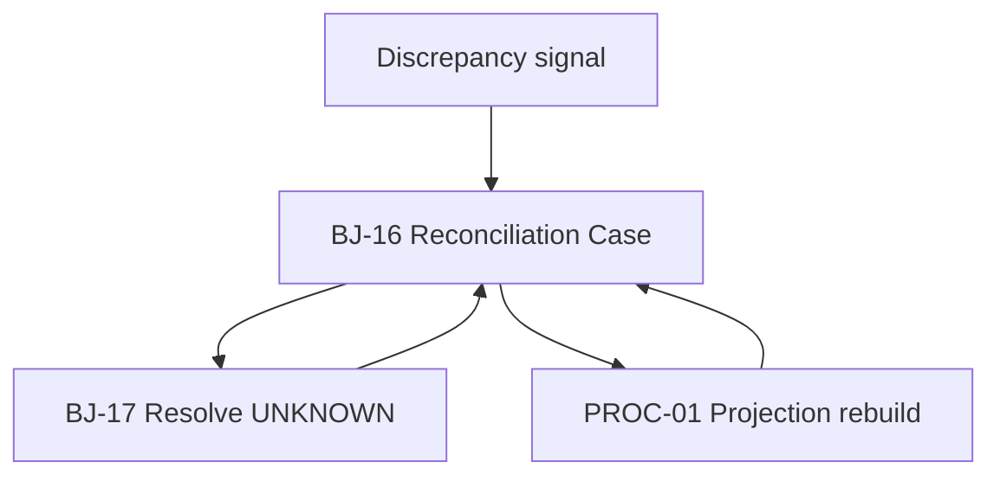

# Theme 7 — Business Journey map 4.1.0

> **Trạng thái:** Release đã đóng băng; baseline v4.0.0 không bị ghi đè  
> **Danh mục:** 17 BJ nội Theme, 5 XREF, 1 CAP, 1 PROC  
> **Owner BJ-09:** Inventory Control

# 1. Danh mục Business Journey nội Theme

| STT | ID | Hành trình | Owner | Tài liệu |
|---:|---|---|---|---|
| 01 | BJ-01 | Theo dõi tồn, khả dụng và chỉ báo vận hành | Inventory Operations / Monitoring | [Mở](../../../../../../../02.specification/behavior/journeys/BJ-01-theo-doi-ton-kha-dung-va-chi-bao-van-hanh.md) |
| 02 | BJ-02 | Nhận hàng mua | Inventory Operations | [Mở](../../../../../../../02.specification/behavior/journeys/BJ-02-nhan-hang-mua.md) |
| 03 | BJ-03 | Xác nhận giá trị ban đầu của hàng nhận | Inventory Valuation | [Mở](../../../../../../../02.specification/behavior/journeys/BJ-03-xac-nhan-gia-tri-ban-au-cua-hang-nhan.md) |
| 04 | BJ-04 | Quản lý vòng đời giữ hàng | Inventory Operations | [Mở](../../../../../../../02.specification/behavior/journeys/BJ-04-quan-ly-vong-oi-giu-hang.md) |
| 05 | BJ-05 | Lấy hàng và bàn giao đơn | Inventory Operations | [Mở](../../../../../../../02.specification/behavior/journeys/BJ-05-lay-hang-va-ban-giao-on.md) |
| 06 | BJ-06 | Tiếp nhận và phân loại hàng khách trả | Inventory Operations | [Mở](../../../../../../../02.specification/behavior/journeys/BJ-06-tiep-nhan-va-phan-loai-hang-khach-tra.md) |
| 07 | BJ-07 | Thực hiện trả hàng cho nhà cung cấp | Inventory Operations | [Mở](../../../../../../../02.specification/behavior/journeys/BJ-07-thuc-hien-tra-hang-cho-nha-cung-cap.md) |
| 08 | BJ-08 | Kiểm kê và điều chỉnh chênh lệch | Inventory Control | [Mở](../../../../../../../02.specification/behavior/journeys/BJ-08-kiem-ke-va-ieu-chinh-chenh-lech.md) |
| 09 | BJ-09 | Quản lý trạng thái hàng | Inventory Control | [Mở](../../../../../../../02.specification/behavior/journeys/BJ-09-quan-ly-trang-thai-hang.md) |
| 10 | BJ-10 | Tiêu hủy hàng | Inventory Control | [Mở](../../../../../../../02.specification/behavior/journeys/BJ-10-tieu-huy-hang.md) |
| 11 | BJ-11 | Hủy và sửa sai nghiệp vụ kho | Inventory Control | [Mở](../../../../../../../02.specification/behavior/journeys/BJ-11-huy-va-sua-sai-nghiep-vu-kho.md) |
| 12 | BJ-12 | Khởi tạo số dư tồn kho đầu kỳ | Inventory Control / Inventory Valuation | [Mở](../../../../../../../02.specification/behavior/journeys/BJ-12-khoi-tao-so-du-ton-kho-au-ky.md) |
| 13 | BJ-13 | Ghi nhận chi phí mua đến muộn | Inventory Valuation | [Mở](../../../../../../../02.specification/behavior/journeys/BJ-13-ghi-nhan-chi-phi-mua-en-muon.md) |
| 14 | BJ-14 | Tính và công bố giá vốn | Inventory Valuation | [Mở](../../../../../../../02.specification/behavior/journeys/BJ-14-tinh-va-cong-bo-gia-von.md) |
| 15 | BJ-15 | Tra cứu báo cáo tồn và thẻ kho | Inventory Reporting / Read layer | [Mở](../../../../../../../02.specification/behavior/journeys/BJ-15-tra-cuu-bao-cao-ton-va-the-kho.md) |
| 16 | BJ-16 | Điều tra và đối soát sai lệch | Inventory Control | [Mở](../../../../../../../02.specification/behavior/journeys/BJ-16-ieu-tra-va-oi-soat-sai-lech.md) |
| 17 | BJ-17 | Phục hồi nghiệp vụ có kết quả chưa xác định | Inventory Control + Operation Owner | [Mở](../../../../../../../02.specification/behavior/journeys/BJ-17-phuc-hoi-nghiep-vu-co-ket-qua-chua-xac-inh.md) |

# 2. Supporting artifacts

- [CAP-01 — Quản lý chính sách tồn và cận hạn](../../../../../../../02.specification/behavior/behavioral-contracts/CAP-01.md)
- [PROC-01 — Dựng lại dữ liệu dẫn xuất từ sổ kho](../07-technical-procedures/PROC-01-dung-lai-du-lieu-dan-xuat-tu-so-kho/00-procedure.md)

# 3. External references

[Mở khu vực outbound tạm thời](../../../../../../../04.architecture/integrations/INT-01-cross-theme-outbound.md).

# 4. Quan hệ recovery

# 5. Shared contracts

- [Finality contract](../../../../../../../02.specification/behavior/behavioral-contracts/BC-COMMON-EXTENSIONS.md)
- [Ownership metadata contract](../../../../../../../02.specification/behavior/behavioral-contracts/BC-COMMON-EXTENSIONS.md)
