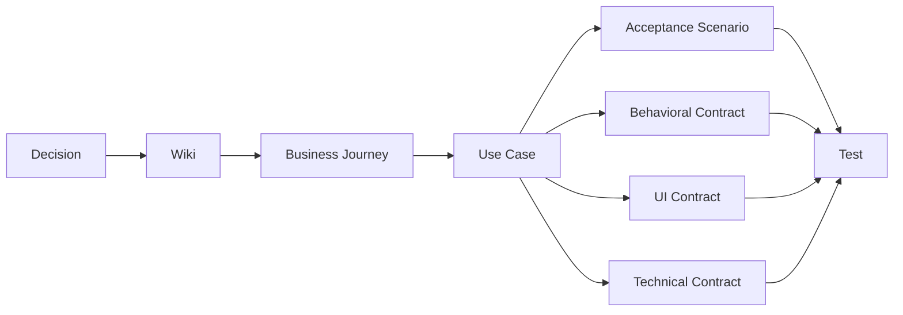

# 09 — Truy vết, kiểm thử và kiểm soát chất lượng

## 1. Mục đích

Phần này khóa cách chứng minh rằng yêu cầu nghiệp vụ, thiết kế, triển khai và kiểm thử không bị đứt đoạn.

UC là khóa nghiệp vụ cho hành vi và nghiệm thu. BC là khóa hiện thực hành vi. UI surface có thể phục vụ nhiều UC/BJ nhưng chỉ có một UI Contract. Registry chỉ điều hướng; nội dung quy tắc nằm ở artifact sở hữu nó.

## 2. Registry thẩm quyền

| Phạm vi | Registry/nguồn | Khóa ổn định |
|---|---|---|
| Quyết định | [Quyết định nghiệp vụ](../../../../../../01.knowledge/decisions/decision-register.md) | `T7-DR-*` |
| Tri thức | [Wiki TOC](../../../../../../01.knowledge/know-how/00-table-of-contents.md) | `KB-KGV-*`, `KGV-C*` |
| Hành trình | [Business Journey Map](../../../../../../02.specification/behavior/journeys/00-business-journey-map.md) | `BJ-nn` |
| Trường hợp sử dụng | [Use Case Map](../../../../../../02.specification/behavior/use-cases/00-use-case-map.md) | `UC-nn-mm` |
| Hành vi dùng chung | [Shared Behavioral Contracts](../../../../../../02.specification/behavior/behavioral-contracts) | `SBC-*`, `BC-*` |
| Kỹ thuật | [Technical Contracts](../../../../../../04.architecture/foundations/FND-TECH-01.md) | `API-*`, `EVT-*`, error/permission ID |
| UI | [UI/UX](08-ui-ux.md), [Screen Catalog](../../../../../design/legacy-contracts/screen-catalog.json) | `SG-*`, `SCR-*`, `ACT-*`, State ID |
| Prototype | [Prototype manifest](../prototype/prototype.manifest.json) | route + SG/Screen/State/Action |

## 3. Coverage tĩnh của package

| Đối tượng | Số lượng | Gate |
|---|---:|---|
| Quyết định nghiệp vụ | 102 | ID liên tục, link wiki/SRS đúng quyết định hoặc yêu cầu |
| Yêu cầu nguyên tử | 78 | Locator duy nhất và có anchor toàn cục |
| Quy tắc quản trị | 9 | Rule key, owner và file/anchor đích |
| Wiki article | 45 | Related/cluster/decision link tương đối |
| BJ | 25 | Có ranh giới, flowchart và UC coverage; loại nội/liên miền là metadata |
| UC độc nhất | 97 | Nằm trong thư mục BJ, có 6 phần chuẩn và link nguồn |
| Quan hệ BJ↔UC | 99 | Link hai chiều qua registry/file |
| Shared BC | 34 | ID, owner, guard, effect, result và realization |
| Screen Group | 17 | Mỗi SG đúng 3 UI artifact |
| Screen | 99 | ID và route duy nhất |
| Screen–State fixture | 568 | Render được trong prototype |
| Action | 38 | Mỗi action có primary BC và API |
| Event Contract | 23 | Envelope/version/consumer contract |

## 4. Truy vết tại một Use Case

Mỗi file UC phải chứa:

1. Hành trình nghiệp vụ cha.
2. Kết quả thành công, không thành công và chưa xác định trong bảng tổng quan.
3. Link nguồn quyết định, wiki, SBC và BC chính.
4. Các quy tắc/bất biến áp dụng.
5. Acceptance Scenario với ID ổn định.
6. UI Contract/SG liên quan; không sao chép screen tree.
7. BC → handler → API → transaction boundary → event/result → test prefix.
8. Cách BA, FE, BE, QA và Harness sử dụng lát đó.

Ví dụ chuẩn: [UC-02-01](../../../../../../02.specification/behavior/use-cases/UC-02-01-chuan-bi-nhan-theo-chung-tu.md).

## 5. Quy tắc giao việc và nghiệm thu

| Vai trò | Đơn vị lập kế hoạch | Đơn vị nghiệm thu/trace |
|---|---|---|
| BA | BJ và UC | Flow BJ + UC behavior + acceptance |
| FE | BJ work package | `UC × Screen × State × Action` |
| BE | UC/BC | `BC × handler × API × transaction` |
| QA | UC | Acceptance + BC test + UI state/action |
| Harness | Stable IDs/registries | UC, BC, API, event, test prefix và dependency graph |

Một BJ có thể lớn hơn một sprint; khi đó chia checkpoint theo UC hoặc nhóm UC liền mạch, không tách task nhỏ chỉ theo từng state. Một màn hình dùng chung không bị copy vào nhiều task: UI Contract là nguồn duy nhất, còn từng task trỏ tới đúng state/action phải hoàn tất.

## 6. Test taxonomy

| Prefix | Loại test | Mục tiêu |
|---|---|---|
| `UT-` | Unit/domain | Công thức, transition, eligibility, cost calculation |
| `CT-` | Contract/schema | API/event envelope, version, error và compatibility |
| `IT-` | Integration/persistence | Transaction, constraint, ledger/balance/outbox |
| `CC-` | Concurrency | Oversell, duplicate, stale version, concurrent approval |
| `FI-` | Fault injection | Timeout, crash, deadlock, outbox và rollback |
| `E2E-` | Journey | Actor flow xuyên UI/adapters |
| `SEC-` | Security | Tenant/scope/RBAC/masking/evidence |
| `A11Y-` | Accessibility | Keyboard, focus, label và trạng thái không chỉ bằng màu |
| `PERF-` | Performance | SLO, throughput và capacity |
| `DR-` | Recovery | RPO=0, UNKNOWN, reconciliation và rebuild |
| `MIG-` | Migration | Opening balance, totals và Chuyển đổi chính thức |
| `VIS-` | Prototype/UI contract | Screen/state/action, responsive và design handoff |

## 7. Pattern kiểm thử tối thiểu

Mỗi BC có tối thiểu:

- `TST-{BC}-HAPPY-01` — đường nghiệp vụ hợp lệ.
- `TST-{BC}-AUTH-01` — quyền và scope.
- `TST-{BC}-GUARD-01` — bất biến nghiệp vụ trọng yếu.
- `TST-{BC}-IDEMP-01` — idempotency hoặc snapshot stability.
- `TST-{BC}-TRACE-01` — entity/event/audit trace.

BC mutation số lượng/giá trị bổ sung `ATOMIC-01`, `CONC-01`, `FAULT-01`. Query bổ sung masking/as-of/pagination khi áp dụng. Mỗi Acceptance Scenario trong UC phải được ánh xạ ít nhất một test ID khi tạo Harness package.

## 8. UI/prototype gates

| Gate | Điều kiện pass |
|---|---|
| `VIS-ID-01` | 17 SG, 99 Screen và 38 Action khớp SRS/catalog/prototype |
| `VIS-STATE-02` | 568 fixture chọn và render được đúng Screen |
| `VIS-SEPARATION-03` | Controller/trace nằm ngoài `[data-design-viewport]` |
| `VIS-MOBILE-04` | Viewport tham chiếu 390 px; dùng được từ 360 px; touch target ≥ 44 px |
| `VIS-SCOPE-05` | Không có transfer/close/offline/serial/custody/proposal screen hay hidden CTA |
| `VIS-FORM-06` | Prefill dữ liệu đã biết; `NONE/LOT/expiry` mở đúng policy; validation giữ input |
| `VIS-RECOVERY-07` | Success/error/conflict/locked/unknown nêu tác động và bước tiếp theo an toàn |
| `SEC-UI-08` | Không có dữ liệu tài chính trong DOM/export preview khi thiếu quyền |
| `A11Y-UI-09` | Keyboard/focus/label/error association và non-color status đạt yêu cầu |

## 9. Quality gates

| Gate | Điều kiện pass | Evidence |
|---|---|---|
| `QG-01 Scope` | Phase 1 và structured exclusions nhất quán | Part 01, Quyết định nghiệp vụ |
| `QG-02 Journey` | 25 BJ có flow business-level và UC coverage | Part 02, journey audit |
| `QG-03 Domain/Data` | Owner, entity, ledger và lifecycle rõ | Part 03–04 |
| `QG-04 Use Case` | 97 UC đủ behavior, acceptance, UI, technical trace | Part 05 |
| `QG-05 Behavior` | Shared BC định nghĩa một lần và có anchor | Part 06 |
| `QG-06 Technical` | Handler/API/event/error/permission khép kín | Part 07 + CT/IT |
| `QG-07 UI` | 17 SG, 99 Screen, 568 State fixture, 38 Action | Part 08 + UI contracts + prototype |
| `QG-08 Finality` | Atomicity/idempotency/UNKNOWN/outbox/rebuild có test | CC/FI/DR evidence |
| `QG-09 Links` | Mọi link tương đối có đích; wiki anchor hợp lệ | Package validator |
| `QG-10 Freeze` | Manifest/checksum/ZIP nhất quán | Control artifacts |

## 10. Rà soát đối kháng

- Có đường mutation nào bỏ qua operation/ledger không?
- Có adapter nào hiện thực khác BC hoặc một CTA trộn hai mutation không?
- Có capability tương lai lọt vào UI, API, entity, enum hoặc fixture không?
- Retry/version/concurrency có thể tạo duplicate, oversell hoặc âm kho không?
- `NONE` có lô/hạn hoặc `LOT` thiếu dữ liệu bắt buộc không?
- Hàng cách ly/hỏng có bị đánh dấu sellable chỉ vì đã có giá không?
- Cost dự kiến có lọt vào COGS/value ledger không?
- UNKNOWN có bị hiển thị như thành công/thất bại chắc chắn hoặc retry bằng identity mới không?
- Projection có bị sửa tay thay vì rebuild từ ledger không?
- Một màn hình dùng nhiều UC/BJ có bị sao chép và lệch contract không?

## 11. Mức bằng chứng

| Level | Ý nghĩa |
|---|---|
| `DRAFT` | Chưa tự kiểm tra |
| `STATIC_VALIDATED` | ID, link, scope, contract và trace đã kiểm tra tĩnh |
| `CONTRACT_TESTED` | Schema/BC contract test đã chạy |
| `INTEGRATION_TESTED` | Persistence/event/concurrency/fault test đã chạy |
| `E2E_VALIDATED` | Journey/UI/accessibility/performance/recovery đã chạy |
| `RELEASE_READY` | Mọi hard gate pass trên release candidate |

Package tài liệu này chỉ tuyên bố `STATIC_VALIDATED`. Không suy diễn thành code/runtime `RELEASE_READY`.

## 12. Freeze requirements

1. Decision/Glossary/Wiki/SRS cross-check pass.
2. 25 BJ, 97 UC và 99 quan hệ không thiếu/trùng.
3. UI Contract và prototype validators pass 100%.
4. Link tương đối và checksum registry pass.
5. Review log, validation report và known limits đã ghi rõ.
6. ZIP giải nén thành công và chứa đúng root package.

## 13. Cổng quản trị baseline và hợp đồng

### `BASELINE_FREEZE_GATE` — Cổng đóng băng baseline

Baseline chỉ được đóng băng khi Quyết định nghiệp vụ, kho tri thức, chín phần SRS, UI Contract, prototype, quiz, Harness, manifest và checksum không còn xung đột về phạm vi, thẩm quyền, aggregate, bất biến hoặc hiệu lực tài chính cuối cùng. Ba lượt bắt buộc: cấu trúc/liên kết, ngữ nghĩa/liên miền và đối kháng/finality.

- **Chủ trì:** Release Owner. **Phối hợp:** BA Lead.

### `CONTRACT_CLOSURE_GATE` — Cổng khép kín hợp đồng

Mọi query, command, event, error và permission đã công bố phải có owner, schema tối thiểu, nguồn truy vết, test ID và fixture/kết quả kỳ vọng. Không chấp nhận endpoint hoặc mã lỗi chỉ có tên nhưng không có nghĩa vụ kiểm thử.

- **Chủ trì:** Solution Architect. **Phối hợp:** BA Lead; QA/Harness Owner.
