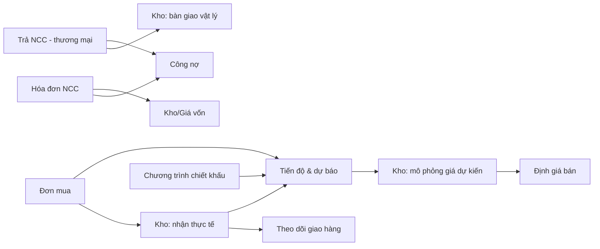

# Decision Register — Theme 10 Mua hàng

**Quy tắc:** quyết định được nhóm theo nghiệp vụ, không theo version. `CONFIRMED_PARENT` là semantic đã kế thừa từ v0.1.1. `PROPOSED_UNFROZEN` là phương án em chủ động đề xuất để hoàn thiện bức tranh v0.2.0; chưa có giá trị freeze.

## Sơ đồ quan hệ

## A. Phạm vi và ownership

| ID | Câu hỏi | Trạng thái | Lựa chọn/định hướng | Quyết định/đề xuất | Lý do & hệ quả |
|---|---|---|---|---|---|
| D-01 | Theme 10 khởi tạo và tiến hóa baseline thế nào? | CONFIRMED_PARENT | Khởi tạo mới; version cumulative | Theme 10 bắt đầu từ baseline riêng; mọi update sau phải có parent, impact set và bảo toàn semantic ngoài vùng tác động | Tránh kéo lịch sử/implementation của Theme khác thành nguồn Theme 10 |
| D-02 | Ai sở hữu đặt mua và ai sở hữu nhận hàng? | CONFIRMED_PARENT | Mua hàng vs Kho | Mua hàng sở hữu đơn mua/phiên bản và quyết định thương mại; Kho sở hữu nhận thật, tồn/lô/trạng thái và giá trị kho | Đặt mua không tăng tồn; nhập nhanh không sinh PO giả |
| D-04 | Ai sở hữu NCC, sản phẩm và UOM? | CONFIRMED_PARENT | Dùng master chung | Đối tác sở hữu NCC; Sản phẩm sở hữu Product/UOM/tracking policy. Mua hàng chỉ tham chiếu ID chuẩn và giữ snapshot cần thiết trên chứng từ | Tránh trùng master và sai lịch sử khi tên/đơn vị thay đổi |

## B. Hóa đơn, nghĩa vụ và kế toán

| ID | Câu hỏi | Trạng thái | Lựa chọn/định hướng | Quyết định/đề xuất | Lý do & hệ quả |
|---|---|---|---|---|---|
| D-03 | Ai sở hữu hóa đơn NCC và nguồn nghĩa vụ? | CONFIRMED_PARENT | Mua hàng làm nguồn thương mại | Mua hàng sở hữu hóa đơn NCC, phiên bản và nguồn nghĩa vụ phát sinh từ hóa đơn đủ điều kiện | Không dùng tồn kho hoặc file upload làm nguồn nghĩa vụ |
| D-09 | Ai giữ số dư phải trả và sổ kế toán? | CONFIRMED_PARENT | Tách nguồn khỏi ledger | Công nợ giữ nghĩa vụ/số dư, chi/phân bổ/cấn trừ; Kế toán giữ sổ và kỳ. Mua hàng không tạo ledger song song | Một nguồn sự thật cho payable và accounting |

## C. Chương trình chiết khấu và dữ liệu dự kiến

| ID | Câu hỏi | Trạng thái | Lựa chọn/định hướng | Quyết định/đề xuất | Lý do & hệ quả |
|---|---|---|---|---|---|
| D-05 | Chương trình chiết khấu nằm ở đâu? | CONFIRMED_PARENT | Thuộc Mua hàng | Theme 10 quản lý chương trình kỳ hiện tại/tương lai, điều khoản, tiến độ thực tế và phần thiếu | Chương trình là quan hệ thương mại với NCC, không phải inventory rule |
| D-06 | Khi nào chiết khấu trở thành quyền lợi thực tế? | CONFIRMED_PARENT | Tách các mốc | Chỉ sau khi đạt điều kiện theo điều khoản mới có thể hưởng; `đạt ngưỡng`, `NCC xác nhận quyền lợi`, `đủ căn cứ ghi nhận` là các mốc khác nhau | Chặn việc forecast biến thành số ghi sổ |
| D-07 | Ai dự báo mức đạt và phân bổ lợi ích dự kiến? | CONFIRMED_PARENT | Theme 10 | Mua hàng dùng dữ liệu có nguồn từ Kho/đơn còn mở/giả định để dự báo và phân bổ lợi ích thương mại dự kiến | Kho không duy trì bộ tính ngưỡng độc lập |
| D-08 | Giá dự kiến được dùng thế nào? | CONFIRMED_PARENT | Kho/Giá vốn mô phỏng; Định giá quyết định | Kho/Giá vốn dùng đầu vào dự kiến từ Mua hàng để mô phỏng giá nhập/bình quân; Định giá bán quyết định tham chiếu và công bố giá bán | Dữ liệu dự kiến không ghi vào giá vốn chính thức |

## D. Trả nhà cung cấp

| ID | Câu hỏi | Trạng thái | Lựa chọn/định hướng | Quyết định/đề xuất | Lý do & hệ quả |
|---|---|---|---|---|---|
| D-10 | Trả NCC chia ownership thế nào? | CONFIRMED_PARENT | Tách thương mại và vật lý | Mua hàng quyết định phạm vi trả/thay đổi thương mại; Kho xác nhận hàng chờ trả, bàn giao và giảm tồn theo nguồn hợp lệ | Bàn giao vật lý chưa tự chứng minh NCC đã giảm số tiền phải trả |

## E. Mô hình semantic đề xuất v0.2.0

### D-11 — Một chứng từ mua gốc thuộc một NCC

- **Trạng thái:** `PROPOSED_UNFROZEN`
- **Câu hỏi:** Một Đơn mua/Hóa đơn/Yêu cầu trả có thể trộn nhiều NCC không?
- **Đề xuất:** mỗi aggregate root thương mại thuộc đúng một NCC. Quan hệ nhiều bên trung gian/đại lý nếu phát sinh phải được mô hình hóa riêng, không trộn các line khác NCC vào cùng chứng từ.
- **Lý do:** đơn giản hóa đối chiếu, nghĩa vụ, trả hàng, chiết khấu và audit.
- **Impact:** AGG-PUR-01/02/03; A-05.

### D-12 — Sửa đơn đã xác nhận bằng phiên bản mới

- **Trạng thái:** `PROPOSED_UNFROZEN`
- **Lựa chọn:** sửa đè / append-only revision.
- **Đề xuất:** sau khi đơn đã xác nhận, mọi thay đổi thương mại tạo **phiên bản mới**; bản cũ bất biến để Kho và các miền downstream biết chính xác nguồn nào đã dùng.
- **Hệ quả:** cần `source_version`, effective time và rule xử lý việc nhận đang diễn ra khi đơn đổi.

### D-13 — Tình hình giao hàng là projection, không phải bản sao nghiệp vụ Kho

- **Trạng thái:** `PROPOSED_UNFROZEN`
- **Đề xuất:** Theme 10 lưu `PurchaseFulfillmentProjection` để hiển thị đã nhận/còn phải giao/chênh lệch, nhưng sự thật lần nhận vẫn thuộc Kho. Projection phải truy ngược được về receipt operation/version.
- **Hệ quả:** không tạo entity LOT/stock movement riêng trong Theme 10.

### D-14 — Hóa đơn có thể đến trước hàng hoặc không có Đơn mua

- **Trạng thái:** `PROPOSED_UNFROZEN`
- **Đề xuất:** Supplier Invoice không bắt buộc có Purchase Order tại thời điểm tiếp nhận. Có thể `chờ đối chiếu` và liên kết sau; không bắt buộc tạo PO bù giả.
- **Ranh giới:** hóa đơn dịch vụ và trả trước vẫn cần quyết định scope riêng theo Q-09.

### D-15 — Mốc bàn giao nghĩa vụ là “Hóa đơn đủ điều kiện”, không phải “đã tải tệp”

- **Trạng thái:** `PROPOSED_UNFROZEN`
- **Đề xuất:** một hóa đơn chỉ phát nguồn nghĩa vụ sau khi vượt các kiểm tra nghiệp vụ bắt buộc: NCC xác định được, nhận diện chứng từ không trùng trong phạm vi policy, thông tin số/ngày/giá trị đủ để xác lập nghĩa vụ, và không ở trạng thái bị từ chối/chờ làm rõ.
- **Chưa chốt:** validation pháp lý/thuế chi tiết, permission xác nhận và rule dịch vụ/trả trước.

### D-16 — Trả NCC có hai kết quả độc lập

- **Trạng thái:** `PROPOSED_UNFROZEN`
- **Đề xuất:** luôn phân biệt `kết quả vật lý` (Kho đã bàn giao hàng) và `kết quả thương mại` (NCC đã chấp nhận điều chỉnh/hoàn/giảm nghĩa vụ theo căn cứ). Case chỉ đóng hoàn toàn khi các nhánh bắt buộc theo policy đã rõ.
- **Lý do:** tránh giảm công nợ sớm hoặc hiểu sai giá trị xuất kho = giá trị NCC chấp nhận.

### D-17 — Điều khoản chương trình là versioned + effective-dated

- **Trạng thái:** `PROPOSED_UNFROZEN`
- **Đề xuất:** thay đổi ngưỡng, phạm vi, bậc hưởng, kỳ, benefit type hoặc basis tạo `DiscountProgramVersion` mới với thời điểm hiệu lực; không sửa đè lịch sử.
- **Hệ quả:** mọi assessment/forecast phải tham chiếu đúng program version.

### D-18 — Căn cứ tính ngưỡng là thuộc tính của chương trình, không phải hằng số hệ thống

- **Trạng thái:** `PROPOSED_UNFROZEN`
- **Đề xuất:** `qualification_basis` được cấu hình theo chương trình. Candidate hỗ trợ: lượng nhận đạt đã xác nhận; lượng hóa đơn đủ điều kiện; hoặc basis khác đã được business cho phép. **Khuyến nghị mặc định** cho hàng hóa là lượng nhận đạt đã xác nhận, sau chuẩn hóa UOM và trừ sửa/đảo theo rule.
- **Guardrail:** Mua hàng quyết định phần đủ điều kiện; Kho chỉ cung cấp dữ liệu thực nhận có nguồn.

### D-19 — Hỗ trợ hai kiểu áp ngưỡng và nhiều bậc theo từng chương trình

- **Trạng thái:** `PROPOSED_UNFROZEN`
- **Đề xuất:** không hard-code một cách hiểu “đạt ngưỡng”. Program Version có `benefit_application_mode` ít nhất gồm: `TOÀN_KỲ_KHI_ĐẠT` và `PHẦN_VƯỢT_NGƯỠNG`; có thể có nhiều bậc.
- **Lý do:** hai kiểu cho kết quả tài chính rất khác; đưa thành điều khoản tường minh giúp tránh suy diễn ở Theme 7.

### D-20 — Tiến độ và dự báo là snapshot có phiên bản, không ghi đè nhau

- **Trạng thái:** `PROPOSED_UNFROZEN`
- **Đề xuất:** `DiscountAssessmentVersion` lưu `as_of`, program version, actual eligible, committed/projected input, assumptions và allocations. Bản mới supersede bản cũ nhưng không xóa lịch sử.
- **Guardrail:** forecast không phải entitlement; không tự sinh xác suất đạt % khi chưa có model xác suất được duyệt.

## Phụ thuộc hiệu lực

- D-11–D-20 chỉ dùng để review model; implementation không được coi chúng là `FROZEN`.
- Q-01/Q-02/Q-04/Q-08 cần chốt trước khi formula BJ-05 hoặc cross-theme pricing contract trở thành canonical.
- Q-05/Q-06/Q-10 cần chốt trước khi mutation/handoff tài chính được triển khai.
