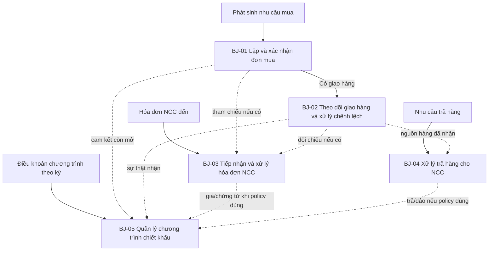

# 00 — Business Journey Map — Theme 10 Mua hàng

**Status:** `CONFIRMED_CATALOG from v0.1.1`; flow chi tiết chưa frozen.

## BJ-01 — Lập và xác nhận đơn mua

- **Start:** có nhu cầu mua một số hàng xác định.
- **End:** đơn mua có hiệu lực để NCC giao; hoặc dừng/hủy có căn cứ.
- **Owner:** Mua hàng.
- **Nguồn ngoài:** NCC, Product/UOM.
- **Chưa khóa:** approval policy, actor/permission, một số trạng thái sửa/hủy.

## BJ-02 — Theo dõi giao hàng và xử lý chênh lệch

- **Start:** NCC báo giao hoặc Kho có kết quả nhận.
- **End:** các line phản ánh rõ phần đã nhận, từ chối, còn phải giao và quyết định chênh lệch.
- **Owner sự thật vật lý:** Kho.
- **Owner quyết định thương mại:** Mua hàng.

## BJ-03 — Tiếp nhận và xử lý hóa đơn NCC

- **Start:** NCC gửi hóa đơn/chứng từ tính tiền.
- **End:** đủ điều kiện/chờ/từ chối; nếu đủ mốc thì phát nguồn nghĩa vụ sang Công nợ.
- **Đặc tính:** hóa đơn có thể đến trước, xen giữa hoặc sau các lần nhận; có thể không có Đơn mua.

## BJ-04 — Xử lý trả hàng cho NCC

- **Start:** cần trả hàng đã nhận và cần quyết định thương mại.
- **End:** kết quả vật lý + thương mại được đối chiếu; case hoàn tất hoặc chờ ngoại lệ.
- **Owner vật lý:** Kho.
- **Owner thương mại:** Mua hàng.

## BJ-05 — Quản lý chương trình chiết khấu mua hàng theo kỳ

- **Start:** có điều khoản ưu đãi cho kỳ hiện tại/tương lai.
- **End:** chương trình có version; tiến độ thực tế + dự báo được cập nhật; cuối kỳ có kết quả quyền lợi/không đạt có căn cứ.
- **Owner tính tiến độ/dự báo:** Mua hàng.
- **Nguồn actual:** Kho và các nguồn đủ điều kiện khác theo program terms.

## Không được suy ra

- Không buộc BJ-03 sau BJ-02.
- Không buộc giao dịch có BJ-01 nếu luồng hợp lệ không có Đơn mua.
- Không coi BJ-04 là bước cuối của mọi đơn mua.
- Không coi BJ-05 là một bước của từng đơn; đây là hành trình chạy theo kỳ/chương trình.
