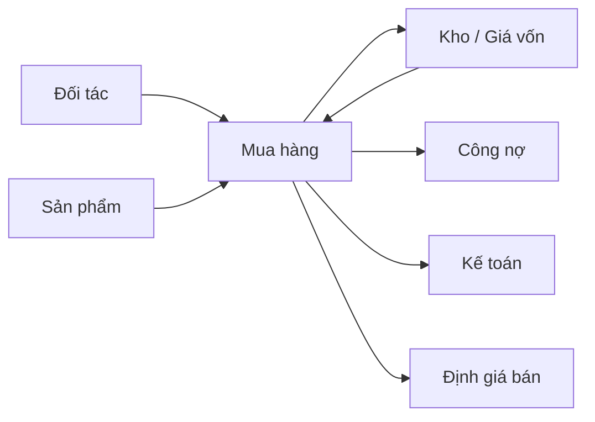
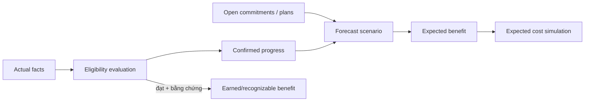

# Domain Foundation — DOM-PUR Mua hàng

## 1. Bounded context

`DOM-PUR` quản lý **commercial purchasing semantics**: commitment, supplier billing source, supplier-return commercial case và purchase-discount program.

### Context map

| Context | Quan hệ với Mua hàng | Anti-corruption boundary |
|---|---|---|
| Đối tác | Upstream master | Chỉ nhận `supplier_id` + snapshot cần thiết; không copy lifecycle NCC |
| Sản phẩm | Upstream master | Chỉ nhận product/UOM/conversion/tracking refs; không sở hữu master |
| Kho | Hai chiều | Receipt facts vào; source order/return/expected benefit ra; không copy stock/LOT ledger |
| Công nợ | Downstream consumer | Nhận payable source; Mua hàng không đọc/ghi balance như source truth |
| Kế toán | Downstream/peer | Nhận nguồn khi contract yêu cầu; không tạo posting trong DOM-PUR |
| Định giá bán | Downstream decision domain | Nhận tham chiếu expected cost từ Kho; DOM-PUR không công bố sale price |

## 2. Capability map

- **Order Commitment Management** — Đơn mua và phiên bản.
- **Fulfillment Oversight** — projection giao hàng + quyết định chênh lệch.
- **Supplier Billing Intake** — hóa đơn NCC, qualification và payable source.
- **Supplier Return Commercial Management** — case trả, thương mại, reconciliation.
- **Purchase Discount Program Management** — điều khoản, kỳ, scope, threshold.
- **Discount Assessment & Forecasting** — actual progress, scenario, expected benefit allocation.

## 3. Semantic aggregates

| ID | Aggregate | Mục đích | Trạng thái model |
|---|---|---|---|
| AGG-PUR-01 | Đơn mua (`PurchaseOrder`) | Cam kết mua và revision history | PROPOSED_UNFROZEN |
| AGG-PUR-02 | Hóa đơn NCC (`SupplierInvoice`) | Tiếp nhận/qualification/source nghĩa vụ | PROPOSED_UNFROZEN |
| AGG-PUR-03 | Hồ sơ trả NCC (`SupplierReturnCase`) | Quyết định thương mại và ghép kết quả vật lý/thương mại | PROPOSED_UNFROZEN |
| AGG-PUR-04 | Chương trình chiết khấu (`PurchaseDiscountProgram`) | Điều khoản versioned/effective-dated | PROPOSED_UNFROZEN |
| AGG-PUR-05 | Đánh giá chiết khấu (`DiscountAssessment`) | Actual progress + forecast + expected allocations | PROPOSED_UNFROZEN |

`PurchaseFulfillmentProjection` là **projection**, không phải aggregate owner của receipt.

## 4. Ubiquitous language quan trọng

- `Đơn mua` = commitment.
- `Lần nhận hàng` = physical fact từ Kho.
- `Hóa đơn đủ điều kiện` = business milestone trước payable source.
- `Bàn giao vật lý` ≠ `Kết quả thương mại`.
- `Tiến độ đã xác nhận` ≠ `Dự báo mức đạt`.
- `Lợi ích thương mại dự kiến` ≠ `Quyền lợi đã phát sinh`.

Chi tiết tại `01.knowledge/glossary/glossary.md`.

## 5. Invariant cấp domain

### Ownership

- DOM-PUR không tạo Supplier/Product/UOM/LOT/StockBalance/PayableBalance/AccountingEntry/SalePrice.
- Reference ngoài context luôn có source ID; snapshot chỉ phục vụ lịch sử chứng từ.

### Versioning

- Business document đã xác nhận không sửa đè phần làm thay đổi nghĩa.
- Program terms và forecast/assessment có version riêng.
- Downstream input luôn chỉ rõ source version hoặc effective version.

### Quantity/UOM

- Không cộng trực tiếp hai UOM khác nhau.
- Khi cần so ngưỡng, chuẩn hóa qua conversion có source + effective context.
- Rounding policy phải được khóa trước formula implementation.

### Money

- Mọi amount phải gắn currency.
- PO price, invoice price, expected benefit, inventory cost và payable balance là các lớp giá trị khác nhau.
- Không lấy một lớp làm alias cho lớp khác.

### Time

Tối thiểu phân biệt:

- `effective_at/from/to` — khi điều khoản có hiệu lực.
- `business_date` — ngày nghiệp vụ của chứng từ/sự kiện.
- `recorded_at` — hệ thống ghi nhận khi nào.
- `as_of` — thời điểm snapshot progress/forecast.

## 6. Consistency boundary

Semantic aggregate mô tả invariant business phải nhất quán khi mutation một object. Cross-domain consistency là **eventual** về mặt semantic: Mua hàng không khóa giao dịch DB với Kho/Công nợ/Kế toán.

Cơ chế API/event/outbox/inbox/idempotency cụ thể thuộc Architecture, chưa được baseline này quyết định.

## 7. Lifecycle tổng quát

### Actual vs expected

Actual path và forecast path chỉ gặp nhau ở bước ra quyết định; forecast không mutate actual ledger.
