# Entity Catalog — Theme 10 Mua hàng

**Status:** `SEMANTIC_MODEL / PROPOSED_UNFROZEN`  
**Mục đích:** mô tả identity, thuộc tính business tối thiểu, relation và invariant để BA/SA review. Đây **không phải physical DB schema**.

## 1. Quan hệ tổng quan

```mermaid
classDiagram
  PurchaseOrder "1" --> "1..*" PurchaseOrderVersion
  PurchaseOrderVersion "1" --> "1..*" PurchaseOrderLine
  PurchaseOrder --> PurchaseFulfillmentProjection

  SupplierInvoice "1" --> "1..*" SupplierInvoiceVersion
  SupplierInvoiceVersion "1" --> "1..*" SupplierInvoiceLine
  SupplierInvoiceVersion --> InvoiceSourceLink
  SupplierInvoice --> InvoiceQualification
  SupplierInvoice --> PayableSourceReference

  SupplierReturnCase "1" --> "1..*" SupplierReturnLine
  SupplierReturnLine --> ReturnSourceAllocation
  SupplierReturnCase --> PhysicalHandoverReference
  SupplierReturnCase --> CommercialOutcome

  PurchaseDiscountProgram "1" --> "1..*" DiscountProgramVersion
  DiscountProgramVersion --> EligibilityScope
  DiscountProgramVersion --> DiscountTier
  DiscountProgramVersion --> BenefitRule
  PurchaseDiscountProgram --> DiscountProgramOutcome

  DiscountAssessment "1" --> "1..*" DiscountAssessmentVersion
  DiscountAssessmentVersion --> AssessmentInputReference
  DiscountAssessmentVersion --> ProgressBreakdown
  DiscountAssessmentVersion --> ForecastScenario
  DiscountAssessmentVersion --> ExpectedBenefitAllocation
```

## 2. Quy ước chung

- `UUID` dùng cho identity logic trong catalog; mechanism phát ID do Architecture chốt.
- Mọi root có `tenant_id`.
- Mọi mutable root có `record_version` hoặc cơ chế optimistic concurrency tương đương; cách triển khai do SA chốt.
- Immutable business versions không sửa đè sau khi finalized/confirmed.
- `Money` = `amount + currency_code`; không lưu số tiền không có currency.
- `Quantity` = decimal + UOM reference; không cộng UOM khác nhau nếu chưa normalize.
- `created_at`, `updated_at`, `created_by`, `updated_by` là audit metadata ở mức platform; field vật lý do Architecture chuẩn hóa.
- Xóa vật lý chứng từ business không phải behavior mặc định; retention/deletion policy cuối do platform/compliance contract quyết định.

---

# A. AGG-PUR-01 — Đơn mua

## ENT-PUR-001 — PurchaseOrder

| Field | Kiểu semantic | Required | Ý nghĩa / invariant |
|---|---|---:|---|
| id | UUID | Yes | Logical order ID |
| tenant_id | UUID | Yes | Tenant boundary |
| supplier_id | UUID ref | Yes | Một NCC duy nhất |
| order_number | String | Yes | Số hiển thị; uniqueness scope do policy chốt |
| lifecycle_state | Enum | Yes | Nháp/Có hiệu lực/Đã đóng/Đã hủy — candidate |
| current_version_no | Integer | Yes | Trỏ revision hiện hành |
| record_version | Integer | Yes | Optimistic concurrency semantic |
| closed_reason | Code/Text | No | Có khi đóng/hủy |

**Relation:** 1 → N `PurchaseOrderVersion`.

## ENT-PUR-002 — PurchaseOrderVersion

| Field | Kiểu | Required | Ý nghĩa |
|---|---|---:|---|
| id | UUID | Yes | Version identity |
| purchase_order_id | UUID | Yes | Parent root |
| version_no | Integer | Yes | Tăng đơn điệu trong order |
| version_state | Enum | Yes | Draft/Confirmed/Superseded/Cancelled candidate |
| supplier_snapshot | Snapshot | Yes | Tên/mã cần hiển thị lịch sử; không thay master |
| currency_code | ISO currency | Yes | Currency của version |
| effective_from | Timestamp | No | Khi version có hiệu lực |
| confirmed_at | Timestamp | No | Có khi confirmed |
| revision_reason | Text/Code | No | Lý do thay đổi |
| source_request_ref | String/UUID | No | Nhu cầu nguồn nếu có |

**Invariant:** confirmed version immutable.

## ENT-PUR-003 — PurchaseOrderLine

| Field | Kiểu | Required | Ý nghĩa |
|---|---|---:|---|
| id | UUID | Yes | Line ID trong version |
| order_version_id | UUID | Yes | Parent version |
| line_no | Integer | Yes | Thứ tự hiển thị |
| product_id | UUID ref | Yes | Product master ref |
| product_snapshot | Snapshot | Yes | Tên/SKU tại thời điểm version |
| uom_id | UUID/code ref | Yes | UOM đặt mua |
| uom_snapshot | Snapshot | Yes | Tên/ký hiệu |
| ordered_quantity | Decimal | Yes | > 0 |
| unit_price | Money | Yes | Giá mua theo đơn |
| line_amount | Money derived/persisted | Yes | Rule rounding cần chốt |
| delivery_due_date | Date | No | Nếu điều khoản có |
| line_note | Text | No | Ghi chú thương mại |

## PROJ-PUR-001 — PurchaseFulfillmentProjection

> Projection read model, **không phải source receipt**.

| Field | Kiểu | Required | Ý nghĩa |
|---|---|---:|---|
| purchase_order_id | UUID | Yes | Order |
| order_line_identity | Ref | Yes | Stable logical line mapping cần SA chốt |
| based_on_order_version | Integer | Yes | Version cam kết |
| accepted_quantity | Quantity | Yes | Tổng từ receipt facts đã xác nhận |
| rejected_quantity | Quantity | Yes | Tổng từ receipt facts |
| reversed_quantity | Quantity | Yes | Correction/reversal |
| open_receivable_quantity | Quantity | Yes | Phần còn được phép nhận theo rule |
| commercial_remaining_quantity | Quantity | Yes | Phần còn phải giao sau quyết định thương mại |
| last_source_cursor | Ref/version | Yes | Điểm reconcile với Kho |
| as_of | Timestamp | Yes | Freshness |

**Guardrail:** mất/sai projection phải rebuild được từ sources; không coi projection là warehouse ledger.

---

# B. AGG-PUR-02 — Hóa đơn NCC

## ENT-PUR-010 — SupplierInvoice

| Field | Kiểu | Required | Ý nghĩa |
|---|---|---:|---|
| id | UUID | Yes | Logical invoice record |
| tenant_id | UUID | Yes | Tenant boundary |
| supplier_id | UUID ref | Yes | Một NCC |
| external_invoice_number | String | Yes | Số hóa đơn/chứng từ do NCC cấp |
| invoice_date | Date | Yes | Ngày chứng từ |
| lifecycle_state | Enum | Yes | Tiếp nhận/Đang kiểm tra/Đủ điều kiện/Chờ/Từ chối candidate |
| current_version_no | Integer | Yes | Revision hiện hành |
| record_version | Integer | Yes | Concurrency |

**Duplicate policy:** key cuối cùng chưa chốt; tối thiểu cần supplier + external invoice identity + business context.

## ENT-PUR-011 — SupplierInvoiceVersion

| Field | Kiểu | Required | Ý nghĩa |
|---|---|---:|---|
| id | UUID | Yes | Version ID |
| supplier_invoice_id | UUID | Yes | Parent |
| version_no | Integer | Yes | Revision |
| supplier_snapshot | Snapshot | Yes | Historical display |
| currency_code | Currency | Yes | Invoice currency |
| subtotal_amount | Money | Yes | Giá trị trước tax/adjustment theo rule |
| discount_amount | Money | No | Discount trên invoice nếu có |
| tax_amount | Money | No | Semantic field; tax validation owner chưa khóa |
| total_amount | Money | Yes | Tổng chứng từ |
| attachment_refs | Ref[] | No | Evidence/file refs |
| recorded_at | Timestamp | Yes | Khi hệ thống ghi version |

## ENT-PUR-012 — SupplierInvoiceLine

| Field | Kiểu | Required | Ý nghĩa |
|---|---|---:|---|
| id | UUID | Yes | Line ID |
| invoice_version_id | UUID | Yes | Parent |
| line_no | Integer | Yes | Thứ tự |
| line_kind | Enum | Yes | Product / Service candidate; Service scope Q-09 |
| product_id | UUID ref | No | Bắt buộc nếu product line |
| description | String | Yes | Mô tả chứng từ |
| quantity | Decimal | No | Có khi quantity-based |
| uom_id | Ref | No | Có khi quantity-based |
| unit_price | Money | No | Nếu có |
| line_amount | Money | Yes | Giá trị line |
| tax_class_ref | Ref | No | Owner/rule cần cross-domain review |

## ENT-PUR-013 — InvoiceSourceLink

| Field | Kiểu | Required | Ý nghĩa |
|---|---|---:|---|
| id | UUID | Yes | Link ID |
| invoice_line_id | UUID | Yes | Invoice line |
| source_type | Enum | Yes | ORDER_LINE / RECEIPT_LINE / OTHER_ALLOWED |
| source_id | UUID/ref | Yes | External/source identity |
| source_version | String/int | No | Khi nguồn versioned |
| linked_quantity | Quantity | No | Nếu link theo lượng |
| linked_amount | Money | No | Nếu link theo giá trị |
| link_state | Enum | Yes | Proposed/Confirmed/Disputed candidate |

## ENT-PUR-014 — InvoiceQualification

| Field | Kiểu | Required | Ý nghĩa |
|---|---|---:|---|
| supplier_invoice_id | UUID | Yes | Parent |
| evaluated_version_no | Integer | Yes | Version được đánh giá |
| qualification_state | Enum | Yes | Qualified / Waiting / Rejected candidate |
| reason_codes | Code[] | No | Vì sao chờ/từ chối |
| qualified_at | Timestamp | No | Có khi qualified |
| qualified_by | Actor ref | No | Permission Q-10 |
| evidence_refs | Ref[] | No | Bằng chứng |

## ENT-PUR-015 — PayableSourceReference

| Field | Kiểu | Required | Ý nghĩa |
|---|---|---:|---|
| supplier_invoice_id | UUID | Yes | Parent |
| invoice_version_no | Integer | Yes | Source version |
| logical_source_key | String | Yes | Stable dedup semantic key |
| handoff_state | Enum | Yes | NotSent/Sent/Acknowledged/ReconcileNeeded candidate |
| downstream_reference | Ref | No | ID do Công nợ trả về |
| last_handoff_at | Timestamp | No | Audit |

**Guardrail:** không chứa payable balance.

---

# C. AGG-PUR-03 — Hồ sơ trả NCC

## ENT-PUR-020 — SupplierReturnCase

| Field | Kiểu | Required | Ý nghĩa |
|---|---|---:|---|
| id | UUID | Yes | Case ID |
| tenant_id | UUID | Yes | Tenant |
| supplier_id | UUID ref | Yes | Một NCC |
| case_number | String | Yes | Số hồ sơ |
| reason_code | Code | Yes | Lý do nghiệp vụ |
| reason_note | Text | No | Chi tiết |
| physical_state | Enum | Yes | Trục vật lý |
| commercial_state | Enum | Yes | Trục thương mại |
| overall_state | Derived/Enum | Yes | Suy ra theo policy |
| current_version_no | Integer | Yes | Version request thương mại |
| record_version | Integer | Yes | Concurrency |

## ENT-PUR-021 — SupplierReturnLine

| Field | Kiểu | Required | Ý nghĩa |
|---|---|---:|---|
| id | UUID | Yes | Line |
| return_case_id | UUID | Yes | Parent |
| product_id | UUID ref | Yes | Product |
| uom_id | Ref | Yes | UOM thương mại |
| requested_quantity | Decimal | Yes | > 0 |
| commercial_unit_value | Money | No | Không dùng làm inventory cost |
| return_reason_code | Code | Yes | Lý do line |

## ENT-PUR-022 — ReturnSourceAllocation

| Field | Kiểu | Required | Ý nghĩa |
|---|---|---:|---|
| return_line_id | UUID | Yes | Parent line |
| receipt_operation_id | Ref | Yes | Nguồn Kho |
| receipt_line_id | Ref | Yes | Nguồn dòng |
| receipt_version | Ref | No | Version |
| lot_ref | Ref | No | Khi policy cần đúng LOT |
| allocated_quantity | Quantity | Yes | Lượng yêu cầu trả từ nguồn |

## ENT-PUR-023 — PhysicalHandoverReference

| Field | Kiểu | Required | Ý nghĩa |
|---|---|---:|---|
| return_case_id | UUID | Yes | Case |
| warehouse_operation_id | Ref | Yes | Source of truth bên Kho |
| operation_version | Ref | No | Version |
| handover_state | Enum | Yes | Kết quả vật lý |
| handed_over_at | Timestamp | No | Khi hoàn tất |
| evidence_refs | Ref[] | No | Chứng cứ |

## ENT-PUR-024 — CommercialOutcome

| Field | Kiểu | Required | Ý nghĩa |
|---|---|---:|---|
| return_case_id | UUID | Yes | Case |
| outcome_state | Enum | Yes | Accepted/Partial/Rejected/Disputed candidate |
| accepted_amount | Money | No | Giá trị NCC chấp nhận |
| supplier_reference | String | No | Credit note/reference |
| confirmed_at | Timestamp | No | Mốc business |
| evidence_refs | Ref[] | No | Chứng từ |

---

# D. AGG-PUR-04 — Chương trình chiết khấu

## ENT-PUR-030 — PurchaseDiscountProgram

| Field | Kiểu | Required | Ý nghĩa |
|---|---|---:|---|
| id | UUID | Yes | Program ID |
| tenant_id | UUID | Yes | Tenant |
| supplier_id | UUID ref | Yes | NCC |
| program_code | String | Yes | Mã quản lý |
| program_name | String | Yes | Tên thân thiện |
| lifecycle_state | Enum | Yes | Nháp/Sắp hiệu lực/Đang hiệu lực/Kết thúc/Hủy candidate |
| current_version_no | Integer | Yes | Terms hiện hành |
| record_version | Integer | Yes | Concurrency |

## ENT-PUR-031 — DiscountProgramVersion

| Field | Kiểu | Required | Ý nghĩa |
|---|---|---:|---|
| id | UUID | Yes | Terms version |
| program_id | UUID | Yes | Parent |
| version_no | Integer | Yes | Revision |
| period_start | Date/Time | Yes | Kỳ bắt đầu |
| period_end | Date/Time | Yes | Kỳ kết thúc |
| effective_from | Timestamp | Yes | Khi terms có hiệu lực |
| effective_to | Timestamp | No | Khi superseded/end |
| qualification_basis | Enum | Yes | Q-02 — basis tường minh |
| benefit_application_mode | Enum | Yes | Q-01 — toàn kỳ / phần vượt / future types |
| benefit_type | Enum | Yes | Percent/FixedAmount/BonusGoods candidate |
| currency_code | Currency | Conditional | Bắt buộc với amount benefit |
| revision_reason | Text | No | Audit |

**Invariant:** finalized version immutable.

## ENT-PUR-032 — EligibilityScope

| Field | Kiểu | Required | Ý nghĩa |
|---|---|---:|---|
| id | UUID | Yes | Scope item |
| program_version_id | UUID | Yes | Parent |
| scope_type | Enum | Yes | ALL / PRODUCT / PRODUCT_GROUP / other approved |
| product_id | Ref | No | Khi PRODUCT |
| product_group_id | Ref | No | Khi group |
| include_exclude | Enum | Yes | Include/Exclude |
| uom_basis | Enum/Ref | No | Transaction UOM/base UOM/explicit UOM candidate |
| effective_note | Text | No | Ngoại lệ |

## ENT-PUR-033 — DiscountTier

| Field | Kiểu | Required | Ý nghĩa |
|---|---|---:|---|
| id | UUID | Yes | Tier ID |
| program_version_id | UUID | Yes | Parent |
| tier_no | Integer | Yes | Thứ tự bậc |
| threshold_value | Decimal/Money | Yes | Theo qualification basis |
| threshold_uom_or_currency | Ref | Conditional | Theo loại ngưỡng |
| benefit_rate | Percent | No | Với percent benefit |
| benefit_amount | Money | No | Với fixed amount |

## ENT-PUR-034 — BenefitRule

| Field | Kiểu | Required | Ý nghĩa |
|---|---|---:|---|
| id | UUID | Yes | Rule ID |
| program_version_id | UUID | Yes | Parent |
| calculation_basis | Enum | Yes | Theo lượng/giá trị/... cần business chốt |
| allocation_method | Enum | Yes | Cách phân bổ benefit; Q-04 |
| rounding_rule_ref | Ref | No | Cần policy chuẩn |
| evidence_requirement | Code/Ref | No | Gợi ý mốc entitlement; Q-03 |

## ENT-PUR-035 — DiscountProgramOutcome

| Field | Kiểu | Required | Ý nghĩa |
|---|---|---:|---|
| id | UUID | Yes | Outcome ID theo program/version/period |
| program_id | UUID | Yes | Parent |
| program_version_no | Integer | Yes | Terms áp dụng |
| threshold_state | Enum | Yes | Chưa đạt/Đã đạt candidate |
| supplier_confirmation_state | Enum | Yes | Chờ/Đã xác nhận/Từ chối/Không yêu cầu candidate |
| recognition_state | Enum | Yes | Chưa đủ/Đủ căn cứ ghi nhận candidate |
| earned_benefit_amount | Money | No | Actual, không phải forecast |
| evidence_refs | Ref[] | No | Chứng từ/xác nhận |
| determined_at | Timestamp | No | Mốc xác lập |

**Blocker:** Q-03 cần khóa trước canonical lifecycle.

---

# E. AGG-PUR-05 — Đánh giá tiến độ và dự báo

## ENT-PUR-040 — DiscountAssessment

| Field | Kiểu | Required | Ý nghĩa |
|---|---|---:|---|
| id | UUID | Yes | Assessment stream ID |
| tenant_id | UUID | Yes | Tenant |
| program_id | UUID | Yes | Program |
| program_version_no | Integer | Yes | Terms được đánh giá |
| current_version_no | Integer | Yes | Snapshot mới nhất |
| record_version | Integer | Yes | Concurrency |

## ENT-PUR-041 — DiscountAssessmentVersion

| Field | Kiểu | Required | Ý nghĩa |
|---|---|---:|---|
| id | UUID | Yes | Immutable snapshot |
| assessment_id | UUID | Yes | Parent |
| version_no | Integer | Yes | Revision |
| as_of | Timestamp | Yes | Snapshot time |
| actual_eligible_value | Decimal/Money | Yes | Theo basis |
| current_tier_no | Integer | No | Bậc actual đã đạt nếu có |
| next_threshold_value | Decimal/Money | No | Ngưỡng tiếp theo |
| remaining_to_threshold | Decimal/Money | No | Phần còn thiếu |
| generated_reason | Code | Yes | SourceChanged/ManualRefresh/TermsChanged/... candidate |
| method_version | String | Yes | Forecast/calculation method version |

## ENT-PUR-042 — AssessmentInputReference

| Field | Kiểu | Required | Ý nghĩa |
|---|---|---:|---|
| assessment_version_id | UUID | Yes | Snapshot |
| input_kind | Enum | Yes | RECEIPT / ORDER_COMMITMENT / INVOICE / RETURN / PLAN candidate |
| source_id | Ref | Yes | Nguồn |
| source_version | Ref | No | Version |
| source_line_id | Ref | No | Line |
| input_class | Enum | Yes | ACTUAL / FORECAST |
| raw_quantity_or_amount | Decimal/Money | Yes | Giá trị nguồn |
| normalized_value | Decimal/Money | Yes | Giá trị sau eligibility/UOM normalization |
| inclusion_state | Enum | Yes | Included/Excluded/Pending candidate |
| reason_code | Code | No | Vì sao |

## ENT-PUR-043 — ProgressBreakdown

| Field | Kiểu | Required | Ý nghĩa |
|---|---|---:|---|
| assessment_version_id | UUID | Yes | Snapshot |
| scope_bucket | Ref | Yes | Product/group/tier bucket |
| eligible_actual_value | Decimal/Money | Yes | Actual only |
| excluded_actual_value | Decimal/Money | Yes | Có nguồn nhưng không đủ điều kiện |
| pending_actual_value | Decimal/Money | Yes | Chưa xác minh |

## ENT-PUR-044 — ForecastScenario

| Field | Kiểu | Required | Ý nghĩa |
|---|---|---:|---|
| id | UUID | Yes | Scenario ID |
| assessment_version_id | UUID | Yes | Parent snapshot |
| scenario_name | String | Yes | Ví dụ “Theo đơn còn mở” |
| projected_eligible_value | Decimal/Money | Yes | Forecast component |
| forecast_total_value | Decimal/Money | Yes | Actual + projected theo method |
| forecast_tier_no | Integer | No | Bậc forecast |
| assumptions | Structured text/ref | Yes | Giả định có nguồn |
| probability | Percent | No | **Phải null** nếu Q-08 chưa có model xác suất |

## ENT-PUR-045 — ExpectedBenefitAllocation

| Field | Kiểu | Required | Ý nghĩa |
|---|---|---:|---|
| id | UUID | Yes | Allocation ID |
| forecast_scenario_id | UUID | Yes | Scenario |
| allocation_scope_type | Enum | Yes | PRODUCT / PURCHASE_LINE / RECEIPT_BASIS candidate |
| allocation_scope_id | Ref | Yes | Target semantic ref |
| expected_benefit_amount | Money | Yes | Dự kiến |
| expected_unit_benefit | Money/qty | No | Nếu có thể tính |
| calculation_trace_ref | Ref/String | Yes | Trace phương pháp/input |

**Guardrail:** ENT-PUR-045 không phải invoice adjustment, payable adjustment hoặc official cost.

---

# F. Reference snapshots / value objects

## SupplierSnapshot

Tối thiểu: supplier_id, code, display_name và trường business cần hiển thị đúng lịch sử. Không copy trạng thái/lifecycle NCC.

## ProductSnapshot

Tối thiểu: product_id, SKU/code, display_name. Không copy inventory state.

## UomSnapshot

Tối thiểu: uom_id/code, display_name; conversion dùng source riêng từ miền Sản phẩm tại effective context.

## Money

`amount: decimal`, `currency_code: string`. Rounding/precision phải theo money policy canonical khi Architecture được viết.

## SourceReference

`source_domain`, `source_type`, `source_id`, `source_version?`, `source_line_id?`, `business_date?`, `recorded_at?`.

# G. Entity cố ý không tạo trong Theme 10

- Supplier master.
- Product/UOM master.
- LOT/Serial/StockBalance/StockMovement.
- Receipt root.
- OfficialCostVersion / inventory value ledger.
- PayableBalance / Payment / Allocation ledger.
- AccountingEntry / AccountingPeriod.
- SalePrice / PriceList.

Nếu implementation tạo bản sao các entity trên như source truth trong Theme 10, đó là vi phạm ownership baseline.
