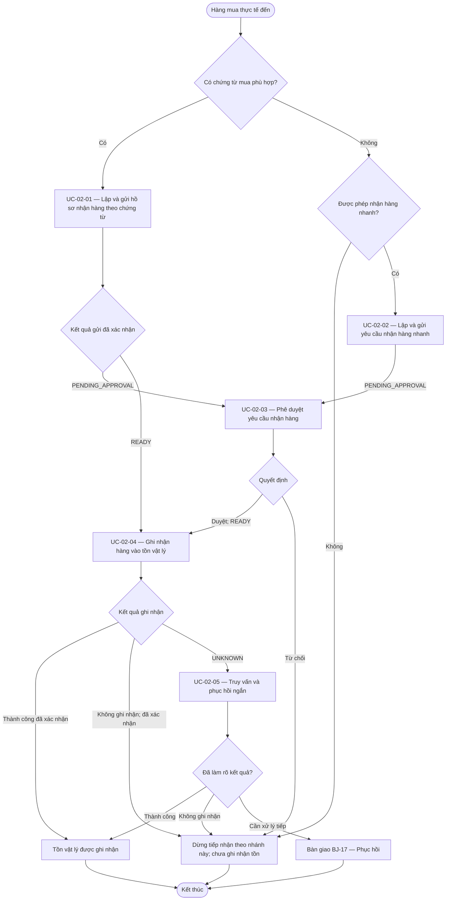

# BJ-02 — Nhận hàng mua

## 1. Tổng quan nghiệp vụ & Bối cảnh

Hành trình bắt đầu khi hàng mua thực tế được giao đến. Người lập xác định hàng thuộc quyền sở hữu của đơn vị, ghi nhận hàng thực nhận và gửi hồ sơ để xử lý. Mục tiêu là ghi đúng hàng vào tồn vật lý, có căn cứ để truy vết và không tạo tác động trùng hoặc bán phần.

Hồ sơ nhận hàng là đối tượng đi xuyên hành trình, mang theo nhà cung cấp, kho nhận, ngày nghiệp vụ, căn cứ giao nhận và các mặt hàng thực nhận. Có hai đường vào: nhận theo chứng từ mua phù hợp hoặc lập yêu cầu nhận hàng nhanh khi không có chứng từ phù hợp và người lập được phép sử dụng cách này.

Việc lập và gửi hồ sơ thuộc UC-02-01/02. Hồ sơ nhận hàng nhanh luôn phải qua phê duyệt; UC-02-03 chỉ sở hữu quyết định duyệt hoặc từ chối. Chỉ hồ sơ đủ điều kiện thực thi mới chuyển sang UC-02-04 để ghi nhận tồn vật lý. Khi chưa xác định được kết quả ghi nhận, hành trình chuyển sang UC-02-05 để làm rõ kết quả của cùng hồ sơ.

**Bắt đầu khi:** Hàng mua thực tế đã đến và cần được tiếp nhận.

**Kết thúc khi:** Kết quả ghi nhận tồn vật lý đã được xác nhận; hồ sơ bị từ chối/dừng với kết quả rõ ràng; hoặc trách nhiệm xử lý tiếp đã được bàn giao sang hành trình phục hồi. Đang bổ sung hồ sơ, chờ duyệt hoặc chưa rõ kết quả không phải hoàn tất thành công.

**Không bao gồm:** Lập kế hoạch mua/PO, hóa đơn và công nợ nhà cung cấp, thanh toán, quyền lợi thương mại, nhập hàng giữ hộ hoặc hàng chưa có xác nhận quyền sở hữu.

## 2. Tác nhân và trách nhiệm

| Tác nhân | Trách nhiệm | Phạm vi thẩm quyền |
|---|---|---|
| Thủ kho / Người lập | Xác lập căn cứ nhận hàng, hoàn thiện và gửi hồ sơ | Lập/gửi trong phạm vi kho được cấp quyền; không tự duyệt hồ sơ của mình |
| Người duyệt | Xem xét hồ sơ đã gửi và quyết định duyệt/từ chối | Quyết định theo chính sách và phạm vi được giao |
| Hệ thống | Kiểm tra điều kiện, ghi nhận và làm rõ kết quả | Chỉ thực thi hồ sơ đủ điều kiện; không bỏ qua phê duyệt bắt buộc |

## 3. Sơ đồ hành trình nghiệp vụ

Các cạnh rời UC-02-01/02 chỉ được đi tiếp sau khi kết quả gửi được xác nhận. Việc bổ sung dữ liệu hoặc làm rõ kết quả gửi chưa xác định thuộc luồng nội bộ của UC; không được chuyển sang phê duyệt bằng một kết quả suy đoán. Bàn giao BJ-17 kết thúc phạm vi xử lý của BJ-02, không có nghĩa việc nhận hàng đã thành công.

## 4. Bản đồ Use Case

| UC — Tên | Mục tiêu | Tác nhân | Đầu vào / Bắt đầu khi | Kết quả | Tiếp tục |
|---|---|---|---|---|---|
| UC-02-01 — Lập và gửi hồ sơ nhận hàng theo chứng từ | Gửi hồ sơ thực nhận có căn cứ nguồn | Người lập | Có chứng từ mua phù hợp | Hồ sơ đã gửi ở `READY` hoặc `PENDING_APPROVAL`; chưa ghi nhận tồn | UC-02-04 hoặc UC-02-03 theo kết quả |
| [UC-02-02 — Lập và gửi yêu cầu nhận hàng nhanh](../use-cases/UC-02-02.sample.md) | Gửi yêu cầu thực nhận không có chứng từ mua phù hợp | Người lập | Hàng đã đến, được phép nhận hàng nhanh | `PENDING_APPROVAL`; chưa ghi nhận tồn | UC-02-03 |
| UC-02-03 — Phê duyệt yêu cầu nhận hàng | Quyết định duyệt hoặc từ chối | Người duyệt | Hồ sơ `PENDING_APPROVAL` | `READY` hoặc quyết định từ chối có căn cứ | UC-02-04 hoặc kết thúc |
| UC-02-04 — Ghi nhận hàng vào tồn vật lý | Ghi đúng hàng thực nhận | Hệ thống | Hồ sơ `READY`, đủ điều kiện thực thi | Kết quả ghi nhận đã rõ hoặc `UNKNOWN` | Kết thúc hoặc UC-02-05 |
| UC-02-05 — Truy vấn và phục hồi ngắn | Làm rõ kết quả ghi nhận của cùng hồ sơ | Hệ thống | Kết quả thực thi `UNKNOWN` | Kết quả xác nhận hoặc bàn giao xử lý tiếp | Kết thúc hoặc BJ-17 |

## 5. Bàn giao và ranh giới liên quan

| Nơi nhận / Nơi cung cấp | Dữ kiện hoặc trách nhiệm bàn giao | Điều kiện bàn giao / tiếp tục |
|---|---|---|
| Người duyệt | Hồ sơ đã gửi và căn cứ xét duyệt | Kết quả gửi là `PENDING_APPROVAL`; tách người lập và người duyệt |
| Domain Sản phẩm | Sản phẩm, đơn vị tính và chính sách theo dõi lô | Dùng dữ liệu hợp lệ từ nơi sở hữu; không tạo sản phẩm trong hồ sơ nhận |
| Domain Đối tác giao dịch | Nhà cung cấp | Nhà cung cấp đã tồn tại và còn hợp lệ |
| Nơi quản lý tổ chức/kho | Ngữ cảnh đơn vị, cửa hàng, kho và phạm vi quyền | Đúng kho nhận và phạm vi được phép |
| Nguồn giá / tỷ giá có thẩm quyền | Căn cứ giá và tỷ giá khi chính sách yêu cầu | Đủ căn cứ trước khi chấp nhận gửi |
| BJ-17 | Hồ sơ, trạng thái chưa xác định và lịch sử xử lý | Phục hồi ngắn chưa làm rõ kết quả; giữ nguyên định danh hồ sơ |

## 6. Luồng giao diện cấp hành trình

Trong sample này, nhánh nhận hàng nhanh có các chuyển tiếp chính sau. Các mã Screen là mã tham chiếu của Theme 7; bố cục và tương tác chi tiết thuộc Screen Contract.

| Chặng / UC | Chuyển màn hình | Hành động nghiệp vụ |
|---|---|---|
| UC-02-02 — Xác lập hồ sơ | SCR-006 → SCR-008 | Chọn nhận hàng nhanh và cung cấp thông tin chung |
| UC-02-02 — Khai báo thực nhận | SCR-008 → SCR-009 | Chuyển sang danh sách hàng thực nhận |
| UC-02-02 — Hoàn thiện mặt hàng | SCR-009 → SCR-084 → SCR-009 | Ghi chi tiết mặt hàng và trở về danh sách |
| UC-02-02 — Rà soát | SCR-009 → SCR-010 | Kiểm tra hồ sơ trước khi gửi |
| UC-02-02 — Gửi yêu cầu | SCR-010 → Trạng thái chờ duyệt | Chỉ hiển thị gửi thành công khi có xác nhận `PENDING_APPROVAL`; từ đây bàn giao UC-02-03 |

## 7. Nghiệm thu hành trình (Journey Acceptance)

| ID | Điều kiện ở cấp hành trình | Kết quả cần bảo đảm | UC / BC liên quan |
|---|---|---|---|
| JA-01 | Nhận hàng nhanh đi từ lập hồ sơ đến ghi nhận tồn | Luôn có quyết định duyệt hợp lệ trước khi thực thi | UC-02-02, UC-02-03, UC-02-04; BC-IC-07 |
| JA-02 | Hồ sơ chuyển từ người lập sang người duyệt | Người lập không tự duyệt hồ sơ của mình | UC-02-02, UC-02-03 |
| JA-03 | Hồ sơ đã gửi hoặc đã được duyệt nhưng chưa thực thi | Việc gửi/duyệt chưa làm tăng tồn vật lý | UC-02-01, UC-02-02, UC-02-03, UC-02-04 |
| JA-04 | Hồ sơ bị từ chối phê duyệt | Không tiếp tục ghi nhận tồn từ hồ sơ bị từ chối | UC-02-03, UC-02-04 |
| JA-05 | Kết quả ghi nhận là `UNKNOWN` | Giữ cùng hồ sơ để truy vấn/phục hồi; không khởi tạo hồ sơ thay thế để thử lại | UC-02-04, UC-02-05 |
| JA-06 | Phục hồi ngắn chưa xác định được kết quả | Bàn giao đầy đủ sang BJ-17; không báo nhận hàng thành công | UC-02-05; BJ-17 |
| JA-07 | Hành trình được xác nhận thành công | Có kết quả tồn vật lý rõ ràng, không trùng hoặc bán phần | UC-02-04, UC-02-05; SBC-COM-04 |

## 8. Truy vết

- **UC minh họa:** [UC-02-02 — Lập và gửi yêu cầu nhận hàng nhanh](../use-cases/UC-02-02.sample.md).
- **Behavioral Contract:** [BC-IO-16 — Maintain operation draft](../behavioral-contracts/BC-IO-16.sample.md), [BC-IC-07 — Submit inventory operation](../behavioral-contracts/BC-IC-07.sample.md); `SBC-COM-03`, `SBC-COM-04`.
- **Domain:** `IO — Inventory Operations`, `IC — Inventory Control`.
- **Decision về nhận hàng nhanh:** `T7-DR-027`, `T7-DR-103`, `T7-DR-104`, `T7-DR-118`, `T7-DR-119`, `T7-DR-121`.
- **Decision về tác động không trùng và kết quả cuối:** `T7-DR-071`, `T7-DR-072`.

Đây là sample V5 để review cấu trúc và cách diễn đạt, không thay thế tài liệu nghiệp vụ chính thức của Theme 7. Các UC ngoài UC-02-02 và BJ-17 được dẫn bằng mã của Theme 7, không phải các sample được tạo trong bộ này.
