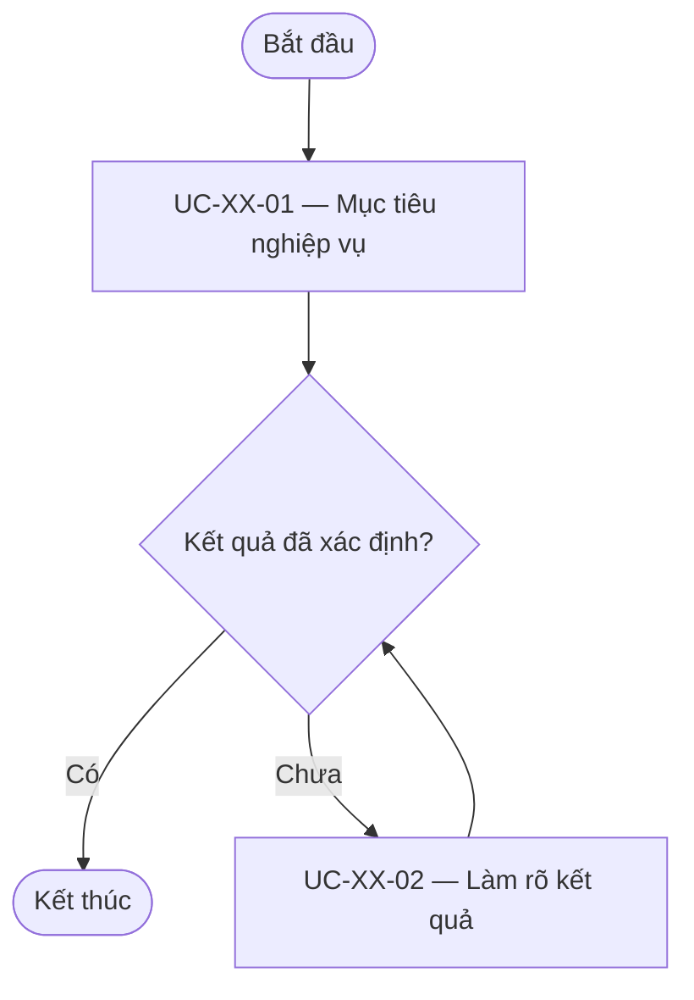

# BJ-XX — <Tên Business Journey>

<!--
Quy ước V5:
- Viết tiếng Việt rõ nghĩa; giữ thuật ngữ chuẩn khi cần đối chiếu.
- BJ sở hữu hành trình đầu–cuối, đường đi giữa các UC và việc bàn giao.
- Chi tiết Basic/Alternate/Exception Flow thuộc UC; không lặp lại ở BJ.
- Phân rã UC theo mục tiêu, thẩm quyền, thời điểm ghi nhận kết quả và cách nghiệm thu;
  không chia theo màn hình, nút bấm, API hoặc số lượng command.
- Sơ đồ sở hữu đường đi giữa các UC; không lập thêm bảng phân nhánh trùng sơ đồ.
- Tham chiếu nguồn bằng ID/link; không sao chép quy tắc dùng chung.
-->

## 1. Tổng quan nghiệp vụ & Bối cảnh

<!-- Viết 2–4 đoạn ngắn: công việc cần hoàn thành, giá trị, hoàn cảnh phát sinh,
đối tượng nghiệp vụ đi xuyên hành trình và những mốc kết quả quan trọng. -->

**Bắt đầu khi:** <Sự kiện hoặc dữ kiện nghiệp vụ khởi phát>.

**Kết thúc khi:** <Kết quả thành công hoặc trạng thái dừng có kiểm soát; phân biệt với đang chờ>.

**Không bao gồm:** <Phạm vi loại trừ và nơi chịu trách nhiệm nếu biết>.

## 2. Tác nhân và trách nhiệm

| Tác nhân | Trách nhiệm | Phạm vi thẩm quyền |
|---|---|---|
| <Tác nhân> | <Công việc chịu trách nhiệm> | <Quyết định được phép thực hiện> |

## 3. Sơ đồ hành trình nghiệp vụ

<!-- Sơ đồ có một Begin và một End; thể hiện điều kiện chuyển UC, kết quả trung gian,
nhánh dừng và bàn giao. Trạng thái chờ/chưa xác định không được mô tả là thành công.
Thay sơ đồ minh họa dưới đây bằng hành trình thực tế. -->

## 4. Bản đồ Use Case

<!-- Bảng giải thích ý nghĩa các UC và điểm chuyển trên sơ đồ, không kể lại luồng nội bộ.
Một UC có thể được triển khai bằng nhiều Slice theo tập Flow/Acceptance Scenario;
không ép quan hệ 1 UC = 1 Slice hoặc cắt nhỏ UC chỉ để vừa một công việc kỹ thuật. -->

| UC — Tên | Mục tiêu | Tác nhân | Đầu vào / Bắt đầu khi | Kết quả | Tiếp tục |
|---|---|---|---|---|---|
| UC-XX-01 — <Tên> | <Mục tiêu> | <Tác nhân> | <Dữ kiện đầu vào> | <Kết quả có thể xác nhận> | <UC kế tiếp hoặc kết thúc> |

## 5. Bàn giao và ranh giới liên quan

| Nơi nhận / Nơi cung cấp | Dữ kiện hoặc trách nhiệm bàn giao | Điều kiện bàn giao / tiếp tục |
|---|---|---|
| <Tác nhân, Journey, Theme hoặc Domain> | <Đối tượng và dữ kiện cần giữ> | <Điều kiện rõ ràng> |

## 6. Liên kết thiết kế

<!-- Chỉ link tới UI Flow canonical (khai báo thêm `ui_flow` trong frontmatter).
Không chép routing màn hình vào BJ; UIF sở hữu routing, điểm vào/kết thúc và state hiển thị,
Screen Contract sở hữu bố cục và tương tác chi tiết. -->

[UIF-XX — <Tên>](../../../03.design/flows/UIF-XX-BJ-XX.md) sở hữu routing giữa các màn hình, điểm vào/kết thúc và state hiển thị; chi tiết màn hình nằm tại `03.design/screens/`.

## 7. Nghiệm thu hành trình (Journey Acceptance)

<!-- Chỉ kiểm kết quả, điều kiện xuyên nhiều UC và bàn giao. Không dùng Given/When/Then
để lặp Acceptance Scenario chi tiết của UC. -->

| ID | Điều kiện ở cấp hành trình | Kết quả cần bảo đảm | UC / BC liên quan |
|---|---|---|---|
| JA-01 | <Điều kiện> | <Kết quả quan sát được> | <ID — Tên> |

## 8. Truy vết

<!-- Nguồn tri thức, Decision, Domain, Entity và BC chi phối hành trình.
Phân biệt nguồn đã chốt với câu hỏi còn mở; chỉ FROZEN khi các ranh giới đã được duyệt. -->

| Nguồn | Vai trò đối với hành trình |
|---|---|
| <ID/link — Tên> | <Căn cứ nghiệp vụ> |
