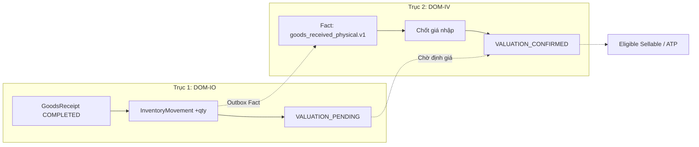
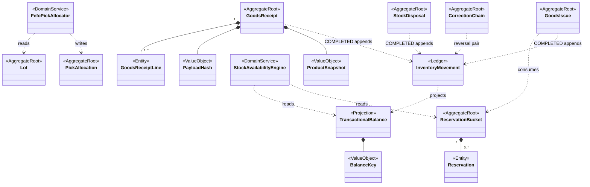
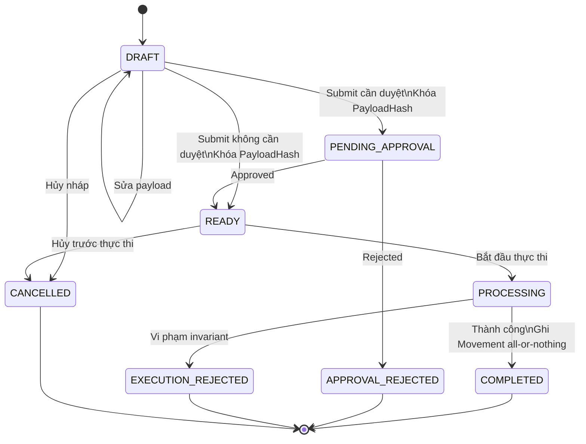
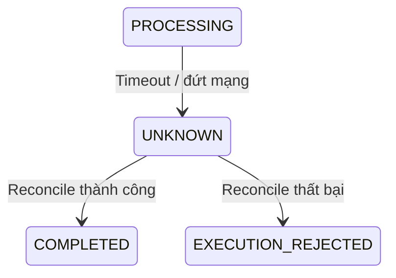
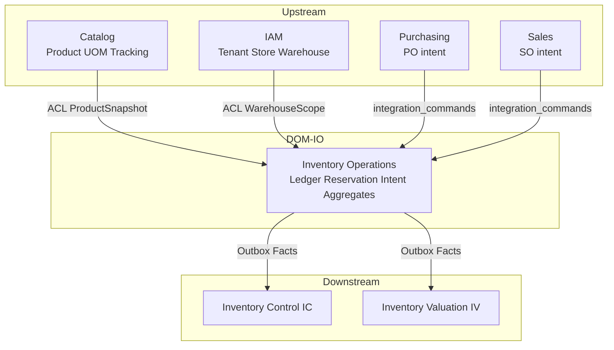

---

## id: DOM-IO

type: domain-foundation
theme: theme-07
title: Inventory Operations
owner: BA/SA
status: DRAFT
sample_of: DOMAIN.template.md
sample_status: GOLD_STANDARD_SAMPLE

# DOM-IO — Inventory Operations

## 1. Trách nhiệm

**Core Subdomain** của Theme 07 — thẩm quyền duy nhất đối với **sự thật biến động vật lý & số lượng** (Physical & Quantity Reality). Không sở hữu giá trị tiền tệ, phê duyệt, hay chính sách thương mại.

| Sứ mệnh cốt lõi           | Trách nhiệm chính                                                                                                  | Phạm vi thẩm quyền                                                                 |
| ------------------------- | ------------------------------------------------------------------------------------------------------------------ | ---------------------------------------------------------------------------------- |
| Quantity Ledger Authority | Sổ cái `InventoryMovement` append-only, không sửa lịch sử                                                          | Sở hữu: movement số lượng. Không: giá vốn / GL                                     |
| Balance Projection        | Bản chiếu `TransactionalBalance` theo `BalanceKey` (6 thành phần)                                                  | Sở hữu: projection. Không: sửa tay số dư                                           |
| Intent-driven operations  | Thực thi lệnh kho theo từng intent (`GoodsReceipt`, `GoodsIssue`, `StockDisposal`…) — payload lock, all-or-nothing | Sở hữu: lifecycle từng Aggregate intent. Không: một God Class `InventoryOperation` |
| Reservation control       | Phong tỏa tồn khả dụng qua `ReservationBucket`                                                                     | Sở hữu: reserved qty. Không: trừ tồn vật lý khi giữ hàng                           |
| Lot & pick                | Hồ sơ `Lot`, phân bổ nhặt hàng `PickAllocation`                                                                    | Sở hữu: lot / allocation. Không: product master / UOM policy                       |
| Correction integrity      | `CorrectionChain`: gốc → đảo → điều chỉnh                                                                          | Sở hữu: chuỗi liên kết. Không: UPDATE/DELETE movement cũ                           |

## 2. Quyền sở hữu và ranh giới

### 2.1 Domain sở hữu

| Khái niệm                                                           | Vai trò                                                                        |
| ------------------------------------------------------------------- | ------------------------------------------------------------------------------ |
| `GoodsReceipt` / `GoodsIssue` / `StockDisposal` / `StockAdjustment` | Aggregate Root theo Business Intent — lifecycle, `PayloadHash`, all-or-nothing |
| `ReservationBucket` + `Reservation`                                 | Aggregate Root + Child — concurrency giữ hàng                                  |
| `Lot`, `PickAllocation`, `CorrectionChain`                          | Aggregate Roots — lô, phân bổ xuất, chuỗi sửa sai                              |
| `InventoryMovement`                                                 | Append-only Ledger — bất biến                                                  |
| `TransactionalBalance`                                              | Projection / Read Model theo `BalanceKey`                                      |
| `stock_state`, `valuation_state` (trên balance)                     | Phân loại hàng vật lý & trạng thái định giá ảnh hưởng ATP                      |

### 2.2 Domain không sở hữu

| Khái niệm ngoài ranh giới            | Owner                                 |
| ------------------------------------ | ------------------------------------- |
| PO, SO, Return Request               | Purchasing / Sales                    |
| Product master, UOM, tracking policy | Catalog                               |
| Store / Warehouse master, RBAC       | IAM / Organization                    |
| Approval policy, ApprovalCase        | Inventory Control (IC)                |
| Giá vốn, value ledger, AP/GL         | Inventory Valuation (IV) / Accounting |

### 2.3 Ranh giới tính nhất quán & Two-Axis Receipt

- Mỗi Command mutation chỉ đổi **đúng 1 Aggregate Root** trong 1 transaction.
- Nhận hàng vật lý hoàn tất → ghi movement với `valuation_state = VALUATION_PENDING` → chỉ sau khi IV xác nhận → `VALUATION_CONFIRMED` mới vào ATP.

## 3. Khái niệm chính

### 3.1 Ngôn ngữ chung (Ubiquitous Language)

Chỉ các thuật ngữ dùng trong DOM này (diagram, lifecycle, invariant, entity map). Cột **Vai trò** thay catalog Tactical DDD riêng.

| Thuật ngữ                                  | Vai trò                 | Định nghĩa                                                                                        |
| ------------------------------------------ | ----------------------- | ------------------------------------------------------------------------------------------------- |
| GoodsReceipt                               | Aggregate Root (intent) | Lệnh nhập kho (PO / NCC / quick receipt); khóa payload sau submit; `COMPLETED` → append Movement. |
| GoodsIssue                                 | Aggregate Root (intent) | Lệnh xuất kho (bán / điều chuyển / trả NCC); tiêu thụ reservation; chống xuất âm Sellable.        |
| StockDisposal                              | Aggregate Root (intent) | Lệnh xuất hủy / hao hụt; `COMPLETED` → append Movement.                                           |
| StockAdjustment                            | Aggregate Root (intent) | Lệnh điều chỉnh kiểm kê khi thuộc phạm vi IO.                                                     |
| GoodsReceiptLine / GoodsIssueLine          | Entity                  | Dòng hàng thuộc Aggregate intent tương ứng.                                                       |
| ReservationBucket                          | Aggregate Root          | Hạn ngạch giữ hàng theo `(tenant, product, warehouse)`; concurrency boundary.                     |
| Reservation                                | Entity                  | Cam kết giữ theo dòng nguồn; thuộc `ReservationBucket`; không trừ Physical On-Hand.               |
| PickAllocation                             | Aggregate Root          | Kết quả phân bổ lô nhặt hàng do `FefoPickAllocator` ghi nhận.                                     |
| Lot                                        | Aggregate Root          | Hồ sơ lô NSX và hạn sử dụng.                                                                      |
| CorrectionChain                            | Aggregate Root          | Liên kết Gốc → Reversal → Correction khi sửa sai sau `COMPLETED`.                                 |
| InventoryMovement                          | Ledger                  | Bút toán số lượng append-only; không lifecycle; nguồn sự thật để rebuild balance.                 |
| TransactionalBalance                       | Projection              | Bản chiếu tồn tức thời theo `BalanceKey`; không phải Aggregate Root.                              |
| BalanceKey                                 | Value Object            | Khóa 6 thành phần: tenant, product, warehouse, stock_state, valuation_state, lot_key.             |
| PayloadHash                                | Value Object            | SHA-256 của payload sau submit; khóa bất biến và phát hiện conflict khi retry.                    |
| ProductSnapshot                            | Value Object (ACL)      | Snapshot sản phẩm từ Catalog; không import domain Catalog.                                        |
| StockQuantity / ShelfLife / WarehouseScope | Value Object            | Đóng gói số lượng–UOM, HSD, và ngữ cảnh kho.                                                      |
| StockAvailabilityEngine                    | Domain Service          | Tính ATP và thẩm định điều kiện bán (`Eligible Sellable − Reserved`).                             |
| FefoPickAllocator                          | Domain Service          | Phân bổ lô xuất theo FEFO/FIFO; đọc `Lot`, ghi `PickAllocation`.                                  |
| OperationReversalPairBuilder               | Domain Service          | Sinh cặp bút toán đảo / điều chỉnh cho `CorrectionChain`.                                         |
| Eligible Sellable                          | Concept                 | Hàng `SELLABLE` + còn HSD an toàn + `VALUATION_CONFIRMED` — đầu vào ATP.                          |
| Available To Promise (ATP)                 | Concept                 | Lượng còn được phép cam kết: `Eligible Sellable − Reserved` (qua `ReservationBucket`).            |
| Inventory Operation                        | Concept                 | Khái niệm bao quát cho lệnh kho — **không** implement như God Aggregate Root.                     |

> **Anti-pattern bị cấm:** một Aggregate `InventoryOperation` với `operation_type` + hàng chục field nullable. Intent khác → Aggregate Root khác; cùng quy ước payload lock, all-or-nothing, `COMPLETED` → append Movement.

### 3.2 Domain Model Overview

Conceptual class diagram — stereotype / tên / quan hệ; không ERD hay cột SQL. Chi tiết field thuộc `ENT-*`.

- Intent Aggregates không kế thừa một God Root; cùng quy ước `COMPLETED` → append `InventoryMovement`.
- `Inventory Operation` (Concept) không xuất hiện trên diagram như một class.
- `InventoryMovement` (Ledger) và `TransactionalBalance` (Projection) không phải Aggregate Root.

## 4. Lifecycle và trạng thái

### 4.1 State machine nghiệp vụ (mẫu dùng chung cho Aggregate intent)

Áp dụng cho `GoodsReceipt`, `GoodsIssue`, `StockDisposal`, … — **lifecycle cụ thể có thể khác nhau** (VD: Issue có thêm bước pick/pack). Sơ đồ dưới là khung tối thiểu chung.

**Trạng thái kỹ thuật** `UNKNOWN` **(không phải kết quả nghiệp vụ):**

> Khi timeout / mất kết nối giữa `PROCESSING` và commit xác định, hệ thống có thể ghi nhận `UNKNOWN` để **bảo vệ chống double-commit**. Đây **không** phải failure nghiệp vụ và **không** được tự hủy. Client poll / reconcile bằng cùng identity cho đến khi xác định `COMPLETED` hoặc `EXECUTION_REJECTED`.

### 4.2 Append-only Ledger — không có lifecycle

- `InventoryMovement` **không** có state machine: sinh ra là bất biến; cấm UPDATE/DELETE.
- Aggregate intent chuyển `COMPLETED` → append movement(s) trong cùng commit set (+ outbox fact nếu có).
- Sửa sai sau COMPLETED: `CorrectionChain` sinh reversal + correction — không sửa movement cũ.

## 5. Quy tắc và Điều kiện bắt buộc

Mức yêu cầu theo RFC 2119 (MUST / MUST NOT / SHOULD / MAY). Diễn đạt tiếng Việt linh hoạt — từ cấp độ **IN HOA** toàn bộ (`CHỈ ĐƯỢC`, `KHÔNG ĐƯỢC`, `BẮT BUỘC`, `CẦN`, `NÊN`, `CÓ THỂ`…), không gò vào đúng cặp PHẢI / PHẢI KHÔNG.

| Mã | Quy tắc |
|---|---|
| INV-IO-01 | `operation_request_id` **PHẢI** tách biệt khỏi `idempotencyKey`. Khi retry, client **PHẢI** giữ nguyên `idempotencyKey`. |
| INV-IO-02 | Hệ thống **CHỈ ĐƯỢC** ghi `InventoryMovement` khi Aggregate intent (`GoodsReceipt`, `GoodsIssue`, `StockDisposal`, …) đã `COMPLETED`. Draft hoặc pending **KHÔNG ĐƯỢC** làm thay đổi tồn vật lý. |
| INV-IO-03 | Lệnh nhiều dòng **BẮT BUỘC** thực thi all-or-nothing trong cùng một Aggregate intent. Một dòng thất bại thì toàn bộ lệnh **PHẢI** chuyển `EXECUTION_REJECTED`. |
| INV-IO-04 | `InventoryMovement` là append-only: hệ thống **KHÔNG ĐƯỢC** `UPDATE` hoặc `DELETE` movement. `TransactionalBalance` **CẦN** tái lập được đầy đủ từ lịch sử movement. |
| INV-IO-05 | Với giao dịch xuất thông thường, `GoodsIssue` và `StockAvailabilityEngine` **KHÔNG ĐƯỢC** cho phép thao tác làm âm tồn Sellable hoặc ATP. |
| INV-IO-06 | Mọi thay đổi trên `ReservationBucket` và Aggregate intent **CẦN** kiểm tra `version` (optimistic concurrency). Commit hợp lệ đầu tiên thắng; commit muộn **PHẢI** bị từ chối vì conflict. |
| INV-IO-07 | Khi giữ hàng, `ReservationBucket` **CHỈ ĐƯỢC** giảm ATP. Hệ thống **KHÔNG ĐƯỢC** trừ Physical On-Hand chỉ vì tạo `Reservation`. |
| INV-IO-08 | Sau khi Aggregate intent rời `DRAFT`, payload **PHẢI** bị khóa qua `PayloadHash` và **KHÔNG ĐƯỢC** sửa nữa. |
| INV-IO-09 | Cùng `idempotencyKey` hoặc `operation_request_id` nhưng `PayloadHash` khác bản đã lưu thì hệ thống **PHẢI** từ chối với `IDEMPOTENCY_CONFLICT`. |
| INV-IO-12 | `UNKNOWN` **KHÔNG ĐƯỢC** coi là failure nghiệp vụ và **KHÔNG ĐƯỢC** auto-cancel. Client **NÊN** poll / reconcile bằng cùng identity đến khi xác định `COMPLETED` hoặc `EXECUTION_REJECTED`. Hệ thống **CÓ THỂ** ghi nhận `UNKNOWN` khi timeout hoặc đứt mạng giữa `PROCESSING` và commit. |
| INV-LOT-01 | Sản phẩm `tracking_policy = NONE` thì hệ thống **KHÔNG ĐƯỢC** nhận thông tin lô. Sản phẩm `LOT` thì **BẮT BUỘC** có `lot_key` và hạn sử dụng hợp lệ trên Aggregate nhận/xuất liên quan. |

## 6. Quan hệ với Domain khác

### 6.1 Context Map

### 6.2 Messaging (tuân thủ `vet45-integration-events.mdc`)

- **Outbox = Facts:** `goods_received_physical.v1`, `goods_issued.v1`, `stock_reserved.v1`, `stock_released.v1`, `inventory_movement_appended.v1`. Cấm `*.requested` trên outbox.
- **Commands:** Sales/Purchasing gửi qua `integration_commands` (VD: `sales.inventory.reserve_stock.v1`, `purchasing.inventory.receive_goods.v1`).
- **ACL:** chỉ nạp `ProductSnapshot`, `WarehouseScope` — không import domain model module ngoài.

## 7. Entity liên quan

| ID        | Khái niệm                              | Vai trò DDD        | Ghi chú                                                                       |
| --------- | -------------------------------------- | ------------------ | ----------------------------------------------------------------------------- |
| ENT-IO-01 | `GoodsReceipt` (và các intent sibling) | Aggregate Root     | Thay God Aggregate `InventoryOperation`; pilot quick receipt thuộc intent này |
| ENT-IO-02 | `GoodsReceiptLine` / line theo intent  | Child Entity       | Định danh `(aggregate_id, line_no)`                                           |
| ENT-IO-03 | `InventoryMovement`                    | Append-Only Ledger | Sự thật số lượng; không lifecycle                                             |
| ENT-IO-04 | `TransactionalBalance`                 | Projection         | Theo `BalanceKey`; không phải Root                                            |
| ENT-IO-05 | `Reservation`                          | Child Entity       | Thuộc `ReservationBucket`                                                     |
| ENT-IO-06 | `Lot`                                  | Aggregate Root     | Lô NSX + HSD                                                                  |
| ENT-IO-07 | `CorrectionChain`                      | Aggregate Root     | Gốc ↔ reversal ↔ correction                                                   |
| ENT-IO-08 | `ReservationBucket`                    | Aggregate Root     | Key `(tenant, product, warehouse)`                                            |
| ENT-IO-09 | `PickAllocation`                       | Aggregate Root     | Kết quả `FefoPickAllocator`                                                   |
| ENT-IO-10 | `GoodsIssue`                           | Aggregate Root     | Xuất kho; tiêu thụ reservation; chống âm                                      |
| ENT-IO-11 | `StockDisposal`                        | Aggregate Root     | Xuất hủy / hao hụt                                                            |
| —         | `IdempotencyRecord`                    | Infrastructure     | Application/Infra — **không** Domain Entity                                   |
| —         | `InventoryOperation`                   | Abstract concept   | Envelope / UL — **không** implement như một God Root                          |

## 8. Quyết định nghiệp vụ chi phối

Nguồn: `specs/themes/theme-07/01.knowledge/decisions/decision-register.md`

| Decision ID | Quyết định                     | Chi phối đối với DOM-IO                                                |
| ----------- | ------------------------------ | ---------------------------------------------------------------------- |
| T7-DR-004   | 1 store / 1 warehouse Phase 1  | `WarehouseScope` mặc định đơn giản                                     |
| T7-DR-020   | Two-Axis Receipt               | IO ghi vật lý; IV chốt giá; ATP cần `VALUATION_CONFIRMED`              |
| T7-DR-027   | Quick receipt bắt buộc duyệt   | `GoodsReceipt` (quick): DRAFT → PENDING_APPROVAL, không shortcut READY |
| T7-DR-028   | Chống xuất âm Sellable         | `GoodsIssue` + `StockAvailabilityEngine`                               |
| T7-DR-029   | Reservation tách khỏi Physical | `ReservationBucket` chỉ giảm ATP                                       |
| T7-DR-070   | Payload lock sau submit        | Mọi Aggregate intent                                                   |
| T7-DR-071   | All-or-nothing                 | Mọi Aggregate intent khi COMPLETED                                     |
| T7-DR-084   | Movement ledger append-only    | `InventoryMovement` + rebuild projection                               |

## 9. Điểm chưa chốt và Định hướng tiến hóa

- **Multi-warehouse / IN_TRANSIT / Transfer:** Phase sau — Aggregate intent `StockTransfer` riêng, không nhét vào God Root.
- **SERIAL tracking:** Aggregate riêng khi mở chính sách `SERIAL`.
- **Cycle-count lock phân vùng:** thuộc IC / coordination; IO chỉ tuân thủ khi lock active.
- Chi tiết Dart / RPC / DDL thuộc `04.architecture/` và harness slices — không ghi trong Domain Foundation.

