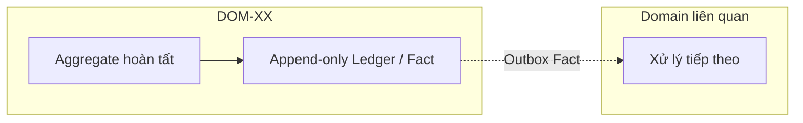
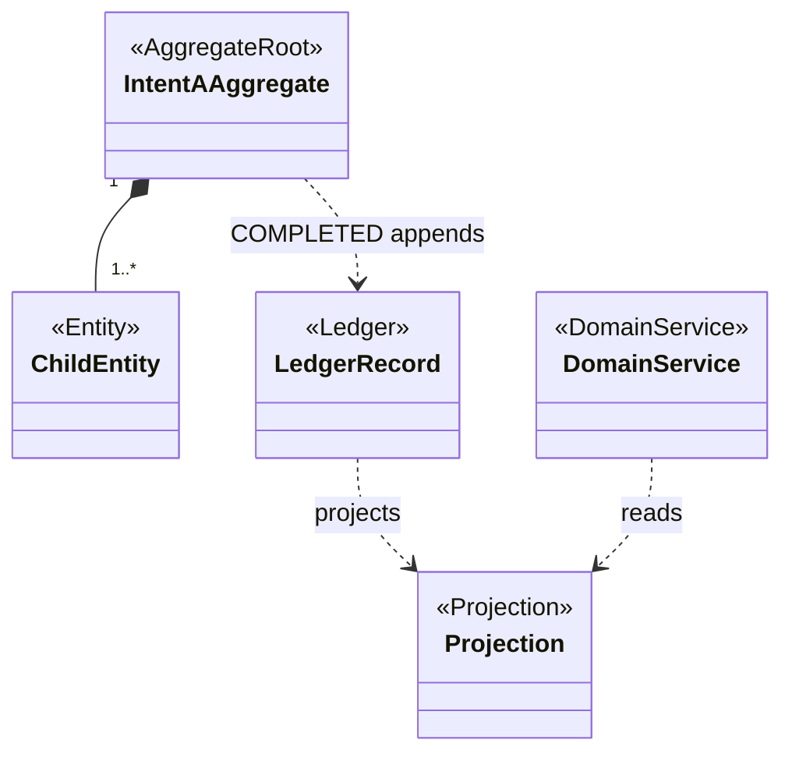
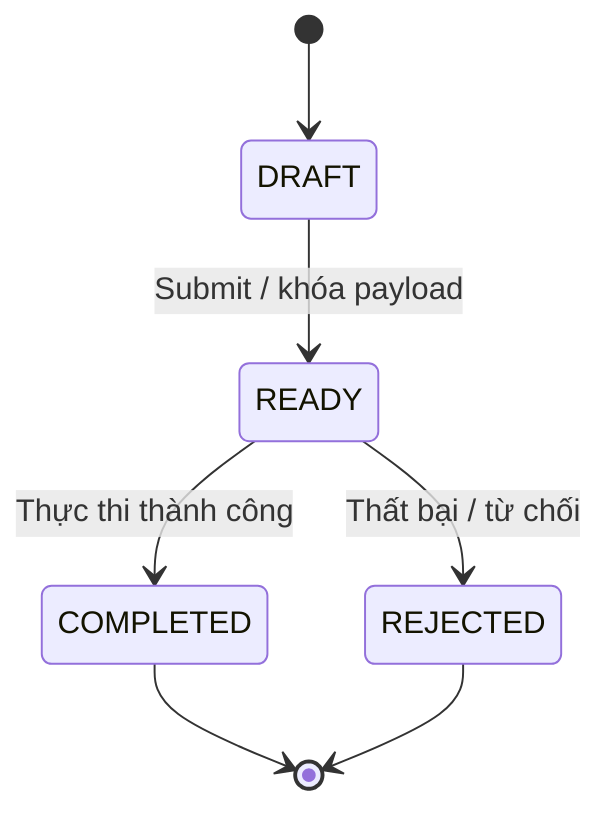
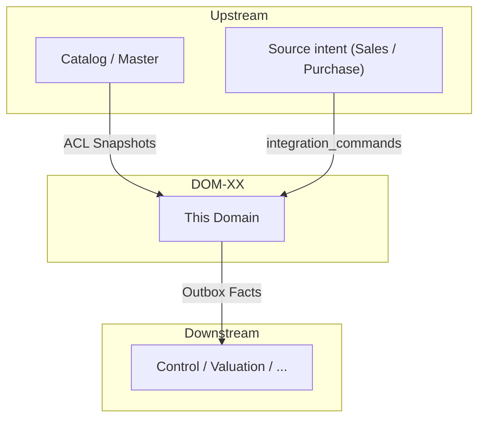

<!--
Hướng dẫn dùng template:
- Nội dung trong comment block là hướng dẫn, có thể xóa sau khi hoàn thiện.
- Chỉ giữ các mục Optional khi thực sự cần.
- Không sao chép lại nội dung đã có nguồn chuẩn khác; ưu tiên tham chiếu bằng ID/link.
- Mỗi phát biểu quan trọng phải lần ngược được về nguồn hoặc quyết định liên quan.
- Không liệt kê bảng DB / cột SQL làm "khái niệm chính" — phân loại theo Tactical DDD.
- Không gom mọi loại chứng từ vào một God Aggregate; tách Aggregate theo Business Intent.
- Tham chiếu mẫu đầy đủ: DOM-IO.sample.md
-->

# DOM-XX — <Tên Domain>

## 1. Trách nhiệm

<!-- Một câu định vị subdomain (Core / Supporting / Generic) + thẩm quyền sự thật nghiệp vụ. -->

| Sứ mệnh cốt lõi | Trách nhiệm chính | Phạm vi thẩm quyền |
|---|---|---|
| <VD: Quantity Ledger Authority> | <1 câu ngắn> | <Sở hữu gì / không sở hữu gì — 1 dòng> |

<!-- Không viết 5–6 đoạn văn xuôi. Dùng bảng trên. -->

## 2. Quyền sở hữu và ranh giới

### 2.1 Domain sở hữu

- <Khái niệm / Aggregate / Ledger / Projection sở hữu>

### 2.2 Domain không sở hữu

- <Khái niệm ngoài ranh giới> — owner: `<Domain / Module>`

### 2.3 Ranh giới tính nhất quán

<!-- Mỗi mutation chỉ đổi đúng 1 Aggregate Root trong 1 transaction. -->
<!-- Nếu có tách trục (VD: physical vs valuation), vẽ Mermaid flowchart ngắn. -->

## 3. Khái niệm chính

### 3.1 Ngôn ngữ chung (Ubiquitous Language)

<!-- Chỉ liệt kê thuật ngữ thực sự dùng trong DOM này (diagram, lifecycle, invariant, entity map). -->
<!-- Cột Vai trò thay catalog Tactical DDD riêng. Cấm God Aggregate. -->

| Thuật ngữ | Vai trò | Định nghĩa |
|---|---|---|
| `<IntentAAggregate>` | Aggregate Root (intent) | <1 câu — nghiệp vụ cụ thể> |
| `<ChildEntity>` | Entity | <Thuộc Root nào> |
| `<LedgerRecord>` | Ledger | Append-only; không lifecycle |
| `<Projection>` | Projection | Bản chiếu; không phải Aggregate Root |
| `<ValueObject>` | Value Object | <Đóng gói gì> |
| `<DomainService>` | Domain Service | <Thuật toán stateless> |
| `<BusinessTerm>` | Concept | <Chỉ khi term được dùng lại trong invariant / service> |

### 3.2 Domain Model Overview

<!-- Conceptual class diagram. Không vẽ ERD / cột SQL. Chỉ stereotype, tên, quan hệ. -->
<!-- `*--` composition · `-->` reference by id · `..>` dependency -->

- Mỗi mutation chỉ đổi đúng 1 Aggregate Root trong 1 transaction (consistency boundary).
- Ledger append-only; Projection tái lập từ history — không phải Aggregate Root.
- Chi tiết field / identity thuộc `ENT-*`; diagram này chỉ quan hệ khái niệm.

## 4. Lifecycle và trạng thái

### 4.1 State machine nghiệp vụ

<!-- Chỉ trạng thái nghiệp vụ. Trạng thái kỹ thuật (timeout / UNKNOWN) ghi chú riêng, không trộn như kết quả nghiệp vụ. -->

### 4.2 Append-only / không có lifecycle

<!-- Ledger record sinh ra là bất biến; sửa sai = bút toán đối ứng, không UPDATE/DELETE. -->

## 5. Quy tắc và Điều kiện bắt buộc

<!-- 2 cột: Mã | Văn xuôi. Mức RFC 2119 (MUST / MUST NOT / SHOULD / MAY). -->
<!-- Từ cấp độ IN HOA toàn bộ; diễn đạt linh hoạt: PHẢI / CHỈ ĐƯỢC / BẮT BUỘC / CẦN / KHÔNG ĐƯỢC / NÊN / CÓ THỂ. -->

| Mã | Quy tắc |
|---|---|
| `<INV-XX-01>` | Hệ thống **CHỈ ĐƯỢC** …. Hệ thống **KHÔNG ĐƯỢC** …. Client **NÊN** …. Hệ thống **CÓ THỂ** …. |

## 6. Quan hệ với Domain khác

### 6.1 Context Map

### 6.2 Messaging

<!-- Outbox = Facts (past tense). Cross-module work = integration_commands. Không dùng `*.requested` trên outbox. -->

- Facts (outbox): `<domain>_<entity>_<past>.v1`
- Commands (integration_commands): `<source>.<owner>.<action>.v1`

## 7. Entity liên quan

| ID | Khái niệm | Vai trò DDD | Ghi chú |
|---|---|---|---|
| `ENT-XX-01` | `<Name>` | Aggregate Root / Child Entity / Ledger / Projection / VO | <1 câu> |

<!-- IdempotencyRecord / CommandReceipt thuộc Application/Infrastructure — không liệt kê như Domain Entity. -->

## 8. Quyết định nghiệp vụ chi phối

| Decision ID | Quyết định | Chi phối đối với domain này |
|---|---|---|
| `TXX-DR-xxx` | <Tên ngắn> | <1 câu> |

## 9. Điểm chưa chốt

<!-- Optional; chỉ khi DRAFT/IN_REVIEW. Không ghi quyết định kiến trúc Aggregate ở đây — thuộc domain/aggregates/. -->

- <Mở / Phase sau / Open question>
