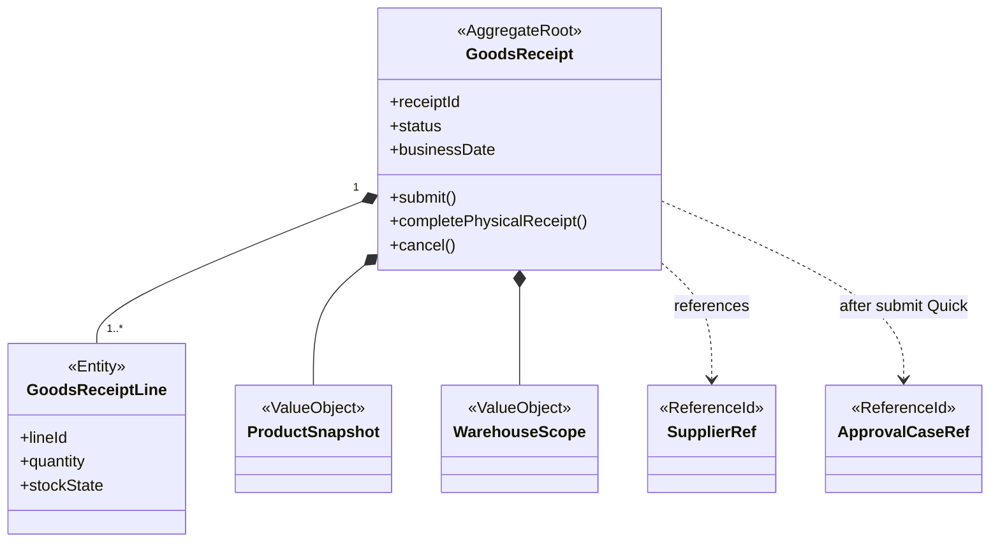
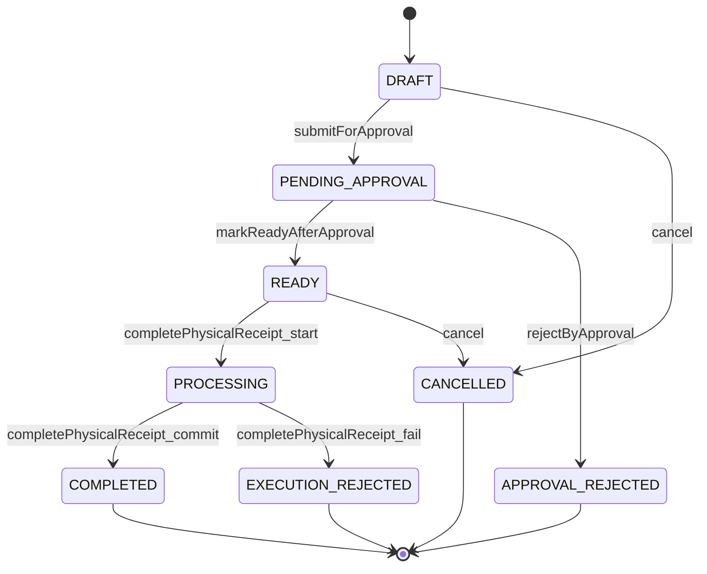

<!--
Mẫu chuẩn (Gold Standard) cho ENTITY.template.md.
Pilot: Quick Receipt trong DOM-IO — không dùng God Aggregate InventoryOperation.
Chi tiết kỹ thuật (CommandReceipt, optimistic version, wire API) nằm ngoài file này.
-->

# ENT-IO-01 — GoodsReceipt

## 1. Định vị nghiệp vụ & ranh giới Aggregate

Hồ sơ lệnh **nhập kho** theo intent nhận hàng (PO / NCC / quick receipt). Sở hữu lifecycle, payload nghiệp vụ và kết quả vật lý của lần nhận; khi `COMPLETED` mới append `InventoryMovement`.

| Thuộc tính | Giá trị |
|---|---|
| Vai trò DDD | `AGGREGATE_ROOT` |
| Aggregate Root | `GoodsReceipt` (tự thân) |
| Domain sở hữu | `DOM-IO` — thẩm quyền biến động vật lý & số lượng |
| Domain không sở hữu | Approval route/case → `DOM-IC`; giá vốn / value ledger → `DOM-IV`; Product / UOM master → Catalog |

### 1.1 Ranh giới Aggregate (Visual)

> Anti-pattern: một Aggregate `InventoryOperation` với `operation_type` + field nullable hàng loạt. Intent nhận hàng → Root `GoodsReceipt`; intent khác → Root khác (`GoodsIssue`, `StockDisposal`, …).

## 2. Identity

| Loại | Định danh | Ghi chú |
|---|---|---|
| Surrogate | `receiptId` | Ổn định suốt vòng đời hồ sơ |
| Business key | `(tenantId, sourceType, operationRequestId)` | Unique theo nguồn yêu cầu nhận hàng |

`operationRequestId` là identity nghiệp vụ của yêu cầu nhận — không đồng nghĩa với khóa kỹ thuật của lần gọi command.

## 3. Thuộc tính nghiệp vụ thuần túy

| Thuộc tính | Ý nghĩa | Bắt buộc | Ghi chú |
|---|---|---:|---|
| `receiptId` | Định danh hồ sơ nhận | Có | Surrogate ổn định |
| `operationRequestId` | ID yêu cầu nguồn | Có | Thành phần business key |
| `sourceType` | Loại chứng từ nguồn | Có | PO / NCC / quick, … |
| `warehouseScope` | Kho / cửa hàng ngữ cảnh | Có | Phase 1: cặp mặc định đang hoạt động |
| `supplierId` | Nhà cung cấp của lần nhận | Với receipt từ NCC/quick | Supplier phải tồn tại trước |
| `businessDate` | Ngày nhận nghiệp vụ | Có | Theo lịch nghiệp vụ tenant |
| `status` | Trạng thái vòng đời | Có | Bắt đầu `DRAFT` |
| `lines` | Các dòng hàng nhận | Có (≥1 khi submit) | Child `GoodsReceiptLine` |
| `reasonCode` | Lý do nghiệp vụ (nếu policy yêu cầu) | Theo policy | Gắn với loại nhận |

## 4. Hành vi nghiệp vụ cốt lõi

| Hành vi | Điều kiện / Invariant | Hệ quả / Domain Event |
|---|---|---|
| `createDraft(...)` | Tenant/store/warehouse hợp lệ; supplier tồn tại khi bắt buộc | Hồ sơ `DRAFT`; chưa có movement |
| `addOrUpdateLine(...)` | Chỉ khi `DRAFT`; quantity > 0; tracking/lot theo product policy | Cập nhật dòng; chưa khóa payload |
| `submitForApproval()` | `DRAFT`; đủ dòng; Quick Receipt **luôn** cần duyệt | `DRAFT → PENDING_APPROVAL`; phát `GoodsReceiptSubmitted`; payload không còn mutable |
| `markReadyAfterApproval()` | Đang `PENDING_APPROVAL`; quyết định duyệt từ IC hợp lệ | `PENDING_APPROVAL → READY` |
| `rejectByApproval()` | Đang `PENDING_APPROVAL`; IC từ chối | `→ APPROVAL_REJECTED`; không movement |
| `completePhysicalReceipt()` | `READY`; all-or-nothing trên toàn bộ dòng | `→ COMPLETED`; append movement (`VALUATION_PENDING`); phát `GoodsReceiptCompleted` |
| `cancel()` | Chưa `COMPLETED`; policy cho phép | `→ CANCELLED`; không movement vật lý |

## 5. Vòng đời & chuyển dịch trạng thái

| Trạng thái | Ý nghĩa | Payload mutable? |
|---|---|---|
| `DRAFT` | Soạn thảo / chỉnh dòng | Có |
| `PENDING_APPROVAL` | Chờ duyệt (bắt buộc với Quick) | Không |
| `READY` | Đã duyệt, sẵn sàng ghi nhận vật lý | Không |
| `PROCESSING` | Đang thực thi ghi nhận | Không |
| `COMPLETED` | Đã ghi movement vật lý | Không |
| `APPROVAL_REJECTED` | Bị từ chối duyệt | Không |
| `EXECUTION_REJECTED` | Thực thi thất bại có lý do rõ | Không |
| `CANCELLED` | Hủy trước khi hoàn tất vật lý | Không |

Với Quick Receipt: **không** có nhánh `DRAFT → READY`. Draft/save/submit **chưa** tạo movement vật lý.

## 6. Domain Events phát sinh

| Event | Khi nào | Ý nghĩa |
|---|---|---|
| `GoodsReceiptSubmitted` | `submitForApproval()` thành công | Hồ sơ đã khóa payload, chờ duyệt |
| `GoodsReceiptApproved` | `markReadyAfterApproval()` | Đã sẵn sàng ghi nhận vật lý |
| `GoodsReceiptApprovalRejected` | `rejectByApproval()` | Từ chối duyệt; không nhận hàng |
| `GoodsReceiptCompleted` | `completePhysicalReceipt()` commit | Đã nhận vật lý; movement tồn tại |
| `GoodsReceiptCancelled` | `cancel()` | Hủy trước hoàn tất vật lý |

> Integration / outbox facts (wire name versioned) được map từ các domain event này trong work slice lúc review để implement — không khai báo ở đây.

## 7. Liên kết truy vết

| Loại | ID |
|---|---|
| Domain Foundation | `DOM-IO` |
| Behavioral Contract | `BC-IO-16`, `BC-IC-07`, `BC-IO-02` |
| Use Case | `UC-02-02`, `UC-02-03`, `UC-02-04` |
| Child Entity | `ENT-IO-02` (`GoodsReceiptLine`) — đặc tả riêng khi cần |
| Quyết định | Nhóm G03 (nhận hàng & xác nhận giá trị), G10 (operation / finality) |
