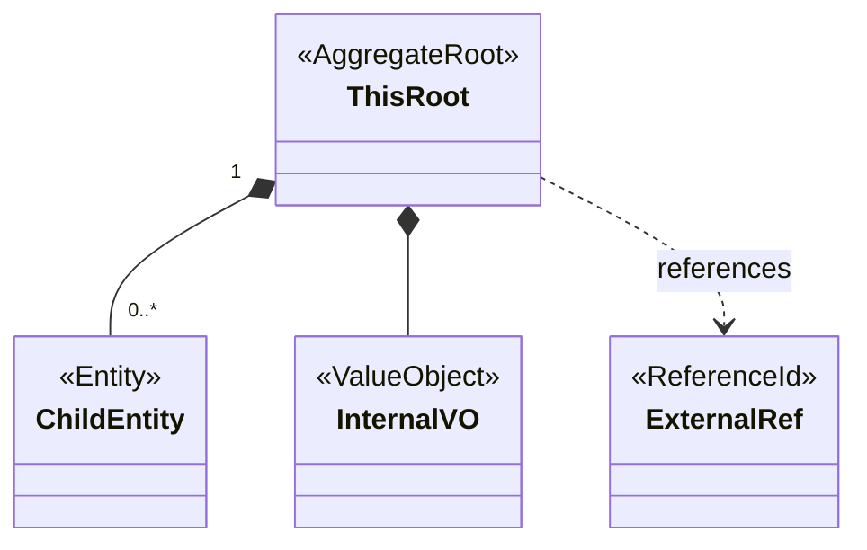
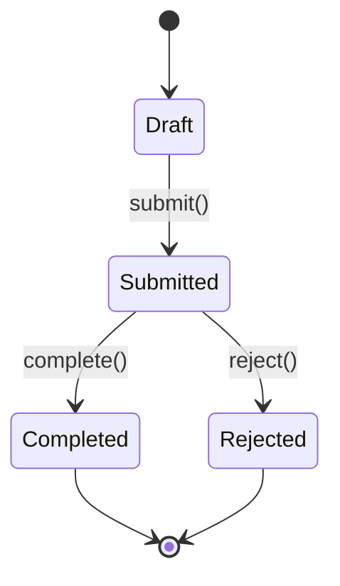

<!--
Hướng dẫn dùng template:
- Nội dung trong Comment block là hướng dẫn, có thể xóa sau khi hoàn thiện.
- Chỉ giữ các mục Optional khi thực sự cần.
- Không sao chép lại nội dung đã có nguồn chuẩn khác; ưu tiên tham chiếu bằng ID/link.
- Mỗi phát biểu quan trọng phải lần ngược được về nguồn hoặc quyết định liên quan.

Phạm vi Domain Entity (Clear / Concise / Visual):
- Mô tả State + Behavior + Domain Event của thực thể trong miền nghiệp vụ.
- KHÔNG mô tả table/SQL, optimistic lock `version`, CommandReceipt, idempotency key,
  payload hash kỹ thuật, API envelope, hay outbox wire name — các mục đó thuộc
  Technical Contract dùng chung hoặc thiết kế cục bộ trong Slice.
- Vai trò Root/Child dẫn theo Aggregate đã chốt; Entity không tự quyết định ranh giới transaction.
- Value Object dùng VALUE_OBJECT.template.md — không dùng file này.
- Lifecycle / Invariants tổng quát của subdomain thuộc DOM-*; file ENT chỉ ghi
  phần gắn trực tiếp với thực thể này (tránh drift).
-->

# ENT-XX-XX — <Tên Entity>

## 1. Định vị nghiệp vụ & ranh giới Aggregate

<!-- Một–hai câu: thực thể đại diện cho cái gì trong thế giới nghiệp vụ. Không mô tả table. -->

| Thuộc tính | Giá trị |
|---|---|
| Vai trò DDD | `<AGGREGATE_ROOT \| CHILD_ENTITY>` |
| Aggregate Root | `<Tên Root nếu đây là Child; tự thân nếu là Root>` |
| Domain sở hữu | `DOM-XX` — `<lý do ngắn>` |
| Domain không sở hữu | `<khái niệm ngoài> → owner` |

### 1.1 Ranh giới Aggregate (Visual)

<!-- Đóng khung Root, Child Entity, VO nội bộ; Reference Id ra ngoài bằng dashed. -->

## 2. Identity

<!-- Cách nhận diện ổn định trong nghiệp vụ. Surrogate ID vs Business Key. -->

| Loại | Định danh | Ghi chú |
|---|---|---|
| Surrogate | `<id>` | Ổn định suốt vòng đời hồ sơ |
| Business key | `(...)` | Unique trong phạm vi tenant / nguồn |

## 3. Thuộc tính nghiệp vụ thuần túy

<!-- Chỉ intrinsic state. Cấm: version, payload_hash, command receipt, technical flags. -->

| Thuộc tính | Ý nghĩa | Bắt buộc | Ghi chú |
|---|---|---:|---|
| `<field>` | `<meaning>` | Có/Không | `<constraint nghiệp vụ>` |

## 4. Hành vi nghiệp vụ cốt lõi

<!-- Method bảo vệ invariant — chống Anemic Model. -->

| Hành vi | Điều kiện / Invariant | Hệ quả / Domain Event |
|---|---|---|
| `<methodName()>` | `<precondition>` | `<event hoặc state change>` |

## 5. Vòng đời & chuyển dịch trạng thái

<!-- Optional nếu thực thể không có lifecycle. Dùng stateDiagram — không liệt kê chuỗi text thuần. -->

| Trạng thái | Ý nghĩa | Payload mutable? |
|---|---|---|
| `<STATE>` | `<meaning>` | Có/Không |

## 6. Domain Events phát sinh

<!-- Facts nội bộ Aggregate (past tense). Không đặt tên imperative / *.requested. -->

| Event | Khi nào | Ý nghĩa |
|---|---|---|
| `<EntityPastTense>` | `<method / transition>` | `<1 câu>` |

## 7. Liên kết truy vết

<!-- Chỉ link ID — không copy BC/UC. -->

| Loại | ID |
|---|---|
| Domain Foundation | `DOM-XX` |
| Behavioral Contract | `BC-…` |
| Use Case | `UC-…` |
| Quyết định | `T7-DR-…` / `DR-…` |
