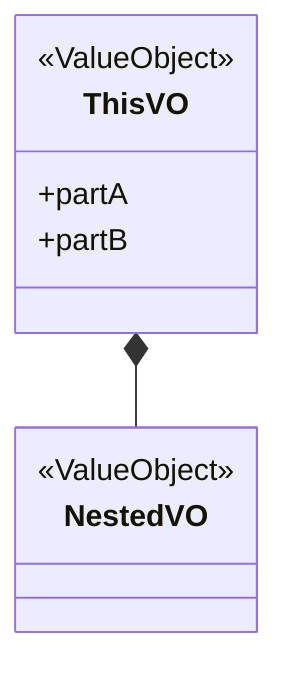

<!--
Hướng dẫn dùng template:
- Nội dung trong Comment block là hướng dẫn, có thể xóa sau khi hoàn thiện.
- Chỉ giữ các mục Optional khi thực sự cần.
- Không sao chép lại nội dung đã có nguồn chuẩn khác; ưu tiên tham chiếu bằng ID/link.

Phạm vi Value Object (Clear / Concise / Visual):
- VO là Conceptual Whole bất biến: không có identity riêng, so sánh bằng giá trị.
- KHÔNG có lifecycle trạng thái, CommandReceipt, optimistic lock, hay table schema.
- Entity / Aggregate Root dùng ENTITY.template.md.
- Nếu VO chỉ là Reference Id mỏng (UUID tham chiếu ngoài), ghi rõ trong mục 1;
  không biến Reference Id thành Entity giả.
-->

# VO-XX-XX — <Tên Value Object>

## 1. Định nghĩa & ý nghĩa

<!-- Một–hai câu: đặc tính giá trị trong miền nghiệp vụ. Immutable + Conceptual Whole. -->

| Thuộc tính | Giá trị |
|---|---|
| Domain sở hữu | `DOM-XX` |
| Dùng bởi | `<ENT-… / Aggregate / Domain Service>` |
| Bất biến | Có — mọi thay đổi tạo instance mới |
| Equality | So sánh bằng toàn bộ thành phần cấu tạo |

## 2. Thành phần cấu tạo

| Thành phần | Ý nghĩa | Bắt buộc | Ghi chú |
|---|---|---:|---|
| `<part>` | `<meaning>` | Có/Không | `<constraint>` |

### 2.1 Cấu trúc khái niệm (Visual — Optional)

<!-- Dùng khi VO có ≥3 thành phần hoặc lồng VO khác. -->

## 3. Quy tắc toàn vẹn (Validation & Invariants)

<!-- Điều kiện hợp lệ khi khởi tạo. Fail → không tạo instance. -->

| Quy tắc | Mô tả |
|---|---|
| `<RULE-01>` | `<điều kiện>` |

**Equality rule:** Hai VO bằng nhau khi và chỉ khi mọi thành phần cấu tạo bằng nhau (theo quy ước chuẩn hóa đã nêu, nếu có).

## 4. Thao tác nghiệp vụ (Operations)

<!-- Method trả về VO mới — không mutate self. Optional nếu VO chỉ đóng gói dữ liệu. -->

| Thao tác | Đầu vào | Kết quả | Invariant |
|---|---|---|---|
| `<opName()>` | `<args>` | `<VO mới / giá trị>` | `<điều kiện>` |

## 5. Liên kết truy vết

| Loại | ID |
|---|---|
| Domain Foundation | `DOM-XX` |
| Entity / Aggregate dùng VO | `ENT-…` |
| Quyết định | `DR-…` |
